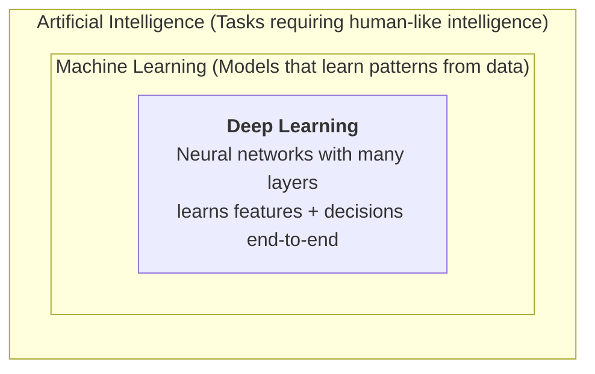
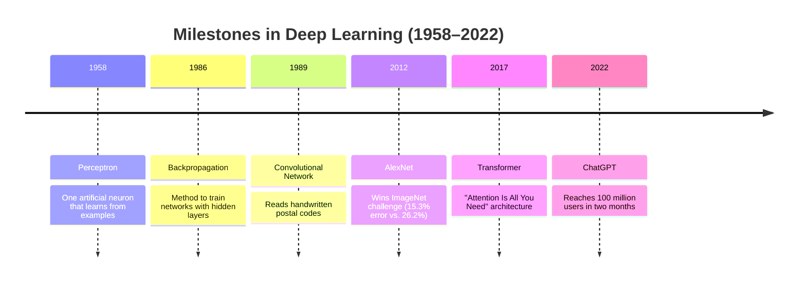
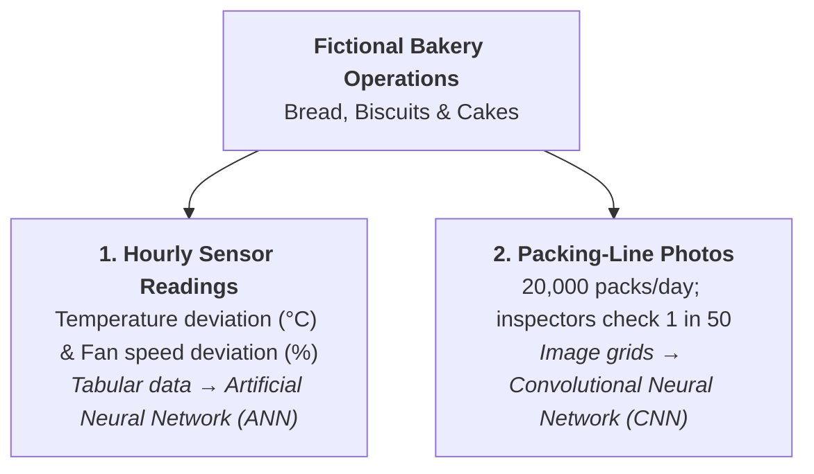
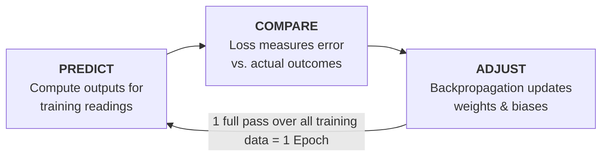
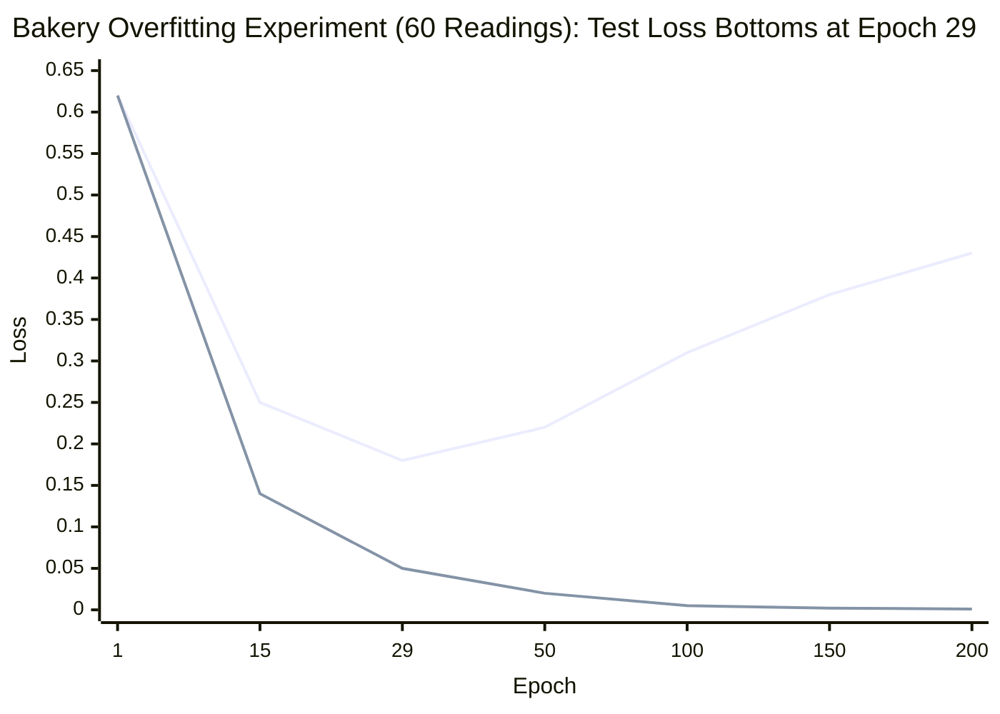
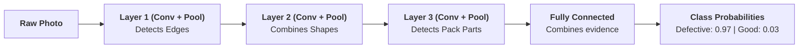

> [!NOTE] Curricular & Faculty Metadata
>
> - **Course:** MK6 Applied Business Analytics — Week 11
> - **Academic Host:** SBM ITB — _Direktorat Pendidikan Profesional Berkelanjutan_
> - **Lead Faculty:** Dr. Eng. Manahan Siallagan
> - **Teaching Team:** Dr. Shimaditya Nuraeni, M. Apriandito Arya Saputra, MBA, Bagus Rullym, MM, Tyas Larassati
> - **Primary Curricular Spine:** `archive/courses/mk6/week-11/W11_Deep_Learning_untuk Serdik.pdf` (57 slides)
> - **Accompanying Assignment:** `archive/courses/mk6/week-11/11-assignment.pdf` — [[courses/mk6-business-analytics/week-11/assignment-deep-learning-concept-map|Cohort Pre-Class Brief: Deep Learning Concept Map]]
> - **Foundational Literature:**
>   - Ian Goodfellow, Yoshua Bengio, & Aaron Courville (2016), _Deep Learning_, MIT Press.
>   - Yann LeCun, Yoshua Bengio, & Geoffrey Hinton (2015), "Deep Learning," _Nature_, 521, 436–444.
>   - Varun Gulshan et al. (2016), "Development and Validation of a Deep Learning Algorithm for Detection of Diabetic Retinopathy in Retinal Fundus Photographs," _JAMA_, 316(22), 2402–2410.

---

## 1. What Is Deep Learning & Why It Matters for Business

In [[courses/mk6-business-analytics/week-10/index|Week 10]], we saw that **most enterprise data is unstructured**—customer reviews, call-center recordings, security camera feeds, and machine sensor streams. Classical machine learning (such as logistic regression or decision trees) struggles with raw unstructured inputs because **human engineers must first hand-craft tabular features** (e.g., measuring seal width, average color, or word counts).

**Deep learning** is a branch of machine learning that uses **neural networks with many layers** to learn both the **features** and the **decision boundary** directly from raw data—images, text, sound, and high-frequency sensor signals.

### 1.1 The AI $\supset$ ML $\supset$ Deep Learning Hierarchy & Feature Learning

| Paradigm                       | Input Example             | Who Designs the Features?                                            | Model & Output                                                |
| :----------------------------- | :------------------------ | :------------------------------------------------------------------- | :------------------------------------------------------------ |
| **Classical Machine Learning** | Photo of a bread pack     | **Human engineers** manually extract `seal width`, `colour`, `shape` | Decision tree / regression classifies `good` vs. `defective`  |
| **Deep Learning**              | Raw photo of a bread pack | **Neural network** learns edges, shapes, and parts automatically     | End-to-end network outputs `good` vs. `defective` probability |

> [!TIP] Quick Diagnostic (Slide 7 Quiz): Which Tasks Call for Deep Learning?
> Consider four business analytics tasks:
>
> - **A.** Forecasting monthly sales from a 12-column table $\rightarrow$ _Classical ML / regression suffices (small structured table)._
> - **B.** Detecting damaged packs in photos $\rightarrow$ **Yes — Deep Learning (CNN)** excels on raw pixel grids.
> - **C.** Sorting customer emails by the problem described $\rightarrow$ **Yes — Deep Learning (NLP / Language Model)** captures word order and context.
> - **D.** Computing average delivery time per region $\rightarrow$ _Simple SQL/Excel aggregation._

### 1.2 Historical Milestones & Why Deep Learning Surged After 2012

Neural networks have existed conceptually since **1958**, yet practical enterprise adoption exploded only after **2012** when three forces converged:

1. **Data:** Millions of labeled examples on the internet (e.g., **ImageNet** with over **14 million** labeled images).
2. **Compute:** Graphics Processing Units (**GPUs**) capable of massive parallel matrix math (AlexNet was trained on just two GPUs).
3. **Algorithms:** Better activation functions, weight initialization, and optimization methods that made deep multi-layer training stable.

### 1.3 Landmark Enterprise Case Studies

| Enterprise Domain                                           | Raw Data Modality                                                                                  | Deep Learning Mechanism                                                                             | Verified Impact                                                                                               |
| :---------------------------------------------------------- | :------------------------------------------------------------------------------------------------- | :-------------------------------------------------------------------------------------------------- | :------------------------------------------------------------------------------------------------------------ |
| **Google Data Centre Cooling** _(DeepMind, 2016)_           | **Sensor Signals:** Thousands of historical readings (temperatures, power, pump speeds, setpoints) | Deep neural networks learned complex multi-sensor interactions without hard-coded engineering rules | Cooling energy consumption fell by **up to 40%**                                                              |
| **Diabetic Retinopathy Screening** _(Gulshan et al., 2016)_ | **Images:** $128{,}175$ retinal photographs graded by ophthalmologists                             | Deep CNN trained directly on labeled fundus photos without hand-crafted lesion rules                | On $9{,}963$ new test photos: detected **90.3%** of referral cases and cleared **98.1%** of non-referral eyes |
| **Google Search Query Understanding** _(2019)_              | **Text:** Full English search queries (e.g., _"2019 brazil traveler to usa need a visa"_)          | Language model read the entire query context, including small prepositions (_to_, _for_)            | Improved search understanding for **1 in 10** English searches in the United States                           |

### 1.4 Four Operational Challenges of Deep Learning

Despite strong accuracy, deep learning introduces four executive governance risks:

1. **Data Hunger:** Requires thousands of accurately labeled examples (e.g., photos tagged `good` or `defective`).
2. **Compute Cost:** Training large models demands specialized GPUs, time, and electricity.
3. **Explainability ("Black Box"):** Millions of learned weights cannot be read like regression coefficients—raising audit questions (_"Why was this specific pack rejected?"_).
4. **Reliability Under Shift:** Accuracy can collapse when deployment conditions change—for example, a pack-inspection model trained at **Factory A** dropping from **96% to 70% accuracy** at **Factory B** under different lighting _(Slide 15 Quiz: Reliability)_.

---

## 2. The Running Case: Two Data Worlds at the Bakery

To connect theory to operations, Session 11 follows a fictional **bakery** producing bread, biscuits, and cakes with two distinct data streams—each requiring its own neural architecture:

---

## 3. Artificial Neural Networks (ANN) for Tabular Sensor Data

### 3.1 Motivation: Why One Straight Line Fails

The bakery wants to answer two operational questions:

1. _Will the oven fail in the next 24 hours?_
2. _Which sensor readings signal an impending failure?_

An oven fails whenever temperature **or** fan speed drifts too far from its target setting—in **either** positive or negative direction. On a 2D scatter plot (`temperature deviation` vs. `fan speed deviation`), normal readings sit inside a central circular cluster surrounded by failures on all sides. A single linear model (such as logistic regression) draws **only one straight line**, which cannot enclose a circular safe zone.

### 3.2 Anatomy of an Artificial Neuron

An **artificial neuron** multiplies each input $x_i$ by a learned **weight** $w_i$, adds a learned **bias** $b$, and passes the resulting sum $z$ through an **activation function** $\phi$:

$$z = \sum_{i=1}^{n} w_i x_i + b \qquad \text{and} \qquad \text{output} = \phi(z)$$

**Worked Bakery Neuron (Slide 21):**

- Inputs: $\text{temperature deviation} = 6$, $\text{fan speed deviation} = -4$
- Weights: $w_1 = 0.5$, $w_2 = -0.25$; Bias: $b = -2$
- Weighted sum + bias: $6 \times 0.5 + (-4) \times (-0.25) - 2 = 3.0 + 1.0 - 2.0 = \mathbf{2.0}$
- Passing $2.0$ through **ReLU** outputs $\mathbf{2.0}$.

> [!NOTE] Slide 23 Quiz Check
> Given inputs $2$ and $2$, weights $0.5$ and $0.5$, bias $-3$, and **ReLU** activation:
> $$z = (2 \times 0.5) + (2 \times 0.5) - 3 = 1 + 1 - 3 = -1 \implies \text{ReLU}(-1) = \mathbf{0}$$

### 3.3 Activation Functions: Why Non-Linearity Matters

An **activation function** transforms the weighted sum before passing it forward. **Without a non-linear activation function, stacking any number of layers still draws only a single straight line.**

| Activation  | Behavior                                                   | Output Range  | Typical Use                                             |
| :---------- | :--------------------------------------------------------- | :-----------: | :------------------------------------------------------ |
| **ReLU**    | Negative values become $0$; positive values pass unchanged | $[0, \infty)$ | Hidden layers (fast, avoids vanishing gradients)        |
| **Sigmoid** | Smooth S-curve compressing any number into a probability   |   $(0, 1)$    | Binary output layer (e.g., probability of oven failure) |
| **Tanh**    | Zero-centered S-curve                                      |   $(-1, 1)$   | Hidden layers in compact tabular / Playground models    |

### 3.4 Layers & Combining Neurons into a Closed Boundary

An **artificial neural network** connects neurons across an **input layer**, one or more **hidden layers**, and an **output layer**. A network with many hidden layers is a **deep neural network**.

In the bakery oven network:

- **Each hidden neuron draws one dashed straight line** across the 2D sensor space.
- With **4 hidden neurons**, the output neuron combines four straight half-planes into **one closed boundary** enclosing the normal operating zone (inside = no failure; outside = failure).

### 3.5 The Training Loop: Loss, Backpropagation & Epochs

- **Loss:** Measures how far predicted outputs are from actual failure outcomes.
- **Backpropagation:** Computes how much each individual weight contributed to the loss so every weight can be nudged in the right direction.
- **Epoch:** One complete pass over the entire training dataset.

### 3.6 Gradient Descent & Learning Rate

**Gradient descent** moves each weight a step in the direction that reduces the loss. The **learning rate** ($\eta$) sets the size of each step:

| Learning Rate Regime            | Optimization Behavior            | Diagnostic Symptom                                                                        |
| :------------------------------ | :------------------------------- | :---------------------------------------------------------------------------------------- |
| **Too Small** (e.g., $0.00001$) | Crawls down the loss curve       | Training progresses painfully slowly                                                      |
| **Suitable** (e.g., $0.03$)     | Smoothly descends to the minimum | Loss decreases steadily and settles                                                       |
| **Too Large** (e.g., $3.0$)     | Overshoots across the valley     | Loss jumps up and down and never settles _(Slide 28 Quiz: lower the learning rate first)_ |

### 3.7 Bakery Oven Results & Business Thresholds

The bakery collected **$1{,}000$ hourly readings** ($700$ training, $300$ testing), where **$31\%$** of readings were followed by an oven failure within 24 hours:

| Model Architecture                      | Correct on 300 Test Readings | Test Accuracy | Geometric Capability                                              |
| :-------------------------------------- | :--------------------------: | :-----------: | :---------------------------------------------------------------- |
| **Logistic Regression (Straight Line)** |         $208 / 300$          |   **69.3%**   | Predicts "no failure" everywhere—misses the ring of failures      |
| **Neural Network (4 Hidden Neurons)**   |         $277 / 300$          |   **92.3%**   | Combines 4 linear cuts into a closed polygon around the safe zone |

Crucially, the network outputs a **probability**, not a certainty. Setting the action threshold is a **business decision** balancing the cost of an unplanned breakdown against the cost of a maintenance visit:

| Reading |   Temp Deviation   | Fan Speed Deviation | Predicted Failure Probability | Recommended Action   |
| :-----: | :----------------: | :-----------------: | :---------------------------: | :------------------- |
|  **A**  | $+9^\circ\text{C}$ |       $+4\%$        |           **0.87**            | Schedule maintenance |
|  **B**  | $+2^\circ\text{C}$ |       $-1\%$        |        **below 0.01**         | None                 |
|  **C**  | $+5^\circ\text{C}$ |       $+5\%$        |           **0.55**            | Inspect the oven     |

### 3.8 Overfitting & Weight Interpretation

When a large network is trained on only **60 readings**, **training loss** drops to $0$, but **test loss** reaches its minimum at **Epoch 29** and rises steadily thereafter as the network **memorizes** training noise—this is **overfitting** _(Slide 33 Quiz: if test loss bottoms at Epoch 40 and rises afterward, stop at Epoch 40)_.

Even in this tiny 4-neuron oven network, there are **17 learned weights and biases** (four hidden neurons $\times$ 3 parameters each + 4 output weights + 1 output bias = $17$):

| Parameter                   | Neuron 1 | Neuron 2 | Neuron 3 | Neuron 4 |
| :-------------------------- | :------: | :------: | :------: | :------: |
| **Weight from temperature** | $-3.17$  |  $2.27$  |  $5.07$  | $-1.86$  |
| **Weight from fan speed**   | $-1.76$  | $-2.03$  | $-6.73$  | $-2.96$  |
| **Bias**                    |  $1.79$  |  $1.59$  | $-5.28$  | $-1.76$  |
| **Weight to output**        | $-5.89$  | $-6.42$  |  $4.18$  |  $5.62$  |
| **Bias of output**          | $12.55$  |    —     |    —     |    —     |

Unlike linear regression—where one weight per column has a direct marginal meaning—**a neural network is judged by its performance on held-out test data, not by reading its weights**.

### 3.9 Hands-On Lab: TensorFlow Playground (`playground.tensorflow.org`)

| Step  | Action in TensorFlow Playground                                                  | Core Principle Demonstrated                                                    |
| :---: | :------------------------------------------------------------------------------- | :----------------------------------------------------------------------------- |
| **1** | Select the **circle** dataset, remove all hidden layers, press Run.              | A single straight line cannot separate a circular class.                       |
| **2** | Add **1 hidden layer with 4 neurons** and run again.                             | Four neurons combine to form a closed boundary.                                |
| **3** | Change activation from Tanh/ReLU to **Linear**.                                  | Without non-linear activation, the boundary collapses back to a straight line. |
| **4** | Set learning rate to **3**, then to **0.00001**.                                 | Demonstrates overshooting oscillation vs. stalled convergence.                 |
| **5** | Select the **spiral** dataset; add hidden layers and neurons.                    | Highly entangled patterns require deeper networks.                             |
| **6** | Set training ratio to **10%** and add **noise**; compare training vs. test loss. | Demonstrates classic overfitting on sparse, noisy data.                        |

---

## 4. Convolutional Neural Networks (CNN) for Visual Inspection

### 4.1 Motivation: Automated Packing-Line Quality Control

The bakery's packing line produces **$20{,}000$ bread packs per day**, while human inspectors can only sample **1 pack in 50**. A **Convolutional Neural Network (CNN)** can inspect a camera photo of **every single pack** in real time for torn seals, crushed loaves, or missing labels.

### 4.2 Images as Grids & Parameter Efficiency

To a computer, an image is a grid of pixel numbers (e.g., $1$ = dark background, $8$ = bright pack edge). A $224 \times 224$ color photo has $3$ color channels (Red, Green, Blue):

$$224 \times 224 \times 3 = \mathbf{150{,}528\text{ numbers per photo}}$$

Connecting every pixel to $1{,}000$ neurons in a standard fully connected network creates **$150\text{ million weights}$**—and ignores which pixels sit next to each other. A **CNN** solves both problems by sliding a small **$3 \times 3$ color filter** ($3 \times 3 \times 3 = \mathbf{27\text{ weights}}$) across the image, reusing the exact same weights everywhere.

### 4.3 Filters, Convolution & Feature Maps

A **convolution** slides a small filter across the image, multiplying overlapping pixel values by filter weights and summing them:

- **Vertical-Edge Filter Example (Slide 42):** Sliding $K = \begin{bmatrix} -1 & 0 & 1 \\ -1 & 0 & 1 \\ -1 & 0 & 1 \end{bmatrix}$ over a $3 \times 3$ patch with dark left pixels ($1$) and one bright right-bottom pixel ($8$) yields:
  $$(1 - 1) + (1 - 1) + (8 - 1) = \mathbf{7}$$
- The resulting 2D grid of filter scores is a **feature map**, showing _where_ in the image that visual feature (e.g., a vertical edge scoring up to $21$) appears.

> [!NOTE] Slide 44 Quiz Check
> Applying the same vertical-edge filter $\begin{bmatrix} -1 & 0 & 1 \\ -1 & 0 & 1 \\ -1 & 0 & 1 \end{bmatrix}$ to the $3 \times 3$ patch $\begin{bmatrix} 2 & 2 & 7 \\ 2 & 2 & 7 \\ 2 & 7 & 7 \end{bmatrix}$:
>
> - Row 1: $-2 + 0 + 7 = 5$
> - Row 2: $-2 + 0 + 7 = 5$
> - Row 3: $-2 + 0 + 7 = 5$
> - **Total:** $5 + 5 + 5 = \mathbf{15}$

### 4.4 Max Pooling & Hierarchical Feature Extraction

**Max pooling** keeps only the largest value in each $2 \times 2$ block—shrinking a $4 \times 4$ feature map into a $2 \times 2$ map ($4\times$ smaller) while ensuring an edge is still detected even if the pack shifts slightly on the conveyor belt.

### 4.5 Transfer Learning: Solving Small-Data Business Problems

Training a deep CNN from scratch requires hundreds of thousands of photos. **Transfer learning** reuses a CNN pre-trained on **ImageNet** ($1.2\text{ million}$ photos across $1{,}000$ classes)—keeping its universal edge, shape, and part detectors—and retrains **only the last layers** for the new business task _(Slide 48 Quiz: with only 300 labeled photos, transfer learning from a pre-trained CNN fits best)_.

### 4.6 Bread Pack Results, Triage & Shortcut Diagnostics

Using a pre-trained ImageNet CNN retrained on **$1{,}200$ training photos** ($600$ good, $600$ defective: torn seal, crushed, no label) and evaluated on **$400$ unseen test photos** ($200$ good, $200$ defective):

| Actual \ Predicted         |  Predicted Defective  |   Predicted Good   |
| :------------------------- | :-------------------: | :----------------: |
| **Actual Defective (200)** |  **191** _(caught)_   |  **9** _(missed)_  |
| **Actual Good (200)**      | **7** _(false alarm)_ | **193** _(passed)_ |

- **Overall Test Accuracy:** $384 / 400 = \mathbf{96.0\%}$.
- **Human-in-the-Loop Probability Triage (Slide 51):**
  - Photo 1 (`defective, 0.97`) $\rightarrow$ **Reject automatically**.
  - Photo 2 (`good, 0.95`) $\rightarrow$ **Pass automatically**.
  - Photo 3 (`defective, 0.55`) $\rightarrow$ **Send to human inspector**, focusing human labor only on uncertain borderline packs.
- **Saliency Heatmaps & Shortcut Learning (Slide 52–53):** A heatmap highlights which pixels drove the prediction. It should cover the **torn seal**, not the **dark background**. If all defective training packs came from a line with darker lighting or a blurred camera _(Slide 53 Quiz)_, a $99\%$ accurate model may actually be detecting **blur or lighting** instead of defects—failing catastrophically when moved to another line.

### 4.7 Hands-On Lab: Google Teachable Machine (`teachablemachine.withgoogle.com`)

| Step  | Action in Teachable Machine                                   | Core Concept Demonstrated                                      |
| :---: | :------------------------------------------------------------ | :------------------------------------------------------------- |
| **1** | Start a new image project with the standard image model.      | Deploys a browser-based CNN for photos.                        |
| **2** | Rename two classes (e.g., `pen` and `phone`).                 | Defines supervised classification labels.                      |
| **3** | Record $\sim 100$ webcam images per class from varied angles. | Builds a diverse labeled training dataset.                     |
| **4** | Click **Train Model**.                                        | Executes **transfer learning** (retraining only final layers). |
| **5** | Hold each object to the camera and read live output bars.     | Inspects predicted class probabilities.                        |
| **6** | Change background or lighting and watch the output bars.      | Exposes **shortcut learning** and reliability drift.           |

---

## 5. Indonesian BUMN & Enterprise Decision Context

For P3MD executives across SOEs (BUMN) and Danantara portfolio companies, Session 11 establishes three boardroom principles for deploying deep learning:

1. **Match Architecture to Data Structure:** Use tabular ML or compact ANNs for structured sensor/ERP telemetry (e.g., predictive maintenance on PLN turbines or Pertamina compressors), and reserve CNNs for unstructured visual/spatial streams (manufacturing QA, infrastructure crack inspection, agri-commodity grading).
2. **Mandate Transfer Learning Before Custom Pre-Training:** Most Indonesian enterprise use cases have hundreds—not millions—of labeled images; transfer learning cuts GPU cost and data-labeling lead time dramatically.
3. **Institutionalize Human-in-the-Loop & Shortcut Audits:** Never deploy a $96\%$–$99\%$ accuracy model blindly. Route borderline confidence bands ($0.45$–$0.65$) to human specialists and audit saliency heatmaps across multiple sites/lighting conditions before scaling.

---

## 6. Companion Guides & Cross-Curricular Links

- [[courses/mk6-business-analytics/week-11/assignment-deep-learning-concept-map|Session 11 Assignment Brief (Pre-Class): Draw a Deep Learning Concept Map]]
- [[concepts/artificial-neural-network|Concept: Artificial Neural Networks & Backpropagation]]
- [[concepts/convolutional-neural-network|Concept: Convolutional Neural Networks (CNN) & Transfer Learning]]
- [[courses/mk6-business-analytics/week-10/index|Previous: Week 10 — Big Data Analytics & Social Media Text Mining]]
