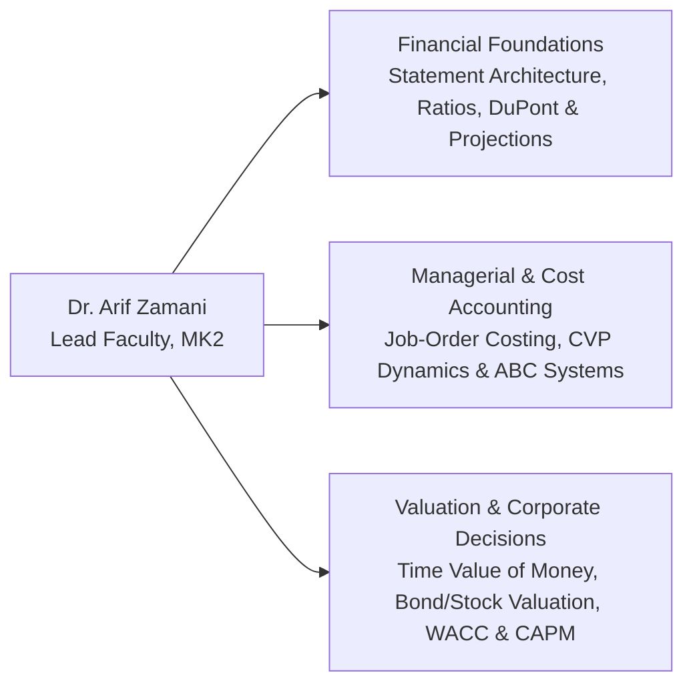

## 👤 Academic & Professional Profile

**Dr. Arif Zamani** is a senior finance academic and lead lecturer for **MK 2: Financial Management and Strategy** in the P3MD MBA program at the School of Business and Management, Institut Teknologi Bandung (SBM ITB). With extensive expertise in corporate finance, managerial accounting, valuation, and capital budgeting, Dr. Zamani leads the core finance curriculum designed for executive leaders across Indonesian state-owned enterprises (BUMN) and strategic corporations.

---

## 🎓 Core Curricular Contributions in MK2

Dr. Zamani's pedagogical approach emphasizes **rigorous quantitative modeling rooted in real Indonesian enterprise crucibles**, including:

- **Financial Statement Diagnosis**: Teaching cohort participants to treat financial ratios not as isolated calculations, but as a holistic corporate diagnosis linking operations, commodity pricing, and financial structure (e.g., the PT Bukit Asam case).
- **Pro-Forma Modeling & Sustainable Growth**: Guiding students through the mechanics of the percent-of-sales method and testing capital limits using Indofood as an empirical benchmark.
- **Strategic Cost Management**: Demonstrating how traditional volume-based cost allocation distorts product margins, and using Activity-Based Costing (ABC) and Cost-Volume-Profit (CVP) frameworks to drive pricing decisions.
- **Valuation Mechanics**: Grounding time value of money, bond pricing, equity valuation, and WACC hurdle rates in Indonesian capital market realities.

---

## 🔗 Related Notes

- Course Overview: [[courses/mk2-financial-management-strategy/index|MK 2: Financial Management and Strategy]]
- [[courses/mk2-financial-management-strategy/week-01/index|MK2 Week 01: Financial Management Function & Objectives]]
- [[courses/mk2-financial-management-strategy/week-02/index|MK2 Week 02: Financial Statement Analysis & DuPont]]
- [[courses/mk2-financial-management-strategy/week-03/index|MK2 Week 03: Financial Statement Projections]]
