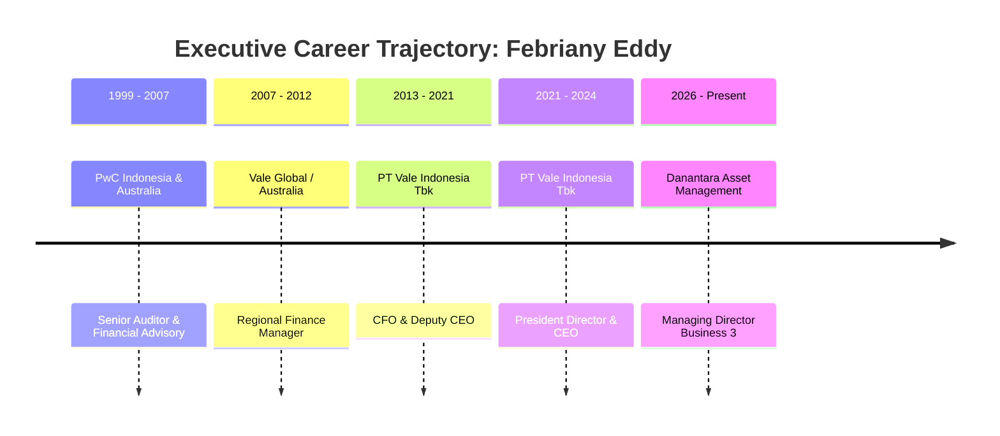
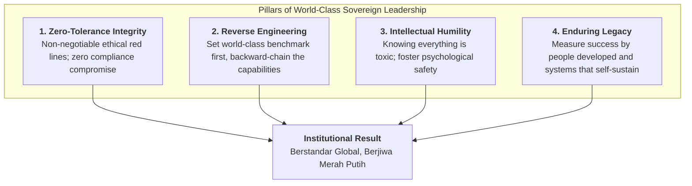

## 👤 Executive & Leader Profile

**Febriany Eddy, S.E., M.B.A., CPA** is a world-class Indonesian corporate chief executive, natural resources strategist, and sovereign asset investment leader. She currently serves as **Managing Director Business 3** at **[[entities/danantara|PT Danantara Asset Management (DAM)]]**, overseeing strategic corporate portfolios, global investor partnerships, and institutional capability elevation across Indonesia's sovereign holdings.

Prior to her appointment at Danantara, Febriany made corporate history as **President Director & Chief Executive Officer (CEO) of PT Vale Indonesia Tbk** (2021–2024), one of Southeast Asia's premier nickel producers. In that capacity, she spearheaded multi-billion-dollar sustainable low-carbon mining mega-projects, negotiated historic divestment transitions into sovereign holding ownership under MIND ID, and championed world-class ESG (Environmental, Social, and Governance) benchmarks. Recognized on _Forbes Asia’s 20 Outstanding Businesswomen_, she presented the executive plenary masterclass **"Kepemimpinan Kelas Dunia untuk Membangun Negeri: Berstandar Global, Berjiwa Merah Putih"** to the **P3MD Batch I Soedirman** cohort on November 11, 2026.

---

## 🎓 Academic Credentials & Professional Distinctions

### Academic Pedigree & Professional Certifications

- **Executive Master of Business Administration (EMBA)**, dual-degree program from **UCLA Anderson School of Management** (USA) and **National University of Singapore (NUS) Business School** (2015)
- **Sarjana Ekonomi (S.E.)**, Jurusan Akuntansi, Fakultas Ekonomi dan Bisnis **Universitas Indonesia**
- **Certified Public Accountant (CPA)**, Ikatan Akuntan Publik Indonesia (IAPI) / CPA Australia

### Core Executive Competencies

- **Global Governance & Zero-Tolerance Integrity**: Institutionalizing world-class compliance, non-negotiable ethical red lines, and zero tolerance for integrity compromises across joint ventures and sovereign investments.
- **Backward-Chaining Execution (Reverse Engineering)**: Setting audacious global targets and backward-engineering every operational dependency, talent threshold, and capital requirement.
- **Sustainable Industrial Decarbonization**: Architecting renewable-powered nickel smelting, biodiversity conservation covenants, and social license governance in extractive industries.
- **Psychological Safety & High-Humility Leadership**: Eliminating executive arrogance (_"toxic know-it-all syndrome"_) to foster transparent problem reporting, cross-functional collaboration, and continuous organizational learning.

---

## 💼 Executive Leadership Trajectory

| Period           | Position / Title                             | Enterprise / Organization                                   | Strategic Governance Scope                                                                            |
| :--------------- | :------------------------------------------- | :---------------------------------------------------------- | :---------------------------------------------------------------------------------------------------- |
| **2026–Present** | Managing Director Business 3                 | [[entities/danantara\|PT Danantara Asset Management (DAM)]] | Pengawasan portofolio BUMN strategis, kemitraan investasi global, dan tata kelola sovereign wealth    |
| **2021–2024**    | President Director & Chief Executive Officer | PT Vale Indonesia Tbk                                       | Transformasi transisi kepemilikan nasional, investasi smelter hijau \$8.6B, dan dekarbonisasi tambang |
| **2019–2021**    | Deputy Chief Executive Officer               | PT Vale Indonesia Tbk                                       | Eksekusi operasional, integrasi rantai pasok hilirisasi, dan kesiapan transisi energi                 |
| **2013–2019**    | Chief Financial Officer (CFO)                | PT Vale Indonesia Tbk                                       | Alokasi modal korporasi, manajemen kas dan utang, serta kepatuhan fiskal dan audit internasional      |
| **2007–2012**    | Manager / Senior Financial Lead              | Vale Australia / Vale Global                                | Operasi keuangan regional, pemodelan investasi tambang batu bara dan mineral global                   |
| **1999–2007**    | Senior Auditor / Advisory Lead               | PricewaterhouseCoopers (PwC) Indonesia & Australia          | Audit laporan keuangan, penilaian pengendalian internal, dan tata kelola emiten terbuka               |

---

## 🏛️ Executive Philosophy & Danantara Leadership Doctrine

In her masterclass to the P3MD cohort, Febriany Eddy laid out the core operating tenets of sovereign enterprise leadership:

- **Output vs. Outcome Distinction**: Leadership is never evaluated by the volume of meetings convened or slide decks printed (_output_); it is measured strictly by measurable structural value added to the nation and enterprise (_outcome_).
- **The True Measure of Executive Legacy**: An executive's greatness is tested only after they depart. If an enterprise collapses or becomes paralyzed when the leader steps down, the leader did not build a successful organization—they merely built personal dependency. A true leader creates resilient, institutionalized operating systems and mentors successors capable of exceeding the predecessor's achievements.

---

## 🔗 Cross-Curricular & Institutional Lattice

- **Plenary Masterclass Dossier**:
  - [[rabuan/2026-11-11-febriany-eddy-global-leadership|Rabuan: Kepemimpinan Kelas Dunia untuk Membangun Negeri — Berstandar Global, Berjiwa Merah Putih]]
- **Compounding Core Concepts**:
  - [[concepts/reverse-engineering-leadership|Reverse-Engineering Leadership & Audacious Benchmarks]]
  - [[concepts/the-integrity-triangle|The Integrity Triangle]]
  - [[concepts/psychological-safety|Psychological Safety & High-Performance Teaming]]
  - [[concepts/pso-commercial-duality|PSO vs Commercial Duality]]
- **Institutional Alignment**:
  - [[entities/danantara|PT Danantara Asset Management]] (Institutional Sponsor & Sovereign Architecture)
  - [[entities/pt-bukit-asam|PT Bukit Asam Tbk / MIND ID Group]] (Downstream Industrial Hilirisasi)
- Return to **[[entities/index|Executive & Institutional Entity Directory]]**
