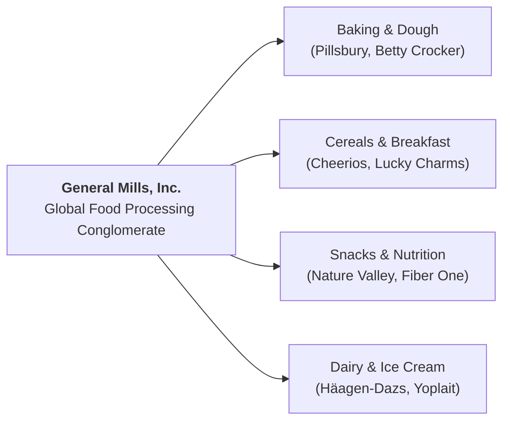

## 👤 Enterprise Profile

**General Mills, Inc.** (NYSE: `GIS`) is an American multinational manufacturer and marketer of branded consumer foods sold through retail stores. Founded in 1866 and headquartered in Minneapolis, Minnesota, the company manages iconic consumer food brands including **Pillsbury, Cheerios, Betty Crocker, Häagen-Dazs, Nature Valley, and Yoplait**.

The company is globally recognized in business literature for its advanced deployment of **consumer research methodologies, retail point-of-sale scanner analytics, and disciplined category management** in consumer packaged goods (CPG).

---

## 📋 Curriculum Case Snapshots (Case-Basis Data)

> [!NOTE] Case-Basis Epistemic Notice
> Scanner sales figures, usage-and-attitude percentages, and testing volumes cited below represent pedagogical case data from **Harvard Business School / Ivey Case Study: Pillsbury Cookie Challenge (General Mills Canada, 2006)**. They represent historical case exhibits rather than current corporate reports.

### MK 3 (Marketing Management) Week 05: Pillsbury Cookie Challenge

- **Curricular Sources**: `Pillsbury Cookie Challenge.pdf` & [[courses/mk3-marketing-management/week-05/case-pillsbury-cookie-challenge|Case Study Dossier]].
- **Core Dilemma**: General Mills Canada evaluated whether to commercialize refrigerated cookie dough (RCD) to replicate US category success. The brand team faced conflicting market research evidence: high reported interest in descriptive surveys vs disappointing scanner panel velocity during test market rollouts.
- **Analytical Mechanics**: Applying [[concepts/marketing-research-methodologies|Marketing Research Diagnostic Frameworks]] to evaluate four distinct data sources (Canadian Usage & Attitude survey, In-Home Usage Testing, Concept/Use tests, and retail scanner data). Identifying the **Causality vs Correlation Trap** when predicting real-world consumer adoption.

---

## 🏛️ Strategic Lenses Across Curriculum

- **Marketing Research Evaluation ([[courses/mk3-marketing-management/week-05/index|MK3 Week 05]]):** Understanding the methodological boundaries between stated consumer preferences and revealed checkout behavior.
- **Category Expansion & Trade Promotion ([[concepts/customer-perceived-value|CPV]]):** Managing supermarket slotting fees, refrigerated end-cap displays, and category growth.

---

## 🔗 Traceability & Directory

- [[courses/mk3-marketing-management/week-05/index|MK3 Week 05: Marketing Research & Diagnostic Methodologies]]
- [[courses/mk3-marketing-management/week-05/case-pillsbury-cookie-challenge|Case Dossier: Pillsbury Cookie Challenge]]
- [[courses/mk3-marketing-management/week-05/assignment-pillsbury-research-evaluation|Assignment Debrief: Research Methodology Evaluation]]
- Return to **[[entities/index|Entity Directory]]**
