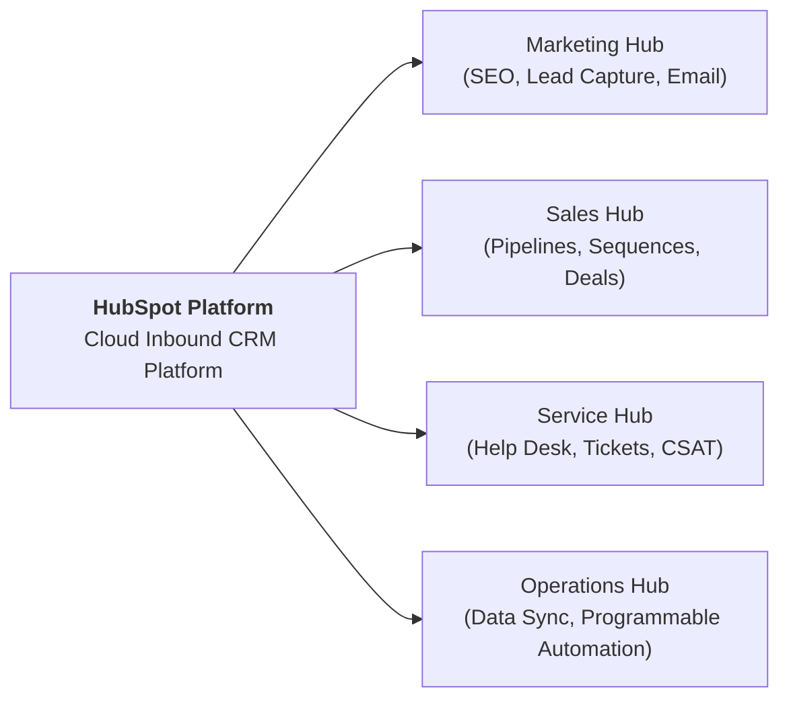

## 👤 Enterprise Profile

**HubSpot, Inc.** (NYSE: `HUBS`) is an American developer and marketer of software products for inbound marketing, sales, customer service, and content management. Founded in 2006 by Brian Halligan and Dharmesh Shah at the Massachusetts Institute of Technology (MIT), HubSpot pioneered the commercial methodology of **Inbound Marketing**—the concept of attracting prospective customers through search engine optimization (SEO), educational blogging, and social media rather than interruptive cold outreach.

Operating on a cloud-based Software-as-a-Service (SaaS) subscription model, HubSpot transformed from a point solution for small business blogging into an enterprise Customer Relationship Management (CRM) platform serving over 200,000 customers worldwide.

---

## 📋 Curriculum Case Snapshots (Case-Basis Data)

> [!NOTE] Case-Basis Epistemic Notice
> Unit economics, customer acquisition costs, and churn figures cited below represent pedagogical case data from **Harvard Business School Case: HubSpot: Inbound Marketing and Web 2.0 (2009)** and the **SBM ITB Indonesia Expansion Case Supplement (2026–2029)**. They reflect specific analytical model parameters rather than current corporate SEC filings.

### MK 3 (Marketing Management) Week 06: HubSpot Inbound Marketing & Indonesia Expansion

- **Curricular Sources**: `HubSpot inbound marketing and web 2.0 .pdf`, `HubSpot in Indonesia — Case Supplement.pdf`, and [[courses/mk3-marketing-management/week-06/case-hubspot-inbound-indonesia|Case Study Dossier]].
- **Core Dilemma**: Evaluating customer segment profitability between two core personas:
  - **Owner Ollie**: Very small business owner (1–25 employees), low marketing sophistication, high price sensitivity, chronic monthly churn ($\sim 4.5\%$).
  - **Marketing Mary**: Mid-market marketing director (26–100 employees), high Web 2.0 readiness, agency support, low monthly churn ($\sim 1.5\%$), and superior $\text{LTV} : \text{CAC}$ economics.
- **Indonesian Market Context (2026–2029)**: The challenge of adapting Western B2B SaaS into the Indonesian SME (UMKM) landscape, where micro-firms lack digital capabilities, driving high onboarding churn unless serviced via local agency partners.

---

## 🏛️ Strategic Lenses Across Curriculum

- **Segmentation & SaaS Metrics ([[courses/mk3-marketing-management/week-06/index|MK3 Week 06]]):** Analyzing customer acquisition cost ($\text{CAC}$), customer lifetime value ($\text{CLV}$), and Bain's [[concepts/elements-of-value|B2B Elements of Value]].
- **Business Model Scalability ([[concepts/customer-perceived-value|CPV]]):** Mapping self-service software models against hands-on customer onboarding requirements.

---

## 🔗 Traceability & Directory

- [[courses/mk3-marketing-management/week-06/index|MK3 Week 06: Market Segmentation & Target Market Selection]]
- [[courses/mk3-marketing-management/week-06/case-hubspot-inbound-indonesia|Case Dossier: HubSpot Inbound Marketing]]
- [[courses/mk3-marketing-management/week-06/assignment-hubspot-segmentation-targeting|Assignment Debrief: HubSpot Segmentation]]
- Return to **[[entities/index|Entity Directory]]**
