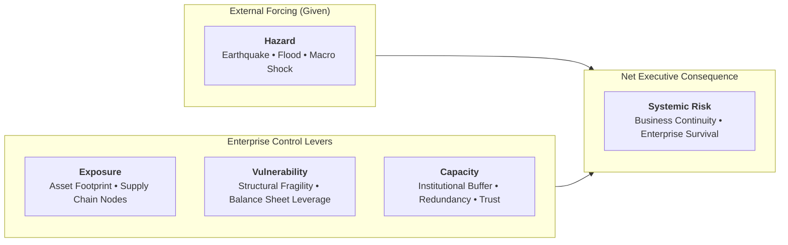

## 👤 Executive Profile

**Prof. Irwan Meilano, S.T., M.Sc., Ph.D.** is a Professor of Earthquake Geodesy and Disaster Science at **Institut Teknologi Bandung (ITB)**. He currently serves as Dean of the Faculty of Earth Sciences and Technology (**FITB ITB**) and Vice Rector for Academic and Student Affairs at ITB. Recognized as one of Southeast Asia's foremost geophysicists and disaster risk strategists, Professor Meilano bridges high-precision tectonic instrumentation with high-level public policy, national infrastructure resilience, and enterprise risk governance.

He completed his undergraduate studies in Geodetic Engineering at **ITB** before earning his Master of Science (M.Sc.) and Doctor of Philosophy (Ph.D.) from **Nagoya University** (Japan), specializing in crustal deformation and seismotectonics. Professor Meilano has served as the Chairman of the Earthquake Working Group at the **National Center for Earthquake Studies (Pusat Studi Gempa Nasional / PuSGeN)**, acting as the lead scientific architect for Indonesia's national Seismic Hazard Maps (_Peta Sumber dan Bahaya Gempa Indonesia_), which govern the mandatory structural safety codes for critical BUMN infrastructure (toll roads, high-speed rail, dams, power plants, and mining pits).

---

## 🧠 Core Philosophy & Contributions

### 1. The Shifting Ground & The Disaster Risk Formula

In executive governance and national strategic planning, Professor Meilano champions the formal decomposition of risk as a multi-variable dynamic system rather than an unpredictable stroke of fate:

$$\mathbf{Risk} = \frac{\mathbf{Hazard} \times \mathbf{Exposure} \times \mathbf{Vulnerability}}{\mathbf{Capacity}}$$

- **The Core Control Axiom**: Leaders cannot control the occurrence or intensity of external shocks (**Hazard**)—whether tectonic quakes, global supply chain chokepoints, or sudden trade embargoes.
- **The Three Controllable Levers**: Enterprise leadership operates strictly through the remaining three variables:
  1. _Reducing Exposure_: Diversifying asset locations and counterparty dependencies.
  2. _Mitigating Vulnerability_: Eliminating debt over-leverage, reinforcing physical plants, and shedding operational fragility.
  3. _Multiplying Capacity_: Cultivating institutional redundancy, digital adaptability, and inter-organizational trust.

### 2. The Two Megatrends: Abundant Intelligence vs. Systemic Risk

Professor Meilano identifies two defining forces shaping corporate leadership in the 21st century:

- **Intelligence Becomes Abundant**: Analytical compute, artificial intelligence, and raw information are rapidly commoditizing. Competitive advantage no longer belongs to those who merely possess data.
- **Risk Becomes Systemic**: Risks are hyper-connected and non-linear. A failure in an electricity transmission substation cascades instantly into telecommunications, rail signaling, banking settlement systems, and public panic. In a systemic environment, isolated silo-level risk assessments are fatally blind.

### 3. The Turkey Illusion & Black Swan in Critical Assets

Drawing on Nassim Nicholas Taleb's _The Black Swan_, Professor Meilano warns enterprise executives against the **Turkey Illusion**:

- A turkey fed every morning for 1,000 consecutive days develops an empirically robust statistical confidence that humans are benevolent protectors. That confidence peaks on Day 1,000—the day before Thanksgiving.
- In BUMN asset management, past operational calm creates an illusory sense of safety (_"we've operated this plant for 30 years without an incident"_). Professor Meilano stresses that **absence of evidence is not evidence of absence**. Extreme tail-risk events do not announce themselves via historical averages.

### 4. Five Simulation Lessons for Strategic Leadership

From extensive empirical disaster simulations conducted across Indonesian infrastructure:

1. **Vulnerability Reduction is the Fastest Lever**: Reducing asset fragility yields the quickest drop in catastrophic downside.
2. **Capacity Governs Long-Term Survivability**: Absorption and recovery capacity dictate whether an organization survives the aftermath.
3. **Trust is Institutional Capacity**: In times of systemic breakdown, social capital, transparency, and stakeholder trust are operational assets that prevent institutional paralysis.
4. **Levers are Multiplicative**: Improving exposure, vulnerability, and capacity concurrently produces exponential resilience, not linear addition.
5. **One Strategy for Compound Threats**: A well-designed resilience architecture mitigates multiple distinct hazards simultaneously.

### 5. Multi-Dimensional Innovation

Professor Meilano cautions against reducing innovation to technological gadgetry. Sustainable national resilience requires:

- **Technological Innovation**: Sensors, early warning algorithms, resilient engineering.
- **Social Innovation**: Community preparedness, workplace safety culture.
- **Institutional Innovation**: Transparent governance, inter-agency coordination, and shifting from extractive to inclusive organizational practices (grounded in Daron Acemoglu's _Why Nations Fail_).

---

## Contributions to P3MD MBA

- **Rabuan Keynote (2026-09-30)**: [[rabuan/2026-09-30-meilano-systemic-risk|Rabuan 06: The Shifting Ground: Systemic Risk Governance & Institutional Resilience]]
- **Curricular Impact**: Anchored systemic risk governance and national disaster resilience as mandatory competencies for future Indonesian BUMN directors and Danantara asset stewards.

---

## Knowledge Graph & Curriculum Bridges

- **Featured Masterclass**:
  - [[rabuan/2026-09-30-meilano-systemic-risk|Rabuan 06: The Shifting Ground: Systemic Risk Governance & Institutional Resilience]]
- **Accompanying Plenary Speaker**:
  - [[entities/edward-buckingham|Prof. Edward Buckingham]] (Monash University)
- **Direct Curricular Synergies**:
  - [[courses/mk4-operations-supply-chain-management/index|MK 4: Operations & Supply Chain Management]] (Resilience, capacity planning & Little's Law)
  - [[courses/mk5-decision-making-negotiation/index|MK 5: Problem Solving, Decision Making and Negotiation]] (Decisions under extreme uncertainty & risk analysis)
- Return to **[[entities/index|Enterprise & Leader Knowledge Directory]]**
