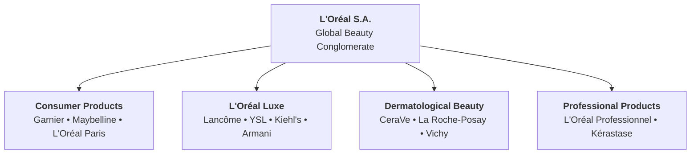

## 👤 Enterprise Profile

**L'Oréal S.A.** (Euronext: `OR`) is the world's largest cosmetics and personal care corporation. Founded in 1909 by French chemist Eugène Schueller in Paris, France, the group operates across skin care, make-up, hair care, hair coloring, and fragrances.

The enterprise operates through four global divisions:

1. **Consumer Products Division (CPD)**: Mass-market accessible beauty distributed via supermarkets, hypermarkets, and traditional trade (e.g., L'Oréal Paris, Garnier, Maybelline New York).
2. **L'Oréal Luxe**: High-end prestige skincare, makeup, and designer fragrances sold through department stores and branded boutiques (e.g., Lancôme, Yves Saint Laurent, Kiehl's).
3. **Dermatological Beauty (formerly Active Cosmetics)**: Clinical and medical skincare distributed primarily through pharmacies and dermatologists (e.g., La Roche-Posay, CeraVe, Vichy).
4. **Professional Products**: Salon-grade professional hair care and color products (e.g., L'Oréal Professionnel, Kérastase).

---

## 📋 Curriculum Case Snapshots (Case-Basis Data)

> [!NOTE] Case-Basis Epistemic Notice
> Financial allocations, market shares, and product pricing cited below reflect pedagogical case data from the **SBM ITB Case Study: L'Oréal in Indonesia — Managing a Global Product Portfolio in a Local-Brand Market**. They represent specific classroom decision parameters rather than audited annual filings.

### MK 3 (Marketing Management) Week 07: L'Oréal in Indonesia

- **Curricular Sources**: `L_Oréal in Indonesia Managing a Global Product Portfolio in a Local-Brand Market.pdf` & [[courses/mk3-marketing-management/week-07/case-loreal-indonesia-portfolio|Case Study Dossier]].
- **Core Dilemma**: Allocating a strategic marketing budget of **Rp 250 billion** across mature mass brightening serums (Garnier), fast-growing barrier-repair skincare (CeraVe), and color cosmetics (Maybelline), while defending market share against aggressive local Indonesian indie beauty disruptors (Skintific, Somethinc, Wardah / Paragon Technology and Innovation).
- **Analytical Mechanics**: Managing product mix width, length, and depth; evaluating line filling (e.g., 15 ml mini-serum packs) vs downward line stretching; and categorizing offerings across the [[concepts/product-life-cycle|Product Life Cycle (PLC)]].

---

## 🏛️ Strategic Lenses Across Curriculum

- **Brand Portfolio Architecture ([[courses/mk3-marketing-management/week-07/index|MK3 Week 07]]):** Managing multi-tier brand portfolios without cannibalization across mass and prestige tiers.
- **Global Strategy vs Local Adaptation ([[concepts/customer-perceived-value|CPV]]):** Customizing global formulas for Southeast Asian tropical climates, Halal certification requirements, and traditional trade (_warung/toko kelontong_) distribution channels.

---

## 🔗 Traceability & Directory

- [[courses/mk3-marketing-management/week-07/index|MK3 Week 07: Strategic Positioning & Product Portfolio Strategy]]
- [[courses/mk3-marketing-management/week-07/case-loreal-indonesia-portfolio|Case Dossier: L'Oréal Indonesia]]
- [[courses/mk3-marketing-management/week-07/assignment-loreal-product-portfolio|Assignment Debrief: L'Oréal Portfolio Decisions]]
- Return to **[[entities/index|Entity Directory]]**
