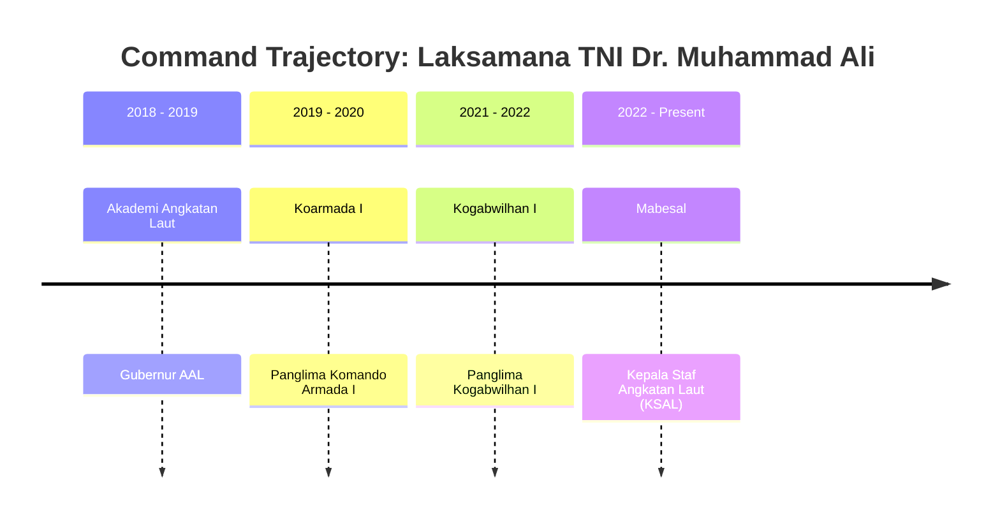
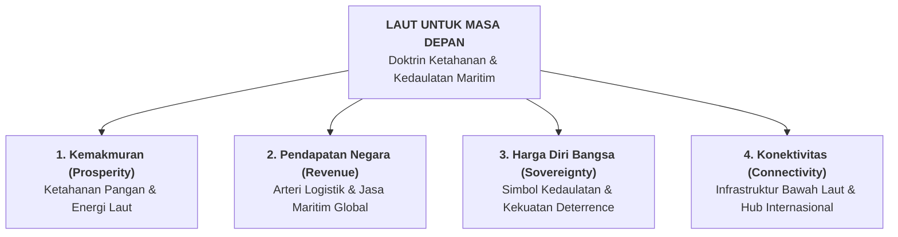

## 👤 Executive & Leader Profile

**Laksamana TNI Dr. Muhammad Ali, S.E., M.M., M.Tr.Opsla** is a four-star naval flag officer and maritime strategist serving as the **Kepala Staf TNI Angkatan Laut (KSAL)**. As the supreme operational and administrative leader of the Indonesian Navy (TNI AL), he oversees the defense of sovereign archipelagic sea lines of communication (SLOCs), exclusive economic zones (EEZ), critical undersea communications and energy infrastructure, and naval modernization across the archipelago.

A graduate of the Indonesian Naval Academy (AAL) Class of 1989, Admiral Muhammad Ali possesses extensive operational command experience, having served as Commander of the Submarine Unit (Satuan Kapal Selam), Commander of the Western Fleet Command (Pangkoarmada I), and Commander of Joint Defense Area Command I (Pangkogabwilhan I). He delivered the executive plenary masterclass to the **P3MD Batch I Soedirman** cohort on November 11, 2026, articulating the strategic doctrine of **"Laut untuk Masa Depan"** and the imperative of uniting national state-owned enterprise (BUMN) supply chains with sovereign maritime power.

---

## 🎓 Academic Credentials & Strategic Competencies

### Education & Military Pedigree

- **Doktor (Dr.)**, Ilmu Manajemen / Kajian Strategik Pertahanan
- **Magister Terapan Operasi Laut (M.Tr.Opsla)**, Sekolah Staf dan Komando TNI Angkatan Laut (Seskoal)
- **Magister Manajemen (M.M.)**, Program Pascasarjana Manajemen
- **Sarjana Ekonomi (S.E.)**, Universitas Terbuka / Manajemen Keuangan
- **Akademi Angkatan Laut (AAL)**, Korps Pelaut (1989)

### Strategic Competency Pillars

- **Archipelagic Geopolitics & Chokepoint Defense**: Operational command over Indonesia's critical maritime choke points (Malacca, Sunda, Lombok, and Makassar straits) and deterrence posture in the North Natuna Sea.
- **Tri-Role Naval Doctrine**: Executing the universal tripartite roles of sea power: **Military Defense** (sovereignty and deterrence), **Constabulary Governance** (maritime law enforcement, anti-smuggling, fishery protection), and **Naval Diplomacy** (bilateral exercises, humanitarian assistance, peace-support operations).
- **Submarine & Undersea Infrastructure Security**: Safeguarding the dense lattice of undersea fiber-optic telecommunications cables and submarine energy pipelines powering the national economy.
- **Adaptive Crisis Leadership**: Operationalizing composure, cross-agency alignment, and strategic patience during asymmetric geopolitical friction.

---

## 💼 Military Command Trajectory & National Service

| Period           | Command / Position                                                 | Organization                             | Strategic Focus                                                                             |
| :--------------- | :----------------------------------------------------------------- | :--------------------------------------- | :------------------------------------------------------------------------------------------ |
| **2022–Present** | Kepala Staf TNI Angkatan Laut (KSAL)                               | Markas Besar TNI Angkatan Laut (Mabesal) | Modernisasi armada laut, interoperabilitas gabungan, diplomasi maritim, dan kedaulatan laut |
| **2021–2022**    | Panglima Komando Gabungan Wilayah Pertahanan I (Pangkogabwilhan I) | Kogabwilhan I (TNI)                      | Kesiapsiagaan operasi gabungan matra darat, laut, dan udara di wilayah barat Indonesia      |
| **2019–2020**    | Panglima Komando Armada I (Pangkoarmada I)                         | Koarmada I (TNI AL)                      | Pengamanan Selat Malaka, Laut Natuna Utara, dan perairan barat Nusantara                    |
| **2018–2019**    | Gubernur Akademi Angkatan Laut (AAL)                               | Akademi Angkatan Laut                    | Kaderisasi perwira kepemimpinan maritim masa depan                                          |

---

## 🏛️ Contributions to P3MD & National Leadership Doctrine

During his masterclass at Kampus DCU Nawasena on November 11, 2026, Admiral Muhammad Ali introduced the **Four Pillars of Laut Masa Depan**:

Admiral Muhammad Ali imparted **Five Executive Principles for Leaders Under Pressure**:

1. _Berdamai dengan situasi tidak nyaman_: Menerima realitas lapangan tanpa menyia-nyiakan energi mengeluh, agar fokus terarah pada perumusan solusi.
2. _Menyamakan frekuensi sebelum bergerak_: Menyatukan orientasi dan kepentingan lintas unit/instansi agar tidak berjalan sendiri-sendiri.
3. _Ketenangan dan kejernihan berpikir_: Mengendalikan emosi ketika menghadapi tekanan tinggi, kemudian memutuskan dengan tegas.
4. _Rela berkorban untuk kepentingan yang lebih besar_: Mengedepankan kepentingan institusi dan bangsa di atas kenyamanan pribadi.
5. _Optimis namun siap menghadapi skenario terburuk_: Memiliki _contingency planning_ matang saat situasi tidak berjalan sesuai rencana.

---

## 🔗 Cross-Curricular & Institutional Lattice

- **Plenary Masterclass Dossier**:
  - [[rabuan/2026-11-11-muhammad-ali-kejayaan-maritim|Rabuan: Bersama Menuju Kejayaan Maritim Indonesia — Geopolitik Kawasan & Transformasi Laut]]
- **Compounding Core Concepts**:
  - [[concepts/maritime-geostrategy-framework|Maritime Geostrategy & Chokepoint Statecraft]]
  - [[concepts/crisis-leadership-framework|Crisis Leadership: Leading Under Extreme Pressure]]
  - [[concepts/the-integrity-triangle|The Integrity Triangle]]
- **Curricular Bridges**:
  - [[courses/mk1-organizational-behavior-managing-people/index|MK 1: Organizational Behavior & Managing People]] (Composure & Military Decision-Making)
  - [[courses/mk5-decision-making-negotiation/index|MK 5: Decision Making & Negotiation]] (Geopolitical Negotiation & Multi-Stakeholder Alignment)
- Return to **[[entities/index|Executive & Institutional Entity Directory]]**
