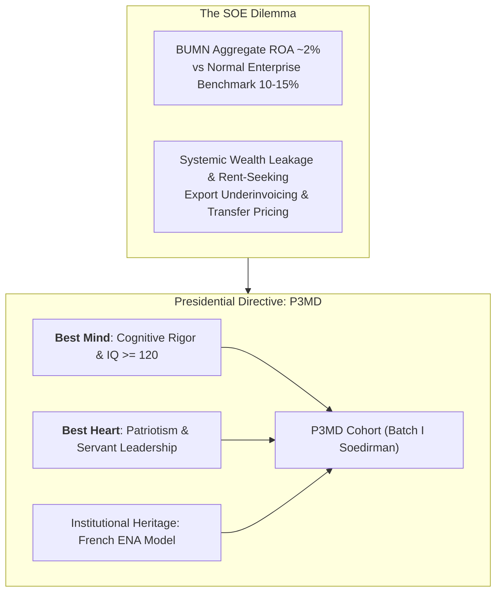

## 👤 Executive & Statesman Profile

**Jenderal TNI (Purn.) H. Prabowo Subianto Djojohadikusumo** is the **8th President of the Republic of Indonesia** and the chief institutional architect, initiator, and supreme patron of the **Program Presiden untuk Pemimpin Masa Depan (P3MD Batch I Soedirman)**. Serving previously as the Minister of Defense of Indonesia (2019–2024), Prabowo brings a synthesis of military strategic doctrine, geopolitical analysis, classical political economy, and institutional statecraft to national leadership.

Born in Jakarta on 17 October 1951, Prabowo is the son of Prof. Dr. Soemitro Djojohadikusumo, one of Indonesia's foremost founding economists and former Minister of Finance and Trade. Educated internationally before entering the Indonesian Military Academy (AKABRI) in Magelang (graduating in 1974), Prabowo served extensively in elite military commands, including the Army Special Forces Command (Kopassus) and the Army Strategic Reserve Command (Kostrad). Across his political and executive career, Prabowo has centered his economic philosophy on constitutional economic sovereignty, national self-reliance (_swasembada_), the eradication of systemic wealth leakages, and the cultivation of an incorruptible national meritocratic leadership corps.

---

## 🏛️ Strategic Doctrine & The Genesis of P3MD

### 1. The P3MD Cadre Mandate: Inspired by France's ENA

In conceptualizing P3MD (initially designated as the _Presidential Future Leaders Program_ / PFLP), President Prabowo sought to dismantle the historic vulnerability of Indonesian State-Owned Enterprises (BUMN): chronic under-performance and rent-seeking:

- **The Capital Allocation Paradox**: While high-performing commercial enterprises generate an annual return on assets ($\text{ROA}$) of $10\%\text{–}15\%$, the consolidated aggregate return of Indonesia's BUMN portfolio historically hovered around a mere $2\%$.
- **The ENA Benchmark**: Inspired by France’s elite **École Nationale d'Administration (ENA)**—which systematically prepared the senior civil service and industrial directors who rebuilt postwar France—Prabowo commissioned P3MD under the executive command of [[entities/anton-palaguna|Marsma TNI Dr. Anton Palaguna]] to recruit, screen, and forge Indonesia's top $384\text{–}393$ young executives from over $10.000$ national applicants.
- **The [[concepts/best-mind-best-heart|Best Mind & Best Heart]] Imperative**: Prabowo formulated the foundational selection doctrine: intellectual horsepower alone ($\text{IQ} \ge 120$) is hazardous if unmoored from patriotic ethics and love for the people. Drawing upon economic sociologist Liah Greenfeld’s treatise (_"Growth is stimulated & sustained by nationalism"_), P3MD instills unconditional public stewardship.

---

## 🧭 Economic Blueprint & National Policies

### 1. Constitutional Economics: Pasal 33 UUD 1945

In his strategic addresses—most notably during the **KEM-PPKF RAPBN 2027** address at DPR RI—Prabowo positions **Article 33 of the 1945 Constitution** as Indonesia's non-negotiable economic compass:

- **Demokrasi Ekonomi**: Production organized as a collective effort based on familial solidarity (_asas kekeluargaan_).
- **Public Dominance of Strategic Sectors**: Strategic production branches vital to national survival and public livelihoods must remain under state sovereignty.
- **Natural Resource Stewardship**: Land, waters, and natural wealth managed strictly for the maximum welfare of the people (_sebesar-besar kemakmuran rakyat_).

### 2. Halting the Net Outflow of National Wealth

Drawing on trade data across 21 years, President Prabowo exposed that while Indonesia generated a trade surplus of **\$436 Billion**, an alarming **\$343 Billion (78.7%)** escaped abroad through illicit financial flows, leaving only **\$93 Billion (21.3%)** within domestic circulation:

- Over 34 years, illicit **export underinvoicing** stripped the Indonesian republic of over **\$908 Billion**.
- **The Single-Door Export Mandate**: Through government regulations (_PP Tata Kelola Ekspor Komoditas SDA_ and _PP Devisa Hasil Ekspor_), export of key natural commodities (palm oil, coal, nickel, ferro-alloys) is centralized through a state-designated BUMN vehicle, establishing [[entities/danantara|BPI Danantara]] as the sovereign custodian to repatriate national export proceeds.

### 3. Food, Energy & Social Equity Pillars

- **Food Sovereignty (_Swasembada Pangan_)**: Fast-tracked domestic agricultural resilience, securing historic peak national rice reserves ($5,31\text{ million metric tons}$) and closing import dependencies on corn and sugar.
- **Makan Bergizi Gratis (MBG)**: Universal nutrition safety net for 62.4 million beneficiaries (infants, pregnant/nursing mothers, school children, and elderly living alone), paired with ruthless audit oversight over meal preparation centers.
- **Koperasi Desa Merah Putih (KDMP)**: Village-level distribution and logistics network reversing capital drainage from rural regions, expanding from 1,061 pilot cooperatives toward 60,000 nationwide hubs.

---

## 🎤 Contributions to P3MD MBA Curriculum

- **Featured Presidential Briefings & Addresses**:
  - [[rabuan/2026-05-24-prabowo-taklimat-hambalang|Special Session: Taklimat Presiden Prabowo Subianto — Doktrin Kepemimpinan BUMN, Best Mind & Best Heart, dan Pertahanan Ekonomi Nasional]] (Padepokan Garuda Yaksa, Hambalang)
  - [[rabuan/2026-05-20-prabowo-kem-ppkf-rapbn-2027|Special Session: Kerangka Ekonomi Makro & Pokok-Pokok Kebijakan Fiskal (KEM-PPKF) RAPBN 2027]] (Rapat Paripurna DPR RI ke-19)
- **Direct Curricular Integration**:
  - [[courses/mk1-organizational-behavior-managing-people/week-01/index|MK 1 Week 01: Strategizing Your Life & Leadership Mandate]]
  - [[courses/mk1-organizational-behavior-managing-people/week-07/index|MK 1 Week 07: Power, Politics & SOE Governance]]
  - [[courses/mk2-financial-management-strategy/week-01/index|MK 2 Week 01: Financial Management Function & BUMN Governance]]
- **Key Institutional Entities & Collaborators**:
  - [[entities/anton-palaguna|Marsma TNI Dr. Anton Palaguna]] (Program Commander, P3MD Batch I Soedirman)
  - [[entities/danantara|BPI Danantara]] (Sovereign Investment Agency & BUMN Superholding)
  - [[entities/agus-dwi-handaya|Agus Dwi Handaya]] (MD Human Capital, Danantara Asset Management)
  - [[entities/sahala-situmorang|Sahala Tua Paulus Situmorang]] (MD Finance, Danantara Asset Management)
- **Core Concepts**:
  - [[concepts/best-mind-best-heart|Best Mind & Best Heart Doctrine]]
  - [[concepts/behavior-change-engine|Behavior Change Engine]]
  - [[concepts/tough-and-agile-learner|Tough & Agile Learner (TAL)]]
