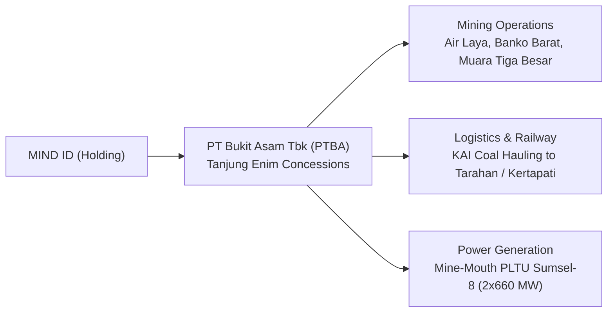

## 👤 Enterprise Profile

**PT Bukit Asam (Persero) Tbk (IDX: PTBA)** is one of Indonesia’s oldest and largest state-owned natural resource enterprises. Based in Tanjung Enim, South Sumatra, PTBA operates integrated open-pit coal mining concessions, proprietary mine-mouth power generation plants, and industrial logistics networks connected to marine export terminals in Tarahan and Kertapati. As an operating subsidiary of the state mining holding company **MIND ID** (_Mining Industry Indonesia_), PTBA plays a pivotal role in supplying fuel to state utility **PT Perusahaan Listrik Negara (PLN)** under national Domestic Market Obligation (DMO) mandates.

---

## 📋 Curriculum Case Snapshots (Case-Basis Data)

> [!NOTE] Case-Basis Epistemic Notice
> The financial ratios, balance sheet valuations, and operational figures below are drawn from **MK2 Financial Management and Strategy** case assignments and working models developed by **`F9 (Class F / Syndicate 9)`**. These metrics reflect specific pedagogical problem sets based on FY2024–FY2025 financial statements and should not be cited as real-time investor disclosures.

### 1. Financial Statement Structure & Asset Idiosyncrasies (MK2 Week 01)

- **Source Material**: [[courses/mk2-financial-management-strategy/week-01/assignment-ptba-financial-statement-structure|MK2 Week 01 Assignment]]
- **Pedagogical Focus**: Capitalized advance stripping assets, lower-of-cost-or-NRV stockpile inventory write-downs, and asset retirement obligation (ARO) reclamation provisions in natural resource extraction.

### 2. Longitudinal Ratio Diagnostics & DuPont ROE Deconstruction (MK2 Week 02)

- **Source Case**: [[courses/mk2-financial-management-strategy/week-02/case-ptba-ratio-analysis|MK2 Week 02 Case Analysis]] & [[courses/mk2-financial-management-strategy/week-02/assignment-post-ptba-reflection|MK2 Week 02 Strategic Reflection]]
- **Case Baseline Financials (FY2025 Pedagogical Model)**:
  - **Net Revenue**: $\text{Rp } 42.65\text{ trillion}$ (flat vs $\text{Rp } 42.76\text{ trillion}$ in FY2024, $-0.26\%$).
  - **Sales Volume**: Record high of $45.43\text{ million tonnes}$ in FY2025.
  - **Net Profit**: $\text{Rp } 2.96\text{ trillion}$ (contracted $-51.6\%$ from $\text{Rp } 6.11\text{ trillion}$).
  - **Total Assets & Equity**: Assets at $\text{Rp } 43.92\text{ trillion}$; Equity at $\text{Rp } 22.62\text{ trillion}$.
  - **DuPont ROE Collapse**: Return on Equity dropped from $28.3\%$ (FY2024) to $13.1\%$ (FY2025), isolating profit margin compression (down from $14.3\%$ to $6.9\%$) as the primary driver when benchmark coal prices soften despite record physical extraction.

---

## 🎤 Contributions to P3MD MBA

- **Course Appearances**:
  - [[courses/mk2-financial-management-strategy/week-01/index|MK2 Week 01: Financial Statement Structure & Risk]]
  - [[courses/mk2-financial-management-strategy/week-02/index|MK2 Week 02: Financial Ratio Analysis & DuPont System]]
- **Case Studies & Assignments**:
  - [[courses/mk2-financial-management-strategy/week-01/assignment-ptba-financial-statement-structure|PTBA Financial Statement Structure]]
  - [[courses/mk2-financial-management-strategy/week-02/case-ptba-ratio-analysis|PTBA 25+ Ratio Deep-Dive & DuPont Diagnostic]]
  - [[courses/mk2-financial-management-strategy/week-02/assignment-post-ptba-reflection|Strategic Lessons from the PTBA Diagnostic]]
- **Related Concepts**:
  - [[concepts/dupont-analysis|DuPont Analysis Framework]]

---

## 🔗 Traceability & Directory

- Return to **[[entities/index|Entity Directory]]**
- Return to **[[index|MBA Cohort Portal Home]]**
