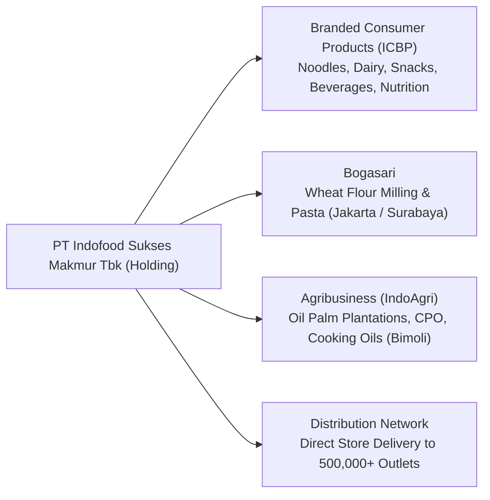

## 👤 Enterprise Profile

**PT Indofood Sukses Makmur Tbk (IDX: INDF)** is an Indonesian multinational food solutions company and one of the largest consumer packaged goods corporations in the Asia-Pacific region. Founded by the Salim Group, Indofood operates a fully integrated supply chain spanning agricultural plantations, wheat flour milling, branded consumer product manufacturing, and an extensive nationwide distribution network supplying over half a million retail outlets across Indonesia.

---

## 📋 Curriculum Case Snapshots (Case-Basis Data)

> [!NOTE] Case-Basis Epistemic Notice
> The forecast parameters, pro-forma statement lines (2026E–2030E), and cash flow dynamics below are outputs of the financial projection models developed by **`F9 (Class F / Syndicate 9)`** for **MK2 Financial Management and Strategy (Week 03)**. They apply academic percent-of-sales forecasting techniques to FY2024–FY2025 audited baselines and do not constitute corporate forward guidance or investor forecasts from INDF management.

### MK2 Financial Management (Week 03): 5-Year Pro-Forma Forecast & Sustainable Growth

- **Source Case**: [[courses/mk2-financial-management-strategy/week-03/case-indofood-financial-projections|Indofood 5-Year Financial Forecast Model]] & [[courses/mk2-financial-management-strategy/week-03/index|Week 03 Masterclass]]
- **Pedagogical Modeling Assumptions**:
  - **Nominal Sales Growth Anchor ($g$)**: Set at $5.60\%$ annually (matching the 5-year historical CAGR from Rp 99.35 T to Rp 123.49 T).
  - **Percent-of-Sales Cost Ratios**: COGS pegged at $69.10\%$, Selling & Distribution at $10.20\%$, and G&A at $5.30\%$.
  - **Dividend Policy ($d$)**: $45.00\%$ payout ratio, retaining $55.00\%$ for operational reinvestment.
  - **Tax Rate**: Statutory $22.00\%$ corporate income tax.
- **Pro-Forma Trajectory (2025 Actual $\rightarrow$ 2030E)**:
  - **Consolidated Net Sales**: $\text{Rp } 123.49\text{ trillion}$ (FY25) $\rightarrow$ $\text{Rp } 162.17\text{ trillion}$ (FY30E).
  - **Consolidated Net Income**: $\text{Rp } 12.87\text{ trillion}$ (FY25) $\rightarrow$ $\text{Rp } 16.69\text{ trillion}$ (FY30E).
  - **Operating Cash Flow & EFN Analysis**: Operating cash flow exceeding $\text{Rp } 14\text{ trillion}$ annually fully covers projected capex ($3.5\%$ of sales) and dividends, yielding **negative External Financing Needed ($\text{EFN}$)** and confirming that steady-state growth is self-funding without debt or equity dilution.

---

## 🎤 Contributions to P3MD MBA

- **Course Appearances**:
  - [[courses/mk2-financial-management-strategy/week-03/index|MK2 Week 03: Financial Statement Projections]]
- **Case Studies & Model Files**:
  - [[courses/mk2-financial-management-strategy/week-03/case-indofood-financial-projections|MK2 Week 03: Indofood 5-Year Financial Forecast Model]]
- **Related Concepts**:
  - [[concepts/sustainable-growth-rate|Sustainable Growth Rate Framework]]

---

## 🔗 Traceability & Directory

- Return to **[[entities/index|Entity Directory]]**
- Return to **[[index|MBA Cohort Portal Home]]**
