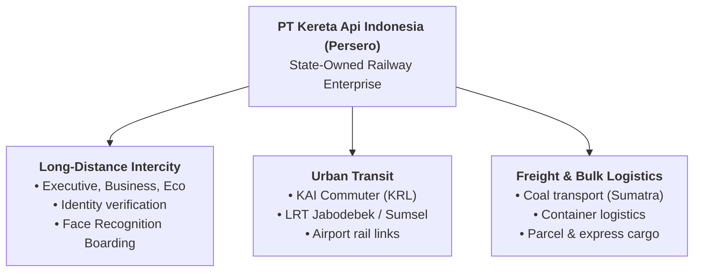

## 👤 Enterprise Profile

**PT Kereta Api Indonesia (Persero)**, commonly known as **KAI**, is Indonesia’s state-owned railway enterprise, operating nearly all passenger and freight rail networks across the islands of Java and Sumatra. As a Category-1 public enterprise under the supervision of the Ministry of BUMN and Danantara, KAI manages a vast multi-modal transportation ecosystem encompassing intercity passenger rail, suburban commuter rail (**KAI Commuter** / KRL Jabodetabek), airport rail links, urban mass transit (**LRT Jabodebek** and **LRT South Sumatra**), and bulk industrial freight transport (**KAI Logistik**).

### Strategic Transformation & Operating Philosophy

KAI is recognized across Asian business schools as one of the most successful turnaround stories in modern state-owned enterprise history:

#### 1. The Jonan Era: From Deficit to Customer-Centric Discipline (2009–2014)

Under the leadership of **Ignasius Jonan**, KAI transitioned from chronic financial losses, widespread ticket scalping, dangerous roof-riding, and chaotic station environments into a disciplined, profitable, and customer-first public utility. Jonan introduced:

- Strict seat-only ticketing (banning unseated passengers on long-distance trains).
- Digital reservation systems and automated station turnstiles.
- Comprehensive air conditioning and strict anti-smoking enforcement across all train classes.
- Cultural transformation emphasizing field presence: directors and senior managers stationed on train platforms during national holiday peaks.

#### 2. The Digital Modernization Era (2020–Present)

Under subsequent executive leadership (Didiek Hartantyo and Bobby Rasyidin), KAI accelerated its digital ecosystem:

- **Access by KAI**: The super-app integrating ticketing, hotel bookings, e-boarding passes, and intermodal transfers.
- **Biometric Face Recognition Boarding Gate (FRBG)**: Deployed to streamline passenger flow at long-distance station turnstiles.
- **Enterprise Security**: ISO 27001-certified information security architectures for passenger biometric data governance.

---

## 📋 Curriculum Case Snapshots (Case-Basis Data)

> [!NOTE] Case-Basis Epistemic Notice
> The operational metrics, gate cycle times, station queuing parameters, and strategic dilemmas below are extracted from the **SBM ITB** teaching case study **[[courses/mk4-operations-supply-chain-management/week-06/case-kai-gambir-gate|PT Kereta Api Indonesia (Persero): One Second at the Gambir Gate (Case No. SBM-ITB/OSCM/2026-06)]]**. These figures incorporate pedagogical scenario bounds, illustrative parameters, and composite character vignettes designed for classroom operations analysis rather than official investor relations disclosures.

### MK4 Operations & SCM (Week 06): One Second at the Gambir Gate

- **Primary Dilemma**: Balancing high-speed physical gate clearance (1-second face scan vs. 15-second manual inspection) against the unmeasured bottleneck of upstream customer service desk registration.
- **Case Operational Baseline (2025–2026 Pedagogical Data)**:
  - **KAI Group Passenger Volume**: $503.5\text{ million}$ customers ($+8.52\%$ YoY), with passenger transport generating $\text{Rp } 12.9\text{ trillion}$ of $\text{Rp } 35.7\text{ trillion}$ consolidated revenue.
  - **Operating EBITDA & Net Profit**: Operating EBITDA at $\text{Rp } 8.3\text{ trillion}$, net profit at $\text{Rp } 2.3\text{ trillion}$, and state fiscal contribution at $\text{Rp } 6.8\text{ trillion}$.
  - **Freight Volume**: $70.0\text{ million tonnes}$ (dominated by South Sumatra coal logistics).
  - **On-Time Performance (OTP)**: $96.2\%$ in H1 2026.
  - **Biometric FRBG Adoption**: Trialled September 2022 at Bandung Station; scaled to 22 stations (67 lines) by 2024; logged $5.55\text{ million}$ passengers in H1 2026 with an expansion plan to 60 stations targeting $70\%$ adoption by 2028.
- **The Dual-Mandate Friction**:
  1. _Commercial Modernization_: Rapid automation to lower operational station costs and accelerate peak passenger throughput.
  2. _Public Service Obligation (PSO)_: Ensuring non-smartphone, rural, and elderly passengers without electronic identity cards are not relegated to discriminatory registration queues.

### Additional MK4 Curricular Case Deployments

- **Week 02 (Operations Strategy)**: [[courses/mk4-operations-supply-chain-management/week-02/case-kai-coal-dilemma|Rails at a Crossroads: The Coal Dilemma at KAI]] — Reconciling South Sumatra coal freight (Babaranjang) generating $82.4\%$ of freight volume and dominant profits against national decarbonization mandates.
- **Week 03 (Product & Service Design)**: [[courses/mk4-operations-supply-chain-management/week-03/case-kai-access|Access by KAI: Redesigning an Integrated Journey Service Under the Weight of Whoosh]] — Scaling a $29.8\text{M}$ user app into a multimodal journey orchestrator.
- **Week 07 (Waiting Line Analysis)**: [[courses/mk4-operations-supply-chain-management/week-07/case-kai-commuter-manggarai|The Queue at the Largest Junction: KAI Commuter and Manggarai Station Capacity]] — Queuing theory, platform passenger dispersion, and headway constraints.
- **Week 08 (Lean Operations)**: [[courses/mk4-operations-supply-chain-management/week-08/case-kai-logistik-lean|KAI Logistik: Lean Operations and Waste Elimination]] — Eliminating dry port container dwell waste and empty wagon repositioning.

---

## 🎤 Contributions to P3MD MBA

- **Course Appearances**:
  - [[courses/mk4-operations-supply-chain-management/week-02/index|MK4 Week 02: Operations Strategy & Competitive Dimensions]]
  - [[courses/mk4-operations-supply-chain-management/week-03/index|MK4 Week 03: Product and Service Design]]
  - [[courses/mk4-operations-supply-chain-management/week-06/index|MK4 Week 06: Process Design, Analysis & Little's Law]]
  - [[courses/mk4-operations-supply-chain-management/week-07/index|MK4 Week 07: Waiting Line Analysis, Simulation & OSCM Game]]
  - [[courses/mk4-operations-supply-chain-management/week-08/index|MK4 Week 08: Lean Operations & Waste Elimination]]
- **Dedicated Case Studies**:
  - [[courses/mk4-operations-supply-chain-management/week-02/case-kai-coal-dilemma|Rails at a Crossroads: The Coal Dilemma at KAI (Case No. SBM-ITB/OSCM-02-2026)]]
  - [[courses/mk4-operations-supply-chain-management/week-03/case-kai-access|Access by KAI: Redesigning an Integrated Journey Service (Case No. SBM-OSCM-2026-03)]]
  - [[courses/mk4-operations-supply-chain-management/week-06/case-kai-gambir-gate|PT Kereta Api Indonesia (Persero): One Second at the Gambir Gate (Case No. SBM-ITB/OSCM/2026-06)]]
  - [[courses/mk4-operations-supply-chain-management/week-07/case-kai-commuter-manggarai|The Queue at the Largest Junction: KAI Commuter and Manggarai Station (Case No. SBM-OSCM-07-2026)]]
  - [[courses/mk4-operations-supply-chain-management/week-08/case-kai-logistik-lean|KAI Logistik: Lean Operations and Waste Elimination (Case No. SBM-OSCM-26-08)]]
- **Related Concepts**:
  - [[concepts/order-winners-and-qualifiers|Order Winners and Order Qualifiers]]
  - [[concepts/service-blueprinting|Service Blueprinting]]
  - [[concepts/customer-order-decoupling-point|Customer Order Decoupling Point]]
  - [[concepts/service-system-design-matrix|Service-System Design Matrix]]
  - [[concepts/customer-introduced-variability|Customer-Introduced Variability]]
  - [[concepts/littles-law|Little's Law]]
  - [[concepts/queuing-theory|Queuing Theory and Waiting Line Analysis]]
  - [[concepts/toyota-production-system|Toyota Production System and Lean Operations]]
- **Action Learning Project (ALP) Context**: Benchmark enterprise for service operations, transport logistics, and BUMN public-value management.

---

## 🔗 Traceability & Directory

- Return to **[[entities/index|Entity Directory]]**
- Return to **[[index|MBA Cohort Portal Home]]**
