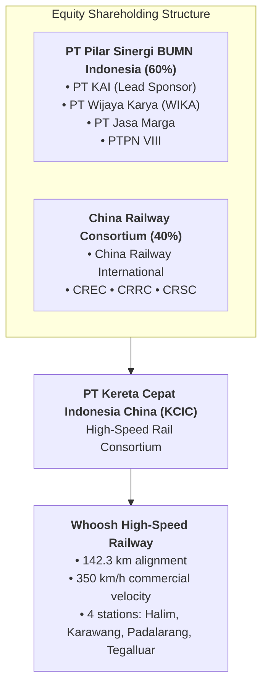

## 👤 Enterprise Profile

**PT Kereta Cepat Indonesia China (KCIC)** is a bilateral joint venture established in October 2015 between an Indonesian state-owned consortium, **PT Pilar Sinergi BUMN Indonesia (PSBI)** (comprising PT Kereta Api Indonesia, PT Wijaya Karya, PT Jasa Marga, and PTPN VIII), and a Chinese consortium led by **China Railway International Co., Ltd. (CRI)**.

KCIC was chartered to develop, finance, construct, and operate Indonesia and Southeast Asia's first high-speed railway, connecting Jakarta (Halim Station) and Bandung (Tegalluar Station) under the commercial brand **Whoosh**.

---

## 📋 Curriculum Case Snapshots (Case-Basis Data)

> [!NOTE] Case-Basis Epistemic Notice
> The capital investment numbers, schedule milestones, and debt-service figures below are drawn from the **SBM ITB** teaching case **[[courses/mk4-operations-supply-chain-management/week-04/case-whoosh-kcic|Whoosh: When Schedule, Cost and a State Mandate Collide on the Jakarta–Bandung High-Speed Rail]]**.

### MK4 Operations & SCM (Week 04): When Schedule, Cost and a State Mandate Collide

- **Primary Dilemma**: Reconciling world-class operational performance ($99.9\%$ on-time punctuality, $350\text{ km/h}$, zero accidents across $40,000$ trips) with a project management track record plagued by catastrophic schedule delays and a $\text{US\$ } 1.77\text{ billion}$ cost overrun.
- **The Mega-Project Cost Overrun**:
  - Initial estimated investment (2015): $\text{US\$ } 5.5\text{ billion}$ with commercial operations scheduled for 2019.
  - Final outturn cost (2023): $\text{US\$ } 7.27\text{ billion}$ ($+32.2\%$ cost escalation), funded by loans from China Development Bank (CDB) and state equity injections (PMN).
- **Project Scheduling & Execution Bottlenecks**:
  - Land acquisition complexities across 8 regencies and cities.
  - Challenging geological conditions in Tunnel 2 (unstable clay shale) and Tunnel 6.
  - COVID-19 pandemic mobility restrictions and labor/equipment import disruptions.
- **Operational Integration Challenge**:
  - Terminus at Tegalluar sits $15\text{ km}$ outside central Bandung, necessitating a dedicated feeder rail transfer operated by [[entities/pt-kereta-api-indonesia|PT KAI]] at Padalarang to complete the door-to-door passenger journey.

---

## 🎤 Contributions to P3MD MBA

- **Course Appearances**:
  - [[courses/mk4-operations-supply-chain-management/week-04/index|MK4 Week 04: Project Management]]
  - [[courses/mk4-operations-supply-chain-management/week-03/index|MK4 Week 03: Product and Service Design]]
- **Dedicated Case Study**:
  - [[courses/mk4-operations-supply-chain-management/week-04/case-whoosh-kcic|Whoosh: When Schedule, Cost and a State Mandate Collide]]
- **Related Concepts**:
  - [[concepts/critical-path-method|Critical Path Method (CPM) and PERT]]
  - [[concepts/order-winners-and-qualifiers|Order Winners and Order Qualifiers]]

---

## 🔗 Traceability & Directory

- Return to **[[entities/index|Entity Directory]]**
- Return to **[[index|MBA Cohort Portal Home]]**
