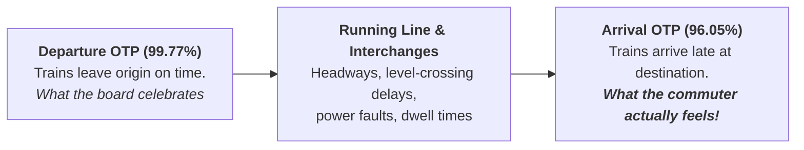

**PT Kereta Commuter Indonesia (KAI Commuter / KCI)** is an operating subsidiary of state-owned rail enterprise **PT Kereta Api Indonesia (Persero)**, responsible for managing the electric commuter rail transit network (_KRL Commuter Line_) across the Greater Jakarta (Jabodetabek) metropolitan area, Banten, West Java, Yogyakarta, and Solo.

---

## 1. Enterprise Scale & Operational Overview

| Metric / Dimension          | Figure                                          | Strategic Significance                                                                                                                                  |
| :-------------------------- | :---------------------------------------------- | :------------------------------------------------------------------------------------------------------------------------------------------------------ |
| **Annual Passenger Volume** | **179.1 million passengers** (H1 2024)          | Represents **81.8%** of the entire KAI Group customer volume.                                                                                           |
| **Daily Train Journeys**    | **~1,100 trips per day**                        | High-frequency, tight-headway urban rail network serving 1.2M daily riders.                                                                             |
| **Infrastructure Context**  | Manggarai Central Interchange Station           | Central transit node connecting Bogorian, Cikarang, and Airport lines; critical bottleneck for network dwell times.                                     |
| **Regulatory Framework**    | Public Service Obligation (PSO) & IMO Contracts | Government operational compensation (PSO: Rp 4.68T, IMO: Rp 3.48T in 2024) tied to line-level arrival punctuality thresholds ($\le 3.00\%$ delay rate). |

---

## 2. Operational Quality Dilemma: The Punctuality Paradox

In transit operations management, KAI Commuter exemplifies the critical distinction between **Departure On-Time Performance (OTP)** and **Arrival OTP**:

- **Departure OTP:** Consistently exceeds **99.5%** across 2020–2024.
- **Arrival OTP:** Averages between **92.6% and 96.0%**, leaving an unmeasured operational gap of **3.7 to 7.0 percentage points**.

### The SBM ITB Teaching Case (SBM-ITB 26-03)

In the operations management case studied in [[courses/mk4-operations-supply-chain-management/week-10/case-kai-commuter-sqc|KAI Commuter: On-Time Performance on Indonesia's Busiest Line]], Protagonist **Rania Prameswari** (VP Operations Quality & Performance) must evaluate whether 24 weeks of Commuter Line delay data ($n = 500$ journeys/week, $\bar{p} = 0.0525$) represents:

1. A process in statistical control at $3\sigma$.
2. A process that is in control but **incapable** of meeting the Ministry's $\le 3.00\%$ contract penalty ceiling.
3. The need to sequence capital upgrades (signaling, rolling stock) before refining station dwell procedures.

---

## 3. Curricular Cross-References

- **Primary Case Study:** [[courses/mk4-operations-supply-chain-management/week-10/case-kai-commuter-sqc|Case Dossier: KAI Commuter SQC Analysis]]
- **Master Lecture Hub:** [[courses/mk4-operations-supply-chain-management/week-10/index|Week 10: Statistical Quality Control]]
- **Lattice Concept:** [[concepts/statistical-process-control|Statistical Process Control (SPC) & Process Capability]]
- Return to [[entities/index|Entities Directory]]
