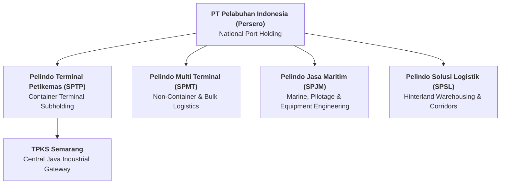

## 👤 Enterprise Profile

**PT Pelabuhan Indonesia (Persero)**, commonly known as **Pelindo**, is Indonesia's state-owned port operator resulting from the historic October 2021 merger of Pelindo I, II, III, and IV. As the maritime gateway operator of the world's largest archipelagic state, Pelindo manages over 100 commercial ports across Indonesia, handling containerized cargo, dry bulk, liquid bulk, and passenger passenger vessels.

Pelindo's container operations are organized into regional hubs and feeder ports. A critical industrial gateway in Central Java is the **Terminal Peti Kemas Semarang (TPKS)** located at the Port of Tanjung Emas, serving the dense export manufacturing corridors of Semarang, Kendal, and Demak.

---

## 📋 Curriculum Case Snapshots (Case-Basis Data)

> [!NOTE] Case-Basis Epistemic Notice
> The container volumes, berth crane metrics, and tidal flood impact figures below are synthesized from the **SBM ITB** teaching case **[[courses/mk4-operations-supply-chain-management/week-05/case-pelindo-tpks-capacity|Pelindo and Semarang Container Terminal: Adding Capacity on Sinking Ground (Case No. OSCM-05-2026-01)]]**.

### MK4 Operations & SCM (Week 05): Adding Capacity on Sinking Ground

- **Primary Dilemma**: TPKS operates at near-zero capacity cushion (over $1.0\text{ million TEU}$ handled against $1.1\text{ million TEU}$ design capacity; $90.9\%$ utilization in 2025). Leadership must decide how to expand container throughput on ground suffering chronic land subsidence and severe tidal flooding (_rob_).
- **Interconnected Port Bottleneck Subsystems**:
  1. _Berth & Quay Crane Capacity_: Ship-to-shore (STS) container crane cycle times and vessel turnarounds.
  2. _Container Yard Capacity_: Rubber-tyred gantry (RTG) stacking density and dwell time management.
  3. _Terminal Gate Capacity_: Automated gate systems and optical container code scanners.
- **Environmental Hazard & Climate Vulnerability**:
  - Tanjung Emas coastal subsidence averaging 8–10 cm per year.
  - In May 2025, a critical sea-wall failure submerged 75% of the port yard, halting operations and damaging sensitive refrigerated containers (_reefers_).

### MK4 Operations & SCM (Week 09): The Score, the Berth, and the Gate That Is Not Ours

- **Curricular Link**: [[courses/mk4-operations-supply-chain-management/week-09/case-pelindo-lean-six-sigma|Case Study: Pelindo — The Score, the Berth, and the Gate That Is Not Ours (SBM-OSCM-2026-03)]]
- **Primary Dilemma**: Post-merger operational excellence doubled quay crane moves and halved port stays, yet Tanjung Priok plummeted from 23rd to 121st in the World Bank Container Port Performance Index (CPPI 2025). SVP Operational Excellence Rangga Pradipta must defend whether Pelindo's 2027 improvement capital should focus on waterside automation (100% control) or landside ecosystem coordination with Customs and truckers (shared control).
- **Core Operations Frameworks**: [[concepts/lean-six-sigma-dmaic|Lean Six Sigma (DMAIC)]], Cost of Quality (CoQ 1-10-100 Rule), and Measurement System Analysis (MSA).

### Business Immersion 1 (October 2026): Tanjung Priok Container Terminal Gateway

During **[[program/alp/business-immersion-1/pelabuhan-indonesia|Business Immersion 1]]**, Syndicates 36, 37, 38, and 39 conducted field diagnostics at **Pelindo Port of Tanjung Priok**:

- **On-Site Operational Focus**: Investigating container dwell times, quay crane vessel productivity (gross moves per hour / GMPH), terminal gate automated optical character recognition (OCR), and rail-port dry connectivity.
- **Observed Bottlenecks**: Yard congestion caused by import container dwell times averaging $> 3.2$ days, manual customs clearance hold-ups, and land-side truck queuing along the access toll artery during peak vessel berthing windows.
- **Synergy with [[concepts/pso-commercial-duality|PSO vs Commercial Duality]]**: Fulfilling the national developmental mission to lower Indonesia's logistics costs (targeting $< 15\%$ of GDP) and subsidizing non-commercial pioneer sea-highways (_Tol Laut_) while maintaining competitive commercial stevedoring tariffs and container terminal EBITDA margins.

---

## 🎤 Contributions to P3MD MBA

- **Action Learning Project & Immersion**:
  - [[program/alp/business-immersion-1/pelabuhan-indonesia|Business Immersion 1: PT Pelabuhan Indonesia (Tanjung Priok Gateway)]] (Host BUMN for Syndicates 36, 37, 38, 39)
- **Course Appearances**:
  - [[courses/mk4-operations-supply-chain-management/week-05/index|MK4 Week 05: Strategic Capacity Planning]]
- **Dedicated Case Study**:
  - [[courses/mk4-operations-supply-chain-management/week-05/case-pelindo-tpks-capacity|Pelindo and Semarang Container Terminal: Adding Capacity on Sinking Ground]]
- **Related Concepts**:
  - [[concepts/pso-commercial-duality|Public Service Obligation (PSO) vs Commercial Viability Duality]]
  - [[concepts/capacity-cushion|Capacity Cushion & Strategic Capacity Planning]]
  - [[concepts/littles-law|Little's Law]]

---

## 🔗 Traceability & Directory

- Return to **[[entities/index|Entity Directory]]**
- Return to **[[index|MBA Cohort Portal Home]]**
