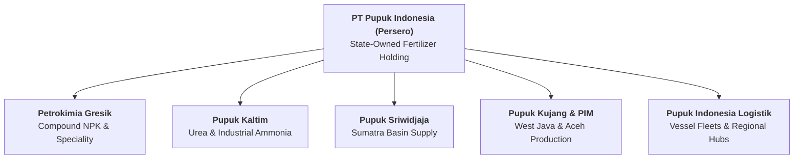

## 👤 Enterprise Profile

**PT Pupuk Indonesia (Persero)** is the Indonesian state-owned holding enterprise overseeing the country’s entire state-owned fertilizer manufacturing and distribution infrastructure. Formed as the holding entity uniting operating subsidiaries including PT Petrokimia Gresik, PT Pupuk Kujang, PT Pupuk Kaltim, PT Pupuk Iskandar Muda, and PT Pupuk Sriwidjaja Palembang, Pupuk Indonesia is the central pillar of national food sovereignty and agricultural productivity.

The corporation operates massive ammonia and urea chemical complexes, blending facilities, and a nationwide logistics network responsible for supplying both subsidized fertilizer (_Pupuk Bersubsidi_) to registered smallholder farmers and commercial fertilizers to plantation conglomerates and export markets.

---

## 📋 Curriculum Case Snapshots (Case-Basis Data)

> [!NOTE] Case-Basis Epistemic Notice
> The distribution quotas, inventory lead times, and retail kiosk parameters below are drawn from the **SBM ITB** teaching case **[[courses/mk4-operations-supply-chain-management/week-01/case-pupuk-indonesia|Pupuk Indonesia: Shorten the Chain Without Breaking the Field (Case Ref: SBM-OSCM-26-001)]]**.

### MK4 Operations & SCM (Week 01): Shorten the Chain Without Breaking the Field

- **Primary Dilemma**: Reconciling the **6 Prinsip Tepat** (_Tepat Jumlah, Jenis, Waktu, Tempat, Mutu, Harga_) across a 5-tier distribution channel while navigating severe seasonal planting spikes, working capital constraints, and government subsidy leakage scrutiny.
- **Case Multi-Echelon Pipeline Architecture**:
  - **Line I (Production Plants & Port Warehouses)**: Urea and NPK output synthesized in capital-intensive continuous plants.
  - **Line II (Provincial Buffer Warehouses)**: Regional transit hubs absorbing plant batch variations.
  - **Line III (Regency / District Warehouses)**: Local distribution centers managed by distributor partners.
  - **Line IV (Official Retail Kiosks / Kios Pupuk Lengkap - KPL)**: Authorized frontline retailers verifying farmer allocations.
  - **Line V (Smallholder Farmers & Poktan)**: Registered end-beneficiaries redeeming allocated quotas.
- **Digital Innovation**: Implementation of **i-Pubers** (Integrated Subsidized Fertilizer Redemption App) developed jointly with the Ministry of Agriculture, pairing electronic KTP scanning and facial verification to close Line IV leakage.

### Business Immersion 1 (October 2026): PT Pupuk Kujang Cikampek On-Site Diagnostic

During **[[program/alp/business-immersion-1/pupuk-indonesia|Business Immersion 1]]**, Syndicates 31, 32, 33, and 34 conducted on-site field diagnostics at **PT Pupuk Kujang Cikampek**:

- **On-Site Operational Focus**: Dissecting the complete supply chain interface linking manufacturing plants (Kujang 1A and 1B), regional Line III buffer warehouses, and frontline retail kiosks (Kios Pupuk Lengkap / KPL).
- **Observed Bottlenecks**: Farmer redemption friction where physical fertilizer bags were available in warehouse stock, but smallholders could not redeem due to digital discrepancies in _e-RDKK / i-Pubers_ beneficiary lists, alongside working capital debt carry caused by seasonal planting cycle mismatches.
- **Synergy with [[concepts/pso-commercial-duality|PSO vs Commercial Duality]]**: Safeguarding national food security via mandated subsidized urea/NPK distribution while expanding commercial retail lines (such as customized NPK Nitrea and industrial chemicals) to fund plant modernization.

---

## 🎤 Contributions to P3MD MBA

- **Action Learning Project & Immersion**:
  - [[program/alp/business-immersion-1/pupuk-indonesia|Business Immersion 1: PT Pupuk Indonesia & PT Pupuk Kujang Cikampek]] (Host BUMN for Syndicates 31, 32, 33, 34)
- **Course Appearances**:
  - [[courses/mk4-operations-supply-chain-management/week-01/index|MK4 Week 01: Introduction to Operations and Supply Chain Management]]
- **Dedicated Case Study**:
  - [[courses/mk4-operations-supply-chain-management/week-01/case-pupuk-indonesia|Pupuk Indonesia: Shorten the Chain Without Breaking the Field]]
- **Related Concepts**:
  - [[concepts/pso-commercial-duality|Public Service Obligation (PSO) vs Commercial Viability Duality]]
  - [[concepts/supply-chain-operations-reference|Supply Chain Operations Reference (SCOR)]]
  - [[concepts/customer-order-decoupling-point|Customer Order Decoupling Point]]

---

## 🔗 Traceability & Directory

- Return to **[[entities/index|Entity Directory]]**
- Return to **[[index|MBA Cohort Portal Home]]**
