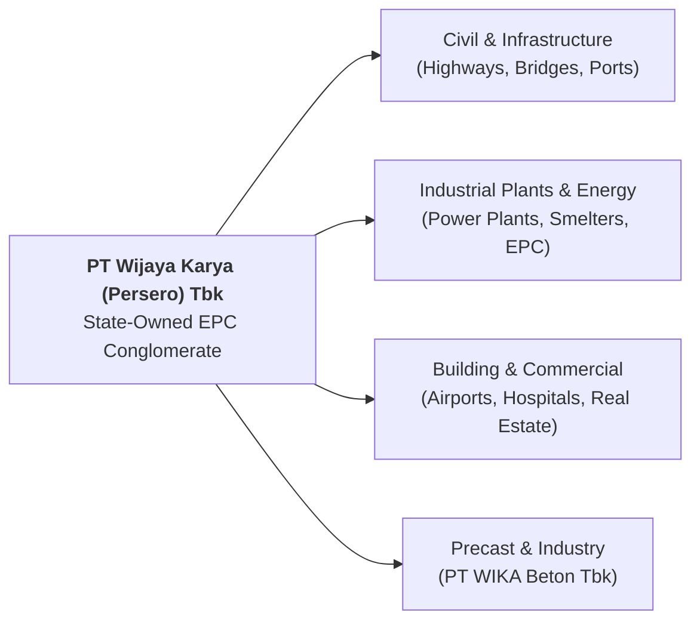

## 👤 Enterprise Profile

**PT Wijaya Karya (Persero) Tbk** (known as **WIKA**, IDX: `WIKA`) is one of Indonesia’s flagship state-owned engineering, procurement, and construction (EPC) conglomerates. Established in 1960 through the nationalization of Dutch contracting assets, WIKA expanded across civil infrastructure, high-speed rail construction, industrial plants, energy facilities, and precast concrete manufacturing.

Headquartered in Jakarta, Indonesia, WIKA operates under the administrative and shareholder oversight of the Ministry of State-Owned Enterprises (Kementerian BUMN) and the strategic investment coordination of Danantara Indonesia. As a public contractor, it balances commercial profitability against national strategic development mandates.

---

## 📋 Curriculum Case Snapshots (Case-Basis Data)

> [!NOTE] Case-Basis Epistemic Notice
> Operating margins, leverage metrics, and project bids cited below reflect specific pedagogical case snapshots from **SBM ITB Case Studies** and syndicate research models. They are pedagogical constructs and historic case exhibits, distinct from ongoing live corporate filings.

### MK 3 (Marketing Management) Week 04: WIKA and the Building EPC Champion Program

- **Curricular Source**: `WIKA_and_the_Building_EPC_Champion_Program.pdf` & [[courses/mk3-marketing-management/week-04/case-wika-epc-champion|Case Study Dossier]].
- **Core Dilemma**: Navigating structural liquidity constraints and balance-sheet stress following capital-intensive turnkey infrastructure programs, while defending core B2B industrial EPC accounts (such as PT Aneka Tambang / MIND ID) against domestic state competitors (PTPP, Rekind) and international industrial specialists (Chiyoda).
- **Analytical Mechanics**: Applying [[concepts/five-c-analysis|5C Environmental Analysis]], Porter's Five Forces, and the [[concepts/b2b-buying-center|B2B Buying Center / DMU]] framework to manage long-cycle client procurement in heavy industrial plants.

---

## 🏛️ Strategic Lenses Across Curriculum

- **B2B Relationship Marketing ([[courses/mk3-marketing-management/week-04/index|MK3 Week 04]]):** Analyzing derived demand, multi-stakeholder procurement committees, and risk-adjusted contractor selection.
- **Corporate Restructuring & Financial Health ([[courses/mk2-financial-management-strategy/index|MK2]]):** Evaluating debt maturity waterfalls, working capital cycles in turnkey projects, and government equity injections (PMN).
- **SOE Governance & Power Dynamics ([[courses/mk1-organizational-behavior-managing-people/week-07/index|MK1 Week 07]]):** Balancing ministerial mandates, public procurement oversight (BPKP/LKPP), and commercial autonomy.
- **Human Capital & Blue Ocean Transformation ([[rabuan/2026-08-31-hadjar-from-learner-to-transformer|Rabuan Plenary]]):** Led by [[entities/hadjar-seti-adji|Hadjar Seti Adji]] (Director of Human Capital & Transformation, WIKA), shifting BUMN Karya contracting from Red Ocean price wars toward BIM, Green Building, and SDG-aligned differentiation.

---

## 🔗 Traceability & Directory

- [[entities/hadjar-seti-adji|Executive Profile: Hadjar Seti Adji (Director of HC & Transformation, WIKA)]]
- [[rabuan/2026-08-31-hadjar-from-learner-to-transformer|Rabuan Plenary: From a Learner to a Transformer for Legacy]]
- [[courses/mk3-marketing-management/week-04/index|MK3 Week 04: B2B Marketing & Organizational Buying]]
- [[courses/mk3-marketing-management/week-04/case-wika-epc-champion|Case Dossier: WIKA EPC Champion Program]]
- [[courses/mk3-marketing-management/week-04/assignment-wika-b2b-analysis|Assignment Debrief: WIKA Strategic Analysis]]
- Return to **[[entities/index|Entity Directory]]**
