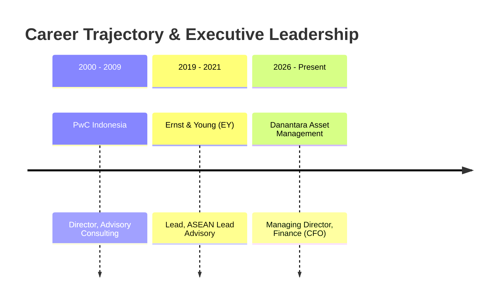

## 👤 Executive & Theorist Profile

**Sahala Tua Paulus Situmorang, S.E.Ak., M.B.A.** is a distinguished Indonesian corporate finance executive, chartered accountant, and institutional asset management leader. He serves as **Managing Director of Finance / Chief Financial Officer (CFO)** at **PT Danantara Asset Management (DAM)**, the specialized investment and capital allocation arm under the sovereign **[[entities/danantara|Danantara]]** institutional umbrella.

With extensive executive leadership experience across international corporate finance, balance-sheet restructuring, risk governance, and capital budgeting, Sahala is renowned for his pragmatic, uncompromising advocacy of financial discipline as an essential leadership capability for non-finance managers. His executive pedagogy asserts that financial acumen is not a narrow back-office accounting task, but the core strategic language through which enterprise leaders allocate scarce resources, measure operational risk, and create compounding enterprise value.

---

## 🎓 Academic Credentials & Core Competencies

### Education & Academic Pedigree

- **Master of Business Administration (MBA)**, Western Illinois University, USA — _Fulbright Master's Degree Program_ (2000)
- **Bachelor's Degree in Economics (S.E.Ak.)**, Universitas Indonesia (1990)

### Functional Competency Pillars

- **Business Planning**: Corporate long-term strategy, operational budgeting, and resource modeling.
- **Performance Improvement**: Total Quality Management (TQM), zero-defect workflows, and cash-margin optimization.
- **SOE Transformation**: Sovereign asset management, balance-sheet restructuring, and ending reliance on state capital injections (PMN).

---

## 💼 Career Experience & Leadership Trajectory

| Tenure Period    | Position / Title                 | Organization / Institution                                  | Strategic Focus                                                              |
| :--------------- | :------------------------------- | :---------------------------------------------------------- | :--------------------------------------------------------------------------- |
| **2026–Present** | Managing Director, Finance (CFO) | [[entities/danantara\|PT Danantara Asset Management (DAM)]] | Sovereign asset allocation, asset monetization, and fiscal discipline        |
| **2019–2021**    | Lead, ASEAN Lead Advisory        | Ernst & Young (EY)                                          | Cross-border M&A advisory, sovereign transaction structuring                 |
| **2000–2009**    | Director, Advisory Consulting    | PricewaterhouseCoopers (PwC) Indonesia                      | SOE operational restructuring, enterprise governance, and financial advisory |

---

## 🧠 Core Philosophy & Contributions

1. **"Think Big, Think Global" with Deep Enterprise Ownership**:
   Indonesian state-owned enterprise (BUMN) managers must discard parochial mentalities and operate with global competitive rigor. Enterprise stewardship demands an acute sense of psychological ownership (_sense of ownership_): treating state balance-sheet resources with the same obsessive care, frugality, and vigilance as one's personal family business.

2. **The Multiplicative Capital-Capability Equation**:
   As articulated in the **[[concepts/capital-capability-synergy|Capital-Capability Synergy Framework]]**, corporate productivity is never the sum of disconnected balance-sheet injections. It is a strict multiplication:
   $$\text{Enterprise Productivity} = f(\text{Capital} \times \text{Capability})$$
   - _Capital without capability_ produces capex bloat, unutilized hardware, and wasteful expenditure (_"Modal tanpa kapabilitas hanya menjadi belanja"_).
   - _Capability without capital_ paralyzes high-potential innovations into dormant, uncommercialized concepts (_"Kapabilitas tanpa modal berhenti sebagai potensi"_).

3. **Demystifying Financial Discipline for Operational Leaders**:
   Every leader—regardless of whether they oversee human resources, engineering, legal, or field operations—must master the financial transmission mechanism of their division:
   - Where does the organization genuinely generate cash margins?
   - How does everyday decision-making consume working capital?
   - Is a given capital deployment delivering returns superior to the cost of capital ([[concepts/weighted-average-cost-of-capital|WACC]])?

4. **The 4-Stage Risk Management Protocol**:
   Risk management is effective only when transformed from qualitative checklists into mathematical quantification:
   - **Identify**: Uncovering operational, financial, and regulatory vulnerabilities.
   - **Quantify**: Calculating expected monetary exposure ($P \times L$) and Value-at-Risk ($VaR$).
   - **Mitigate**: Executing structured choices between risk transfer, avoidance, or capital retention.
   - **Monitor**: Maintaining real-time dynamic dashboard alerts before breach limits occur.

5. **Total Quality Management (TQM) & The "Pilih – Jalankan – Ukur" Loop**:
   Operational quality and financial discipline are two sides of the same coin. Sahala codifies execution into three iterative steps:
   - **Pilih (Select)**: Rigorously filtering projects to fund only differentiated assets with defensible moats (_"Yang penting berbeda meskipun sedikit"_). Pausing to question assumptions (_"Hold on a second"_) before releasing capital.
   - **Jalankan (Execute)**: Embedding TQM principles into workflows to prevent defects at source rather than relying on retroactive audits.
   - **Ukur (Measure)**: Continuously auditing actual cash flows and Return on Investment (ROI) against baseline underwriting assumptions.

6. **Investment Timing Heuristics & Avoiding Beginner Traps**:
   Timing is an asymmetric risk vector. Executing an operationally brilliant strategy three years ahead of market readiness or two quarters after a competitor locks down supply channels results in severe capital destruction. Avoiding beginner traps (_"kesalahan pemula"_) requires synchronizing capital expenditure with macroeconomic cycles and verified organizational capabilities.

---

## 🎤 Contributions to P3MD MBA

- **Rabuan Executive Plenary**:
  - Keynote speaker on September 23, 2026: [[rabuan/2026-09-23-sahala-financial-discipline|Memimpin dengan Financial Discipline: Capital Allocation, Risk Quantification & Enterprise Productivity]].
- **Related Foundational Concepts**:
  - [[concepts/capital-capability-synergy|Capital-Capability Synergy & Financial Discipline Engine]]
  - [[concepts/weighted-average-cost-of-capital|Weighted Average Cost of Capital (WACC)]]
  - [[concepts/batna-and-zopa|BATNA and ZOPA in Corporate Negotiations]]
- **Institutional Entities**:
  - [[entities/danantara|Danantara Indonesia (PT Danantara Asset Management)]]

---

## 🔗 Traceability & Directory

- Return to **[[entities/index|Entity Directory]]**
- Return to **[[index|MBA Cohort Portal Home]]**
