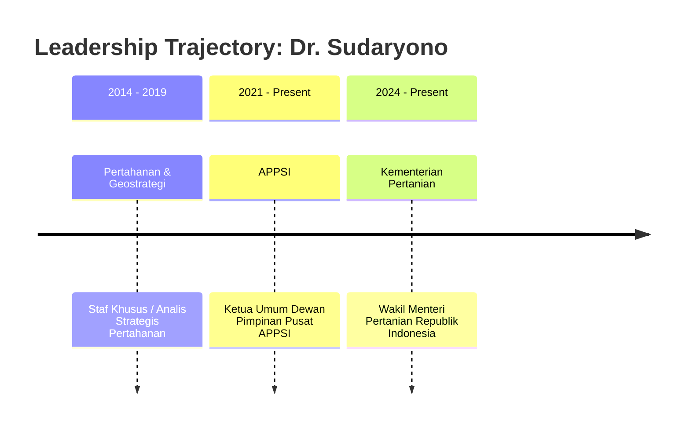
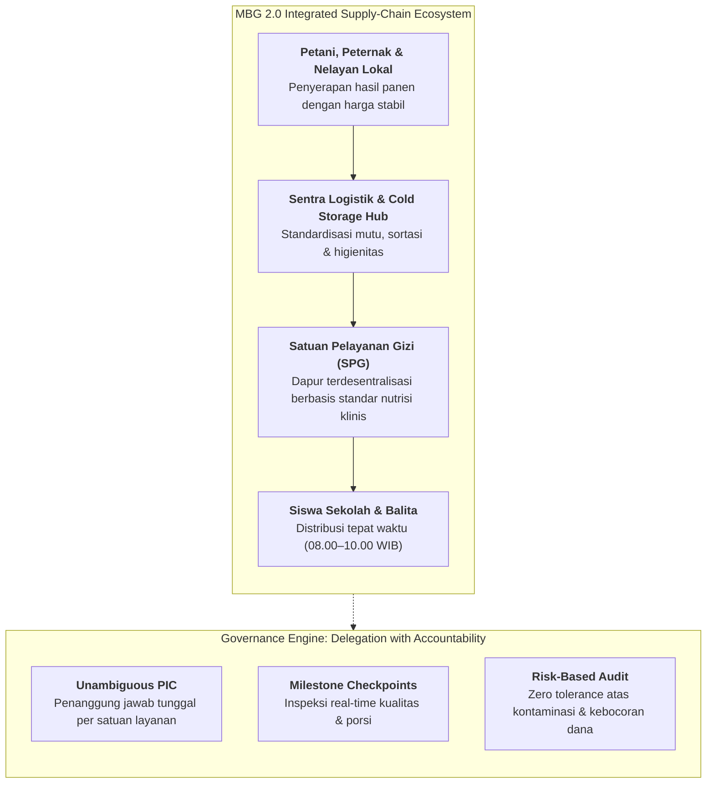

## 👤 Executive & Policymaker Profile

**Dr. Sudaryono, B.Eng., M.M., M.B.A.** is an Indonesian policymaker, agricultural supply-chain strategist, and defense engineer serving as the **Wakil Menteri Pertanian Republik Indonesia (Wamentan RI)**. In this capacity, he leads strategic operations for national food self-sufficiency (_swasembada pangan_), fertilizer distribution reform, smallholder farmer empowerment, and the cross-ministerial supply-chain integration underpinning the **Makan Bergizi Gratis (MBG 2.0)** program.

Educated in aerospace engineering at the **National Defense Academy of Japan (NDA Japan)** and possessing advanced business and agricultural degrees, Sudaryono combines rigorous systems engineering methodologies with pragmatic, field-level supply chain governance. He previously led the **Asosiasi Pedagang Pasar Seluruh Indonesia (APPSI)** as General Chairman, giving him unparalleled granular insight into traditional market mechanics, price volatility, and wholesale food distribution across the archipelago. On November 11, 2026, he delivered the executive plenary masterclass **"Membangun Fondasi Bangsa: MBG 2.0, Ketahanan Pangan & Kedaulatan Nasional"** to the **P3MD Batch I Soedirman** cohort at Kampus DCU Nawasena.

---

## 🎓 Academic Credentials & Strategic Competencies

### Education & Academic Pedigree

- **Doktor (Dr.)**, Program Pascasarjana Ilmu Kebijakan Publik / Pertanian
- **Master of Business Administration (MBA)** & **Magister Manajemen (M.M.)**, Program Manajemen Strategis
- **Bachelor of Engineering (B.Eng.) in Aerospace & Defense Engineering**, **National Defense Academy of Japan (Bouei Daigakko)**, Yokosuka, Japan (scholarship graduate)

### Core Policy & Supply-Chain Competencies

- **Integrated Farm-to-Fork Supply Networks**: Structuring decentralized collection centers, cold storage hubs, regional food processors, and local farmer cooperatives into high-reliability supply chains.
- **National Nutrition & Human Capital Architecture**: Designing the institutional logistics for MBG 2.0 to feed tens of millions of school children daily, viewing nutritional security as the physical foundation of national GDP compounding and defense resilience.
- **Delegation with Accountability**: Engineering public governance workflows where operational autonomy is delegated down to field units while institutionalizing strict quality standards, automated traceability, and risk-based inspection audits.
- **Cross-Sectoral Execution Velocity**: Aligning the Ministry of Agriculture, National Nutrition Agency (BGN), Ministry of Defense, state-owned food holdings (ID FOOD, Bulog, Pupuk Indonesia), and regional governments into unified operational execution.

---

## 💼 Leadership Trajectory & Public Service

| Period           | Position / Title                | Institution / Organization                        | Strategic Governance Focus                                                                            |
| :--------------- | :------------------------------ | :------------------------------------------------ | :---------------------------------------------------------------------------------------------------- |
| **2024–Present** | Wakil Menteri Pertanian RI      | Kementerian Pertanian Republik Indonesia          | Swasembada beras & jagung, cetak sawah modern, digitalisasi pupuk subsidi, dan rantai pasok MBG       |
| **2021–Present** | Ketua Umum / Dewan Pembina      | Asosiasi Pedagang Pasar Seluruh Indonesia (APPSI) | Advokasi pasar tradisional, stabilisasi pasokan sembako, dan digitalisasi pedagang pasar              |
| **2019–2024**    | CEO & Komisaris Korporasi       | Berbagai Holding Agribisnis & Media               | Manajemen rantai pasok pangan, korporatisasi petani, dan logistik komoditas strategis                 |
| **2014–2019**    | Asisten Khusus & Staf Strategis | Sekretariat Pertahanan & Diplomasi                | Analisis geostrategi ketahanan nasional, logistik pertahanan pangan, dan hubungan bilateral RI-Jepang |

---

## 🏛️ Public Policy Doctrine & MBG 2.0 Architecture

In his address to the P3MD cohort, Dr. Sudaryono articulated why food and nutrition constitute the primary bedrock of sovereign capability:

- **Nutrition as Sovereign Defense Infrastructure**: A nation cannot build a knowledge economy or an elite military with an under-nourished, cognitively impaired population. Investing in child nutrition via MBG 2.0 is not a social welfare cost; it is an upfront capital expenditure into national productive capability that compounds over 50 years.
- **The Local Multiplier**: MBG 2.0 is deliberately designed not as a centralized corporate procurement monopoly, but as an open distributed economic engine that injects purchasing power directly into rural agrarian communities.

---

## 🔗 Cross-Curricular & Institutional Lattice

- **Plenary Masterclass Dossier**:
  - [[rabuan/2026-11-11-sudaryono-mbg-ketahanan-pangan|Rabuan: Membangun Fondasi Bangsa — MBG 2.0, Ketahanan Pangan Nasional & Ekosistem Gizi]]
- **Compounding Core Concepts**:
  - [[concepts/supply-chain-operations-reference|Supply Chain Operations Reference (SCOR) in Public Distribution]]
  - [[concepts/pso-commercial-duality|Public Service Obligation (PSO) vs Commercial Duality]]
  - [[concepts/reverse-engineering-leadership|Reverse-Engineering Leadership & Audacious Public Goals]]
  - [[concepts/public-administration-paradigms|Public Administration Paradigms: Delivery & Governance]]
- **Institutional Partners**:
  - [[entities/pt-pupuk-indonesia|PT Pupuk Indonesia (Persero)]] & BUMN Pangan Coordination
  - [[entities/danantara|Danantara Asset Management]] (Agricultural Sovereign Investments)
- Return to **[[entities/index|Executive & Institutional Entity Directory]]**
