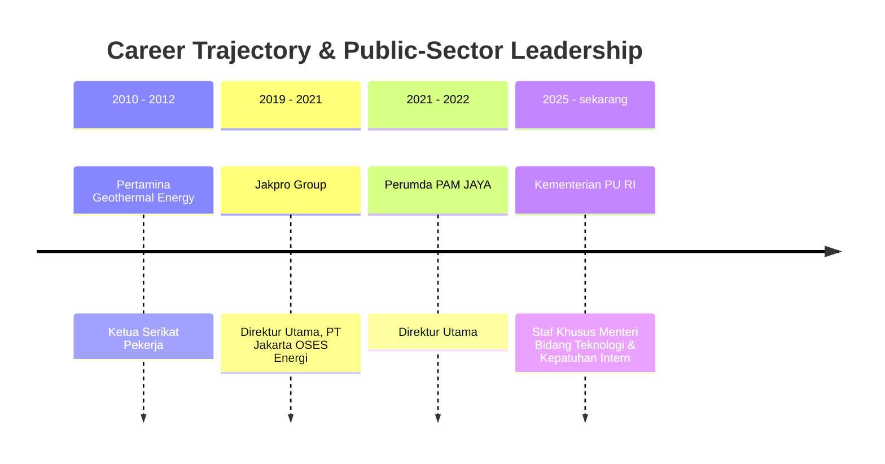

## 👤 Executive & Theorist Profile

**Dipl.-Ing. Syamsul Bachri Yusuf, M.Si. (Han)** is a seasoned public sector executive, infrastructure strategist, and technology governance expert in the Indonesian state administration. He serves as **Staf Khusus Menteri Pekerjaan Umum (KemenPU)** specializing in Technology and Internal Compliance (as well as Policy and Institutional Support) and sits on the Board of Commissioners of **[[entities/pt-jasa-marga|PT Jasa Marga (Persero) Tbk]]**, Indonesia's primary expressway corporation.

With an educational background in engineering from Germany (_Diplom-Ingenieur_) and national defense/security strategy (_Magister Sains Pertahanan_), Syamsul synthesizes technical engineering precision with macro-geopolitical and national security analysis. His governance framework focuses on ensuring that Indonesia's monumental public infrastructure investments not only meet engineering specifications but operate with impeccable compliance, climate resilience, and economic efficiency.

---

## 🎓 Academic Credentials & Core Competencies

### Education & Academic Pedigree

- **Magister Sains Ilmu Pertahanan (M.Si.) – Ketahanan Energi**, Universitas Pertahanan (Unhan), 2016
- **Diploma Ingenieur (Dipl.-Ing.) – Teknik Mesin**, University of Applied Sciences Hannover (Fachhochschule Hannover), Jerman, 2006

### Core Competency Pillars

- **Kepatuhan Internal (Internal Compliance)**: Technology-driven compliance auditing, risk prevention, and ministerial statutory alignment.
- **Ketahanan Energi (Energy Security)**: Geothermal exploration, sovereign resource defense, and renewable energy integration.
- **Infrastruktur dan Utilitas (Infrastructure & Utilities)**: Municipal water management (PDAM), transport corridors, and multi-utility pipelines.
- **Tata Kelola Perusahaan (Corporate Governance)**: State-owned enterprise oversight, regional enterprise (BUMD) management, and public-private partnerships (KPBU).

---

## 💼 Career Experience & Leadership Trajectory

| Tenure Period     | Position / Title                                                            | Organization / Institution           | Strategic Mandate                                                                         |
| :---------------- | :-------------------------------------------------------------------------- | :----------------------------------- | :---------------------------------------------------------------------------------------- |
| **2025–sekarang** | Staf Khusus Menteri Bidang Teknologi dan Kepatuhan Intern                   | Kementerian Pekerjaan Umum RI        | Institutional compliance, civil engineering technology, and cross-sectoral policy support |
| **2021–2022**     | Direktur Utama                                                              | Perumda PAM JAYA                     | Restructuring DKI Jakarta municipal clean water distribution and utility governance       |
| **2019–2021**     | Jabatan Eksekutif (Jabatan terakhir: Direktur Utama PT Jakarta OSES Energi) | Jakpro Group                         | Regional energy development, oil and gas services, and infrastructure investment          |
| **2010–2012**     | Ketua Serikat Pekerja                                                       | PT Pertamina Geothermal Energy (PGE) | Labor leadership, employee welfare, and sovereign geothermal asset defense                |

---

## 🧠 Core Philosophy & Contributions

1. **Strategic Foresight over Reactive Administration**:
   Leadership in state-owned enterprises and public ministries requires the cognitive ability to recognize structural shifts before their consequences become disruptive. Leaders must track macro-disruptions across three non-negotiable vectors:
   - **Climate Change**: Extreme hydrological stress, sea-level rise, and environmental degradation that threaten coastal corridors and water basins.
   - **Geopolitical Realignments**: Global supply chain fragmentations, energy transitions, and currency volatility that imperil raw material procurement.
   - **Accelerating Urbanization**: Dense demographic migrations requiring integrated mass transit, flood control, and localized economic ecosystems.

2. **Economic Efficiency & The ICOR Mandate**:
   Infrastructure cannot be evaluated solely by the physical volume of concrete poured or ribbon-cutting milestones. It must be judged by its efficiency in driving economic productivity, measured through the **[[concepts/incremental-capital-output-ratio|Incremental Capital Output Ratio (ICOR)]]**. A high national ICOR indicates wasteful capital friction; efficient leaders design infrastructure that lowers logistics costs, accelerates trade velocity, and stimulates local enterprise.

3. **Multi-Utility & Dual-Use Infrastructure Asset Optimization**:
   Civil infrastructure assets must be conceived as multi-dimensional public wealth platforms. Expressways operated by entities like [[entities/pt-jasa-marga|Jasa Marga]] should simultaneously serve as logistical arteries, utility transmission corridors (fiber optic pipelines, electricity, water), and disaster evacuation spines.

4. **Agile Public Problem Solving ("Memahami yang Tersirat")**:
   In high-stakes public service, critical community needs frequently transcend rigid departmental jurisdictions. Responsible leaders must look beyond bureaucratic boundaries and formal statutory text to protect the broader public welfare, acting proactively rather than hiding behind jurisdictional demarcation.

5. **The Food, Energy, Water (FEW) Nexus**:
   Infrastructure cannot be planned in isolation. True national resilience rests on coordinating the tripartite FEW Nexus—ensuring that multi-purpose water reservoirs simultaneously provide downstream agricultural irrigation (Food), clean power generation (Energy), and municipal drinking supply (Water).

6. **Primacy of the National Interest over Sectoral Ego**:
   A guiding tenet for emerging BUMN executives: corporate and divisional KPIs must remain subservient to sovereign national resilience. Framing the world through Thomas Friedman's _The World is Flat_, Syamsul reminds leaders that global competitiveness requires seamless intermodal logistics, and that sectoral silos or territorial data hoarding directly undermine sovereign strength.

7. **Alternative Infrastructure Financing (KPBU)**:
   Overcoming state budget (_APBN_) constraints by mobilizing private institutional capital through structured Public-Private Partnerships (_Kerjasama Pemerintah dan Badan Usaha_ / KPBU), ensuring private concessionaires bear operational risk and maintain asset quality over multi-decade lifecycles.

---

## 🎤 Contributions to P3MD MBA

- **Rabuan Executive Plenary**:
  - Keynote speaker on September 23, 2026: [[rabuan/2026-09-23-syamsul-infrastruktur|Nation in Motion: Infrastruktur sebagai Penggerak Pertumbuhan & Pemerataan Indonesia]].
- **Related Foundational Concepts**:
  - [[concepts/incremental-capital-output-ratio|Incremental Capital Output Ratio (ICOR) & Infrastructure Capital Productivity]]
  - [[concepts/capacity-cushion|Capacity Cushion & Operational Buffer Sizing]]
- **Institutional Entities**:
  - [[entities/pt-jasa-marga|PT Jasa Marga (Persero) Tbk]]
  - [[entities/danantara|Danantara Indonesia]]

---

## 🔗 Traceability & Directory

- Return to **[[entities/index|Entity Directory]]**
- Return to **[[index|MBA Cohort Portal Home]]**
