## 🏢 Host Enterprise & Site Diagnostics

During **Business Immersion 1** on October 7, 2026, **40 executive participants** across **Syndicates 5, 10, 15, and 20** conducted on-site field diagnostic investigations at **[[entities/pt-bank-rakyat-indonesia|PT Bank Rakyat Indonesia (Persero) Tbk]]**, examining frontline **BRI Micro Units (Unit Kerja Mikro)** and community **AgenBRILink** networks across the Greater Jakarta and West Java micro-ecosystems (including Pasar Kramat Jati, Pasar Minggu, and suburban peri-urban clusters).

As the anchor institution of Indonesia's grassroots banking system and lead operator of the **Ultra-Micro Holding (Holding UMi)** integrating **PT Pegadaian** and **PT Permodalan Nasional Madani (PNM)**, BRI operates the largest micro-distribution infrastructure in Southeast Asia under the sovereign asset framework of **[[entities/danantara|Danantara]]**.

```mermaid
flowchart LR
    subgraph Sourcing ["Ultra-Micro Onboarding Engine"]
        direction TB
        S1["<b>AgenBRILink Network</b><br/>1M+ Grassroots POS Kiosks<br/>Cash-In / Cash-Out Nodes"]
        S2["<b>Mantri BRI Field Mobility</b><br/>BRISPOT Digital Origination<br/>On-Site Credit Assessment"]
        S3["<b>Holding UMi Integration</b><br/>PNM Mekaar Escalation<br/>Pegadaian Micro Collateral"]
    end

    subgraph Operations ["Micro Unit Hub (BRI Unit)"]
        direction TB
        O1["<b>Cash Liquidity Balancing</b><br/>Vault Holding vs Float Risk"]
        O2["<b>Underwriting & KYC Gate</b><br/>Character & Cash Flow Audit"]
        O3["<b>Non-Performing Loan (NPL) Watch</b><br/>Early Delinquency Mitigation"]
    end

    subgraph Products ["Grassroots Value Realization"]
        direction TB
        P1["<b>Kupedes (Commercial Micro)</b><br/>High NIM Sustainable Lending"]
        P2["<b>KUR Mikro (State Mandate)</b><br/>Subsidized Priority Injections"]
        P3["<b>Simpedes & BRImo</b><br/>Low-Cost CASA Mobilization"]
    end

    Sourcing ==> Operations ==> Products
```

---

## 🔄 Business Landscape & Value Delivery Architecture

1. **Unit & Functional Mandate**:
   - The BRI Micro Unit and AgenBRILink infrastructure deliver universal financial inclusion, grassroots credit underwriting, micro-savings mobilization, and transactional liquidity directly into underserved rural, agricultural, and traditional market communities.
2. **Product & Customer Segments**:
   - _Core Products_: Unsubsidized commercial micro-loans (_Kupedes_), government-subsidized micro-credit (_Kredit Usaha Rakyat / KUR Mikro_), micro-savings (_Simpedes_), micro-insurance (_BRINS Mikro_), and digital payment interfaces (_BRImo_, QRIS).
   - _Customer Profiles_: Traditional market stall traders (_pedagang pasar_), smallholder farmers, food vendors, informal artisans, and micro-entrepreneurs transitioning from unbanked status into formal commercial banking.
3. **Revenue Model & Value Generation**:
   - High net interest margin (NIM $\approx 7\text{--}8\%$) earned on small-ticket, high-velocity micro-loan portfolios, supported by exceptionally low cost of funds (CoF) derived from massive grassroots current account and savings account (CASA) balances.
   - Transaction fee sharing earned on AgenBRILink operations (utility bill payments, social assistance disbursements, interbank cash transfers), converting branch overhead into variable commission expenses.

---

## ⚠️ Core Operational & Strategic Bottlenecks

A comprehensive cross-analysis of the 40 diagnostic reflection dossiers reveals three core operating dilemmas:

| Core Operational Challenge                                            | Observed Business Impact                                                                                                                                                                                         | Hypothesized Root Causes                                                                                                                                                                                                      |
| :-------------------------------------------------------------------- | :--------------------------------------------------------------------------------------------------------------------------------------------------------------------------------------------------------------- | :---------------------------------------------------------------------------------------------------------------------------------------------------------------------------------------------------------------------------- |
| **AgenBRILink Working Capital Float & Cash Exhaustion**               | Local branchless kiosks run out of physical cash during peak withdrawal windows (e.g. government social transfers, market harvest days), turning away customers and damaging community trust.                    | Agents have limited personal working capital buffers; high transport friction and physical security risk when traveling to distant BRI Units to replenish cash vaults; lack of an automated intra-day micro-liquidity bridge. |
| **Trade-Off between Speed and Underwriting Quality under BRISPOT**    | Rapid loan expansion increases credit delinquency vulnerability during economic downturns, placing pressure on loan loss provisions (CKPN).                                                                      | Pressure to meet high disbursement targets; algorithm reliance without sufficient cross-checking of informal bookkeeping; variable business cycles among micro-borrowers not fully captured by static scoring templates.      |
| **Transition Friction between Subsidized KUR and Commercial Kupedes** | Borrowers develop psychological dependency on low-interest subsidized KUR ($6\%$ p.a.) and resist graduating into sustainable commercial Kupedes loans ($> 12\%$ p.a.), creating a commercial growth bottleneck. | Information asymmetry and interest rate shock; lack of structured financial literacy coaching showing borrowers how higher credit ceilings justify market interest rates; subsidized program quota exhaustion.                |

---

## 💡 Key Strategic & S&OP Insights

1. **The Phygital Advantage (Physical Touch Anchored by Digital Power)**:
   Pure fintech apps fail in grassroots Indonesian markets because micro-borrowers value personal relationships, physical proximity, and social accountability. BRI's model succeeds through its **Phygital Architecture**: equipping field loan officers (_Mantri_) with mobile digital tools (_BRISPOT_) while preserving daily human touchpoints in traditional markets.
2. **The [[concepts/pso-commercial-duality|PSO vs Commercial Duality]] in Grassroots Banking**:
   BRI masterfully balances its public development mandate—executing government KUR disbursements and social assistance payments (_Bansos_)—with commercial profitability. By converting millions of subsidized borrowers into commercial _Kupedes_ borrowers and mobilizing their savings into zero-interest _Simpedes_ accounts, BRI finances its public mission through internal commercial cash engines.
3. **Holding Ultra Mikro (UMi) Synergy Realization**:
   The strategic federation of BRI, Pegadaian, and PNM creates a seamless customer escalation pipeline: an unbanked woman entrepreneur starts with PNM Mekaar group lending, pledges micro-assets for working capital at Pegadaian, and eventually graduates into an individual BRI commercial _Kupedes_ borrower.

---

## 👁️ Cross-BUMN Comparative Perspectives ("The External Eye")

Visiting syndicates included executives from heavy industry (**SIG**, **Krakatau Steel**), transport (**KAI**, **Pelindo**), and telecommunications (**Telkom**):

- **The Telecommunications Lens**: Telkom executives observed that AgenBRILink agents face liquidity problems identical to traditional prepaid cellular airtime distributors in the 2000s. Telkom suggested implementing an automated "digital peer-to-peer liquidity balancing system" where nearby agents with surplus cash can digitally settle balances with cash-starved agents.
- **The Heavy Logistics & Port Lens**: Pelindo and KAI logistics managers analyzed the physical cash replenishment cycle of BRI Units as a closed-loop supply chain problem, noting that armored cash delivery vans (_mobil kas_) operate on static routes rather than dynamic, sensor-driven replenishment schedules.
- **The Industrial Manufacturing Lens**: Cement and fertilizer plant managers noted that Mantri loan officers operate essentially as field sales engineers: their performance is directly governed by pipeline conversion rates, territory mapping, and churn prevention.

---

## 🎯 Cohort Commitments & Action Learning Dilemmas

In their personal commitments, participants formulated key research inquiries carried forward into **ALP Stage 2 (Data Gathering)**:

- _Inquiry 1_: How can BRI deploy an automated, real-time working capital overdraft facility (_Instant Liquidity Line_) on the AgenBRILink terminal to eliminate cash exhaustion during rural harvest peaks?
- _Inquiry 2_: What behavioral incentive structure and product bundling strategy will motivate $30\%$ of subsidized KUR graduates to transition voluntarily into commercial Kupedes facilities?
- _Inquiry 3_: How can digital footprint sharing across Holding UMi (PNM, Pegadaian, BRI) compress borrower underwriting verification time from 24 hours to under 30 minutes while reducing credit loss risk?

---

## 🔗 Traceability & Directory

- Return to **[[program/alp/business-immersion-1/index|Business Immersion 1 Master Hub]]**
- Enterprise Profile: **[[entities/pt-bank-rakyat-indonesia|PT Bank Rakyat Indonesia (Persero) Tbk]]**
- Foundational Concept: **[[concepts/pso-commercial-duality|Public Service Obligation (PSO) vs Commercial Viability Duality]]**
- Operational Synergy: **[[concepts/customer-perceived-value|Customer-Perceived Value & Trust in Grassroots Financial Services]]**
