## 🏢 Host Enterprise & Site Diagnostics

During **Business Immersion 1** on October 7, 2026, **39 executive participants** across **Syndicates 25, 30, 35, and 40** conducted field diagnostic investigations into **[[entities/pt-bank-syariah-indonesia|PT Bank Syariah Indonesia Tbk (BSI)]]**, focusing on its central **Treasury & Global Markets** division and wholesale financing operations in Jakarta.

Formed through the landmark merger of Bank Syariah Mandiri, BNI Syariah, and BRIsyariah, and operating within the state enterprise sovereign framework under **[[entities/danantara|Danantara]]**, BSI represents Indonesia's top-10 commercial banking champion and the premier vehicle for advancing the national Islamic financial ecosystem and global halal value chain.

```mermaid
flowchart LR
    subgraph FundingEngine ["Sharia Funding & Deposits"]
        direction TB
        F1["<b>Low-Cost CASA (Wadiah & Mudharabah)</b><br/>Hajj/Umrah Escrow & Retail"]
        F2["<b>Sovereign & Corporate Sukuk</b><br/>Asset-Backed Liquidity Notes"]
        F3["<b>Interbank PUAS Market</b><br/>Sharia Money Market Clearing"]
    end

    subgraph TreasuryHub ["Treasury & Global Markets"]
        direction TB
        T1["<b>Liquidity & ALM Matching</b><br/>Asset-Liability Maturity Windows"]
        T2["<b>Sharia Hedging (Wa'ad)</b><br/>Compliant FX & Rate Risk Control"]
        T3["<b>Yield Curve & Spread Optimization</b><br/>Maximizing Return on Sharia Capital"]
    end

    subgraph FinancingOutlets ["Wholesale & Retail Deployment"]
        direction TB
        D1["<b>Corporate Infrastructure (Ijarah)</b><br/>State Strategic Project Financing"]
        D2["<b>Halal Value Chain (Murabahah)</b><br/>Food, Pharma & Muslim Fashion"]
        D3["<b>Consumer Digital (BYOND by BSI)</b><br/>Griya & Mitraguna Digital Credit"]
    end

    FundingEngine ==> TreasuryHub ==> FinancingOutlets
```

---

## 🔄 Business Landscape & Value Delivery Architecture

1. **Unit & Functional Mandate**:
   - The Treasury & Global Markets division manages BSI's enterprise-wide asset-liability management (ALM), structural liquidity buffers, foreign exchange exposures, and sovereign Sukuk portfolios, ensuring strict compliance with both Bank Indonesia regulatory ratios and National Sharia Board (DSN-MUI) fatwas.
2. **Product & Customer Segments**:
   - _Core Products_: Sharia-compliant deposit instruments (_Wadiah Yad Dhamanah_, _Mudharabah Muthlaqah_), wholesale syndication financing (_Murabahah_, _Musyarakah Mutanaqisah_, _Ijarah Muntahiyah Bittamlik_), Sukuk underwriting, and foreign currency forward contracts based on _Wa'ad_ (unilateral binding promise).
   - _Customer Profiles_: BUMN infrastructure sponsors, multinational corporations operating in the halal economy, Islamic social finance institutions (BAZNAS, BWI), and over 20 million retail Muslim depositors.
3. **Revenue Model & Value Generation**:
   - Profit-sharing margins (_Bagi Hasil_) and contractual sales markups (_Margin Murabahah_) earned on commercial and consumer financing portfolios.
   - Treasury trading gains on sovereign Sukuk secondary markets and fee-based income from transactional cash management, trade finance L/Cs, and Hajj pilgrimage services.

---

## ⚠️ Core Operational & Strategic Bottlenecks

Diagnostic observations compiled across the 39 participant reports highlight three major structural dilemmas:

| Core Operational Challenge                                       | Observed Business Impact                                                                                                                                                                          | Hypothesized Root Causes                                                                                                                                                                                                                        |
| :--------------------------------------------------------------- | :------------------------------------------------------------------------------------------------------------------------------------------------------------------------------------------------ | :---------------------------------------------------------------------------------------------------------------------------------------------------------------------------------------------------------------------------------------------- |
| **Constrained Sharia Liquidity Hedging Instruments**             | Heightened foreign exchange and maturity-mismatch vulnerability during global interest rate shocks, limiting the bank's ability to offer long-tenor fixed-rate project financing.                 | Regulatory ban on conventional interest rate swaps and speculative derivatives; shallow secondary trading volume in the interbank Sharia money market (PUAS); dependency on short-term retail deposits to fund long-term infrastructure assets. |
| **Low National Sharia Financial Literacy & Perception Gap**      | Growth friction in retail banking where potential customers perceive Islamic banking as either "more expensive than conventional banks" or "merely conventional banking with Arabic terminology." | Historical communication gaps; complex legal contract terminology that confuses retail consumers; limited marketing focus on the ethical, profit-sharing, and asset-backed advantages of Islamic finance.                                       |
| **Information Technology Core Banking Scalability & Resilience** | Occasional service interruptions and digital onboarding latency on mobile channels, triggering reputational risk and social media backlash.                                                       | Legacy multi-system integration debt persisting from the three-way bank merger; rapid customer volume growth outpacing database architecture; stringent cybersecurity hardening requirements.                                                   |

---

## 💡 Key Strategic & S&OP Insights

1. **Asset-Backed Banking and Real Economy Discipline**:
   Unlike conventional banking which can generate money through unbacked financial engineering, Sharia banking requires every financing transaction to be anchored to an identifiable underlying real-world physical asset (_Underlying Asset_ in _Murabahah_ or _Ijarah_). This structural requirement provides inherent macroprudential resilience against speculative asset bubbles.
2. **The [[concepts/pso-commercial-duality|PSO vs Commercial Duality]] in Islamic Financial Inclusion**:
   BSI holds the public developmental mission of uplifting Indonesia's national Sharia market share (historically languishing below $8\%$ despite Indonesia possessing the world's largest Muslim population) and administering national Hajj pilgrimage funds with near-zero default tolerance. Simultaneously, it must compete head-to-head commercially against conventional state and private banking giants (Mandiri, BRI, BCA) to deliver double-digit ROE to public shareholders.
3. **The Power of the Halal Ecosystem Multiplier**:
   BSI's growth engine does not rely solely on general retail banking; it acts as the financial orchestrator of the entire domestic halal economy—linking halal-certified slaughterhouses, food processors, pharmaceutical manufacturers, modest fashion exporters, and Islamic education campuses under an integrated supply chain financing portal.

---

## 👁️ Cross-BUMN Comparative Perspectives ("The External Eye")

Visiting syndicates featured executives from mining (**MIND ID**, **Antam**), manufacturing (**Pupuk Indonesia**, **SIG**), and logistics (**Pelindo**, **Pos Indonesia**):

- **The Mining & Capital Expenditure Lens**: Mining executives noted that BSI's _Ijarah Muntahiyah Bittamlik_ (lease-to-own) contracts are functionally identical to heavy mining equipment leasing, recommending that BSI market customized Islamic equipment leasing facilities to mining contractors to diversify its asset book away from consumer mortgages.
- **The Manufacturing & SCM Lens**: Supply chain managers from fertilizer and cement plants observed that BSI could establish specialized _Sharia Vendor Financing_ programs that automatically advance cash to small BUMN raw material suppliers upon delivery acceptance, eliminating cash flow delays.
- **The Corporate Governance & Compliance Lens**: Cross-sector risk officers commended BSI's dual-layered governance system (Board of Commissioners + Dewan Pengawas Syariah), noting that conventional BUMNs could adopt similar independent ethics boards to oversee ESG and sustainability commitments.

---

## 🎯 Cohort Commitments & Action Learning Dilemmas

In their personal commitments, participants formulated key research inquiries carried forward into **ALP Stage 2 (Data Gathering)**:

- _Inquiry 1_: What structured Sharia treasury hedging instrument based on _Wa'ad_ can BSI innovate with Bank Indonesia to protect multi-trillion rupiah long-tenor BUMN infrastructure financing from global currency volatility?
- _Inquiry 2_: How can BSI re-architect its digital banking platform (_BYOND_) to streamline retail micro-financing origination while guaranteeing $99.99\%$ core banking system uptime?
- _Inquiry 3_: What cross-selling framework linking Hajj savings depositors to productive micro-enterprise financing can lower BSI's blended cost of funds to below $2.5\%$?

---

## 🔗 Traceability & Directory

- Return to **[[program/alp/business-immersion-1/index|Business Immersion 1 Master Hub]]**
- Enterprise Profile: **[[entities/pt-bank-syariah-indonesia|PT Bank Syariah Indonesia Tbk]]**
- Foundational Concept: **[[concepts/pso-commercial-duality|Public Service Obligation (PSO) vs Commercial Viability Duality]]**
- Governance Partner: **[[entities/danantara|PT Danantara Asset Management]]**
