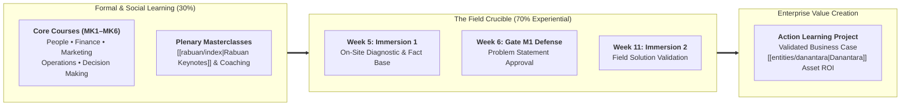

  

    
  

  

    Program Presiden Untuk Pemimpin Masa Depan &bull; Action Learning Project
    <h2 class="program-crest-title">Business Immersion 1: On-Site Diagnostic Field Immersion</h2>
    
Pelaksanaan Kunjungan Lapangan Diagnostik &bull; 7 Oktober 2026 &bull; SBM ITB &bull; 10 Mitra Strategis BUMN

  

> _"Tukang bangunan yang tahu menggunakan alat, belum tentu bisa membuat rumah. Hanya pengalaman dalam membuat rumah maka ia dapat menggunakan keahliannya."_  
> — **The Carpenter Analogy**, [[program/action-learning-project|Action Learning Project (ALP) Blueprint]]

On **October 7, 2026** (Week 5 of the MBA curriculum), all **385 executive participants** of **P3MD Batch I Soedirman** departed Kampus DCU Nawasena to execute **Business Immersion 1**—the inaugural field diagnostic milestone of the 16-week **Action Learning Project (ALP)**. Deployed in 40 cross-functional syndicates across **10 partner state-owned enterprises (BUMN)**, participants moved from theoretical classroom models into active industrial sites, command centers, power complexes, container terminals, and grassroots branch networks.

---

## 🧭 The Immersion Architecture within the 70-20-10 Model

As codified in the [[program/learning-journey|Learning Journey Architecture]], the P3MD MBA allocates **360 contact hours** across the 9 weeks of Business Immersion, making it the single most intensive experiential learning crucible of the program:

---

## 📊 Full-Cohort Census & Distribution Matrix ($N = 385$)

Every participant submitted a structured reflective diagnostic report evaluating the host enterprise across four dimensions: (1) _Business Landscape & Revenue Models_, (2) _Core Operational Challenges & Hypothesized Causes_, (3) _Key Strategic & S&OP Insights_, and (4) _Personal Behavioral Commitments_.

An automated census across all **385 submitted dossiers** establishes the distribution across the 10 partner BUMN hosts:

| Host Enterprise / Immersion Site                                                                                  | Target Facilities & Operational Units                                      |   Assigned Syndicates   | Submissions ($N = 385$) | Primary Strategic Focus in Field Diagnostics                                                                |
| :---------------------------------------------------------------------------------------------------------------- | :------------------------------------------------------------------------- | :---------------------: | :---------------------: | :---------------------------------------------------------------------------------------------------------- |
| **[[program/alp/business-immersion-1/jasa-marga\|PT Jasa Marga (Persero) Tbk]]**                                  | JMTC Command Center, Jagorawi & Cikampek Corridors, Rest Area Travoy       |   Kelompok 1, 2, 3, 4   |     **53** (13.8%)      | Intelligent traffic management, SPM road quality, rest area commercialization, peak surge pricing.          |
| **[[program/alp/business-immersion-1/bank-rakyat-indonesia\|PT Bank Rakyat Indonesia (Persero) Tbk]]**            | BRI Micro Outlets (Unit), AgenBRILink, Holding Ultra Mikro (Pegadaian/PNM) | Kelompok 5, 10, 15, 20  |     **40** (10.4%)      | Rural cash liquidity float, Mantri digital productivity (BRISPOT), Kupedes vs KUR credit risk underwriting. |
| **[[program/alp/business-immersion-1/sig-solusi-bangun-indonesia\|SIG / PT Solusi Bangun Indonesia (Narogong)]]** | Rotary Kiln Lines, Nathabumi Waste-to-Energy, Municipal RDF Facility       | Kelompok 26, 27, 28, 29 |     **39** (10.1%)      | Clinker thermal substitution, municipal Refuse-Derived Fuel (RDF), overcapacity pricing, green cement.      |
| **[[program/alp/business-immersion-1/bank-syariah-indonesia\|PT Bank Syariah Indonesia Tbk (BSI)]]**              | Treasury & Global Markets, Sharia Liquidity, Wholesale Financing           | Kelompok 25, 30, 35, 40 |     **39** (10.1%)      | Non-conventional liquidity hedging, Sukuk instruments, Sharia contract governance (_Murabahah/Musyarakah_). |
| **[[program/alp/business-immersion-1/pupuk-indonesia\|PT Pupuk Indonesia & Pupuk Kujang]]**                       | Kujang 1A/1B Ammonia-Urea Plants, Line III Warehouses, Retail Kiosks (KPL) | Kelompok 31, 32, 33, 34 |      **38** (9.9%)      | S&OP planting seasonality, i-Pubers farmer allocation verification, Line I–IV inventory holding costs.      |
| **[[program/alp/business-immersion-1/injourney\|InJourney (PT Aviasi Pariwisata Indonesia)]]**                    | InJourney Airports, Airside Operations, Sarinah Cultural Department Store  |  Kelompok 6, 7, 8, 14   |      **38** (9.9%)      | Baggage turnaround velocity, non-aeronautical revenue yield, MSME retail curatorial integration.            |
| **[[program/alp/business-immersion-1/pelabuhan-indonesia\|PT Pelabuhan Indonesia (Pelindo)]]**                    | Tanjung Priok Container Terminal, STS Cranes, Automated Terminal Gates     | Kelompok 36, 37, 38, 39 |      **38** (9.9%)      | Container dwell time reduction, quay crane gross moves per hour (GMPH), hinterland road/rail connectivity.  |
| **[[program/alp/business-immersion-1/pln-nusantara-power\|PT PLN Nusantara Power (Muara Karang)]]**               | Blok 1–3 Combined Cycle (PLTGU), 500 kV Ring Substation, Control Rooms     | Kelompok 16, 21, 22, 24 |      **34** (8.8%)      | Merit order dispatch, LNG fuel price volatility, Greater Jakarta VVIP grid stability, biomass co-firing.    |
| **[[program/alp/business-immersion-1/telkom-neutradc\|Telkom Indonesia (NeutraDC Sentul)]]**                      | Sentul Hyperscale Data Center, Server Halls, Danantara Asset Optimization  | Kelompok 17, 18, 19, 23 |      **33** (8.6%)      | Power Usage Effectiveness (PUE $< 1.3$), data sovereignty compliance, idle state property monetization.     |
| **[[program/alp/business-immersion-1/pertamina-patra-niaga\|PT Pertamina Patra Niaga (ITJ Plumpang)]]**           | Receiving Pipeline Manifolds, Storage Tank Farm, 24/7 Road Tanker Gantries | Kelompok 9, 11, 12, 13  |      **33** (8.6%)      | 24/7 Greater Jakarta fuel dispatch, pipeline automation, buffer zone community safety, losses threshold.    |
| **Total Cohort Census**                                                                                           | **10 Partner BUMN Enterprises**                                            |    **40 Syndicates**    |   **385 Submissions**   | **100.0% Verified Census**                                                                                  |

---

## 🏛️ Cross-Cohort Comparative Synthesis: 4 Universal Enterprise Themes

Across the 385 reflections, four universal operational and governance tensions emerged regardless of whether participants visited a power plant, a container terminal, or a retail micro-bank:

### 1. The Digital-Physical Execution Gap

Every visited enterprise possessed sophisticated digital front-ends (_i-Pubers_ in Pupuk Indonesia, _BRISPOT_ in BRI, _JMTC/Travoy_ in Jasa Marga, _MyPertamina_ in Pertamina, _BYOND_ in BSI). However, field immersion exposed that digital systems routinely fail at the "last meter" if ground operational realities are misaligned.

- In fertilizer, farmers with valid state allocations were turned away because regional telecommunications blackouts prevented biometric verification.
- In toll operations, electronic toll collection (ETC) sensors stalled because non-standard freight trucks entered narrow passenger car lanes.
- **Cohort Consensus**: Digitalization is not software deployment; it is the rigorous synchronization of data flows with physical human workflows.

### 2. The [[concepts/pso-commercial-duality|Public Service Obligation (PSO) vs Commercial Duality]]

Participants witnessed firsthand the acute balance sheet strain born from state development mandates:

- Subsidized tariffs require state budget reimbursements that often lag actual cash outlays by 6 to 9 months, creating multi-trillion rupiah working capital financing burdens.
- Enterprises must aggressively grow commercial market share (unsubsidized fertilizers, corporate banking, commercial cloud, high-octane fuels) to generate the cash flow required to subsidize public missions.

### 3. Operational Safety, Decarbonization & Tail-Risk

Visits to high-hazard facilities (ITJ Plumpang fuel tanks, Muara Karang high-pressure steam boilers, Narogong $1400^\circ\text{C}$ cement kilns, Tanjung Priok heavy quay cranes) made systemic risk visceral:

- Operational history without an accident is not proof of safety (reflecting [[rabuan/2026-09-30-buckingham-minto-method|Nassim Taleb's Turkey Illusion]]).
- Industrial decarbonization cannot rely on slogans; it requires capital-intensive engineering adjustments such as municipal waste Refuse-Derived Fuel (RDF) substitution and thermal co-processing.

### 4. The "External Eye" Cross-BUMN Cross-Pollination

Because syndicates were intentionally composed of executives from outside the host enterprise's industry (e.g. mining engineers from MIND ID visiting a micro-bank; telecom managers visiting a cement kiln; railway officers visiting a fuel terminal), participants applied fresh analytical paradigms:

- Mining and plantation executives scrutinized the preventive maintenance schedules and spare-part inventories of power turbines and port cranes.
- Financial executives mapped the working capital cash conversion cycles embedded in fertilizer distribution and toll concession debt recycling.

---

## 🗂️ Master Navigation: The 10 Company Immersion Dossiers

Explore the complete field diagnostic findings, operational exhibits, core challenges, and cross-BUMN benchmarks across each of the 10 host state enterprises:

  

    <h3>[[program/alp/business-immersion-1/jasa-marga|1. PT Jasa Marga (Persero) Tbk]]</h3>
    
<strong>Corridors & Toll Command Center (JMTC)</strong> &bull; Syndicates 1, 2, 3, 4 (53 Submissions) 
    Real-time intelligent traffic management, SPM compliance, rest area Travoy monetization, and multi-lane free flow (MLFF) transition.

  

  

    <h3>[[program/alp/business-immersion-1/bank-rakyat-indonesia|2. PT Bank Rakyat Indonesia (Persero) Tbk]]</h3>
    
<strong>Micro Business & Ultra-Micro Holding</strong> &bull; Syndicates 5, 10, 15, 20 (40 Submissions) 
    BRI Unit branch economics, AgenBRILink cash liquidity float, Mantri digital productivity (BRISPOT), and Kupedes commercial micro-lending.

  

  

    <h3>[[program/alp/business-immersion-1/injourney|3. InJourney (PT Aviasi Pariwisata Indonesia)]]</h3>
    
<strong>Airports & Sarinah Cultural Ecosystem</strong> &bull; Syndicates 6, 7, 8, 14 (38 Submissions) 
    Airside movement punctuality, non-aeronautical retail yield, passenger dwell experience, and domestic MSME curatorial commerce.

  

  

    <h3>[[program/alp/business-immersion-1/pertamina-patra-niaga|4. PT Pertamina Patra Niaga (ITJ Plumpang)]]</h3>
    
<strong>Integrated Terminal Jakarta Plumpang</strong> &bull; Syndicates 9, 11, 12, 13 (33 Submissions) 
    24/7 Greater Jakarta fuel supply continuity, pipeline receipts from RU VI Balongan, automated gantry dispatch, and buffer zone safety.

  

  

    <h3>[[program/alp/business-immersion-1/pln-nusantara-power|5. PT PLN Nusantara Power (UP Muara Karang)]]</h3>
    
<strong>Combined Cycle Power Complex (PLTGU)</strong> &bull; Syndicates 16, 21, 22, 24 (34 Submissions) 
    Merit order dispatch, 2,100 MW baseload and peaking for the national capital, LNG fuel economics, and biomass co-firing.

  

  

    <h3>[[program/alp/business-immersion-1/telkom-neutradc|6. Telkom Indonesia (NeutraDC Sentul)]]</h3>
    
<strong>Hyperscale Data Center & Danantara Synergy</strong> &bull; Syndicates 17, 18, 19, 23 (33 Submissions) 
    Tier IV high-density server halls, PUE energy cooling efficiency, national data sovereignty, and real estate asset monetization.

  

  

    <h3>[[program/alp/business-immersion-1/bank-syariah-indonesia|7. PT Bank Syariah Indonesia Tbk (BSI)]]</h3>
    
<strong>Treasury, Global Markets & Islamic Banking</strong> &bull; Syndicates 25, 30, 35, 40 (39 Submissions) 
    Sharia liquidity hedging without conventional derivatives, Sukuk underwriting, halal supply chain financing, and digital retail onboarding.

  

  

    <h3>[[program/alp/business-immersion-1/sig-solusi-bangun-indonesia|8. SIG / PT Solusi Bangun Indonesia (Narogong)]]</h3>
    
<strong>Pabrik Narogong & Nathabumi Waste-to-Energy</strong> &bull; Syndicates 26, 27, 28, 29 (39 Submissions) 
    Rotary kiln thermal co-processing, municipal Refuse-Derived Fuel (RDF), clinker ratio reduction, and cement oversupply pricing strategy.

  

  

    <h3>[[program/alp/business-immersion-1/pupuk-indonesia|9. PT Pupuk Indonesia & PT Pupuk Kujang]]</h3>
    
<strong>Pupuk Kujang Cikampek & S&OP Distribution</strong> &bull; Syndicates 31, 32, 33, 34 (38 Submissions) 
    Multi-echelon Line I–IV buffer inventory, seasonal planting peaks, i-Pubers digital farmer validation, and commercial NPK Nitrea expansion.

  

  

    <h3>[[program/alp/business-immersion-1/pelabuhan-indonesia|10. PT Pelabuhan Indonesia (Pelindo)]]</h3>
    
<strong>Port of Tanjung Priok Container Gateway</strong> &bull; Syndicates 36, 37, 38, 39 (38 Submissions) 
    Ship-to-shore (STS) crane cycle productivity, yard utilization, import container dwell time, and multimodal port-rail dry connectivity.

  

---

## 🔗 Traceability & Governance Links

- **Parent Program Governance**:
  - [[program/action-learning-project|Action Learning Project (ALP) Blueprint & 6 SMART-Gated Stages]]
  - [[program/learning-journey|Learning Journey Architecture & 70-20-10 Model]]
  - [[program/academic-calendar|16-Week Academic & Synchronization Calendar]]
- **Foundational Core Concepts**:
  - [[concepts/pso-commercial-duality|Public Service Obligation (PSO) vs Commercial Viability Duality]]
  - [[concepts/capital-capability-synergy|Capital-Capability Synergy & Financial Discipline Engine]]
  - [[concepts/capacity-cushion|Capacity Cushion & Operational Buffer Sizing]]
  - [[concepts/supply-chain-operations-reference|Supply Chain Operations Reference (SCOR)]]
- **Enterprise Profiles**:
  - [[entities/danantara|PT Danantara Asset Management]]
  - [[entities/index|Master Directory of BUMN Enterprises & Leaders]]
