## 🏢 Host Enterprise & Site Diagnostics

During **Business Immersion 1** on October 7, 2026, **38 executive participants** across **Syndicates 6, 7, 8, and 14** conducted on-site diagnostic investigations into **[[entities/injourney|InJourney (PT Aviasi Pariwisata Indonesia)]]**, focusing on two complementary operating environments: the airside and passenger terminal operations of **InJourney Airports** (Soekarno-Hatta International Airport `CGK`) and the revitalized cultural retail ecosystem of **PT Sarinah** in Central Jakarta.

As Indonesia's national holding company for aviation, hospitality, and destination ecosystems, InJourney orchestrates the full traveler journey under the sovereign asset management umbrella of **[[entities/danantara|Danantara]]**, integrating airports, airlines support, historic hotels, cultural heritage parks, and artisanal retail commerce.

```mermaid
flowchart LR
    subgraph AirsideOps ["Aviation Gateway (InJourney Airports)"]
        direction TB
        A1["<b>Runway & Slot Allocation</b><br/>Airside Aircraft Turnaround"]
        A2["<b>Baggage Handling Systems (BHS)</b><br/>Transfer Velocity & Tracking"]
        A3["<b>Security & Boarding Flow</b><br/>Passenger Dwell Management"]
    end

    subgraph CommercialEngine ["Non-Aero Revenue Optimization"]
        direction TB
        C1["<b>Terminal Retail & Dining</b><br/>Duty-Free & Curated Dining"]
        C2["<b>Advertising & Concessions</b><br/>Digital Out-of-Home Yield"]
        C3["<b>Passenger Experience Design</b><br/>[[concepts/service-blueprinting|Service Blueprinting]]"]
    end

    subgraph CulturalRetail ["Cultural Showcase (Sarinah)"]
        direction TB
        S1["<b>MSME Curation & Incubation</b><br/>Export-Grade Handicrafts"]
        S2["<b>Heritage Gastronomy</b><br/>Authentic Indonesian Flavors"]
        S3["<b>Omnichannel Tourist Commerce</b><br/>Cross-Destination Loyalty"]
    end

    AirsideOps ==> CommercialEngine
    CommercialEngine <==> CulturalRetail
```

---

## 🔄 Business Landscape & Value Delivery Architecture

1. **Unit & Functional Mandate**:
   - InJourney coordinates the full visitor value chain, ensuring that airport infrastructure operates with international safety, punctuality, and seamless transfer efficiency while transforming transit spaces and heritage landmarks into high-margin commercial and cultural retail showcases.
2. **Product & Customer Segments**:
   - _Core Products_: Aeronautical services (runway landing, aircraft parking, passenger security screening), non-aeronautical services (terminal retail leasing, premium lounges, duty-free concessions, advertising), and curated cultural merchandising (_Sarinah_).
   - _Customer Profiles_: Domestic business travelers, international tourists, commercial airline operators, air freight cargo forwarders, and Indonesian micro, small, and medium enterprise (MSME) artisans.
3. **Revenue Model & Value Generation**:
   - Regulated aeronautical fees (Passenger Service Charges / PJP2U, aircraft landing and parking fees) which provide baseline operational cash flows.
   - High-margin non-aeronautical revenues (percentage-of-sales retail tenant concessions, premium advertising, parking fees, hotel lodging, and retail sales margins at Sarinah), driving consolidated EBITDA expansion.

---

## ⚠️ Core Operational & Strategic Bottlenecks

A synthesis of the diagnostic observations submitted by the 38 participants identifies three primary operational challenges:

| Core Operational Challenge                                       | Observed Business Impact                                                                                                                                                                                                         | Hypothesized Root Causes                                                                                                                                                                                                                 |
| :--------------------------------------------------------------- | :------------------------------------------------------------------------------------------------------------------------------------------------------------------------------------------------------------------------------- | :--------------------------------------------------------------------------------------------------------------------------------------------------------------------------------------------------------------------------------------- |
| **Baggage Delivery Turnaround Delays & Passenger Congestion**    | First-bag and last-bag delivery times exceeding SLA standards during simultaneous wide-body international flight arrivals, creating severe terminal arrival hall congestion and lowering ASQ (_Airport Service Quality_) scores. | Peak flight clustering within narrow scheduling windows; legacy mechanical sorting bottlenecks across older terminal wings; unintegrated coordination between ground handling contractors and airline staff.                             |
| **Sub-Optimal Non-Aeronautical Revenue Per Passenger**           | Despite millions of transit passengers passing through airport concourses, retail spend per passenger lags leading regional hubs (e.g. Singapore Changi `SIN` or Incheon `ICN`).                                                 | Passenger flow architecture rushing travelers straight to gates without intuitive commercial dwell zones; homogeneous retail brand mix failing to differentiate authentic local culture; lack of personalized digital retail promotions. |
| **MSME Supplier Scalability & Quality Inconsistency at Sarinah** | Stock-outs of high-demand artisanal products and inconsistent reorder lead times, limiting export scaling and enterprise revenue velocity.                                                                                       | Traditional artisans operate as informal micro-workshops without standardized supply chain planning (S&OP); working capital gaps preventing bulk raw material procurement; lack of centralized packaging and fulfillment standards.      |

---

## 💡 Key Strategic & S&OP Insights

1. **The Terminal as a Cultural Theater (Beyond Concrete Infrastructure)**:
   InJourney's strategic advantage over conventional infrastructure operators lies in viewing airports and retail spaces as cultural experience platforms. Applying [[concepts/service-blueprinting|Service Blueprinting]] allows management to choreograph front-stage sensory encounters (Indonesian music, batik aesthetics, culinary storytelling) while engineering seamless back-stage logistics.
2. **The [[concepts/pso-commercial-duality|PSO vs Commercial Duality]] in Tourism Infrastructure**:
   InJourney is mandated to maintain unprofitable pioneer regional airports across outer archipelagic islands to preserve national connectivity, alongside preserving irreplaceable world heritage monuments (such as Candi Borobudur and Prambanan). To finance these heavy public conservation burdens, InJourney must aggressively maximize commercial non-aeronautical yields at high-density gateways like Soekarno-Hatta and Ngurah Rai.
3. **Integrated Tourism Hub Synergy**:
   Connecting airport passenger arrivals directly with InJourney destination hotels, cultural tours, and Sarinah retail concessions creates an enclosed economic multiplier, ensuring that a higher share of tourist spending is retained within state-owned and local enterprise ecosystems.

---

## 👁️ Cross-BUMN Comparative Perspectives ("The External Eye")

Visiting syndicates featured executives from railways (**PT Kereta Api Indonesia**), logistics (**Pelindo**, **Pos Indonesia**), and banking (**BRI**, **Bank Mandiri**):

- **The Railway & Mass Transit Lens**: KAI station managers noted that airport passenger wayfinding and gate congestion could benefit from high-density commuter rail crowd-flow management techniques, including bi-directional automated ticket gates and dynamic queue stanchions.
- **The Maritime & Container Port Lens**: Pelindo port managers drew direct parallels between container dwell time and airport baggage handling: treating baggage containers (ULDs) with port-style yard crane tracking and automated RFID tracing could eliminate missing baggage bottlenecks.
- **The Banking & Fintech Lens**: Bank executives pointed out that Sarinah and InJourney Airports lack an integrated digital loyalty wallet that converts transit travelers into repeat digital e-commerce buyers after they return home.

---

## 🎯 Cohort Commitments & Action Learning Dilemmas

In their personal commitments, participants formulated key research inquiries carried forward into **ALP Stage 2 (Data Gathering)**:

- _Inquiry 1_: What operational interventions in baggage transfer workflows and automated sorting can compress peak arrival baggage wait times to under 15 minutes across all terminals?
- _Inquiry 2_: How can InJourney re-engineer terminal passenger dwell layouts using retail heat-mapping to increase non-aeronautical spend per passenger by $25\%$?
- _Inquiry 3_: What supplier financing and digital inventory consolidation model will enable 500+ local MSME artisans at Sarinah to achieve industrial-grade supply continuity and export scale?

---

## 🔗 Traceability & Directory

- Return to **[[program/alp/business-immersion-1/index|Business Immersion 1 Master Hub]]**
- Enterprise Profile: **[[entities/injourney|InJourney (PT Aviasi Pariwisata Indonesia)]]**
- Foundational Concept: **[[concepts/pso-commercial-duality|Public Service Obligation (PSO) vs Commercial Viability Duality]]**
- Operational Synergy: **[[concepts/service-blueprinting|Service Blueprinting & Front-Stage/Back-Stage Alignment]]**
