## 🏢 Host Enterprise & Site Diagnostics

During **Business Immersion 1** on October 7, 2026, **53 executive participants** across **Syndicates 1, 2, 3, and 4** visited the central operations of **[[entities/pt-jasa-marga|PT Jasa Marga (Persero) Tbk]]**, focusing on the **Jasa Marga Tollroad Command Center (JMTC)** and key arterial corridors of the Greater Jakarta Urban Toll Network (Jagorawi, Jakarta-Cikampek, and Jakarta Outer Ring Road / JORR).

As Indonesia's premier expressway operator managing over 1,260 km of toll roads (~50% of the national operational network), Jasa Marga operates at the vital nexus of national logistics fluidity, urban commuter mobility, and long-term infrastructure asset management under the sovereign **[[entities/danantara|Danantara]]** framework.

```mermaid
flowchart LR
    subgraph Sensing ["JMTC Real-Time Traffic Sensing"]
        direction TB
        S1["<b>CCTV & AI Sensors</b><br/>Automated Incident Detection"]
        S2["<b>Loop Detectors & Radar</b><br/>Vehicle Speed & Density Metrics"]
        S3["<b>Smart Patrol GPS</b><br/>Mobile Field Inspection Units"]
    end

    subgraph Command ["Central Traffic Processing (JMTC)"]
        direction TB
        C1["<b>Traffic Incident Management</b><br/>Tow, Rescue & Medevac Protocol"]
        C2["<b>Dynamic Information Signs (DMS)</b><br/>Route Recommendations & Alerts"]
        C3["<b>Lane Reversible Controls</b><br/>Contraflow & Peak Traffic Gates"]
    end

    subgraph Delivery ["Roadside Value Realization"]
        direction TB
        D1["<b>SPM Quality Assurance</b><br/>Smooth Pavement & Pothole Fixes"]
        D2["<b>Travoy Rest Areas</b><br/>Commercial & MSME Ecosystem"]
        D3["<b>Electronic Toll Collection</b><br/>Automated Barrier Clearance"]
    end

    Sensing ==> Command ==> Delivery
```

---

## 🔄 Business Landscape & Value Delivery Architecture

1. **Unit & Functional Mandate**:
   - The Tollroad Command Center (JMTC) functions as the nerve center for nationwide traffic monitoring, real-time emergency dispatch, and asset surveillance. It ensures that arterial economic corridors maintain target flow speeds, rapid clearance of traffic blockages, and compliance with statutory expressway standards.
2. **Product & Customer Segments**:
   - _Primary Products_: Safe, controlled-access terrestrial mobility corridors, emergency roadside services, automated toll collection points, and commercial rest area services (_Travoy_).
   - _Customer Profiles_: Daily urban commuters, inter-city passenger buses, national freight logistics carriers, and commercial concessionaires operating in rest areas.
3. **Revenue Model & Value Generation**:
   - Core revenue is derived from vehicle toll tariffs regulated by the Ministry of Public Works (PUPR) based on vehicle classification and corridor distance.
   - Non-toll revenues are generated through rest area property leasing, optical fiber right-of-way (ROW) concessions, digital advertising billboards, and mobile travel apps (_Travoy_). Value creation relies on maximizing corridor utilization while minimizing vehicle congestion drag and accident clearance times.

---

## ⚠️ Core Operational & Strategic Bottlenecks

A synthesis of the diagnostic observations submitted by the 53 participants highlights three critical operational dilemmas:

| Core Operational Challenge                                                                                     | Observed Business Impact                                                                                                                              | Hypothesized Root Causes                                                                                                                                                                                       |
| :------------------------------------------------------------------------------------------------------------- | :---------------------------------------------------------------------------------------------------------------------------------------------------- | :------------------------------------------------------------------------------------------------------------------------------------------------------------------------------------------------------------- |
| **Severe Arterial Bottlenecking at Expressway Interchanges** (e.g. Cikunir, Tomang, and Jagorawi merge points) | Recurrent peak-hour gridlock, reduced corridor average speed ($< 30\text{ km/h}$), elevated commuter dissatisfaction, and increased carbon emissions. | Physical geometry limits where multiple traffic streams merge into constrained lane widths; unintegrated feeder road management with local municipal traffic authorities; uncoordinated contraflow scheduling. |
| **Electronic Toll Collection (ETC) Lane Stalls & Queue Spillovers**                                            | Vehicle queues backing up into main expressway lanes, causing secondary accident hazards and barrier processing delays.                               | Non-standard e-toll card read failures; insufficient user card balances; freight trucks with abnormal vehicle heights triggering sensor errors; lack of dynamic multi-lane free flow (MLFF) infrastructure.    |
| **Rest Area Over-Saturation & Parking Inefficiencies during Peak Cycles**                                      | Heavy shoulder parking on the expressway apron near rest area entrances, creating severe accident hazards and blocking throughput lanes.              | Static parking slot allocation without real-time reservation systems; lack of segregated freight vs private vehicle rest zones; commercial tenants overflowing pedestrian thoroughfares.                       |

---

## 💡 Key Strategic & S&OP Insights

1. **Intelligent Transportation Systems (ITS) and Predictive Traffic Management**:
   The JMTC facility proves that managing high-density traffic requires moving from reactive accident response to predictive traffic control. Leveraging historical sensor data and machine learning algorithms allows operators to deploy contraflow lanes and divert freight traffic before gridlock materializes.
2. **The [[concepts/pso-commercial-duality|PSO vs Commercial Duality]] in Expressway Concessions**:
   Jasa Marga must strictly satisfy statutory Minimum Service Standards (_Standar Pelayanan Minimal / SPM_—e.g. zero potholes $> 5\text{ cm}$ within 24 hours, patrol arrival $< 30\text{ minutes}$) regardless of revenue fluctuations, while simultaneously servicing multi-trillion rupiah debt facilities incurred during the Trans-Java expansion.
3. **Asset Monetization via Digital Corridors**:
   Toll roads are no longer merely asphalt corridors. Embedding telecommunication fiber conduits and micro-fulfillment logistics nodes along expressway rights-of-way represents a high-margin revenue frontier that decouples financial returns from pure vehicle volume tariffs.

---

## 👁️ Cross-BUMN Comparative Perspectives ("The External Eye")

Visiting syndicates featured executives from mining (**MIND ID**, **PT Bukit Asam**, **PT Timah**), energy (**Pertamina**, **PLN**), and manufacturing (**Pupuk Indonesia**, **SIG**):

- **The Mining & Heavy Logistics Lens**: Executives accustomed to open-pit heavy haulage noted that expressway maintenance routines could adopt mining-style predictive reliability-centered maintenance (RCM) for asphalt surfaces, utilizing automated laser profilers rather than visual patrol inspections.
- **The Energy & Power Lens**: Power generation specialists compared expressway traffic balancing to electric grid load dispatch: when peak demand spikes at suburban entries, dynamic variable toll pricing (congestion pricing) could act as a financial "demand response" mechanism to flatten peak loads.
- **The Manufacturing Lens**: Plant managers from fertilizer and cement plants observed that rest area supply chains operate with fragmented, uncoordinated vendor deliveries, suggesting that Jasa Marga could establish a centralized consolidation hub for rest area inventory.

---

## 🎯 Cohort Commitments & Action Learning Dilemmas

In their personal commitments, participants formulated key research inquiries carried forward into **ALP Stage 2 (Data Gathering)**:

- _Inquiry 1_: How can Jasa Marga implement a unified dynamic traffic algorithm that balances contraflow gates, variable message signs, and ramp metering to reduce interchange queue delays by $20\%$?
- _Inquiry 2_: What commercial restructuring model for Rest Area Travoy will maximize MSME tenant productivity while eliminating hazardous roadside shoulder parking during holiday peak seasons?
- _Inquiry 3_: How can asset recycling through Danantara infrastructure investment funds (DINFRA) optimize the capital structure of mature toll corridors to fund greenfield regional expansion?

---

## 🔗 Traceability & Directory

- Return to **[[program/alp/business-immersion-1/index|Business Immersion 1 Master Hub]]**
- Enterprise Profile: **[[entities/pt-jasa-marga|PT Jasa Marga (Persero) Tbk]]**
- Related Masterclass: **[[rabuan/2026-09-23-syamsul-infrastruktur|Rabuan: Nation in Motion — Infrastruktur Penggerak Pertumbuhan]]**
- Foundational Concept: **[[concepts/pso-commercial-duality|Public Service Obligation (PSO) vs Commercial Viability Duality]]**
