## 🏢 Host Enterprise & Site Diagnostics

During **Business Immersion 1** on October 7, 2026, **38 executive participants** across **Syndicates 36, 37, 38, and 39** conducted on-site maritime logistics and container operations diagnostic investigations into **[[entities/pt-pelabuhan-indonesia|PT Pelabuhan Indonesia (Persero)]]** at Indonesia's primary maritime gateway: the **Port of Tanjung Priok** (including Jakarta International Container Terminal / JICT and Terminal Petikemas Koja) in North Jakarta.

Following the unified national port merger under **PT Pelabuhan Indonesia (Persero)** and positioned within the sovereign development architecture of **[[entities/danantara|Danantara]]**, Tanjung Priok handles over **$50\%$ of Indonesia's national international containerized trade**. The port acts as the critical choke-point and economic barometer for national manufacturing supply chains, international export competitiveness, and archipelagic domestic inter-island trade.

```mermaid
flowchart LR
    subgraph QuaysideOps ["Berth & Quayside Stevedoring"]
        direction TB
        Q1["<b>Vessel Pilotage & Berthing</b><br/>Tug Assist & Berth Allocation"]
        Q2["<b>Ship-to-Shore (STS) Cranes</b><br/>High-Speed Container Discharge"]
        Q3["<b>Internal Terminal Vehicles</b><br/>Quay-to-Yard Head Trucks"]
    end

    subgraph ContainerYard ["Yard Management & Storage"]
        direction TB
        Y1["<b>Rubber-Tyred Gantry (RTG)</b><br/>Automated Stacking Density"]
        Y2["<b>Dwell Time Control (< 3 Days)</b><br/>Customs Clearance Buffer"]
        Y3["<b>Reefer Cold Chain Storage</b><br/>Continuous Temperature Monitoring"]
    end

    subgraph LandsideInterface ["Landside Gate & Multimodal"]
        direction TB
        G1["<b>Automated Optical Gates (OCR)</b><br/>Biometric Driver Clearance"]
        G2["<b>Toll Expressway Direct Spur</b><br/>Highway Freight Fluidity"]
        G3["<b>Port-Rail Multimodal Line</b><br/>Direct Dry Port Connectivity"]
    end

    QuaysideOps ==> ContainerYard ==> LandsideInterface
```

---

## 🔄 Business Landscape & Value Delivery Architecture

1. **Unit & Functional Mandate**:
   - The container terminal operations manage vessel traffic, ship-to-shore stevedoring, container yard stacking and rehandling, customs inspection facilitation, and landside truck receipt/delivery, ensuring that maritime transport turnaround is maximized and vessel port stays are minimized.
2. **Product & Customer Segments**:
   - _Core Products_: Container stevedoring (handling loaded and empty twenty-foot equivalent units / TEU), vessel mooring and pilotage, container storage and reefer plugging, and inland terminal interchange services.
   - _Customer Profiles_: International container shipping lines (Maersk, MSC, CMA CGM, ONE), domestic inter-island coastal carriers, international freight forwarders, customs brokers, and industrial import/export manufacturers.
3. **Revenue Model & Value Generation**:
   - Container terminal handling charges (Terminal Handling Charges / THC), berth occupancy dues, vessel pilotage fees, and container yard storage tariffs.
   - Value generation relies on **quay crane gross moves per hour (GMPH $> 28\text{ moves/hr/crane})$**, **berth productivity**, and **vessel turnaround time**, converting quayside infrastructure into high-margin logistics throughput.

---

## ⚠️ Core Operational & Strategic Bottlenecks

Diagnostic observations compiled across the 38 participant reports highlight three major structural dilemmas:

| Core Operational Challenge                                          | Observed Business Impact                                                                                                                                                     | Hypothesized Root Causes                                                                                                                                                                                                            |
| :------------------------------------------------------------------ | :--------------------------------------------------------------------------------------------------------------------------------------------------------------------------- | :---------------------------------------------------------------------------------------------------------------------------------------------------------------------------------------------------------------------------------- |
| **Container Yard Congestion & Prolonged Dwell Time**                | Yard occupancy rate (YOR) exceeding optimal thresholds ($> 70\%$), triggering severe crane reshuffling delays, truck waiting lines, and reduced ship discharge productivity. | Cargo owners using the port container yard as inexpensive long-term temporary warehousing instead of clearing cargo to inland dry ports; manual regulatory clearance bottlenecks across non-customs government inspection agencies. |
| **Landside Gate Truck Queuing & Expressway Spillover**              | Hundreds of container chassis trucks idling on terminal access ramps, spilling onto the North Jakarta public toll expressway and delaying exports.                           | Concentrated truck arrivals within narrow evening delivery windows; optical character recognition (OCR) camera read failures on weathered container plates; unintegrated terminal appointment booking systems (TABS).               |
| **Inter-Island Cabotage Imbalance & Empty Container Repositioning** | High domestic logistics costs and freight rates on eastbound routes, inflating consumer commodity prices in eastern Indonesia.                                               | Structural macroeconomic trade imbalance where Java exports manufactured consumer goods to outer islands, but return vessels carry minimal containerized cargo back to Java, necessitating costly empty container repositioning.    |

---

## 💡 Key Strategic & S&OP Insights

1. **Yard Yard Management as a Queuing Theory Problem**:
   Applying the analytical principles of [[concepts/queuing-theory|Queuing Theory]] and [[concepts/littles-law|Little's Law]], participants recognized that when yard utilization exceeds $75\%$, crane unproductive reshuffle moves (_shifting_) increase exponentially. Halving import container dwell time from $3.5$ days to $1.8$ days effectively doubles port capacity without pouring a single cubic meter of new concrete.
2. **The [[concepts/pso-commercial-duality|PSO vs Commercial Duality]] in Maritime Logistics**:
   Pelindo is mandated by the state to develop and operate unprofitable pioneer ports across remote border regions to support national territorial integrity and the Sea Tollway (_Tol Laut_). To subsidize these developmental pioneer routes, Pelindo must operate major gateway terminals like Tanjung Priok, Tanjung Perak, and Belawan with world-class commercial efficiency.
3. **Multimodal Hinterland Dry Port Integration**:
   Solving port congestion requires moving the logistics bottleneck away from the waterfront. Establishing direct port-to-rail corridors connecting Tanjung Priok to inland dry ports (such as Cikarang Dry Port) allows containers to clear customs inland, eliminating truck bottlenecks on urban coastal expressways.

---

## 👁️ Cross-BUMN Comparative Perspectives ("The External Eye")

Visiting syndicates featured executives from mining (**PT Freeport Indonesia**, **PT Vale Indonesia**), telecommunications (**Telkom**), and financial services (**BRI**, **Bank Mandiri**):

- **The Mining & Bulk Materials Lens**: Bulk shipping specialists from Freeport and Vale observed that while container handling uses advanced automated optical scanners, quayside STS cranes could adopt mining-style tele-remote operation centers, allowing crane operators to control quayside cranes from air-conditioned office consoles rather than high-vibration crane cabs.
- **The Telecommunications & Digital Lens**: Telkom executives recommended integrating 5G private cellular networks across the container yard to support autonomous guided vehicles (AGVs) and automated container inventory positioning.
- **The Highway & Transport Lens**: Jasa Marga toll operators analyzed the terminal gate congestion, noting that Pelindo could synchronize its Terminal Appointment Booking System (TABS) directly with highway dynamic message signs (DMS) to meter truck traffic before it enters port access spurs.

---

## 🎯 Cohort Commitments & Action Learning Dilemmas

In their personal commitments, participants formulated key research inquiries carried forward into **ALP Stage 2 (Data Gathering)**:

- _Inquiry 1_: What digital Terminal Appointment Booking System (TABS) and progressive yard storage tariff structure can compress average import container dwell time at Tanjung Priok to under 2.5 days?
- _Inquiry 2_: How can Pelindo, KAI, and customs authorities establish a zero-friction bonded rail corridor to Cikarang Dry Port to remove 1,500 container trucks daily from North Jakarta highways?
- _Inquiry 3_: What cross-BUMN commodity consolidation model can balance domestic eastbound vs westbound container flows to lower national inter-island logistics costs?

---

## 🔗 Traceability & Directory

- Return to **[[program/alp/business-immersion-1/index|Business Immersion 1 Master Hub]]**
- Enterprise Profile: **[[entities/pt-pelabuhan-indonesia|PT Pelabuhan Indonesia (Pelindo)]]**
- Curricular Case: **[[courses/mk4-operations-supply-chain-management/week-05/case-pelindo-tpks-capacity|Case Study: Pelindo and Semarang Container Terminal]]**
- Foundational Concept: **[[concepts/pso-commercial-duality|Public Service Obligation (PSO) vs Commercial Viability Duality]]**
- Analytical Tool: **[[concepts/littles-law|Little's Law & Queuing Dynamics in Yard Bottlenecks]]**
