## 🏢 Host Enterprise & Site Diagnostics

During **Business Immersion 1** on October 7, 2026, **33 executive participants** across **Syndicates 9, 11, 12, and 13** conducted on-site diagnostic investigations into **[[entities/pt-pertamina|PT Pertamina Patra Niaga]]** at its flagship downstream terminal: **Integrated Terminal Jakarta (ITJ Plumpang)** in Rawa Badak Selatan, Koja, North Jakarta.

Operating since 1974 as the commercial and trading subholding anchor of **PT Pertamina (Persero)** within the **[[entities/danantara|Danantara]]** ecosystem, ITJ Plumpang is the single most vital downstream energy hub in Indonesia. It directly supplies over **$20\%$ of national fuel needs** and upwards of **$70\%$ of Greater Jakarta's daily fuel consumption** (Pertalite, Solar, Pertamax Series, and Dexlite).

```mermaid
flowchart LR
    subgraph Intake ["Primary Supply Intake"]
        direction TB
        P1["<b>Pipeline Manifold (CB-I/II)</b><br/>Continuous Feed from RU VI Balongan"]
        P2["<b>Marine Oil Jetty</b><br/>Tanker Discharge from Tanjung Priok"]
    end

    subgraph Storage ["Storage & Quality Control"]
        direction TB
        S1["<b>Tank Farm (24+ Tanks)</b><br/>300,000+ kL Storage Capacity"]
        S2["<b>Automated Fuel Blending</b><br/>Fuel Additive & Biofuel Injections"]
        S3["<b>Terminal Automation System (TAS)</b><br/>Continuous Leak & Level Sensing"]
    end

    subgraph Outbound ["Dispatch & Retail Distribution"]
        direction TB
        O1["<b>Automated Loading Gantries</b><br/>Bottom-Loading Tanker Bays"]
        O2["<b>Fleet Management & ODO</b><br/>Real-Time GPS & Driver Fatigue AI"]
        O3["<b>SPBU Retail Network</b><br/>24/7 Security of Supply"]
    end

    Intake ==> Storage ==> Outbound
```

---

## 🔄 Business Landscape & Value Delivery Architecture

1. **Unit & Functional Mandate**:
   - ITJ Plumpang functions as the primary distribution hub responsible for receiving refined petroleum products from domestic refineries and international vessels, storing strategic energy reserves, performing automated additive blending and quality control, and executing 24/7 road-tanker dispatch to thousands of retail petrol stations (SPBU).
2. **Product & Customer Segments**:
   - _Core Products_: Subsidized fuels (Pertalite, BioSolar), deregulated commercial automotive fuels (Pertamax, Pertamax Turbo, Pertamina Dex), and specialized industrial fuel oils.
   - _Customer Profiles_: General public retail motorists, commercial industrial logistics fleets, public transportation authorities (TransJakarta, KAI), and emergency civil services across Jabodetabek and West Java.
3. **Revenue Model & Value Generation**:
   - Regulated distribution fee reimbursements and statutory compensation margins from the government for subsidized fuels (_BBM Satu Harga_ and public transport mandates).
   - Commercial wholesale and retail fuel trading margins on deregulated premium fuels.
   - Core value creation lies in **guaranteeing zero stockouts** in the national capital while maintaining inventory losses below strict corporate governance benchmarks (_losses threshold $< 0.15\text{--}0.20\%$_).

---

## ⚠️ Core Operational & Strategic Bottlenecks

Diagnostic observations compiled across the 33 participant reports highlight three major structural dilemmas:

| Core Operational Challenge                                      | Observed Business Impact                                                                                                                                                       | Hypothesized Root Causes                                                                                                                                                                                      |
| :-------------------------------------------------------------- | :----------------------------------------------------------------------------------------------------------------------------------------------------------------------------- | :------------------------------------------------------------------------------------------------------------------------------------------------------------------------------------------------------------ |
| **High-Density Urban Encroachment & Buffer Zone Vulnerability** | Severe industrial safety risk and catastrophic tail-risk exposure (as highlighted in previous fire incidents); high public scrutiny and regulatory liability.                  | Historic lack of enforced land-use zoning around critical state assets; informal community settlements building directly against terminal boundary walls; complex socio-political resistance to resettlement. |
| **Road Tanker Dispatch Congestion & Turnaround Friction**       | Tanker trucks queuing on public urban arteries waiting for terminal gantry access during morning shift changes, causing localized traffic congestion and vehicle cycle delays. | Fixed gantry bay capacities during simultaneous peak refilling windows; manual driver physical fitness checks creating check-in bottlenecks; delays in electronic order bill generation.                      |
| **Inventory Shrinkage & Temperature-Induced Variance**          | Measurement discrepancies between pipeline intake volume, storage tank volume, and tanker meter ticket dispensing, complicating financial and tax reconciliation.              | Thermal volume expansion/contraction during ambient temperature swings; calibration drift on legacy mechanical flow meters; vapor recovery system (VRS) efficiency variations.                                |

---

## 💡 Key Strategic & S&OP Insights

1. **Systemic Tail-Risk and the "Turkey Illusion" in Energy Terminals**:
   Connecting directly to the plenary teachings of [[entities/irwan-meilano|Prof. Irwan Meilano]] ([[rabuan/2026-09-30-meilano-systemic-risk|Rabuan 06]]) and [[entities/edward-buckingham|Prof. Edward Buckingham]] ([[rabuan/2026-09-30-buckingham-minto-method|Rabuan 05]]), participants recognized that years of accident-free operations do not guarantee safety. Safety in a high-hazard fuel depot requires continuous stress-testing against low-probability, high-consequence catastrophic events (Black Swans).
2. **The [[concepts/pso-commercial-duality|PSO vs Commercial Duality]] in Downstream Distribution**:
   Pertamina Patra Niaga is legally obligated to guarantee 24/7 fuel availability at every retail SPBU regardless of road blockages, extreme weather, or logistics cost spikes. To prevent this public mandate from draining working capital, the company relies on automated terminal automation systems (TAS) and advanced predictive sales and operations planning (S&OP) to minimize safety buffer inventory holding costs.
3. **Automated Bottom-Loading & Vapor Recovery Systems (VRS)**:
   Transitioning from manual top-loading gantries to automated bottom-loading bays with vapor recovery eliminates hazardous volatile organic compound (VOC) emissions, protects operator health, and reduces hydrocarbon product vaporization loss by over $0.15\%$.

---

## 👁️ Cross-BUMN Comparative Perspectives ("The External Eye")

Visiting syndicates featured executives from mining (**PT Bukit Asam**, **PT Timah**), telecommunications (**Telkom**), and banking (**BRI**, **BSI**):

- **The Mining & Explosives Management Lens**: Mining engineers familiar with high-consequence safety protocols on blast sites commended ITJ Plumpang's fire suppression water curtains, but cautioned that buffer zone enforcement must be treated with military-grade perimeter defense rather than civilian fencing.
- **The Telecommunications & IoT Lens**: Telkom data specialists recommended deploying IoT thermal imaging cameras and acoustic gas leak sensors directly along pipeline manifolds to automate leak detection before human patrol discovery.
- **The Banking & Audit Lens**: Financial executives analyzed the daily multi-billion rupiah fuel reconciliation protocols, emphasizing that pairing flow meter readings with blockchain-verified dispatch certificates would eliminate inventory accounting disputes with the Ministry of Finance.

---

## 🎯 Cohort Commitments & Action Learning Dilemmas

In their personal commitments, participants formulated key research inquiries carried forward into **ALP Stage 2 (Data Gathering)**:

- _Inquiry 1_: What technical buffer-zone buffer design (physical blast walls, green acoustic corridors, land-swap logistics parks) can permanently resolve community proximity risk at ITJ Plumpang?
- _Inquiry 2_: How can Pertamina Patra Niaga deploy dynamic algorithmic tanker scheduling (_Smart Dispatch 2.0_) to eliminate road tanker street queuing and compress terminal turnaround time to under 45 minutes?
- _Inquiry 3_: What digital sensor upgrades across storage tanks and gantry flow meters will compress distribution inventory losses to below $0.08\%$ across Greater Jakarta?

---

## 🔗 Traceability & Directory

- Return to **[[program/alp/business-immersion-1/index|Business Immersion 1 Master Hub]]**
- Enterprise Profile: **[[entities/pt-pertamina|PT Pertamina (Persero)]]**
- Foundational Concept: **[[concepts/pso-commercial-duality|Public Service Obligation (PSO) vs Commercial Viability Duality]]**
- Plenary Reference: **[[rabuan/2026-09-30-meilano-systemic-risk|Rabuan 06: The Shifting Ground: Systemic Risk Governance & Institutional Resilience]]**
