## 🏢 Host Enterprise & Site Diagnostics

During **Business Immersion 1** on October 7, 2026, **34 executive participants** across **Syndicates 16, 21, 22, and 24** conducted field diagnostic investigations into **[[entities/pt-pln-persero|PT PLN Nusantara Power]]** at its premier generation facility: **Unit Pembangkitan (UP) Muara Karang** in Pluit, Penjaringan, North Jakarta.

As the critical generation subholding anchor of **PT PLN (Persero)** operating within the sovereign portfolio of **[[entities/danantara|Danantara]]**, UP Muara Karang operates modern combined-cycle gas and steam turbine power plants (PLTGU Blok 1, 2, and 3) delivering an installed capacity of **2,177 MW**. Sited strategically on the northern coast of Jakarta, UP Muara Karang guarantees the baseload electrical resilience, spinning reserve, and black-start restoration capability for Indonesia's sovereign decision-making nerve center (including Istana Kepresidenan, MPR/DPR, Bank Indonesia, international airports, and vital data centers).

```mermaid
flowchart LR
    subgraph PrimaryFuel ["Fuel Sourcing & Logistics"]
        direction TB
        F1["<b>Piped Natural Gas & LNG</b><br/>FSRU Jawa Satu & Nusantara Regas"]
        F2["<b>Fuel Oil Storage (HSD)</b><br/>Emergency Reserve Backup"]
    end

    subgraph Generation ["Combined Cycle Blocks (PLTGU)"]
        direction TB
        G1["<b>Gas Turbines (Brayton Cycle)</b><br/>High-Velocity Gas Combustion"]
        G2["<b>Heat Recovery Steam Generator</b><br/>Waste Heat Absorption (HRSG)"]
        G3["<b>Steam Turbines (Rankine Cycle)</b><br/>Secondary Generation Efficiency"]
    end

    subgraph Transmission ["Grid Integration & Delivery"]
        direction TB
        T1["<b>150 kV & 500 kV Substation</b><br/>Interconnected Java-Bali Grid"]
        T2["<b>Merit Order Load Dispatch</b><br/>Automated Frequency Control"]
        T3["<b>VVIP Ring & Hyperscale Hubs</b><br/>Zero-Blackout Guarantee"]
    end

    PrimaryFuel ==> Generation ==> Transmission
```

---

## 🔄 Business Landscape & Value Delivery Architecture

1. **Unit & Functional Mandate**:
   - UP Muara Karang operates to provide highly reliable, flexible electrical energy into the 150 kV and 500 kV Greater Jakarta transmission grid. It provides fast-ramping peaking capacity to follow rapid urban load changes and maintains black-start capability to restore the regional power grid in the event of a catastrophic blackout.
2. **Product & Customer Segments**:
   - _Core Products_: Active electrical energy (MWh), reactive power voltage support (MVAr), spinning reserve capacity, and emergency grid black-start services.
   - _Customer Profiles_: The PLN Java-Madura-Bali Load Dispatch Center (P2B Gandul), commercial business districts (Sudirman-Thamrin-Kuningan), international transport hubs, industrial zones, and residential consumers across Jakarta and Banten.
3. **Revenue Model & Value Generation**:
   - Internal power purchase agreement (PPA) tariffs settled with holding company PLN, structured around **Capacity Charges** (reimbursing capital expenditures and fixed maintenance costs for plant availability) and **Energy Charges** (reimbursing variable fuel and operating costs based on actual dispatch).
   - Core value creation relies on **thermal heat-rate efficiency** (minimizing fuel consumption per generated kWh) and **Equivalent Availability Factor (EAF $> 90\%$)**.

---

## ⚠️ Core Operational & Strategic Bottlenecks

Diagnostic observations compiled across the 34 participant dossiers reveal three primary operating tensions:

| Core Operational Challenge                                     | Observed Business Impact                                                                                                                                                       | Hypothesized Root Causes                                                                                                                                                                                                                  |
| :------------------------------------------------------------- | :----------------------------------------------------------------------------------------------------------------------------------------------------------------------------- | :---------------------------------------------------------------------------------------------------------------------------------------------------------------------------------------------------------------------------------------- |
| **Primary Fuel Supply Volatility & Take-or-Pay LNG Contracts** | High operational generation costs during periods of gas supply pressure or when forced to burn expensive backup High Speed Diesel (HSD), compressing operating margins.        | Dependence on long-distance offshore pipeline supply and Floating Storage Regasification Units (FSRU); rigid Take-or-Pay contractual minimums that penalize the plant if grid dispatch lowers plant load.                                 |
| **Merit Order Dispatch Conflicts vs Reserve Readiness**        | Running thermal gas plants at low partial-load capacity during daytime solar/renewable peaks lowers plant thermal efficiency, causing higher wear-and-tear per generated unit. | Grid economic merit-order protocols prioritizing low-marginal-cost renewable and mine-mouth coal power over combined-cycle gas plants; lack of specific ancillary service tariffs compensating gas plants for spinning reserve readiness. |
| **Marine Coastal Siltation & Condenser Cooling Water Fouling** | Reduced heat transfer efficiency in condenser cooling tubes, leading to elevated turbine backpressure, forced power derating, and frequent maintenance downtime.               | Coastal sedimentation and marine trash accumulation in the Jakarta Bay intake canals; bio-fouling from barnacles and algae requiring continuous chemical dosing and manual trash-rack dredging.                                           |

---

## 💡 Key Strategic & S&OP Insights

1. **Combined-Cycle Thermodynamic Efficiency**:
   UP Muara Karang showcases the industrial power of thermodynamic compounding: capturing high-temperature exhaust heat ($> 550^\circ\text{C}$) from Brayton-cycle gas turbines using Heat Recovery Steam Generators (HRSG) to power Rankine-cycle steam turbines boosts overall thermal plant efficiency from $38\%$ to over **$58\%$** without consuming additional fuel.
2. **The [[concepts/pso-commercial-duality|PSO vs Commercial Duality]] in Power Generation**:
   PLN must guarantee universal electricity access and stable end-consumer tariffs (_Tarif Tenaga Listrik / TTL_) frozen by the state, while absorbing international commodity price volatility on LNG, coal, and imported gas turbine replacement parts. Sustaining corporate financial health requires continuous cost optimization through [[concepts/capacity-cushion|capacity cushion modeling]] and predictive overhaul cycles.
3. **Decarbonization Through Hydrogen & Biomass Co-Firing**:
   The path toward Net Zero Emissions for gas utilities does not require immediate plant decommissioning; modern gas turbines at Muara Karang are engineered to pilot green hydrogen co-firing and industrial heat integration, serving as the bridge to a clean energy future.

---

## 👁️ Cross-BUMN Comparative Perspectives ("The External Eye")

Visiting syndicates featured executives from mining (**PT Timah**, **PT Vale Indonesia**), telecommunications (**Telkom**), and banking (**BRI**, **Bank Mandiri**):

- **The Mining & Smelting Lens**: Mineral processing engineers noted that UP Muara Karang's predictive vibration analysis on multi-stage turbine shafts represents a gold standard that BUMN nickel and aluminum smelters could adopt to eliminate unplanned smelter freeze-ups.
- **The Telecommunications & Hyperscale Cloud Lens**: Telkom data center engineers pointed out that data centers require ultra-reliable power feeds: UP Muara Karang could partner directly with nearby data center hubs to provide dedicated private behind-the-meter clean energy connections, bypassing public grid congestion.
- **The Banking & Project Finance Lens**: Corporate bankers analyzed the multi-trillion rupiah capital expenditure loans financing Blok 3 PLTGU, observing that renegotiating fuel indexation covenants could shield PLN from international currency fluctuations.

---

## 🎯 Cohort Commitments & Action Learning Dilemmas

In their personal commitments, participants formulated key research inquiries carried forward into **ALP Stage 2 (Data Gathering)**:

- _Inquiry 1_: What digital thermal management systems and intake water filtration retrofits can prevent condenser heat-rate degradation and save Rp 40+ billion annually in fuel waste?
- _Inquiry 2_: How can PLN formulate an Ancillary Services Compensation Tariff to ensure that gas plants providing essential grid frequency stabilization and spinning reserves are rewarded independently of volumetric generation?
- _Inquiry 3_: What blended-finance framework through Danantara can accelerate the co-firing transition of gas turbines toward green hydrogen without impairing PLN's debt-service coverage ratio?

---

## 🔗 Traceability & Directory

- Return to **[[program/alp/business-immersion-1/index|Business Immersion 1 Master Hub]]**
- Enterprise Profile: **[[entities/pt-pln-persero|PT Perusahaan Listrik Negara (Persero)]]**
- Foundational Concept: **[[concepts/pso-commercial-duality|Public Service Obligation (PSO) vs Commercial Viability Duality]]**
- Operational Synergy: **[[concepts/capacity-cushion|Capacity Cushion & Power Generation Reserve Sizing]]**
