## 🏢 Host Enterprise & Site Diagnostics

During **Business Immersion 1** on October 7, 2026, **38 executive participants** across **Syndicates 31, 32, 33, and 34** conducted on-site manufacturing, supply chain, and retail distribution diagnostic investigations into **[[entities/pt-pupuk-indonesia|PT Pupuk Indonesia (Persero)]]** and its operating subsidiary, **PT Pupuk Kujang**, at the **Kawasan Industri Kujang Cikampek** in Karawang, West Java.

As the state-owned fertilizer holding company anchoring national food security and agricultural productivity under the sovereign oversight of **[[entities/danantara|Danantara]]**, Pupuk Indonesia operates the Cikampek manufacturing complex (comprising the Kujang 1A and 1B ammonia and urea plants, NPK compound blending facilities, and regional distribution warehouses). The complex supplies essential plant nutrients across the primary rice-producing agricultural heartlands of West Java, DKI Jakarta, and Banten.

```mermaid
flowchart LR
    subgraph Manufacturing ["Synthesis & Plant Gate (Line I)"]
        direction TB
        M1["<b>Natural Gas Feedstock</b><br/>H2 Extraction & Ammonia Synthesis"]
        M2["<b>Urea & NPK Granulation</b><br/>Capital-Intensive Continuous Plants"]
        M3["<b>Line I Plant Warehouse</b><br/>Bagging Lines & Bulk Rail Dispatch"]
    end

    subgraph LogisticsEchelon ["Multi-Echelon Distribution (Line II & III)"]
        direction TB
        L1["<b>Provincial Hubs (Line II)</b><br/>Regional Demand Buffers"]
        L2["<b>Regency Warehouses (Line III)</b><br/>Distributor Stock Holding"]
        L3["<b>Transportation Network</b><br/>Vessel Fleets, Rail & 3PL Trucks"]
    end

    subgraph RetailPoint ["Field Last-Mile & Farmer (Line IV & V)"]
        direction TB
        R1["<b>Authorized Kiosks (Line IV / KPL)</b><br/>Point-of-Sale Redemption Hubs"]
        R2["<b>Digital Validation (i-Pubers)</b><br/>e-KTP & Face Scanning Verification"]
        R3["<b>Smallholder Farmers (Line V)</b><br/>Seasonal Crop Planting Cycles"]
    end

    Manufacturing ==> LogisticsEchelon ==> RetailPoint
```

---

## 🔄 Business Landscape & Value Delivery Architecture

1. **Unit & Functional Mandate**:
   - The Pupuk Kujang manufacturing and supply chain organization operates to synthesize ammonia, urea, and customized compound fertilizers, and coordinate distribution through a regulated 5-echelon supply network to guarantee the **6 Prinsip Tepat**: _Right Quantity, Right Type, Right Time, Right Place, Right Quality, and Right Price_.
2. **Product & Customer Segments**:
   - _Subsidized Portfolio (PSO)_: Subsidized Urea and NPK Phonska distributed exclusively to registered smallholder farmers listed in the Ministry of Agriculture's _e-Alokasi / e-RDKK_ database.
   - _Commercial Portfolio_: Non-subsidized retail fertilizers (NPK Nitrea, customized blends), specialty water-soluble fertilizers, and industrial chemicals (liquid ammonia, dry ice) sold to commercial plantation conglomerates and export buyers.
3. **Revenue Model & Value Generation**:
   - Subsidized product sales settled at government-mandated Maximum Retail Prices (Harga Eceran Tertinggi / HET), with the production and distribution cost variance audited and reimbursed by the Ministry of Finance through the **Subsidi Pupuk** fiscal mechanism.
   - Commercial retail and industrial sales operating on open-market market pricing. Value creation relies on **natural gas energy efficiency ($MMBTU/t\text{ urea}$)** and **supply chain inventory holding cost optimization**.

---

## ⚠️ Core Operational & Strategic Bottlenecks

Diagnostic observations compiled across the 38 participant reports highlight three major structural dilemmas:

| Core Operational Challenge                                         | Observed Business Impact                                                                                                                                                                       | Hypothesized Root Causes                                                                                                                                                                                                                                                  |
| :----------------------------------------------------------------- | :--------------------------------------------------------------------------------------------------------------------------------------------------------------------------------------------- | :------------------------------------------------------------------------------------------------------------------------------------------------------------------------------------------------------------------------------------------------------------------------ |
| **The "Last-Meter" Farmer Redemption Bottleneck under i-Pubers**   | Physical fertilizer bags are available in Line IV kiosk stock, but eligible farmers cannot redeem them when planting rains arrive, creating localized farmer unrest and delayed crop planting. | Inconsistencies between farmer identity data on electronic KTP and national e-Alokasi rosters; cellular connectivity dropouts in rural kiosks; elderly farmers struggling with biometric facial recognition.                                                              |
| **Seasonal Planting Demand Spikes vs Continuous Plant Operations** | High finished-goods inventory holding costs and warehouse congestion during dry non-planting months, followed by acute regional freight truck shortages during planting surge windows.         | Fertilizer synthesis operates as a continuous capital-intensive process ($24/7/365$) that cannot easily throttle output without massive thermal penalties; extreme agricultural seasonality where $70\%$ of annual demand hits within two narrow 6-week planting windows. |
| **Subsidy Reimbursement Lag and Working Capital Financing Drag**   | Multi-trillion rupiah operating cash flow deficits that must be financed through short-term bank credit facilities, generating substantial uncompensated interest expense.                     | Multi-tier government bureaucratic auditing processes (BPKP, Ministry of Agriculture, Ministry of Finance) requiring physical receipt verification before subsidy funds are formally disbursed.                                                                           |

---

## 💡 Key Strategic & S&OP Insights

1. **Sales and Operations Planning (S&OP) as the Master Bridge**:
   Connecting directly to the teachings of [[courses/mk4-operations-supply-chain-management/week-01/index|MK4 Operations & Supply Chain]], participants observed that fertilizer logistics cannot be solved solely through more trucks or larger warehouses. It requires an integrated S&OP mechanism that links regional meteorological monsoon forecasts directly to refinery natural gas scheduling and Line II buffer positioning.
2. **The [[concepts/pso-commercial-duality|PSO vs Commercial Duality]] in Food Security**:
   Pupuk Indonesia bears the statutory burden of national food sovereignty, maintaining strategic national buffer stocks in every regency across Indonesia regardless of profitability. To remain financially self-sustaining without waiting for delayed state subsidy checks, management must aggressively expand the high-margin commercial retail portfolio (such as customized NPK Nitrea for fruit and horticultural crops).
3. **Closing the Information Loop with i-Pubers**:
   Transitioning from manual paper coupons to the **i-Pubers** application (jointly engineered with the Ministry of Agriculture) represents a critical leap in closing Line IV leakage. When properly synchronized with telecommunications coverage, it provides real-time point-of-sale visibility into actual soil application rates.

---

## 👁️ Cross-BUMN Comparative Perspectives ("The External Eye")

Visiting syndicates featured executives from mining (**PT Aneka Tambang**, **PT Inalum**), energy utilities (**PLN**, **Pertamina**), and transport (**Pelindo**, **Jasa Marga**):

- **The Downstream Energy & Fuel Logistics Lens**: Pertamina Patra Niaga executives compared Line I–IV fertilizer distribution to downstream oil distribution: just as fuel terminals utilize automated gantry loading to eliminate manual paperwork, Pupuk Indonesia could equip regional Line III warehouses with automated RFID barcode pallet scanners to track bags down to the retail kiosk.
- **The Port & Terminal Logistics Lens**: Pelindo port managers observed that moving seasonal peak fertilizer volumes via road trucks creates severe highway congestion and elevated carbon emissions. They recommended partnering with Pelindo and KAI to establish containerized maritime-rail multimodal distribution spines directly into agricultural regencies.
- **The Commercial Banking Lens**: Financial executives analyzed the working capital squeeze caused by subsidy reimbursement delays, proposing that state banks structure an automated _Government Subsidy Factoring Facility_ to convert audited delivery slips into immediate operating cash.

---

## 🎯 Cohort Commitments & Action Learning Dilemmas

In their personal commitments, participants formulated key research inquiries carried forward into **ALP Stage 2 (Data Gathering)**:

- _Inquiry 1_: How can Pupuk Indonesia develop an offline-first, store-and-forward architecture for the _i-Pubers_ app to eliminate farmer redemption failures in low-connectivity rural kiosks?
- _Inquiry 2_: What predictive S&OP algorithmic model can dynamically optimize Line II and Line III safety stock levels based on real-time satellite rainfall data, reducing national inventory holding costs by $15\%$?
- _Inquiry 3_: What retail branding and soil-testing advisory strategy will accelerate commercial non-subsidized fertilizer sales among emerging horticultural and plantation smallholders?

---

## 🔗 Traceability & Directory

- Return to **[[program/alp/business-immersion-1/index|Business Immersion 1 Master Hub]]**
- Enterprise Profile: **[[entities/pt-pupuk-indonesia|PT Pupuk Indonesia (Persero)]]**
- Curricular Case: **[[courses/mk4-operations-supply-chain-management/week-01/case-pupuk-indonesia|Case Study: Pupuk Indonesia — Shorten the Chain Without Breaking the Field]]**
- Foundational Concept: **[[concepts/pso-commercial-duality|Public Service Obligation (PSO) vs Commercial Viability Duality]]**
- Operations Framework: **[[concepts/supply-chain-operations-reference|Supply Chain Operations Reference (SCOR)]]**
