## 🏢 Host Enterprise & Site Diagnostics

During **Business Immersion 1** on October 7, 2026, **39 executive participants** across **Syndicates 26, 27, 28, and 29** conducted on-site manufacturing and environmental diagnostic investigations into **[[entities/pt-semen-indonesia|PT Semen Indonesia (Persero) Tbk (SIG)]]** at the **Pabrik Narogong** facility operated by its subsidiary, **PT Solusi Bangun Indonesia Tbk (SBI)**, in Klapanunggal, Bogor, West Java.

As Indonesia's national building materials champion holding over $50\%$ domestic market share and positioned within the sovereign wealth portfolio of **[[entities/danantara|Danantara]]**, SIG operates Pabrik Narogong as an industrial benchmark for heavy manufacturing efficiency, circular economy integration, and industrial decarbonization. The facility features massive raw material limestone quarries, automated raw meal grinding mills, giant pre-calciner rotary kilns operating at over **$1,400^\circ\text{C}$**, and the pioneering **Nathabumi** waste management and municipal Refuse-Derived Fuel (RDF) co-processing facility.

```mermaid
flowchart LR
    subgraph RawIntake ["Raw Materials & Waste Intake"]
        direction TB
        R1["<b>Limestone & Clay Quarrying</b><br/>Crushing & Raw Meal Grinding"]
        R2["<b>Nathabumi RDF Processing</b><br/>Municipal Solid Waste Sorting"]
        R3["<b>Industrial By-Products (FABA)</b><br/>Fly Ash, Bottom Ash & Slag"]
    end

    subgraph ThermalCore ["Rotary Kiln Thermal Core (1400°C)"]
        direction TB
        K1["<b>Pre-Calciner Decarbonation</b><br/>Thermal Alternative Fuel Injection"]
        K2["<b>Clinker Mineral Sintering</b><br/>Alite, Belite & Ferrite Synthesis"]
        K3["<b>Clinker Cooler & Heat Recovery</b><br/>Waste Heat Power Generation"]
    end

    subgraph GrindingFinish ["Finish Grinding & Packaging"]
        direction TB
        F1["<b>Blended Cement Mills</b><br/>Lower Clinker-to-Cement Ratio"]
        F2["<b>Bulk Logistics & Coastal Fleet</b><br/>Rail & Maritime Distribution"]
        F3["<b>Green Cement Products</b><br/>Low-Carbon Construction Mix"]
    end

    RawIntake ==> ThermalCore ==> GrindingFinish
```

---

## 🔄 Business Landscape & Value Delivery Architecture

1. **Unit & Functional Mandate**:
   - Pabrik Narogong operates to produce high-specification hydraulic cements, clinker, and specialized building materials while serving as a regional environmental waste management partner by co-processing municipal and industrial hazardous waste into alternative thermal energy.
2. **Product & Customer Segments**:
   - _Core Products_: Ordinary Portland Cement (OPC), Portland Composite Cement (PCC), specialized low-heat and sulfate-resistant hydraulic cements, ready-mix concrete, and environmental waste destruction services (_Nathabumi_).
   - _Customer Profiles_: National strategic infrastructure developers (IKN Nusantara, Trans-Java, high-speed rail contractors), commercial real estate developers, concrete precast fabricators, and millions of retail individual home builders purchasing bagged cement via retail distributors.
3. **Revenue Model & Value Generation**:
   - High-volume sales of bulk and bagged cement settled through regional distributor networks and corporate B2B contracts.
   - Waste tipping fees and disposal management contracts earned by the Nathabumi division from municipal governments (DKI Jakarta and Bogor Regency) and multinational manufacturing corporations.
   - Value generation relies on **thermal substitution rates (TSR)** (displacing expensive fossil coal with municipal waste) and **clinker factor optimization** (reducing the proportion of energy-intensive clinker per ton of finished cement).

---

## ⚠️ Core Operational & Strategic Bottlenecks

Diagnostic observations compiled across the 39 participant reports highlight three primary industrial tensions:

| Core Operational Challenge                                        | Observed Business Impact                                                                                                                                                                                                                                                                        | Hypothesized Root Causes                                                                                                                                                                                                                                     |
| :---------------------------------------------------------------- | :---------------------------------------------------------------------------------------------------------------------------------------------------------------------------------------------------------------------------------------------------------------------------------------------- | :----------------------------------------------------------------------------------------------------------------------------------------------------------------------------------------------------------------------------------------------------------- |
| **Severe Domestic Cement Market Oversupply & Price War Drag**     | National installed production capacity ($\approx 120\text{ million tons}$) exceeds domestic consumption ($\approx 65\text{--}70\text{ million tons}$) by nearly $40\%$, triggering intense price competition from private aggressive market entrants and depressing plant capacity utilization. | Greenfield capacity additions by foreign competitors during the previous decade; slower-than-expected commercial property market recovery; high transportation logistics costs preventing domestic surplus from reaching export markets economically.        |
| **Moisture Content and Inconsistency in Municipal RDF Feedstock** | Variations in municipal waste quality cause temperature fluctuations inside rotary kilns, forcing operators to temporarily ramp up coal firing and increasing specific thermal energy consumption ($MJ/t\text{ clinker}$).                                                                      | Inadequate upstream household waste segregation at municipal landfills (TPST Bantargebang / Klapanunggal); seasonal monsoon rains elevating municipal solid waste moisture content above $35\%$; mechanical shredder jamming from unclassified heavy debris. |
| **High Clinker Factor in Traditional Consumer Markets**           | Retail consumer perception equates high clinker content with superior cement strength, slowing customer adoption of eco-friendly, lower-clinker blended green cements and limiting carbon reduction speed.                                                                                      | Deeply ingrained contractor and artisan habits favoring traditional OPC/PCC; lack of mandatory green procurement standards in private housing construction; communication gaps regarding hydraulic performance of slag and fly ash blends.                   |

---

## 💡 Key Strategic & S&OP Insights

1. **Thermal Co-Processing as a Double-Bottom-Line Advantage**:
   The Nathabumi facility proves that heavy industry can solve societal environmental crises while expanding operating margins. By consuming pre-processed municipal solid waste as Refuse-Derived Fuel (RDF) in kilns operating at $1,400^\circ\text{C}$, the plant achieves complete thermal destruction of dioxins and furans with zero ash residue, while slashing the factory's fossil coal procurement bill.
2. **The [[concepts/pso-commercial-duality|PSO vs Commercial Duality]] in Heavy Industry**:
   As a state enterprise, SIG is expected to champion national decarbonization commitments (Net Zero targets), absorb regional municipal waste crises, and support national infrastructure projects at regulated government pricing. Simultaneously, it must survive against lean private multinational competitors who do not carry developmental mandates.
3. **Clinker Factor Reduction as the Ultimate Margin & Carbon Lever**:
   Because clinker production generates over **$85\%$ of a cement plant's direct carbon emissions** and consumes nearly all thermal fuel, replacing $10\%$ of clinker with industrial pozzolans, fly ash, and limestone filler directly expands gross margins while lowering carbon intensity per ton of product.

---

## 👁️ Cross-BUMN Comparative Perspectives ("The External Eye")

Visiting syndicates featured executives from mining (**PT Bukit Asam**, **PT Timah**), energy utilities (**PLN**), and logistics (**KAI**, **Pelindo**):

- **The Coal Mining & Power Utility Lens**: Bukit Asam and PLN executives commended SIG's alternative fuel utilization, noting that power plant coal-fired boilers (PLTU) also struggle with Fly Ash and Bottom Ash (FABA) disposal. A direct BUMN circular partnership could channel PLN's power plant FABA directly into SIG's cement mills as free clinker substitutes.
- **The Railway & Freight Transportation Lens**: KAI freight logistics managers observed that transport represents up to **$25\%$ of delivered cement costs**. They proposed expanding unit-train bulk container shipments directly from Pabrik Narogong to distribution terminals in Central and East Java, bypassing congested highway arteries.
- **The Banking & Corporate Finance Lens**: Financial specialists noted that SIG's high fixed-cost manufacturing base makes plant break-even points acutely sensitive to volume. They recommended utilizing [[concepts/cost-volume-profit-analysis|Cost-Volume-Profit (CVP) analysis]] to evaluate whether exporting clinker at marginal cost during seasonal domestic construction lulls protects plant cash flows.

---

## 🎯 Cohort Commitments & Action Learning Dilemmas

In their personal commitments, participants formulated key research inquiries carried forward into **ALP Stage 2 (Data Gathering)**:

- _Inquiry 1_: What automated drying and sorting technology pre-treatment can stabilize municipal RDF moisture content below $20\%$ to boost Pabrik Narogong's Thermal Substitution Rate (TSR) from $15\%$ to over $30\%$?
- _Inquiry 2_: How can SIG structure a closed-loop BUMN industrial symbiosis program that ingests $100\%$ of nearby PLN power plant FABA as raw material inputs, lowering raw material procurement costs by Rp 50+ billion?
- _Inquiry 3_: What market education and contractor certification program will accelerate commercial adoption of low-clinker green cement in private residential construction across West Java?

---

## 🔗 Traceability & Directory

- Return to **[[program/alp/business-immersion-1/index|Business Immersion 1 Master Hub]]**
- Enterprise Profile: **[[entities/pt-semen-indonesia|PT Semen Indonesia (Persero) Tbk (SIG)]]**
- Foundational Concept: **[[concepts/pso-commercial-duality|Public Service Obligation (PSO) vs Commercial Viability Duality]]**
- Operational Synergy: **[[concepts/cost-volume-profit-analysis|Cost-Volume-Profit Analysis & Plant Operating Leverage]]**
