## 🏢 Host Enterprise & Site Diagnostics

During **Business Immersion 1** on October 7, 2026, **33 executive participants** across **Syndicates 17, 18, 19, and 23** conducted field diagnostic investigations into **[[entities/pt-telkom-indonesia|PT Telkom Indonesia (Persero) Tbk]]** at its flagship digital infrastructure asset: the **NeutraDC Sentul Hyperscale Data Center** in Sentul, Bogor, West Java.

Operating under **PT Telkom Data Ekosistem (NeutraDC)**—the data center subholding created under Telkom's "Five Bold Moves" restructuring—and coordinating with **[[entities/danantara|PT Danantara Asset Management]]** for strategic capital allocation, NeutraDC Sentul represents Indonesia's premier sovereign cloud and colocation facility. Built to Tier III and Tier IV design standards, the facility provides high-density computing space, carrier-neutral interconnectivity, and maximum physical/cyber security for national banking networks, government clouds, and international technology hyperscalers.

```mermaid
flowchart LR
    subgraph ResilientPower ["2N Redundant Power Architecture"]
        direction TB
        P1["<b>Dual Grid Feeds (PLN 150 kV)</b><br/>Isolated Transmission Substations"]
        P2["<b>Dynamic Rotary UPS / DRUPS</b><br/>Zero-Interruption Clean Waveforms"]
        P3["<b>On-Site Diesel Generators</b><br/>Continuous 72-Hour Full-Load Fuel"]
    end

    subgraph ServerHalls ["Hyperscale Computing Environment"]
        direction TB
        S1["<b>High-Density Server Halls</b><br/>10–25 kW per Server Rack"]
        S2["<b>Cooling Optimization (PUE < 1.3)</b><br/>Cold/Hot Aisle Containment"]
        S3["<b>Carrier-Neutral Meet-Me-Rooms</b><br/>Domestic & International Fiber Meshes"]
    end

    subgraph ValueEcosystem ["Commercial & Sovereign Delivery"]
        direction TB
        V1["<b>National Data Sovereignty</b><br/>Secure Government Data Centers"]
        V2["<b>Global Cloud Colocation</b><br/>Multi-Tenant Hyperscaler Hosting"]
        V3["<b>Danantara Asset Optimization</b><br/>Real Estate Asset Recycling"]
    end

    ResilientPower ==> ServerHalls ==> ValueEcosystem
```

---

## 🔄 Business Landscape & Value Delivery Architecture

1. **Unit & Functional Mandate**:
   - NeutraDC Sentul operates to provide mission-critical, high-availability server hall colocation, managed power, precision cooling, physical security, and carrier-neutral fiber interconnection to enterprise, governmental, and global technology clients.
2. **Product & Customer Segments**:
   - _Core Products_: Wholesale white-space colocation, dedicated private server suites, high-density power allocation (kW per rack), disaster recovery sites, and direct interconnection cross-connects.
   - _Customer Profiles_: Global cloud providers (AWS, Google Cloud, Microsoft Azure), national state-owned and private financial institutions, telecommunications carriers, and government agencies migrating to the National Data Center (Pusat Data Nasional / PDN).
3. **Revenue Model & Value Generation**:
   - Long-term colocation leases structured on **Recurring Monthly Charges** per rack/suite combined with **Power Usage Pass-Through Charges** based on metered kilowatt-hour (kWh) electricity consumption.
   - Cross-connect cabling interconnection fees. Core value creation relies on **uptime reliability ($99.995\%$ SLA)** and **Power Usage Effectiveness (PUE $< 1.30$)**, converting raw electrical power into high-yield digital hosting revenue.

---

## ⚠️ Core Operational & Strategic Bottlenecks

Diagnostic observations compiled across the 33 participant reports highlight three major structural dilemmas:

| Core Operational Challenge                             | Observed Business Impact                                                                                                                                                                     | Hypothesized Root Causes                                                                                                                                                                                                                        |
| :----------------------------------------------------- | :------------------------------------------------------------------------------------------------------------------------------------------------------------------------------------------- | :---------------------------------------------------------------------------------------------------------------------------------------------------------------------------------------------------------------------------------------------- |
| **High Cooling Power Consumption in Tropical Climate** | Elevated Power Usage Effectiveness (PUE) during peak daytime humidity, increasing operating electricity bills and reducing competitive margin vs regional hubs (e.g. Singapore or Malaysia). | High ambient temperature and humidity in West Java requiring intensive mechanical chiller compression; legacy air-cooling designs reaching thermal capacity limits when hosting dense AI graphic processing units (GPUs $> 30\text{ kW/rack}$). |
| **Long Sales Gestation & Capacity Utilization Lag**    | Substantial capital invested in massive Tier IV physical halls remaining partially unpopulated for 12–24 months, depressing short-term return on invested capital (ROIC).                    | Lengthy enterprise IT migration cycles; complex data sovereignty procurement negotiations with state agencies; intense regional price competition from aggressive private data center operators.                                                |
| **Idle Land & Unmonetized State Property Holdings**    | Carrying costs on peripheral buffer land and sub-optimally utilized real estate around data center perimeters, generating balance sheet drag.                                                | Fragmented property title documentation across historical telecommunications concessions; lack of structured asset monetization frameworks between Telkom and specialized property vehicles.                                                    |

---

## 💡 Key Strategic & S&OP Insights

1. **Thermal Architecture as the Primary Cost Driver**:
   In a hyperscale data center, electricity represents over **$70\%$ of operating expenditures**. The transition from legacy raised-floor room cooling to **Cold Aisle Containment (CAC)** and direct-to-chip liquid cooling represents the difference between a high-cost PUE of $1.6$ and an ultra-efficient PUE below $1.25$, unlocking billions of rupiah in annual margin expansion.
2. **The [[concepts/pso-commercial-duality|PSO vs Commercial Duality]] in National Digital Sovereignty**:
   Under Law No. 27/2022 on Personal Data Protection (UU PDP), Telkom bears the sovereign responsibility of safeguarding critical national public sector and financial data within domestic borders. Simultaneously, NeutraDC must operate as an aggressive, agile commercial player competing against global hyperscale operators for enterprise workloads.
3. **Danantara Capital & Asset Optimization Synergy**:
   Collaborating with **PT Danantara Asset Management** allows Telkom to unlock balance sheet capacity: by transferring physical data center real estate and warehouse assets into an asset-backed infrastructure investment fund, Telkom can recycle equity capital to finance high-margin software and cloud capabilities.

---

## 👁️ Cross-BUMN Comparative Perspectives ("The External Eye")

Visiting syndicates featured executives from power utilities (**PLN**), transportation (**Jasa Marga**, **Pelindo**), and financial services (**BRI**, **BSI**):

- **The Power & Utility Lens**: PLN engineers examined NeutraDC's rotary UPS and emergency generator farms, recommending a formal High-Voltage Industrial Service Level Agreement where PLN provides dedicated dual-substation feeds with automated sub-cycle bus transfer, reducing NeutraDC's reliance on expensive on-site diesel testing.
- **The Banking & Cybersecurity Lens**: Bank risk officers scrutinized NeutraDC's biometric multi-factor physical access mantrap portals, noting that while physical security is impenetrable, the commercial contract must offer bank-grade cyber resilience and compliance guarantees against ransomware outages.
- **The Toll Road & Infrastructure Lens**: Jasa Marga executives recognized that data centers require high-bandwidth fiber connectivity that directly aligns with toll road right-of-way (ROW) conduits, proposing a cross-BUMN partnership to lay dedicated low-latency dark fiber along expressway trunks.

---

## 🎯 Cohort Commitments & Action Learning Dilemmas

In their personal commitments, participants formulated key research inquiries carried forward into **ALP Stage 2 (Data Gathering)**:

- _Inquiry 1_: What liquid cooling engineering retrofit will enable NeutraDC Sentul to host high-density AI computing clusters ($> 30\text{ kW/rack}$) while keeping annual average PUE below $1.25$?
- _Inquiry 2_: What partnership structuring model with Danantara Asset Management will allow Telkom to monetize idle surrounding real estate into a high-yield green digital ecosystem?
- _Inquiry 3_: How can Telkom build an integrated sovereign hybrid cloud offering that accelerates the migration of 40+ state enterprises into secure domestic data centers within 18 months?

---

## 🔗 Traceability & Directory

- Return to **[[program/alp/business-immersion-1/index|Business Immersion 1 Master Hub]]**
- Enterprise Profile: **[[entities/pt-telkom-indonesia|PT Telkom Indonesia (Persero) Tbk]]**
- Sovereign Asset Partner: **[[entities/danantara|PT Danantara Asset Management]]**
- Foundational Concept: **[[concepts/pso-commercial-duality|Public Service Obligation (PSO) vs Commercial Viability Duality]]**
