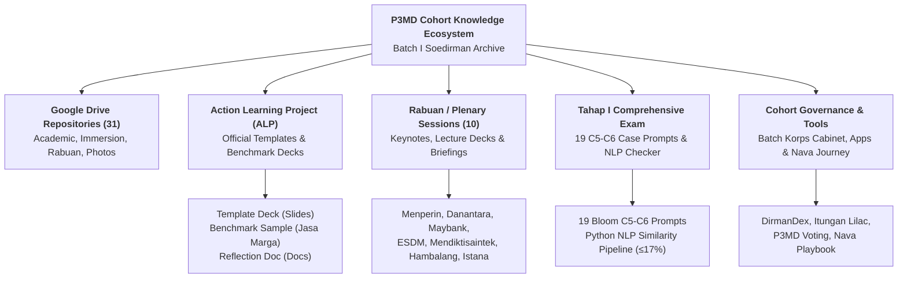
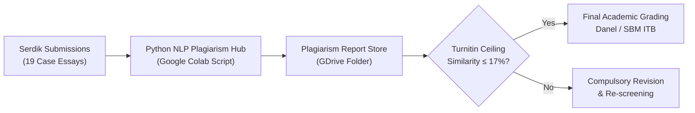
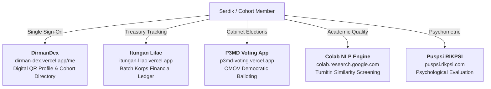
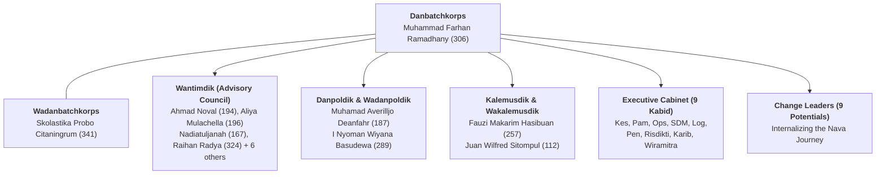

This catalog provides an exhaustive, structured inventory of all digital assets, Google Drive repositories, Action Learning Project (ALP) slide templates, executive plenary (Rabuan) lecture materials, comprehensive examination matrices, cohort governance decrees, custom software applications, and official spreadsheets uncovered from the **P3MD 2026 Batch 1 Soedirman** communication archives (`_chat.txt` and companion document dumps).

> [!NOTE]
> **Authentication Scope & Account Permissions**:
> Many Google Drive folders, Google Forms, and Google Spreadsheets require authentication via active cohort credentials (`@sbm-itb.ac.id`, `@kemhan.go.id`, or official BUMN corporate domains). Access status is tagged accordingly: **Public**, **SBM ITB Auth**, or **Internal Cohort**.

---

## 🧭 Master Resource Architecture

---

## 1. Action Learning Project (ALP) & Business Immersion Suite

The Action Learning Project (ALP) is the core empirical consulting vehicle of P3MD, structured around the 4E Model, Pohon LDP, and 14 formal milestone deliverables (ALP-00 through ALP-07) across 10 partner State-Owned Enterprises (BUMN).

| Asset Name                                 |     Format      | Direct URL / File Reference                                                                                                                                                                                          | Description & Usage                                                                                       |
| :----------------------------------------- | :-------------: | :------------------------------------------------------------------------------------------------------------------------------------------------------------------------------------------------------------------- | :-------------------------------------------------------------------------------------------------------- |
| **ALP Business Immersion Deck Template**   |  Google Slides  | [Template Deck Pemetaan Business Immersion](https://docs.google.com/presentation/d/1AHpKFl8U6YQQB49KOBgeemv1BAlxNsf1/edit)                                                                                           | Official standard presentation deck for Phase 2 Business Immersion mapping.                               |
| **ALP Benchmark Reference Sample Deck**    |  Google Slides  | [ALP-00 Contoh Pengisian - Jasa Marga TCC](https://docs.google.com/presentation/d/1aK1Tf6oj3-l1yQbxW67uC4dqN5quiWbs/edit)                                                                                            | Cohort golden reference sample: Jasa Marga Tollroad Command Center diagnostic mapping.                    |
| **Business Immersion Reflection Template** |   Google Docs   | [Template Refleksi Business Immersion](https://docs.google.com/document/d/1yyETDza_cmYShqEms7iY39yo9DfieHE1UYZNmo8kSv8/edit)                                                                                         | Standardized cohort template for submitting weekly individual and syndicate immersion reflections.        |
| **Panduan Teknis ALP Batch 1 (Final)**     |  PDF (1.3 MB)   | [`00004523-Panduan Teknis ALP Batch 1_130826_FINAL.pdf`](<file:///C:/GitHub/MBA/inbox/textdump/WhatsApp%20Chat%20-%20Umum%20(P3MD%202026%20BATCH%201)/00004523-Panduan%20Teknis%20ALP%20Batch%201_130826_FINAL.pdf>) | Master operational manual covering milestone gates (M1–M3), assessment rubrics, and sponsor expectations. |
| **Immersion Master Deck Serdik P3MD**      | PPTX (17.6 MB)  | [`00004889-Immersion Master Deck Serdik P3MD.pptx`](<file:///C:/GitHub/MBA/inbox/textdump/WhatsApp%20Chat%20-%20Umum%20(P3MD%202026%20BATCH%201)/00004889-Immersion%20Master%20Deck%20Serdik%20P3MD.pptx>)           | Comprehensive deck containing company briefs, site locations, safety SOPs, and syndicate allocations.     |
| **Directory of 40 BUMN Mentors**           |  XLSX (14 KB)   | [`00004893-List 40 Mentor P3MD - BUMN.xlsx`](<file:///C:/GitHub/MBA/inbox/textdump/WhatsApp%20Chat%20-%20Umum%20(P3MD%202026%20BATCH%201)/00004893-List%2040%20Mentor%20P3MD%20-%20BUMN.xlsx>)                       | Complete registry of 40 corporate executives mentoring syndicates across 10 BUMN host sites.              |
| **Pelindo Interactive Flipbook**           | Digital Web App | [Pelindo Immersion Digital Flipbook](https://publuu.com/flip-book/1188358/2650319)                                                                                                                                   | Interactive orientation and operational dossier for maritime logistics immersion.                         |

---

## 2. Plenary & Executive Guest Lecture (Rabuan) Catalog

The weekly Rabuan series connects cohort members with Cabinet Ministers, State-Owned Enterprise Chief Executives, and international academic scholars.

| Session Date          | Keynote Speaker(s)                                                                                                                             | Topic & Strategic Focus                                                                                                                                                   | Official Presentation & Reading Materials                                                                                                                                                                                                                                                                                                                                                                                                                                                                                                          | Submission & Reflection Repositories                                                                                     |
| :-------------------- | :--------------------------------------------------------------------------------------------------------------------------------------------- | :------------------------------------------------------------------------------------------------------------------------------------------------------------------------ | :------------------------------------------------------------------------------------------------------------------------------------------------------------------------------------------------------------------------------------------------------------------------------------------------------------------------------------------------------------------------------------------------------------------------------------------------------------------------------------------------------------------------------------------------- | :----------------------------------------------------------------------------------------------------------------------- |
| **2026-06-09**        | **Dony Oskaria** _Wamen BUMN / COO Danantara_                                                                                              | Transformation of BUMN, establishment of Danantara investment holding, leadership agility.                                                                                | [[rabuan/2026-06-09-oskaria-bumn-transformation-danantara\|Phase 1 Dossier (Reconstructed)]] Q&A Curation Archive                                                                                                                                                                                                                                                                                                                                                                                                                              | [Question Form](https://forms.gle/ZPLawgLQg9qGFGox6)                                                                     |
| **2026-08-19**        | **Agus Gumiwang Kartasasmita** _Menteri Perindustrian RI_                                                                                  | Industrial downstreaming architecture, manufacturing self-reliance, leadership in strategic SOEs.                                                                         | [`00004401-Bahan Menperin.pdf`](<file:///C:/GitHub/MBA/inbox/textdump/WhatsApp%20Chat%20-%20Umum%20(P3MD%202026%20BATCH%201)/00004401-2026-08-18%20Bahan%20Menperin%20terkait%20Kepemimpinan%20BUMN%20final.pdf>) (pre-read) [`00004413-Tayangan Menperin.pptx`](<file:///C:/GitHub/MBA/inbox/textdump/WhatsApp%20Chat%20-%20Umum%20(P3MD%202026%20BATCH%201)/00004413-Rev05%20Bahan%20Tayangan%20Menperin%20P3MD.pptx>) (30.9 MB)                                                                                                              | [intip.in/PembekalanMenperin](https://intip.in/PembekalanMenperin)                                                       |
| **2026-08-31**        | **Pak ADH & Pak Hadjar Seti Adji**                                                                                                             | _PeopleMath_ & _From Learner to Transformer for Legacy_: Quantitative talent modeling ($PPH, SEC, TAL$), BIM, and Blue Ocean construction transformation.                 | [[rabuan/2026-09-02-adh-peoplemath\|Session 1 Dossier (PeopleMath)]] [[rabuan/2026-08-31-hadjar-from-learner-to-transformer\|Session 2 Dossier (Learner to Transformer)]]                                                                                                                                                                                                                                                                                                                                                                       | [GDrive Submissions](https://drive.google.com/drive/folders/1_nGpd8_Pr9E5Qal02DhFYGkNdzIqRCKH)                           |
| **2026-09-02**        | **Dony Oskaria** _COO BPI Danantara / Kepala BP BUMN_                                                                                      | Directorship as a standard, chosen sovereign responsibility, 5 capabilities, Single Grade System, 8 BP BUMN rules, 4-phase turnaround sequencing.                         | [[rabuan/2026-09-02-oskaria-directorship-doctrine\|Phase 2 Dossier (Reconstructed)]]                                                                                                                                                                                                                                                                                                                                                                                                                                                               | Kampus DCU Nawasena Kick-Off                                                                                             |
| **2026-09-04**        | **John Robert Powers**                                                                                                                         | Executive communication, corporate protocol, professional image diplomacy.                                                                                                | Training Manuals                                                                                                                                                                                                                                                                                                                                                                                                                                                                                                                                   | [GDrive Submissions](https://drive.google.com/drive/folders/1G3VJmRoci8CLE2LvPXKvDcWJKqoBDRBQ)                           |
| **2026-09-09 (Morn)** | **Prof. Dr. Aurik Gustomo** _SBM ITB_                                                                                                      | Leading an Ambidextrous Organization: Balancing exploitation with exploratory innovation.                                                                                 | [`00004770-Ambidextrous Org.pptx`](<file:///C:/GitHub/MBA/inbox/textdump/WhatsApp%20Chat%20-%20Umum%20(P3MD%202026%20BATCH%201)/00004770-Leading%20an%20Ambidextrous%20Organization%20P3MD%20by%20Aurik%20Gustomo.pptx>) (22.8 MB)                                                                                                                                                                                                                                                                                                                 | [GDrive Pre-Reading](https://drive.google.com/drive/folders/1m2l75ugtaA86A7W9Sg4WrfcvFwn0suRR)                           |
| **2026-09-09 (Aft)**  | **Mendiktisaintek**                                                                                                                            | Synergy of higher education, scientific research, and national industrial sovereign strategy.                                                                             | [`00004771-Deck Mendiktisaintek.pptx`](<file:///C:/GitHub/MBA/inbox/textdump/WhatsApp%20Chat%20-%20Umum%20(P3MD%202026%20BATCH%201)/00004771-20260909%20-%20Deck%20Mendiktisaintek%20P3MD.pptx>) (16.9 MB)                                                                                                                                                                                                                                                                                                                                         | Nawasena Cohort Archive                                                                                                  |
| **2026-09-16**        | **Dato' (Dr) Nora Manaf** _Group CHCO Maybank_ **Bahlil Lahadalia** _Menteri ESDM RI_                                               | Session 1: Maybank Organizational Transformation Through HR & The People Equation. Session 2: Energy Sovereignty, Downstreaming, and Resource Security.                | [[rabuan/2026-09-16-nora-manaf-people-equation\|Session 1 Dossier (The People Equation)]] [`00004747-ToR Nora & Bahlil.pdf`](<file:///C:/GitHub/MBA/inbox/textdump/WhatsApp%20Chat%20-%20Umum%20(P3MD%202026%20BATCH%201)/00004747-ToR%20P3MD%20Phase%202-Bpk%20Bahlil%20and%20Dato%20Nora.pdf>) [`00004749-Maybank Case.pdf`](<file:///C:/GitHub/MBA/inbox/textdump/WhatsApp%20Chat%20-%20Umum%20(P3MD%202026%20BATCH%201)/00004749-Global%20Case%20People-%20Maybank%20Organisational%20Transformation%20Through%20Human%20Resources.pdf>) | [GDrive Submissions](https://drive.google.com/drive/folders/1wN7QE-Z1IoBghhP1DW-N6OmqlhkzO76z)                           |
| **2026-09-23**        | **Sahala Situmorang** _CFO Danantara_ **Ir. Syamsul** _Stafsus KemenPU RI_                                                          | Session 1: Financial Discipline, Capital Allocation, ROI Quality, Intangibles (Time/Attention/Reputation). Session 2: Nature in Motion (FEW Nexus, Hexa-Helix, PU608). | [`00004838-Nature in Motion PU.pdf`](<file:///C:/GitHub/MBA/inbox/textdump/WhatsApp%20Chat%20-%20Umum%20(P3MD%202026%20BATCH%201)/00004838-Artikel%20-%20Nature%20in%20Motion%20PU%20%20(23%20September%202026).pdf>) [`00004839-Financial Discipline.pdf`](<file:///C:/GitHub/MBA/inbox/textdump/WhatsApp%20Chat%20-%20Umum%20(P3MD%202026%20BATCH%201)/00004839-Artikel%20-%20Memimpin%20Dengan%20Financial%20Discipline%20Managing%20Director%20Finance%20Danantara%20(23%20September%202026).pdf>)                                          | [GDrive Submissions](https://drive.google.com/drive/folders/1YdBxE5zNT3A-wvG01O0jCkfO3MxTzGOs)                           |
| **2026-10-01**        | **Prof. Edward Buckingham** _Monash University_ **Prof. Irwan Meilano** _Wakil Rektor ITB_                                          | Global Strategy, Geopolitical Risk Modeling, and Academic Research Leadership.                                                                                            | [Faculty Bio Monash](https://www.monash.edu/business/our-people/edward-buckingham2)                                                                                                                                                                                                                                                                                                                                                                                                                                                                | [GDrive Submissions](https://drive.google.com/drive/folders/1jIiiD-c2XwpleXde8gUUjyUUczl8Z-zg)                           |
| **2026-10-21**        | **Executive Case Faculty**                                                                                                                     | Video Reflection: Current Socioeconomic Challenges and Transformational Mandate.                                                                                          | [YouTube Video Case Prompt](https://www.youtube.com/watch?v=4pDyQcCj5MM)                                                                                                                                                                                                                                                                                                                                                                                                                                                                           | [GDrive Submissions](https://drive.google.com/drive/folders/1Xgxz1sdhk6_rbAYubDOzWkaLaXiHkvnK)                           |
| **2026-10-31**        | **H.E. Prabowo Subianto** _Presiden Republik Indonesia_                                                                                    | Taklimat Hambalang: Leadership, Article 33 UUD 1945, Long-term SOE Governance, National Wealth Stewardship.                                                               | [`00005221-Daftar Pertanyaan Hambalang.pdf`](<file:///C:/GitHub/MBA/inbox/textdump/WhatsApp%20Chat%20-%20Umum%20(P3MD%202026%20BATCH%201)/00005221-DAFTAR_PERTANYAAN_DALAM_AGENDA_HAMBALANG__SABTU_31_OKTOBER_2026_P3MD.pdf>) [`00005217-Pembagian Bis Hambalang.pdf`](<file:///C:/GitHub/MBA/inbox/textdump/WhatsApp%20Chat%20-%20Umum%20(P3MD%202026%20BATCH%201)/00005217-Pembagian%20Bis%20Hambalang%2031%20Oktober%20(Fix%20Final).docx.pdf>)                                                                                              | [Q&A Curation Form](https://docs.google.com/forms/d/e/1FAIpQLSdeTxezYzJx40cY-YNQxmnPhVFQM2o734k0LnarSREfvul6_g/viewform) |
| **2026-11-03**        | **H.E. Prabowo Subianto** _Presiden Republik Indonesia_                                                                                    | Pengarahan Istana Merdeka: Institutional Statecraft, Public Administration Ethics, Anti-Corruption Mandate.                                                               | [`00005256-Daftar Pertanyaan Istana.pdf`](<file:///C:/GitHub/MBA/inbox/textdump/WhatsApp%20Chat%20-%20Umum%20(P3MD%202026%20BATCH%201)/00005256-DAFTAR_PERTANYAAN_DALAM_AGENDA_ISTANA_SELASA_3_NOVEMBER_2026_P3MDI.pdf>) [`00005248-Pembagian Bis Istana.pdf`](<file:///C:/GitHub/MBA/inbox/textdump/WhatsApp%20Chat%20-%20Umum%20(P3MD%202026%20BATCH%201)/00005248-Pembagian%20Bis%20menuju%20Istana%20Negara%203%20November%202026.pdf>)                                                                                                     | Danel Presidential Briefing Folder                                                                                       |
| **2026-11-04**        | **Jenderal Polisi Suyudi Ario Seto** _Kapolri_ **Prof. Dr. Yassierli** _Menaker RI_ **Angga Raka Prabowo** _Wamenkomdigi RI_ | Multi-panel keynote: Law enforcement and anti-narcotics in SOEs, occupational safety and human capital, digital sovereignty, Carol Dweck's _Mindset_.                     | [`00005262-Pertanyaan Kapolri.pdf`](<file:///C:/GitHub/MBA/inbox/textdump/WhatsApp%20Chat%20-%20Umum%20(P3MD%202026%20BATCH%201)/00005262-Daftar%20Pertanyaan%20Rabuan%20Bapak%20Kapolri_Lemusdik%20P3MDI.pdf>) [`00005264-Mindset Carol Dweck.pdf`](<file:///C:/GitHub/MBA/inbox/textdump/WhatsApp%20Chat%20-%20Umum%20(P3MD%202026%20BATCH%201)/00005264-20231124092918-Mindset_The_New_Psychology_of_Success.pdf>)                                                                                                                           | [Q&A Curation Form](https://intip.in/PertanyaanRabuan4November26)                                                        |

---

## 3. Academic Curricula & Tahap I Comprehensive Examination Architecture

The formal conclusion of Tahap 1 required every Serdik to complete a rigorous 19-essay comprehensive examination (Bloom C5-C6 level) administered on 05–06 September 2026.

### Tahap I Comprehensive Essay Exam Matrix

Extracted directly from [`00004589-Serdik_Soal_Ujian_Tahap_I_P3MD.pdf`](<file:///C:/GitHub/MBA/inbox/textdump/WhatsApp%20Chat%20-%20Umum%20(P3MD%202026%20BATCH%201)/00004589-Serdik_Soal_Ujian_Tahap_I_P3MD.pdf>):

| No. | Subject Code & Module Title                             | Source Reference Material           | Cognitive Level | Core Case Problem Statement                                                                       |
| :-: | :------------------------------------------------------ | :---------------------------------- | :-------------: | :------------------------------------------------------------------------------------------------ |
| 01  | **Pengelolaan Sumber Daya Nasional untuk Hanneg**       | `UU NO 23 UTK HANNEG.pptx`          |      C5–C6      | Sinergi sumber daya nasional dan logistik pertahanan dalam doktrin Sishankamrata.                 |
| 02  | **Ilmu Medan dan Navigasi Darat**                       | `UKRI 2026(1).pptx`                 |      C5–C6      | Analisis peta topografi, kompas siang/malam, orientasi medan, dan interpolasi koordinat.          |
| 03  | **Crisis Leadership I: Banjir Lahar Agam**              | `PPT_Crisis Leadership(2).pptx`     |      C5–C6      | Komando tanggap darurat, manajemen logistik bencana lahar dingin Agam-Tanah Datar.                |
| 04  | **Peraturan Penghormatan Militer (PPM) & Disiplin**     | `PERPANG NO 57 TAHUN 2018.pdf`      |      C5–C6      | Disiplin hierarkis militer dan implementasinya pada tata kelola integritas eksekutif.             |
| 05  | **UU No. 23/2019: Tata Kelola Komcad**                  | `TATA KELOLA KOMCAD.pptx`           |      C5–C6      | Mekanisme mobilisasi dan demobilisasi Komponen Cadangan di lingkungan BUMN strategis.             |
| 06  | **UUD NRI 1945: Demokrasi Ekonomi (Pasal 33)**          | `UUD 1945 PASAL 33.pptx`            |      C5–C6      | Penguasaan cabang produksi vital oleh negara untuk kemakmuran rakyat vs efisiensi pasar.          |
| 07  | **Teori dan Konsepsi Kepemimpinan TNI**                 | `KEPEMIMPINAN TNI.pptx`             |      C5–C6      | Sebelas Azas Kepemimpinan TNI dalam memimpin transformasi korporasi berisiko tinggi.              |
| 08  | **Strategic Decision Making dalam Krisis Kompleks**     | `STRATEGIC DECISION MAKING.pptx`    |      C5–C6      | Pengambilan keputusan bawah tekanan tinggi saat terjadi kegagalan sistem dan informasi asimetris. |
| 09  | **Sapta Marga sebagai Pedoman Nilai**                   | `DOKTRIN TRI DHARMA EKA KARMA.pdf`  |      C5–C6      | Internalisasi Sapta Marga dan Sumpah Prajurit dalam menegakkan etika kepemimpinan nasional.       |
| 10  | **Pancasila sebagai Dasar Negara & Identitas**          | `PANCASILA IDENTITAS NASIONAL.pptx` |      C5–C6      | Mengatasi polarisasi sosial dan penguatan kohesi kebangsaan di era disrupsi digital.              |
| 11  | **Moral Courage & Moral Reasoning**                     | `ETIKA DAN MORALITAS.pptx`          |      C5–C6      | Keberanian moral menolak instruksi melawan hukum dan perlindungan whistleblowing.                 |
| 12  | **Kepemimpinan Lapangan (Field Leadership)**            | `KEPEMIMPINAN LAPANGAN.pptx`        |      C5–C6      | Komando operasional di garis depan, _leading by example_, dan menjaga moril satuan.               |
| 13  | **Integrity Assessment & Behavior Red Flags**           | `INTEGRITAS ANTI-FRAUD.pptx`        |      C5–C6      | Deteksi dini tanda-tanda kecurangan manajerial, conflict of interest, dan audit kepatuhan.        |
| 14  | **Hak Asasi Manusia & Hukum Humaniter Internasional**   | `HAM DAN HUKUM HUMANITER.pptx`      |      C5–C6      | Kepatuhan terhadap _Geneva Conventions_ dalam Operasi Militer Selain Perang (OMSP).               |
| 15  | **Emotional Intelligence: Leading with Wisdom**         | `KECERDASAN EMOSIONAL.pptx`         |      C5–C6      | Regulasi diri, empati lintas generasi, dan resolusi konflik internal dalam organisasi BUMN.       |
| 16  | **Crisis Leadership II: Longsor Tambang Tulabolo**      | `KASUS BENCANA TAMBANG.pptx`        |      C5–C6      | Manajemen evakuasi darurat, komunikasi publik krisis, dan audit K3 tambang mineral rakyat.        |
| 17  | **Bhinneka Tunggal Ika & Integrasi Kebangsaan**         | `WAWASAN NUSANTARA.pptx`            |      C5–C6      | Merajut keragaman kultural tenaga kerja BUMN dalam mendukung proyek strategis nasional.           |
| 18  | **Nilai Dasar Bela Negara (4-O)**                       | `BELA NEGARA KARAKTER.pptx`         |      C5–C6      | Konsepsi Olah Rasa, Olah Pikir, Olah Jiwa, Olah Raga dalam ketahanan pribadi pemimpin.            |
| 19  | **Active Listening, Negotiation & Corporate Diplomacy** | `Active Listening & Diplomacy.pptx` |      C5–C6      | Negosiasi multipihak, diplomasi korporat global, dan mitigasi sengketa bisnis internasional.      |

### Plagiarism Verification Architecture

- **Script Hub (Google Colab)**: [NLP Colab Assignment Checker](https://colab.research.google.com/drive/1Bx64Ly6AqTfkHTwq1zc4JHLnWTJahR1H) — Engineered by Serdik Ahmad Noval (194 | PFLP | Inalum).
- **Report Store (Google Drive)**: [Plagiarism Checking Drive](https://drive.google.com/drive/u/0/folders/1YbKgSou6XhmCr1CLD2dRWy_ahzQ3HFDi).
- **Policy Threshold**: Turnitin similarity index $\le 17\%$. Any submission exceeding the threshold triggered mandatory revision before formal submission to Danel.

---

## 4. Master Directory of Google Drive Repositories (31 Repositories)

| No. | Repository Name                   | Category / Workstream | Date Added | Direct URL                                                                                         | Description & Contents                                                                 |
| :-: | :-------------------------------- | :-------------------- | :--------: | :------------------------------------------------------------------------------------------------- | :------------------------------------------------------------------------------------- |
| 01  | **Phase 1 Slides & Quizzes**      | Academic / Tahap 1    | 2026-09-05 | [Folder Link](https://drive.google.com/drive/folders/1_jR4jYAgsqf_D6j_-blRAR0-uuj58SN8)            | Primary master drive of all Tahap 1 academic slides, study guides, and quiz exercises. |
| 02  | **Phase 1 Slides Mirror**         | Academic / Tahap 1    | 2026-09-05 | [Folder Link](https://drive.google.com/drive/u/0/mobile/folders/1YtrgK5O2tZmn1fBKh3524ySrJVuwA_jk) | Mobile mirror repository for Tahap 1 presentation materials.                           |
| 03  | **Phase 2 Learning Hub**          | Academic / Tahap 2    | 2026-09-03 | [Folder Link](https://bit.ly/4xgdryE)                                                              | Nawasena master curriculum drive for Phase 2 courses and modules.                      |
| 04  | **Prof. Aurik Pre-Reading**       | Guest Lecture         | 2026-09-08 | [Folder Link](https://drive.google.com/drive/folders/1m2l75ugtaA86A7W9Sg4WrfcvFwn0suRR)            | Mandatory pre-reading materials for Prof. Aurik Gustomo's Ambidextrous Org session.    |
| 05  | **NLP Plagiarism Reports**        | Academic Screening    | 2026-09-06 | [Folder Link](https://drive.google.com/drive/u/0/folders/1YbKgSou6XhmCr1CLD2dRWy_ahzQ3HFDi)        | Storage repository for automated similarity checking logs and Turnitin scorecards.     |
| 06  | **Nawasena Archive Backup**       | Cohort Knowledge      | 2026-09-28 | [Folder Link](https://drive.google.com/drive/folders/1GWCdtVY6H57r6feJquK89QoDUeOXO-i9)            | Consolidated archive of Nawasena cohort documents, timetables, and notices.            |
| 07  | **Testimoni Pengasuh Drive**      | Cohort Tradition      | 2026-08-19 | [Folder Link](https://drive.google.com/drive/folders/1r2pnLspWhyt4-vcHZvr84BA1qvhcPWaw)            | Anonymous written testimonials for the 12 Komandan Elemen Pengasuh.                    |
| 08  | **Maybank & ESDM Reflection**     | Plenary Submission    | 2026-09-16 | [Folder Link](https://drive.google.com/drive/folders/1wN7QE-Z1IoBghhP1DW-N6OmqlhkzO76z)            | Submission folder for Dato' Nora Manaf & Bahlil Lahadalia plenary tasks.               |
| 09  | **Danantara & PU Reflection**     | Plenary Submission    | 2026-09-23 | [Folder Link](https://drive.google.com/drive/folders/1YdBxE5zNT3A-wvG01O0jCkfO3MxTzGOs)            | Submissions for Sahala Situmorang (CFO DAM) & Ir. Syamsul (PU) sessions.               |
| 10  | **Monash & ITB Reflection**       | Plenary Submission    | 2026-10-01 | [Folder Link](https://drive.google.com/drive/folders/1jIiiD-c2XwpleXde8gUUjyUUczl8Z-zg)            | Submissions for Prof. Edward Buckingham & Prof. Irwan Meilano keynotes.                |
| 11  | **Video Reflection 21 Okt**       | Plenary Submission    | 2026-10-21 | [Folder Link](https://drive.google.com/drive/folders/1Xgxz1sdhk6_rbAYubDOzWkaLaXiHkvnK)            | Video case study reflection uploads for the 21 October session.                        |
| 12  | **Taklimat Presiden Drive**       | Plenary Submission    | 2026-11-06 | [Folder Link](https://drive.google.com/drive/folders/1LXhzm5VPKIh6G6C46oP8eyY0d2dFv9zL)            | Reflection submissions for Taklimat Hambalang & Istana Merdeka.                        |
| 13  | **ALP 1 Immersion Reflection**    | Field Project         | 2026-10-08 | [Folder Link](https://drive.google.com/drive/folders/1bxbyWtEtXrXUiUmelUn9HV9-NA7cFnpF)            | Diagnostic reflections from initial site visits across 10 partner BUMNs.               |
| 14  | **BI REF 1 (BRI Microfinance)**   | Field Project         | 2026-10-16 | [Folder Link](https://drive.google.com/drive/folders/1tNrHmhLAc9lV9NPO-A70etq8gxuQm_ff)            | Business Immersion 1 reflections: BRI microfinance and financial inclusion.            |
| 15  | **BI REF 2 (Pupuk Indonesia)**    | Field Project         | 2026-10-23 | [Folder Link](https://drive.google.com/drive/folders/1dJ9EUNczDfYYBFxCdfnPl-7kU3Gz8TJj)            | Business Immersion 2 reflections: Pupuk Indonesia fertilizer supply chain.             |
| 16  | **Pupuk Indonesia Reference**     | Field Reference       | 2026-10-23 | [Folder Link](https://drive.google.com/drive/folders/1FRPIXljwg_cs7GtF5yNRA4T5ibigz9ha)            | Official presentation slide decks provided by PT Pupuk Indonesia management.           |
| 17  | **BI REF 3 Submissions**          | Field Project         | 2026-10-30 | [Folder Link](https://drive.google.com/drive/folders/1WqChWPropZbWwUVkZ-LiJlmEtisQVRBh)            | Business Immersion 3 reflection submission drive.                                      |
| 18  | **BI REF 4 Submissions**          | Field Project         | 2026-11-06 | [Folder Link](https://drive.google.com/drive/folders/1I5zWh0HzvOxhgwO_vQNHS8UwRgYh4K9w)            | Business Immersion 4 reflection submission drive.                                      |
| 19  | **Positive Impact Reflection**    | Program Capstone      | 2026-11-01 | [Folder Link](https://drive.google.com/drive/folders/1SS25LepWkdXjhAqjQwfkOceBRd_Jp6Ys)            | Holistic program reflections on social impact and national contribution.               |
| 20  | **Element & Group Submissions**   | Governance / Intake   | 2026-05-26 | [Folder Link](https://drive.google.com/drive/folders/1mdmS6cegmVsuaITRWC5J46p54ztqWSP3)            | Earliest intake repository for Serdik element dossiers and CVs.                        |
| 21  | **Resume Template Drive**         | Administration        | 2026-05-27 | [Folder Link](https://drive.google.com/drive/folders/1_APm5nzZXeZ6lfd9VPKVv6hYwDpA5-dI)            | Standard resume formats and profile templates for cohort onboarding.                   |
| 22  | **Formation Official Photos**     | Documentation         | 2026-05-28 | [Folder Link](https://drive.google.com/drive/folders/1f3vm2c7I77mhStjUjWgskKAuZig-7J52)            | Official regimental formation photographs taken during initial training.               |
| 23  | **Serdik Candid Photo Gallery**   | Documentation         | 2026-05-28 | [Folder Link](https://drive.google.com/drive/folders/19qG0IPOcoD5lRbHwN4CawyUa3iemKtfQ)            | Candid photo stream capturing daily serdik activities.                                 |
| 24  | **Group Photo Archive**           | Documentation         | 2026-05-28 | [Folder Link](https://drive.google.com/drive/folders/1CZ481Dc7gL55ZO2KTl9ScQbpx2PQtCf7)            | High-resolution photography of battalion and platoon groups.                           |
| 25  | **Afternoon PT Photos**           | Physical Training     | 2026-08-05 | [Folder Link](https://drive.google.com/drive/folders/1kSsMFR8vAkQQwbW91PqXOnSdunsYgVNn)            | Photographic documentation of afternoon physical conditioning drills.                  |
| 26  | **Pengasuh Video Tributes**       | Cohort Tradition      | 2026-08-19 | [Folder Link](https://drive.google.com/drive/folders/1iK2nQ29Sb1tDoDzwrmAhdtcu35le-76m)            | Short video appreciations and impersonation clips recorded for Pengasuh.               |
| 27  | **Danbatch Holiday Tasks**        | Self-Development      | 2026-08-24 | [Folder Link](https://drive.google.com/drive/folders/1mzD6CxInErZWK51I5QdOoVHaODxxClQV)            | Anonymous feedback and holiday self-study essays mandated by Danbatch Anton.           |
| 28  | **Parental Reflection Letters**   | Character (Binkar)    | 2026-08-27 | [Folder Link](https://drive.google.com/drive/folders/1myos_YCVfhcGUdAfatkkfpIpOnxgjPIr)            | Handwritten character evaluations composed by parents and family members.              |
| 29  | **Batch Korps Prelim Votes**      | Governance Election   | 2026-10-04 | [Folder Link](https://drive.google.com/drive/folders/1BvaQPXu2tBMKqsyOAUgFKohfnBgEafGL)            | Primary nomination documents and voter verifications for cabinet positions.            |
| 30  | **Batch Korps Nomination Audits** | Governance Election   | 2026-10-04 | [Folder Link](https://drive.google.com/drive/folders/1ZE2OcND4mbjWnVc1-3MUt3_XmzC9FfOR)            | Verification records for executive cabinet nominations.                                |
| 31  | **Batch Korps Portfolios**        | Governance Election   | 2026-10-05 | [Folder Link](https://drive.google.com/drive/folders/1yvywWfasj5qz8B1IW57aTLLJ75vwCqgr)            | Candidate vision decks, portfolios, and leadership manifestos.                         |

---

## 5. Google Docs, Sheets & Presentations Master Registry

| Asset Category          | Asset Title                       | Format | Direct URL                                                                                                                   | Context & Strategic Purpose                                                          |
| :---------------------- | :-------------------------------- | :----: | :--------------------------------------------------------------------------------------------------------------------------- | :----------------------------------------------------------------------------------- |
| **Google Presentation** | **Tahap 1 Exam Prep Deck**        | Slides | [Preparation Berganda Deck](https://docs.google.com/presentation/d/13AhyyJO2WOXvBRUQLHmRYZxy7G55ar37/edit)                   | Multi-module presentation deck for Tahap 1 exam preparation and group review.        |
| **Google Presentation** | **ALP Business Immersion Master** | Slides | [Template Deck Pemetaan](https://docs.google.com/presentation/d/1AHpKFl8U6YQQB49KOBgeemv1BAlxNsf1/edit)                      | Cohort master template for diagnostic business immersion deliverables.               |
| **Google Presentation** | **Jasa Marga Benchmark Model**    | Slides | [Jasa Marga TCC Deck](https://docs.google.com/presentation/d/1aK1Tf6oj3-l1yQbxW67uC4dqN5quiWbs/edit)                         | Benchmark gold standard: ALP-00 diagnostic mapping of tollroad operations.           |
| **Google Document**     | **Immersion Reflection Template** |  Docs  | [Business Immersion Doc](https://docs.google.com/document/d/1yyETDza_cmYShqEms7iY39yo9DfieHE1UYZNmo8kSv8/edit)               | Standardized cohort template for submitting weekly immersion reflections.            |
| **Google Spreadsheet**  | **Komcad Armed Services Choice**  | Sheets | [Komcad Matra Tracker](https://docs.google.com/spreadsheets/d/1Dzy7wzBEolFx0clowfJ8mBwqCIDAszVnMQeduCo80fU/edit?usp=sharing) | Armed service alignment tracking sheet (Matra Darat / Laut / Udara) by BUMN origin.  |
| **Google Spreadsheet**  | **SBM ITB Research FGD Schedule** | Sheets | [SBM ITB FGD Schedule](https://docs.google.com/spreadsheets/d/1RAj_v5pvr6Mx_7ovA9HEtJJgfrTr_mkzQ8de7rDXNTE/edit?gid=0#gid=0) | Timetable and serdik cohort allocations for SBM ITB qualitative research interviews. |
| **Google Spreadsheet**  | **Cohort Master Biodata Tracker** | Sheets | [Cohort Biodata Master](https://docs.google.com/spreadsheets/d/1kctxJvxXD12r3DHzm1so2XXqCve_eqOjVy5isTFGFYw/edit)            | Comprehensive directory of all 399 Serdik across elements, groups, and BUMNs.        |
| **Google Spreadsheet**  | **Minlog Command Roster**         | Sheets | [Minlog Command Roster](https://docs.google.com/spreadsheets/d/11iUcvEpL0aiJnkWYlyi3YljoPLWnQZIUymDMIkerZjI/edit)            | Duty rosters, logistical staff allocations, and administrative assignments.          |
| **Google Spreadsheet**  | **Kaporlap Gear Inventory**       | Sheets | [Kaporlap Gear Inventory](https://docs.google.com/spreadsheets/d/1uLIsE-CnIXoKhcMlxT32Pv3MgNKCiwhkk3ZHRxQfOFw/edit)          | Field equipment, uniforms, boots, and personal gear distribution logs.               |
| **Google Spreadsheet**  | **Immersion Rooming Allocation**  | Sheets | [Immersion Rooming Master](https://docs.google.com/spreadsheets/d/1K8AZDkwLXHXdmDsvWrGBk2Ib0thS8CD7nm4ojRdJzs8/edit)         | Residential room assignments at Nawasena and hotel lodging during field visits.      |
| **Google Spreadsheet**  | **Dining & Fasting Schedule**     | Sheets | [Fasting & Dining Roster](https://docs.google.com/spreadsheets/d/1Vrp6hf2raM-pXwOVYnbVZhWCm5XGjGJ_kdHVWWwyiw0/edit)          | Cohort meal planning, dietary preferences, and fasting coordination.                 |

---

## 6. Digital Tools, Web Applications & Portals

The cohort developed and deployed several custom internal web tools to streamline operations, voting, and financial transparency:

1. **DirmanDex**: `https://dirman-dex.vercel.app/me`
   - _Author:_ Ahmad Noval (Serdik 194 | PFLP | PT Indonesia Asahan Aluminium).
   - _Features:_ Digital badge, QR code profile, live serdik contact directory, and element alignment.
2. **Itungan Lilac**: `https://itungan-lilac.vercel.app/`
   - _Maintainers:_ Jabalnur (Bendahara Batch Korps | Serdik 128) & Adiva Hardja.
   - _Features:_ Real-time cohort fund inflows/outflows, event budgeting, and invoice receipts.
3. **P3MD Voting App**: `https://p3md-voting.vercel.app`
   - _Features:_ One-man-one-vote (OMOV) cryptographic balloting platform authenticated against `@sbm-itb.ac.id` accounts for electing the Danbatchkorps and Lemusdik.
4. **Custom NLP Assignment Plagiarism Engine**: `https://colab.research.google.com/drive/1Bx64Ly6AqTfkHTwq1zc4JHLnWTJahR1H`
   - _Engine:_ Python token-overlap analysis and semantic TF-IDF scoring built to verify Turnitin conformance prior to formal submission.
5. **Pusat Psikologi RIKPSI Assessment Portal**: `https://puspsi.rikpsi.com`
   - _Purpose:_ Official psychometric assessment platform used during baseline testing and leadership profiling.

---

## 7. Media & Official Recordings

### Cohort SharePoint & Video Repositories

- **Cohort Lecture Recording Hub (SharePoint)**:
  `https://muglopi-my.sharepoint.com/:f:/g/personal/mugstudio_muglopi_onmicrosoft_com/IgCHxBgpZlC_TbBF0d_rx_RYASdYZP11smgUVmJDjDGocXI?e=tU1zoc`  
  _Contains multi-camera recordings of keynote plenary sessions and military training reviews._
- **Serdik Choral Anthem**:
  [`00004860-Tujuh Belas - P3MD.m4a`](<file:///C:/GitHub/MBA/inbox/textdump/WhatsApp%20Chat%20-%20Umum%20(P3MD%202026%20BATCH%201)/00004860-Tujuh%20Belas%20-%20P3MD.m4a>) (3.9 MB)  
  _Original choral anthem recorded by Serdik P3MD Batch 1 Soedirman._

### Curated YouTube Broadcasts & Video Prompts

| Video Title                             | Direct URL                                                        | Date Broadcast | Description                                                         |
| :-------------------------------------- | :---------------------------------------------------------------- | :------------: | :------------------------------------------------------------------ |
| **Taklimat Presiden Prabowo Subianto**  | [YouTube Live Stream](https://www.youtube.com/live/P9VLfvhctUE)   |   2026-05-27   | Presidential keynote address inaugurating P3MD.                     |
| **Leadership Motivation & Mindset**     | [YouTube Video](https://youtu.be/PsAgtEo22ac)                     |   2026-06-09   | Executive video prompt for leadership introspection.                |
| **Cohort Training Drill Review 1**      | [YouTube Video](https://youtu.be/NLnKstw2Z7A?si=NO89H7d9oEA8LSiU) |   2026-08-05   | Analysis and review of platoon marching and field discipline.       |
| **Cohort Physical Conditioning Drill**  | [YouTube Video](https://youtu.be/oc-636Oeivw?si=IroWMeXV7bCYpG5i) |   2026-08-11   | Drill sergeant review of athletic stamina and formation marching.   |
| **Dorm Standard: Duvet Setup Protocol** | [YouTube Video](https://youtu.be/oMCQ63MtN8E?si=sDq6Q6Kq10j6z8uC) |   2026-10-17   | Standard military protocol for dormitory duvet folding.             |
| **Dorm Standard: Bed Making Protocol**  | [YouTube Video](https://youtu.be/XdfFGTsTofw?si=hZn_R0wIxvdPWQfc) |   2026-10-17   | Standard military protocol for sheet tensioning and bed inspection. |
| **Executive Case Prompt Reflection**    | [YouTube Video](https://www.youtube.com/watch?v=4pDyQcCj5MM)      |   2026-10-21   | Case study prompt for Rabuan business model discussion.             |

---

## 8. Cohort Corps Governance & Character Development System

### Batch Korps Executive Cabinet Architecture

Validated from [`00005235-Struktur Batch Korps Sementara Waktu.pdf`](<file:///C:/GitHub/MBA/inbox/textdump/WhatsApp%20Chat%20-%20Umum%20(P3MD%202026%20BATCH%201)/00005235-Struktur%20Batch%20Korps%20Sementara%20Waktu.pdf>) and [`00005239-Grand Design Kabinet Kerja Batch Korps P3MDI.pdf`](<file:///C:/GitHub/MBA/inbox/textdump/WhatsApp%20Chat%20-%20Umum%20(P3MD%202026%20BATCH%201)/00005239-Grand%20Design%20Kabinet%20Kerja%20Batch%20Korps%20P3MDI.pdf>):

- **Danbatchkorps**: Muhammad Farhan Ramadhany (Serdik 306)
- **Wadanbatchkorps**: Skolastika Probo Citaningrum (Serdik 341)
- **Wantimdik (Dewan Pertimbangan Pendidikan)**: Ahmad Noval (194), Aliya Mulachella (196), Nadiatuljanah (167), Raihan Radya Cholil (324), Romario Dion (086), Daniel Parsaoran (037), Dimas Satria Dwi Putra (154), Ilham Noor Rahman (009), Owais Suryo Hadi Kusumo (014), Muhammad Hadian Arief (109).
- **Danpoldik & Wadanpoldik**: Muhamad Averilljo Deanfahr Bachtiar (187) & I Nyoman Wiyana Basudewa (289).
- **Sekretaris I & II**: Andrew (207) & Ayu Chotibah (253).
- **Bendahara**: Jabalnur (128).
- **Kalemusdik & Wakalemusdik**: Fauzi Makarim Hasibuan (257) & Juan Wilfred Sitompul (112).
- **Change Champion Binkar**: Muhammad Odivio Octhursa Youhan (163).
- **9 Change Leaders (9 Core Potentials)**:
  1. _Inas Haida Yusfi (396)_
  2. _Auditia Anwar (150)_
  3. _Adib Aulia Syamsu (250)_
  4. _Nazwa Adlina Nasution (217)_
  5. _Avisenna Abimanyu (300)_
  6. _Cahya Farhan Muhammad (239)_
  7. _Erlinda Argyanti (240)_
  8. _Yudistira (096)_
  9. _Fakhrur Ismail Hidayat (034)_
- **Regimental Commanders**: Dangrupkorps 1 (Muhammad Hasan Fatahuddin Noor - 101), Dangrupkorps 2 (Marvel Adam Dieza - 131), Dangrupkorps 3 (Muhammad Rafi Amrullah - 171), Dangrupkorps 4 (Iraisa Farasila - 110).

### Nava Journey Character Building System

Extracted from [`00003915-Playbook Guide Nava Journey.pdf`](<file:///C:/GitHub/MBA/inbox/textdump/WhatsApp%20Chat%20-%20Umum%20(P3MD%202026%20BATCH%201)/00003915-Playbook%20Guide%20Nava%20Journey.pdf>):

- **Daily Quotes**: Inspirational leadership aphorisms grounding the 9 Core Potentials.
- **6 Special Tasks**:
  1. _Book Discussion_: Critical peer seminars analyzing strategic leadership texts.
  2. _Direct Social Action_: Concrete community empowerment initiatives.
  3. _Peer Teaching_: Cross-disciplinary tutoring sessions within syndicates.
  4. _Buddy Support_: Moral, psychological, and academic mutual assistance.
  5. _Solo Physical Training_: Unsupervised personal discipline and fitness workouts.
  6. _Renungan Soedirman_: Reflective evening contemplation of the General Soedirman ethos.
- **Submission Portals**: Form `bit.ly/4fuS4nf` & Core Materials `bit.ly/4w96EXB`.

### Naval Sea Immersion (KRI WSH-991)

Extracted from [`00004112-LIFERAFT 2026 KRI WSH-991 P3MD.pdf`](<file:///C:/GitHub/MBA/inbox/textdump/WhatsApp%20Chat%20-%20Umum%20(P3MD%202026%20BATCH%201)/00004112-LIFERAFT%202026%20KRI%20WSH-991%20P3MD.pdf>):

- Deployment date: 20 July 2026 aboard hospital assistance ship **KRI Dr. Wahidin Sudirohusodo-991** cruising from Kodiklat to Bali.
- Delegations on board: Wamenhan RI (Marsekal TNI Purn Donny Ermawan), Marsdya TNI Koesworo, Marsma TNI Anton Pallaguna, Marsma TNI Nyono Sugondo, Kolonel Marinir Achmad Hadi Alhasny.
- Paired cultural production: Musical Drama production presented during the Bali Deck Reception ([`00003358-Struktur Produksi Drama Musikal P3MD.pdf`](<file:///C:/GitHub/MBA/inbox/textdump/WhatsApp%20Chat%20-%20Umum%20(P3MD%202026%20BATCH%201)/00003358-Struktur%20Produksi%20Drama%20Musikal%20P3MD.pdf>), `https://forms.gle/YomG5nr5rD7bdXddA`).

---

## 9. Ministerial Decks & VIP Briefing Shortlinks

| Title / Briefing Deck                | Shortlink URL                                                                |    Date    | Description                                                                          |
| :----------------------------------- | :--------------------------------------------------------------------------- | :--------: | :----------------------------------------------------------------------------------- |
| **Pembekalan Menteri Pertahanan**    | [intip.in/PembekalanMenhan](https://intip.in/PembekalanMenhan)               | 2026-08-03 | Strategic orientation on national defense posture, geopolitics, and military values. |
| **Pembekalan Menteri Pertanian**     | [intip.in/PembekalanMentan](https://intip.in/PembekalanMentan)               | 2026-08-18 | National food sovereignty, food estate development, and agricultural supply chains.  |
| **Pembekalan Menteri Perindustrian** | [intip.in/PembekalanMenperin](https://intip.in/PembekalanMenperin)           | 2026-08-19 | National industrial roadmap, manufacturing capacity, and value-add processing.       |
| **Dokumenter & Klip Tuplatsar**      | [intip.in/TUPLATSAR/](https://intip.in/TUPLATSAR/)                           | 2026-08-23 | Official documentary video and photo clips from the military graduation ceremony.    |
| **Nava Journey Submission Form**     | [bit.ly/4fuS4nf](https://bit.ly/4fuS4nf)                                     |   Active   | Daily character log submission portal for Serdik.                                    |
| **Nava Journey Core Materials**      | [bit.ly/4w96EXB](https://bit.ly/4w96EXB)                                     |   Active   | Playbooks, rubrics, and reading materials for Binkar.                                |
| **Pakta Integritas Serdik**          | [bit.ly/PAKTAINTEGRITASDANKONTRAK](https://bit.ly/PAKTAINTEGRITASDANKONTRAK) | 2026-05-25 | Legal integrity pact and scholarship contract under Kemhan & Danantara.              |
| **Dashboard Keuangan Batch Korps**   | [bit.ly/dashboard-keuangan-p3md](https://bit.ly/dashboard-keuangan-p3md)     |   Active   | Public treasury ledger tracking cohort contributions and spending.                   |
| **Pemetaan Magang Soedirman**        | [bit.ly/PEMETAANMAGANGSOEDIRMAN](https://bit.ly/PEMETAANMAGANGSOEDIRMAN)     | 2026-10-19 | SBM ITB formal internship and corporate placement preferences.                       |
| **Katering Quality Reviews**         | [bit.ly/ReviewCateringP3MD](https://bit.ly/ReviewCateringP3MD)               |   Active   | Daily dining quality and nutritional evaluation form.                                |
| **Katering Monthly Evaluation**      | [bit.ly/EvaluasiCateringP3MD](https://bit.ly/EvaluasiCateringP3MD)           | 2026-11-09 | Monthly catering performance and quality feedback survey.                            |
| **Social Project Beasiswa Sudirman** | [s.id/PendataanBeasiswaSudirman](https://s.id/PendataanBeasiswaSudirman)     | 2026-10-14 | Cohort social initiative: Educational scholarship mapping and beneficiary screening. |

---

## 10. Master Registry of Google Forms & Question Portals

| Form URL                                                                                              |    Date    | Primary Purpose & Context                                           |
| :---------------------------------------------------------------------------------------------------- | :--------: | :------------------------------------------------------------------ |
| `https://forms.gle/zXsJKqbZrGphAhMH9`                                                                 | 2026-07-25 | Presensi Keberangkatan Pesiar Kodiklat TNI.                         |
| `https://docs.google.com/forms/d/e/1FAIpQLSfyaEpqAR652DzXoRMLxf1rk0rgCoQPsA7FYjVPr780d_suEw/viewform` | 2026-08-03 | Survei Konsep & Bakat Persembahan Tupdik Latsarmil.                 |
| `https://forms.gle/qVM1fQrHS1Yqmgoz8`                                                                 | 2026-08-05 | Perumusan Nilai-Nilai Latihan RPS dan Widya Bhakti.                 |
| `https://forms.gle/osJU729JBNrhbKBP7`                                                                 | 2026-08-05 | Survei Kebutuhan Pelatihan Tambahan & Fasilitas Barak.              |
| `https://forms.gle/Y1buwNyfQqBh8QLY8`                                                                 | 2026-08-06 | Pendaftaran Kegiatan Rohani & Bintal Serdik.                        |
| `https://forms.gle/WuPzG5VBKMGxCQFg8`                                                                 | 2026-08-09 | Pemetaan Anggota Paduan Suara & Orkestra Upacara.                   |
| `https://forms.gle/YeafGoGEr7eh5ZJF9`                                                                 | 2026-08-11 | Pendataan Ukuran Pakaian Dinas Upacara (PDU) & Baju Batik.          |
| `https://forms.gle/UeTSXAi9RK88Gcco7`                                                                 | 2026-08-11 | Konfirmasi Kehadiran Tamu Undangan Keluarga Tupdik.                 |
| `https://forms.gle/hjrgpJn1HhJmFvx89`                                                                 | 2026-08-12 | Kuisioner Evaluasi Pelatih & Instruktur Militer.                    |
| `https://forms.gle/pkq532eLzVrAqkEMA`                                                                 | 2026-08-15 | Pendataan Logistik Transportasi Kepulangan Cuti Tahap 1.            |
| `https://forms.gle/pDPtBwxtFaxBoY5c7`                                                                 | 2026-08-15 | Form Klaim Reimbursement Tiket & Transportasi Dinas.                |
| `https://docs.google.com/forms/d/e/1FAIpQLScc5MaMG8DtQiSSVV-33-YY1ZFx73B5qz7ckuEvfI_3iBu5OQ/viewform` | 2026-08-24 | Survei Kepuasan Fasilitas Mess & Dapur Kodiklat.                    |
| `https://forms.gle/x7RhrJYvLFQg5DhN8`                                                                 | 2026-08-26 | Pendataan Status Kesehatan & Riwayat Cidera Serdik Pasca-Latsarmil. |
| `https://forms.gle/AqQjLJSpx1WxJqaq9`                                                                 | 2026-08-27 | Konfirmasi Titik Kumpul Keberangkatan Menuju Kampus Nawasena.       |
| `https://forms.gle/Zv4oEk9kKpHjTwsh6`                                                                 | 2026-09-05 | Form Konfirmasi Penyelesaian Ujian Komprehensif Tahap 1.            |
| `https://forms.gle/Vb7kL8pC1a2Z8xNm9`                                                                 | 2026-09-12 | Presensi Kehadiran Kuliah Perdana SBM ITB di Nawasena.              |
| `https://forms.gle/MdemNG6eydxy9Mdx7`                                                                 | 2026-10-22 | Survei Minat Proyek Sosial & Pengabdian Masyarakat.                 |
| `https://forms.gle/cPQX6gLPmxJNqQWm6`                                                                 | 2026-10-25 | Pemetaan Kebutuhan Mentor Tambahan untuk ALP.                       |
| `https://forms.gle/ieVLvxCwAc7uuEGaA`                                                                 | 2026-10-25 | Evaluasi Fasilitas Laboratorium Komputer & Koneksi Wi-Fi Nawasena.  |
| `https://forms.gle/W5xHqCjHKLpDRCaE6`                                                                 | 2026-10-26 | Registrasi Sesi Konseling & Bimbingan Psikologis.                   |
| `https://forms.gle/MXqryP7uMkZ42Q2J7`                                                                 | 2026-10-26 | Pendataan Anggota Tim Penulis Buku Bunga Rampai P3MD.               |
| `https://docs.google.com/forms/d/e/1FAIpQLSfm7NaJmAfyrcprALVcYi4Y2jLqoWq9H7PJjNmuqiYT7A0A2g/viewform` | 2026-10-28 | Survei Rekomendasi Destinasi Kunjungan Industri Tahap 2.            |
| `https://docs.google.com/forms/d/e/1FAIpQLSdeTxezYzJx40cY-YNQxmnPhVFQM2o734k0LnarSREfvul6_g/viewform` | 2026-10-30 | Kurasi Pertanyaan Resmi Taklimat Presiden di Hambalang.             |
| `https://forms.gle/ibtJqYNgH8ApVzVW9`                                                                 | 2026-11-03 | Kurasi Pertanyaan Resmi Pengarahan Presiden di Istana Merdeka.      |
| `https://intip.in/PertanyaanRabuan4November26`                                                        | 2026-11-04 | Kurasi Pertanyaan Rabuan: Kapolri, Menaker, Wamenkomdigi.           |
| `https://forms.gle/3NXNX7nfov8CsgAy7`                                                                 | 2026-11-04 | Form Konfirmasi Pembagian Kelompok BUMN Immersion Lanjutan.         |
| `https://forms.gle/377EjRNvxKs7dsGE9`                                                                 | 2026-11-05 | Kuisioner Evaluasi Dosen Tamu SBM ITB.                              |
| `https://forms.cloud.microsoft/r/aqxUNGG7dv`                                                          | 2026-10-18 | Registrasi Partisipan Business Immersion Pelindo.                   |
| `https://docs.google.com/forms/d/e/1FAIpQLSfOruU9CuihhwqEWcZJY2n5303UyGAvdMufhIynHVHlbYjq_Q/viewform` | 2026-10-20 | Registrasi Partisipan Business Immersion Telkom Indonesia.          |

---

## 🔗 Knowledge Base Cross-References

- Explore the [[program/action-learning-project\|Action Learning Project (ALP) Architecture]]
- Review field diagnostic findings at [[program/alp/business-immersion-1/index\|Business Immersion 1 (Field Site Visit)]]
- Consult the [[program/academic-calendar\|Master 16-Week Synchronization Calendar]]
- Inspect lead faculty contacts at [[program/faculty-directory\|Faculty & Staff Directory]]
- Return to [[program/index\|Program Governance & Architecture]]
