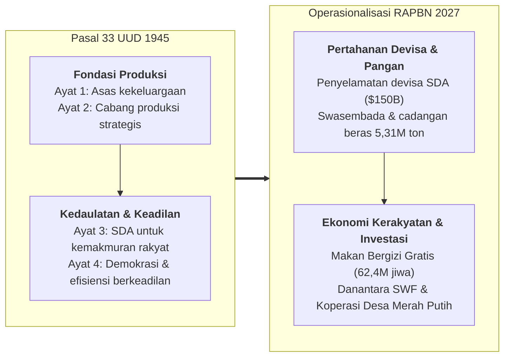
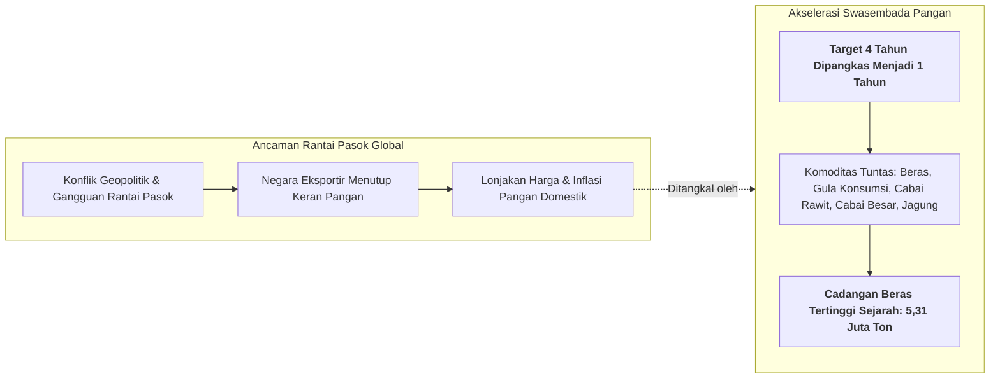
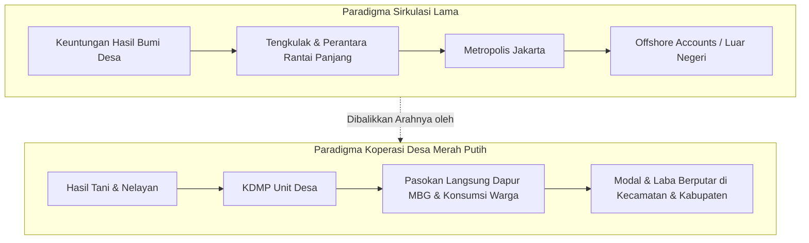
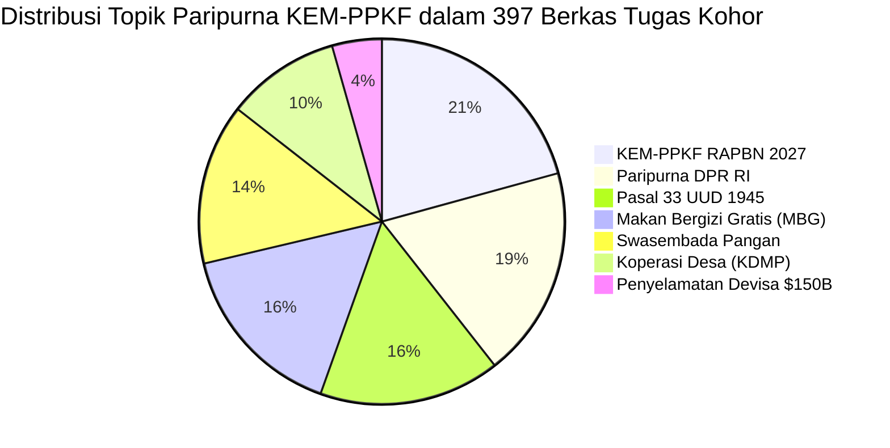

> [!NOTE] Inisiatif Pemantauan Siaran Langsung (Cohort Livestream Briefing)
> **Sesi ini bukan kuliah tatap muka terjadwal di Kampus DCU Nawasena.**
>
> Berkas ini merupakan dokumentasi eksekutif mandiri atas inisiatif kohor **P3MD Batch I Soedirman** dalam memantau dan membedah siaran langsung **Pidato Presiden Republik Indonesia pada Rapat Paripurna DPR RI ke-19** (Masa Persidangan V Tahun Sidang 2025–2026) yang diselenggarakan di Gedung Nusantara MPR/DPR/DPD-RI, Senayan, Jakarta pada Rabu, 20 Mei 2026.
>
> Pidato kenegaraan ini disiarkan secara langsung oleh kanal resmi _Sekretariat Presiden_ ([Tautan Siaran YouTube: P9VLfvhctUE](https://www.youtube.com/watch?v=P9VLfvhctUE)) dalam rangka penyampaian **Kerangka Ekonomi Makro (KEM) dan Pokok-Pokok Kebijakan Fiskal (PPKF) RAPBN Tahun Anggaran 2027**. Bagi kohor P3MD, orasi ekonomi ini menjadi rujukan primer arah arsitektur fiskal nasional, implementasi Pasal 33 UUD 1945, tata kelola hilirisasi, pembentukan superholding **[[entities/danantara|BPI Danantara]]**, hingga rantai pasok ekonomi kerakyatan melalui **Koperasi Desa Merah Putih (KDMP)**.

---

## 🏛️ Executive Session Overview: The Constitutional Economic Blueprint

Pada 20 Mei 2026, bertepatan dengan momentum Hari Kebangkitan Nasional, Presiden **[[entities/prabowo-subianto|Jenderal TNI (Purn.) H. Prabowo Subianto]]** hadir di hadapan Sidang Paripurna DPR RI untuk menyampaikan dokumen haluan fiskal terpenting negara: **KEM dan PPKF RAPBN 2027**.

Berbeda dengan paparan fiskal teknokratis konvensional yang kerap terisolasi dalam kalkulasi ekonometrika abstrak, Presiden Prabowo menegaskan kembali bahwa seluruh kebijakan anggaran negara harus berakar secara konsisten pada **Cetak Biru Ekonomi Konstitusional: Pasal 33 UUD 1945**:

> [!IMPORTANT]
> **Tesis Dasar Presiden Prabowo**:
> _"Bila Pasal 33 UUD 1945 dijalankan secara murni dan konsekuen, bangsa ini akan terbebas dari jerat kronis *export underinvoicing*, penipuan pelaporan kuantitas (*undercounting*), manipulasi *transfer pricing*, serta penjarahan tambang ilegal, pembalakan hutan ilegal, dan perkebunan sawit ilegal. RAPBN 2027 adalah instrumen kedaulatan untuk merebut kembali nilai tambah ekonomi bagi sebesar-besar kemakmuran rakyat."_

---

## 🛡️ Tata Kelola Ekspor Komoditas SDA & Devisa Hasil Ekspor (DHE)

Salah satu terobosan regulasi yang dipaparkan secara tegas di hadapan parlemen adalah penerbitan paket regulasi darurat pertahanan devisa nasional:

1. **Peraturan Pemerintah tentang Tata Kelola Ekspor Komoditas Sumber Daya Alam (SDA)**:
   - Penjualan seluruh hasil bumi strategis—dimulai dari kelapa sawit (CPO), batu bara, nikel, dan _ferro-alloys_—**diwajibkan melalui BUMN yang ditunjuk khusus oleh Pemerintah RI sebagai pengekspor tunggal (_single-door export BUMN_)**.
   - Tujuan: Menghapus manipulasi faktur ekspor (_export underinvoicing_) yang selama puluhan tahun merugikan penerimaan pajak dan royalti negara.
2. **Peraturan Pemerintah tentang Devisa Hasil Ekspor (DHE) dari Kegiatan SDA**:
   - Mengharuskan repatriasi $100\%$ dana hasil ekspor komoditas alam untuk ditempatkan di dalam sistem perbankan nasional.
   - Menghentikan kebiasaan konglomerasi ekstratif yang menikmati keringanan izin di Indonesia namun memarkir seluruh laba likuiditasnya di perbankan luar negeri.
3. **Potensi Penyelamatan Fiskal**:
   - Pemerintah mengestimasikan potensi penyelamatan devisa mencapai **\$150 Miliar USD** per tahun yang dapat dialokasikan langsung untuk memperkuat pembiayaan industrialisasi domestik, riset nasional, dan program jaring pengaman sosial.

---

## 🌾 Kedaulatan & Swasembada Pangan Nasional

Presiden memaparkan strategi pertahanan non-militer melalui pengamanan rantai pasok pangan. Di tengah instabilitas geopolitik global dan ancaman perang regional, ketersediaan pangan adalah pilar pertama kedaulatan nasional.

- **Akselerasi Radikal**: Target pencapaian swasembada pangan yang semula direncanakan selama 4 tahun berhasil dipangkas dan diwujudkan hanya dalam tempo **1 tahun**.
- **Komoditas yang Berhasil Swasembada**: Beras, gula konsumsi, cabai besar, cabai rawit, dan jagung pakan ternak.
- **Cadangan Beras Nasional**: Badan Pangan Nasional dan Bulog membukukan cadangan beras pemerintah sebesar **5,31 juta ton**—angka cadangan stok pangan fisik tertinggi sepanjang sejarah berdirinya Republik Indonesia.

---

## 🍱 Program Makan Bergizi Gratis (MBG): Fondasi Human Capital

Program Makan Bergizi Gratis (MBG) diposisikan bukan sebagai program karitatif (_charity_), melainkan sebagai **investasi modal manusia jangka panjang** untuk memberantas _stunting_, meningkatkan daya tangkap kognitif anak sekolah, dan menggerakkan ekonomi pangan lokal.

### 1. Skala Jangkauan Harian

Setiap hari, MBG melayani **62,4 juta penerima manfaat aktif**, yang mencakup:

- **6,3 juta balita** (pencegahan kerusakan kognitif dini / _golden age_).
- **2,0 juta ibu menyusui**.
- **868 ribu ibu hamil**.
- **Puluhan juta siswa sekolah dasar hingga menengah**.
- **Perluasan Terarah**: Penambahan target **500 ribu lansia miskin yang hidup sebatang kara**, sebagai pemenuhan amanat Pasal 34 ayat (1) UUD 1945 (_fakir miskin dan anak terlantar dipelihara oleh negara_).

### 2. Disiplin Tata Kelola & Transparansi Dapur MBG

Presiden secara terbuka mengakui kompleksitas logistik raksasa dalam menyajikan puluhan juta porsi makanan segar setiap hari. Menolak sikap defensif, pemerintah menerapkan transparansi radikal:

- **Tindakan Korektif Tegas**: Lebih dari **3.000 unit dapur satuan pelayanan telah ditutup dan dievaluasi** akibat gagal memenuhi standar higienitas, rantai dingin, dan kecukupan gramatur gizi.
- **Pengawasan Terbuka**: Presiden secara terbuka mengundang pimpinan dan anggota DPR RI, bupati, wali kota, hingga tokoh masyarakat untuk melakukan inspeksi mendadak ke seluruh dapur layanan MBG di daerah pemilihan masing-masing dan melaporkan setiap indikasi penyimpangan.

---

## 🏛️ BPI Danantara: Sovereign Wealth Fund Penggerak Industrialisasi

Dalam pidato ini, Presiden Prabowo secara resmi memaparkan profil kelembagaan **[[entities/danantara|Badan Pengelola Investasi Danantara (BPI Danantara)]]**:

- **Etimologi Nama**: Danantara merupakan akronim dari _Daya Anagata Nusantara_, yang bermakna **"Energi Kekuatan Masa Depan bagi Seluruh Nusantara"**.
- **Skala Dana Kelolaan AUM**: Danantara mengonsolidasikan aset-aset komersial BUMN terbesar dengan total pengelolaan dana melampaui **\$1.000 Miliar USD** ($>\$1\text{ Triliun}$).
- **Mandat Strategis**: Menjadi pengungkit pendanaan pembangunan non-APBN, khususnya menyediakan investasi ekuitas dan modal kerja untuk mengakselerasi **re-industrialisasi nasional** dan **hilirisasi komoditas SDA** bernilai tambah tinggi di dalam negeri.

---

## 🎯 8 Klaster Program Kerja Prioritas Nasional (PKPN)

Penyusunan anggaran RAPBN 2027 dikonsolidasikan ke dalam **8 Klaster Program Kerja Prioritas Nasional (PKPN)** yang mencerminkan integrasi pertahanan, industri, dan kesejahteraan sosial:

| Klaster | Fokus Sektor                                         | Arah Intervensi Kebijakan Fiskal                                                                                  |
| :-----: | :--------------------------------------------------- | :---------------------------------------------------------------------------------------------------------------- |
|  **1**  | **Kedaulatan Pangan**                                | Modernisasi irigasi, sarana produksi pertanian, proteksi harga gabah petani, dan cadangan pangan strategis.       |
|  **2**  | **Kemandirian Energi dan Air**                       | Hilirisasi bioetanol/biodiesel, transmisi kelistrikan terbarukan, dan konservasi bendungan air baku nasional.     |
|  **3**  | **Pendidikan Nasional**                              | Renovasi masif sekolah rusak, beasiswa sains/teknologi, dan penguatan lembaga pendidikan kebangsaan seperti P3MD. |
|  **4**  | **Kesehatan Universal**                              | Penuntasan _stunting_, pengadaan alat medis canggih di RSUD kabupaten/kota, dan perluasan jaminan BPJS.           |
|  **5**  | **Hilirisasi &amp; Industrialisasi**                 | Larangan ekspor mineral mentah, pemurnian smelter nikel/tembaga/bauksit, dan manufaktur petrokimia domestik.      |
|  **6**  | **Infrastruktur, Perumahan &amp; Ketahanan Bencana** | Pembangunan 3 juta rumah terjangkau rakyat, tanggul laut (_giant sea wall_), dan mitigasi risiko seismik terpadu. |
|  **7**  | **Ekonomi Kerakyatan dan Perdesaan**                 | Pengembangan rantai pasok Koperasi Desa Merah Putih (KDMP) dan akses permodalan tanpa agunan bagi petani/nelayan. |
|  **8**  | **Penurunan Kemiskinan Ekstrem**                     | Integrasi satu data bansos nasional, graduasi penerima manfaat, dan pemberdayaan ekonomi keluarga prasejahtera.   |

---

## 🏪 Koperasi Desa Merah Putih (KDMP): Arsitektur Ekonomi Akar Rumput

Untuk memastikan bahwa likuiditas perbankan dan keuntungan ekonomi tidak melulu tersedot ke kota-kota metropolitan atau lari ke luar negeri, Presiden memperkenalkan **Koperasi Desa Merah Putih (KDMP)** sebagai rantai pasok terdistribusi pertama di Indonesia yang berada di bawah kendali negara:

### Roadmap Skalabilitas KDMP:

1. **Fase Pilot Saat Ini**: **1.061 unit KDMP** telah beroperasi penuh di berbagai provinsi percontohan.
2. **Target Agustus 2026**: Eskalasi agresif mencapai **20.000 unit koperasi**.
3. **Target Akhir Tahun 2026**: Penetrasi penuh melampaui **60.000 unit KDMP**, mencakup hampir seluruh desa dan kelurahan di seluruh Nusantara.

---

## 📊 Sintesis Korpus Kohor: Data Resonansi 397 Berkas Tugas

Berdasarkan hasil analisis komputasional terhadap **397 berkas tugas kader kohor P3MD** (`archive/rabuan/2026-05-prabowo-taklimat-and-paripurna/cohort-synthesis.json`), terekam atensi akademis yang sangat tajam terhadap substansi Pidato KEM-PPKF RAPBN 2027:

| Indikator &amp; Topik Paripurna                      | Frekuensi Kemunculan | Persentase Resonansi |
| :--------------------------------------------------- | :------------------: | :------------------: |
| **Kerangka Ekonomi Makro &amp; PPKF RAPBN 2027**     |    **396 berkas**    |      **99,7%**       |
| **Rapat Paripurna DPR RI ke-19**                     |    **357 berkas**    |      **89,9%**       |
| **Pasal 33 UUD 1945 (Cetak Biru Ekonomi)**           |    **306 berkas**    |      **77,1%**       |
| **Program Makan Bergizi Gratis (62,4 Juta Jiwa)**    |    **303 berkas**    |      **76,3%**       |
| **Swasembada Pangan &amp; Stok Beras 5,31 Juta Ton** |    **272 berkas**    |      **68,5%**       |
| **Koperasi Desa Merah Putih (1.061 unit aktif)**     |    **192 berkas**    |      **48,4%**       |
| **Penyelamatan Devisa SDA (\$150 Miliar)**           |    **84 berkas**     |      **21,2%**       |
| **Roadmap Target Ekspansi KDMP (20k / 60k)**         |    **52 berkas**     |      **13,1%**       |
| **Penertiban Tambang/Hutan/Sawit Ilegal**            |    **49 berkas**     |      **12,3%**       |
| **Danantara AUM &gt; \$1.000 Miliar USD**            |    **24 berkas**     |       **6,0%**       |
| **8 Klaster Prioritas Nasional (PKPN)**              |    **19 berkas**     |       **4,8%**       |

---

## 🔗 Integrasi Kurikulum & Jejaring Konsep

- **Sesi Terkait**:
  - [[rabuan/2026-05-24-prabowo-taklimat-hambalang|Special Session: Taklimat Presiden Prabowo di Hambalang]]
  - [[rabuan/2026-09-23-syamsul-infrastruktur|Kuliah Rabuan: Infrastruktur &amp; Ekosistem Pangan (Syamsul Bachri Yusuf)]]
  - [[rabuan/2026-09-23-sahala-financial-discipline|Kuliah Rabuan: Memimpin dengan Financial Discipline (Sahala Situmorang)]]
  - [[rabuan/2026-10-20-anton-upi-dies-natalis-orasi|Special Session: Doktrin Komandan P3MD Marsma Anton Palaguna (Dies Natalis UPI)]]
- **Konsep Kunci**:
  - [[concepts/best-mind-best-heart|Best Mind and Best Heart: The P3MD Leadership Doctrine]]
  - [[concepts/behavior-change-engine|Behavior Change Engine (BCE)]]
  - [[concepts/incremental-capital-output-ratio|Incremental Capital Output Ratio (ICOR) &amp; Produktivitas Modal]]
- **Lembaga &amp; Tokoh Terkait**:
  - [[entities/prabowo-subianto|Jenderal TNI (Purn.) H. Prabowo Subianto Djojohadikusumo]]
  - [[entities/danantara|BPI Danantara (Badan Pengelola Investasi Danantara)]]
  - [[entities/anton-palaguna|Marsma TNI Dr. Anton 'Sioux' Palaguna]]
- **Korelasi Mata Kuliah**:
  - [[courses/mk1-organizational-behavior-managing-people/week-07/index|MK 1 Week 07: Power, Politics &amp; SOE Governance]]
  - [[courses/mk2-financial-management-strategy/week-01/index|MK 2 Week 01: Financial Management Function &amp; BUMN Governance]]
  - [[courses/mk2-financial-management-strategy/week-06/index|MK 2 Week 06: Mergers, Acquisitions &amp; Corporate Restructuring]]
