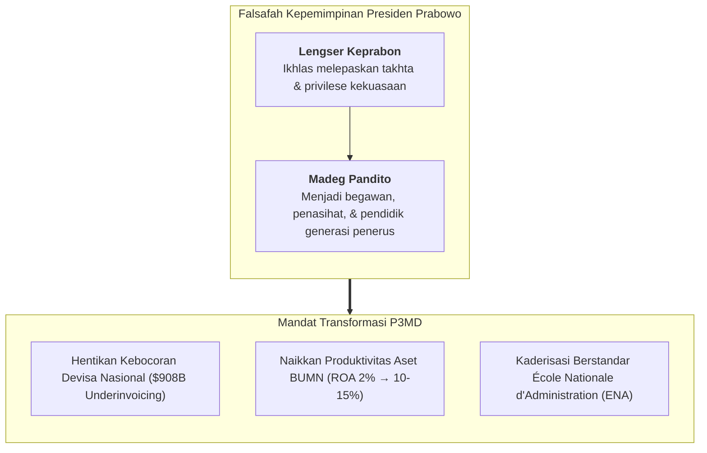
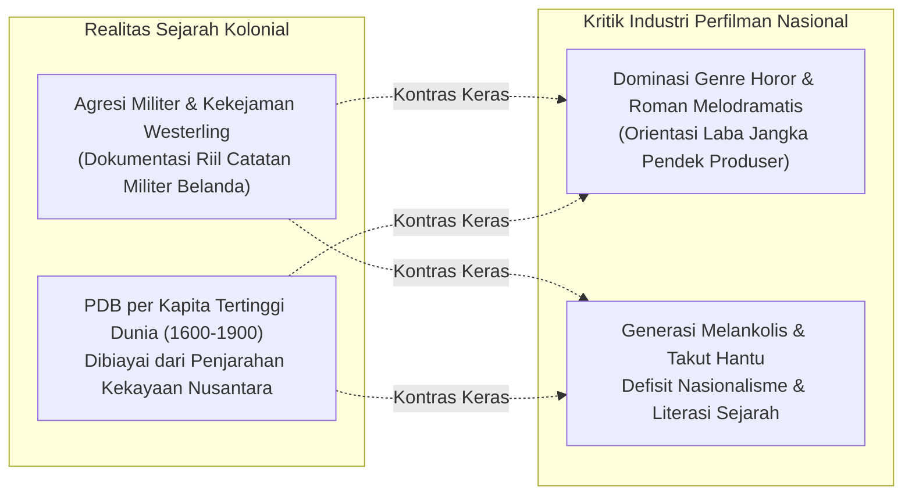
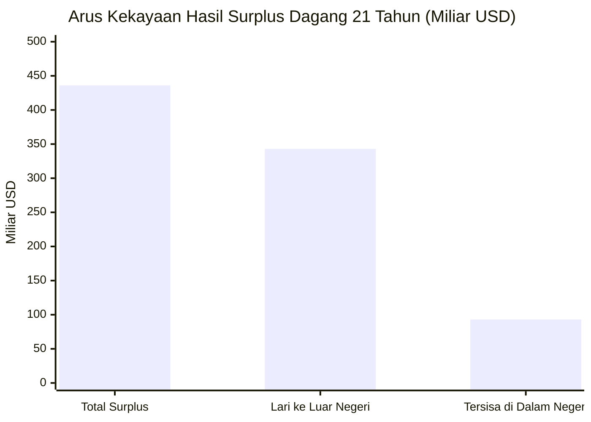
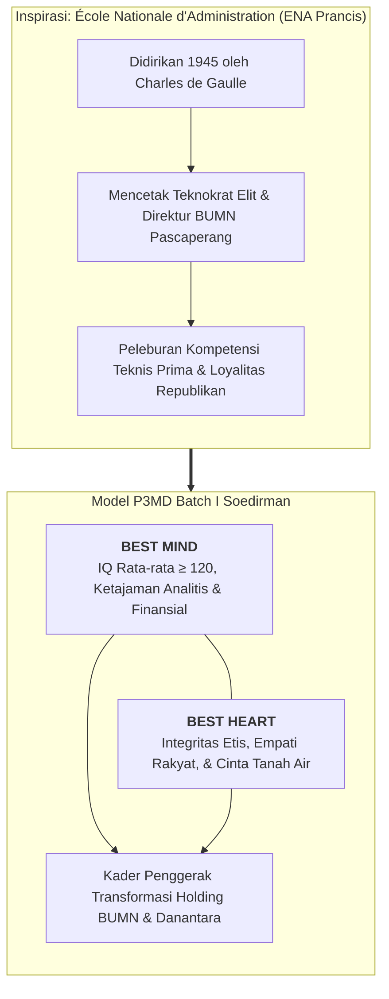
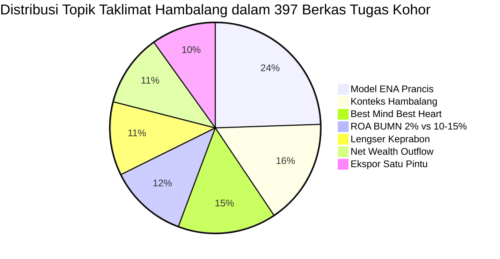

> [!NOTE] Taklimat Perdana Presiden RI di Kediaman Pribadi (Padepokan Garuda Yaksa)
> **Sesi ini merupakan pengarahan tatap muka langsung di kediaman pribadi Presiden Republik Indonesia.**
>
> Seluruh perwira siswa / kader kohor **P3MD Batch I Soedirman** (393 peserta terpilih dari 10.000 pelamar nasional) diberangkatkan secara terorganisir menuju **Padepokan Garuda Yaksa, Hambalang, Bogor** pada Minggu, 24 Mei 2026. Di auditorium utama padepokan, Presiden ke-8 RI, **[[entities/prabowo-subianto|Jenderal TNI (Purn.) H. Prabowo Subianto]]**, menyampaikan taklimat doktrinal yang meresmikan arah filosofis pendirian P3MD (_sebelumnya dikenal sebagai Presidential Future Leaders Program / PFLP_).
>
> Taklimat intensif berdurasi lebih dari 3 jam ini meletakkan fondasi mengapa kader calon pemimpin puncak holding BUMN harus ditempa melalui doktrin **[[concepts/best-mind-best-heart|Best Mind & Best Heart]]**, membedah kebocoran devisa ratusan miliar dolar melalui _export underinvoicing_, menunjuk **[[entities/danantara|BPI Danantara]]** sebagai pintu tunggal ekspor komoditas strategis, serta menggembleng mentalitas patriotik melalui falsafah Jawa luhur: _Lengser Keprabon Madeg Pandito_.

---

## 🧭 Executive Session Overview: The Sovereign Mandate

Pada Minggu, 24 Mei 2026, kohor P3MD Batch I Soedirman melangkah memasuki Padepokan Garuda Yaksa di perbukitan Hambalang. Pertemuan ini bukan sekadar silaturahmi protokoler kenegaraan, melainkan sebuah **mandat penugasan strategis langsung (_Commander's Intent_)** dari Kepala Negara kepada generasi muda yang dipersiapkan memimpin lokomotif ekonomi Republik Indonesia.

Presiden Prabowo Subianto membuka pertemuan dengan merefleksikan identitas kulturalnya sebagai perpaduan darah Jawa dan Minahasa. Dari akar tradisi Jawa, beliau mengangkat prinsip kepemimpinan yang menjadi kompas etika pengabdian tertingginya:

> **"Lengser Keprabon, Madeg Pandito"**
> _(Turun dari takhta kekuasaan, melangkah menjadi pertapa, penasihat, dan guru)._

Bagi seorang patriot sejati, pengabdian tidak pernah berakhir ketika masa jabatan formal atau kursi kekuasaan usai. Jabatan adalah amanah sementara; puncak kematangan seorang pemimpin justru terwujud ketika ia bersedia menanggalkan atribut kekuasaan demi membimbing generasi berikutnya. Kehadiran kader P3MD di Hambalang merupakan bukti konkret dari komitmen Presiden untuk melahirkan para penerus yang jauh lebih cakap, berani, dan berintegritas dalam menjaga kedaulatan bangsa.

---

## 🎬 Refleksi Sejarah & Kritik Industri Perfilman: Analisis Film "De Oost"

Sebelum taklimat dimulai, seluruh kader disajikan penayangan film sejarah garapan sutradara Jim Taihuttu berjudul **"De Oost" (The East)**. Film ini mendokumentasikan kebrutalan operasi militer tentara kerajaan Belanda di Sulawesi Selatan pada masa Revolusi Nasional (1946–1947) di bawah komando Kapten Raymond Westerling (_Depot Speciale Troepen_).

Presiden menyampaikan refleksi mendalam atas substansi film tersebut:

1. **Ketepatan Fakta Sejarah**: Film _De Oost_ dibuat berdasarkan arsip dan buku harian serdadu Belanda sendiri, membuktikan secara objektif bahwa kemerdekaan Indonesia ditebus dengan air mata, darah, dan pengorbanan jutaan rakyat yang tak terhitung nilainya.
2. **Kritik Keras terhadap Industri Sinema Domestik**: Presiden menyoroti ironi industri perfilman Indonesia yang enggan memproduksi film-film perjuangan bernilai patriotik tinggi dan lebih memilih membanjiri bioskop dengan genre horor takhayul dan romansa picisan semata-mata demi mengejar keuntungan komersial instan.
3. **Dampak terhadap Karakter Generasi Muda**: Tayangan yang membodohi masyarakat menghasilkan generasi yang rapuh, mudah terintimidasi oleh takhayul hantu, berjiwa melankolis, dan kehilangan rasa bangga terhadap sejarah bangsanya sendiri. P3MD menuntut kader yang berani menatap realitas geopolitik tanpa ilusi sentimental.

---

## 💰 Anatomi Kebocoran Kekayaan Nasional: The Net Wealth Outflow Paradox

Memasuki substansi ekonomi makro, Presiden Prabowo menyajikan data empiris yang mengejutkan mengenai paradoks neraca perdagangan Indonesia selama dua dekade terakhir.

### 1. PDB Kolonial Belanda vs Realitas Pasca-Kemerdekaan

Belanda mencatatkan PDB per kapita tertinggi di dunia pada kurun abad ke-17 hingga awal abad ke-20 (1600–1900-an). Kemakmuran luar biasa Negeri Kincir Angin tersebut tidak terlepas dari penguasaan monopoli atas rempah-rempah dan kekayaan alam Nusantara melalui VOC dan _Cultuurstelsel_. Pasca-kemerdekaan Indonesia, peringkat PDB per kapita Belanda perlahan merosot keluar dari 10 besar dunia. Sebaliknya, meski Indonesia telah merdeka selama lebih dari 80 tahun dan mengelola sumber dayanya sendiri, Republik ini belum berhasil menembus jajaran ekonomi berpenghasilan tinggi (_high-income economy_).

### 2. Paradoks Surplus Dagang: Kemana Larinya Devisa Kita?

Selama 21 tahun berturut-turut, neraca perdagangan Indonesia selalu mencatatkan surplus kumulatif yang impresif:

$$\text{Total Surplus Neraca Perdagangan (21 Tahun)} = \$436\text{ Miliar USD}$$

Namun, Presiden mengungkapkan fakta pahit mengenai arus kas aktual:

$$\text{Pelarian Modal Keluar Negeri (Capital Flight)} = \$343\text{ Miliar USD} \quad (78,7\%)$$

$$\text{Kekayaan yang Bertahan di Dalam Negeri} = \$93\text{ Miliar USD} \quad (21,3\%)$$

Dari surplus \$436 Miliar, hampir $80\%$ langsung terbang ke luar negeri dan disimpan di rekening-rekening suaka pajak (_tax haven_). Akibatnya, APBN senantiasa mengalami tekanan fiskal, gaji guru dan aparatur negara tertahan rendah, fasilitas kesehatan terbatas, dan ribuan gedung sekolah dasar di pelosok nusantara mengalami kerusakan fisik yang mengenaskan.

### 3. Modus Utama: Export Underinvoicing & Transfer Pricing

Akar penyebab dari kaburnya devisa nasional adalah kejahatan terorganisir di sektor korporasi ekstratif:

- **Export Underinvoicing**: Pelaporan nilai faktur ekspor komoditas mentah (batu bara, CPO, nikel, feronikel) jauh lebih rendah daripada nilai transaksi riil di pasar internasional. Selisih harga riil ditampung di entitas cangkang (_offshore shell companies_) di luar yurisdiksi Indonesia.
- **Kerugian Historis**: Praktik _underinvoicing_ selama 34 tahun terakhir diperkirakan telah membocorkan kekayaan negara hingga **\$908 Miliar USD** ($>\text{Rp } 14.500\text{ Triliun}$).
- **Transfer Pricing & Penyelundupan**: Manipulasi biaya internal antar-anak perusahaan multinasional demi meminimalkan kewajiban pajak di Indonesia.

---

## 🛡️ Kebijakan Penertiban Ekspor: BUMN Sebagai Pintu Tunggal Ekspor SDA

Sebagai respons tegas dan preventif terhadap kebocoran fiskal sistemik tersebut, Presiden Prabowo mengumumkan reformasi tata kelola perdagangan komoditas sumber daya alam:

> [!IMPORTANT]
> **Kebijakan Sentralisasi Ekspor Satu Pintu Melalui BUMN**:
> Pemerintah memberlakukan **Peraturan Pemerintah tentang Tata Kelola Ekspor Komoditas Sumber Daya Alam**. Seluruh kegiatan ekspor komoditas strategis nasional—dimulai dari kelapa sawit (CPO), batu bara, dan ferro-alloy—**wajib disalurkan melalui BUMN yang ditunjuk secara resmi oleh Pemerintah RI sebagai pengekspor tunggal**.

Untuk mengemban mandat raksasa ini, dibentuklah **PT Danantara Sumberdaya Indonesia** di bawah naungan **[[entities/danantara|BPI Danantara]]**. Kebijakan ini memiliki target konkret:

1. **Pengawasan Ketat Terpusat**: Menghilangkan ruang negosiasi gelap di pelabuhan-pelabuhan tikus dan pelaporan ganda manifest kargo.
2. **Penyelamatan Devisa Potensial**: Berdasarkan kalkulasi kepresidenan, sentralisasi ekspor satu pintu berpotensi menyelamatkan hingga **\$150 Miliar USD** devisa yang selama ini menguap setiap tahunnya.
3. **Repatriasi Devisa Hasil Ekspor (DHE)**: Memastikan devisa hasil bumi Nusantara benar-benar parkir di sistem perbankan nasional untuk memperkuat likuiditas perbankan dan cadangan devisa Bank Indonesia.

---

## 🏛️ Doktrin P3MD: "Best Mind, Best Heart" & Model ENA Prancis

Presiden menyoroti stigma kronis yang melekat pada Badan Usaha Milik Negara (BUMN) sebagai sarang inefisiensi, politisasi jabatan, dan korupsi berjamaah:

$$\text{ROA BUMN Rata-Rata Historis} \approx 2\% \quad \text{vs} \quad \text{ROA Korporasi Sehat Global} \approx 10\%\text{–}15\%$$

Dengan total aset konsolidasi BUMN yang mencapai ribuan triliun rupiah, imbal hasil sebesar $2\%$ adalah anomali ekonomi yang tidak dapat ditoleransi. BUMN menguasai cabang-cabang produksi strategis namun kontribusi dividennya terhadap APBN kerap tertinggal dibanding biaya modalnya.

### 1. Landasan Sosiologis: Teori Liah Greenfeld

Presiden mengutip riset fundamental sosiolog ekonomi **Liah Greenfeld** (_The Spirit of Capitalism: Nationalism and Economic Growth_):

> _"Economic growth is stimulated and sustained by nationalism."_
> _(Pertumbuhan ekonomi suatu bangsa dipicu dan dipertahankan oleh rasa nasionalisme)._

Negara-negara hebat—dari Inggris era Revolusi Industri, Amerika Serikat, Jerman pasca-Bismarck, hingga kebangkitan Jepang era Meiji—tidak dibangun oleh birokrat oportunis bermental tentara bayaran (_mercenary_). Mereka dibangun oleh para pemimpin yang memiliki kecintaan fanatik terhadap kehormatan negerinya.

### 2. Keseimbangan Best Mind dan Best Heart

- **Best Mind**: Kecerdasan intelektual, kapabilitas numerik, dan penguasaan sains bisnis modern. Seluruh kader P3MD disaring secara ketat dengan ambang batas $\text{IQ} \ge 120$.
- **Best Heart**: Moralitas tanpa kompromi, kepekaan terhadap penderitaan rakyat, dan kerelaan berkorban. Pintar tanpa integritas hanya melahirkan manipulator kontrak dan mafia anggaran; memiliki niat baik tanpa kecakapan teknis hanya melahirkan ketidakberdayaan.

---

## ⚖️ Penegakan Hukum & Reformasi Gaji Hakim 300%

Presiden Prabowo menegaskan bahwa transformasi ekonomi dan perlindungan aset negara tidak akan pernah terwujud tanpa kepastian hukum yang kokoh. Sistem peradilan yang rapuh dan mudah disuap adalah gerbang utama lolosnya kejahatan korporasi internasional.

Oleh karena itu, Presiden mengambil kebijakan revolusioner:

- **Kenaikan Gaji Hakim hingga 300%**: Langkah berani menaikkan kesejahteraan para hakim di seluruh pelosok tanah air ditujukan untuk menutup godaan suap dan gratifikasi materiil.
- **Kemandirian Peradilan**: Menjadikan hakim sebagai benteng terakhir penegakan keadilan yang tidak dapat diintervensi oleh kekuatan modal atau tekanan politik oligarki.

---

## 📊 Sintesis Korpus Kohor: Data Resonansi 397 Berkas Tugas

Berdasarkan agregasi otomatis terhadap **397 berkas tugas kader P3MD** (`archive/rabuan/2026-05-prabowo-taklimat-and-paripurna/cohort-synthesis.json`), terekam tingkat pemahaman dan resonansi konseptual yang sangat tinggi terhadap Taklimat Hambalang:

| Indikator &amp; Topik Doktrinal                              | Frekuensi Kemunculan | Persentase Resonansi |
| :----------------------------------------------------------- | :------------------: | :------------------: |
| **Inspirasi École Nationale d'Administration (ENA Prancis)** |    **390 berkas**    |      **98,2%**       |
| **Konteks Padepokan Garuda Yaksa, Hambalang**                |    **257 berkas**    |      **64,7%**       |
| **Doktrin Best Mind &amp; Best Heart**                       |    **241 berkas**    |      **60,7%**       |
| **Benchmark ROA BUMN 2% vs 10–15%**                          |    **191 berkas**    |      **48,1%**       |
| **Falsafah "Lengser Keprabon, Madeg Pandito"**               |    **180 berkas**    |      **45,3%**       |
| **Net Outflow Devisa (\$436B vs \$343B kabur)**              |    **177 berkas**    |      **44,6%**       |
| **Ekspor Satu Pintu via BUMN / PT Danantara**                |    **158 berkas**    |      **39,8%**       |
| **Data Historis PDB Kolonial Belanda**                       |    **157 berkas**    |      **39,5%**       |
| **Kerugian Export Underinvoicing \$908 Miliar**              |    **147 berkas**    |      **37,0%**       |
| **Kekayaan Tersisa di RI hanya \$93 Miliar**                 |    **143 berkas**    |      **36,0%**       |
| **Refleksi Film _De Oost_ &amp; Sinema Nasional**            |    **133 berkas**    |      **33,5%**       |
| **Rujukan Teori Liah Greenfeld (Nasionalisme)**              |    **96 berkas**     |      **24,2%**       |
| **Kenaikan Gaji Hakim 300% (Kepastian Hukum)**               |    **92 berkas**     |      **23,2%**       |

---

## 🛡️ Refleksi Kawah Candradimuka: Jiwa Korsa & Aspirasi Kohor

Kunjungan ke Hambalang dan pengarahan langsung dari Presiden RI berlangsung di tengah fase penggemblengan fisik, mental, dan kedisiplinan militer yang sangat intensif di asrama kawah candradimuka. Melalui kanal umpan balik internal kohor (`ASPIRASI SERDIK P3MD`), terekam dinamika batin dan komitmen luar biasa dari para kader terpilih:

### 1. Jiwa Korsa dan Ketahanan Mental-Fisik yang Ditempa Nyata

Kader P3MD, yang berlatar belakang profesional korporasi dan talenta unggul BUMN dari seluruh Indonesia, diuji di bawah ritme dinas harian berstandar militer (bangun pukul 03.45, olahraga fisik bertahap, baris-berbaris, tata tertib barak, jaga kesatrian, hingga apel malam pukul 22.00). Pengalaman ini berhasil memecah sekat-sekat ego individualistis dan melahirkan **jiwa korsa (_esprit de corps_)** yang kokoh antar-Elemen dan antar-Grup.

### 2. Aspirasi Konstruktif Menuju Puncak Kebugaran dan Kesiapan Belajar

Sebagai talenta analitis berdaya nalar tinggi, para kader secara proaktif menyampaikan masukan-masukan bernas dan konstruktif kepada jajaran pengasuh demi menjaga stamina fisik dan kejernihan intelektual:

- **Optimalisasi Manajemen Waktu & Ibadah**: Masukan konstruktif untuk menyinkronkan jeda antara kegiatan fisik dengan waktu ibadah salat berjamaah di masjid dan istirahat mandiri, memastikan keseimbangan spiritual dan pemulihan fisik berjalan selaras.
- **Kualitas Nutrisi & Daya Tahan Tubuh**: Dorongan positif agar menu makanan rukan senantiasa kaya serat dan protein berkualitas tinggi guna mengimbangi pembakaran kalori harian yang tinggi.
- **Inovasi Kepemimpinan Bergilir**: Usulan cerdas agar rotasi kepemimpinan Senat, Komandan Grup, dan Komandan Elemen dilaksanakan secara berkala, membuka ruang bagi setiap kader untuk menguji kepemimpinan manajerial dan komunikasi persuasif dalam situasi bertekanan tinggi.

Dinamika ini membuktikan bahwa kohor P3MD Batch I Soedirman bukan sekadar kelompok pasif yang dicekoki materi di ruang kelas, melainkan komunitas pembelajar tangguh (_Tough & Agile Learners_) yang secara sadar menantang diri mereka sendiri untuk menjadi generasi pemimpin yang utuh lahir dan batin.

---

## 🔗 Integrasi Kurikulum & Jejaring Konsep

- **Doktrin Terkait**:
  - [[concepts/best-mind-best-heart|Doktrin Best Mind & Best Heart P3MD]]
  - [[concepts/behavior-change-engine|Behavior Change Engine (BCE)]]
  - [[concepts/tough-and-agile-learner|Tough & Agile Learner (TAL)]]
- **Sesi Eksekutif Lanjutan**:
  - [[rabuan/2026-05-20-prabowo-kem-ppkf-rapbn-2027|Special Session: Kerangka Ekonomi Makro & PPKF RAPBN 2027 (DPR RI)]]
  - [[rabuan/2026-10-20-anton-upi-dies-natalis-orasi|Special Session: Doktrin Komandan P3MD Marsma Anton Palaguna (Dies Natalis UPI)]]
  - [[rabuan/2026-09-02-adh-peoplemath|Kuliah Rabuan: PeopleMath Framework (Agus Dwi Handaya)]]
  - [[rabuan/2026-09-23-sahala-financial-discipline|Kuliah Rabuan: Memimpin dengan Financial Discipline (Sahala Situmorang)]]
- **Profil Tokoh & Lembaga**:
  - [[entities/prabowo-subianto|Jenderal TNI (Purn.) H. Prabowo Subianto Djojohadikusumo]]
  - [[entities/anton-palaguna|Marsma TNI Dr. Anton 'Sioux' Palaguna]]
  - [[entities/danantara|BPI Danantara (Badan Pengelola Investasi Danantara)]]
- **Mata Kuliah Utama**:
  - [[courses/mk1-organizational-behavior-managing-people/week-01/index|MK 1 Week 01: Strategizing Your Life & Executive Governance]]
  - [[courses/mk1-organizational-behavior-managing-people/week-07/index|MK 1 Week 07: Power, Politics & SOE Governance]]
  - [[courses/mk2-financial-management-strategy/week-01/index|MK 2 Week 01: Financial Management Function & BUMN Governance]]
