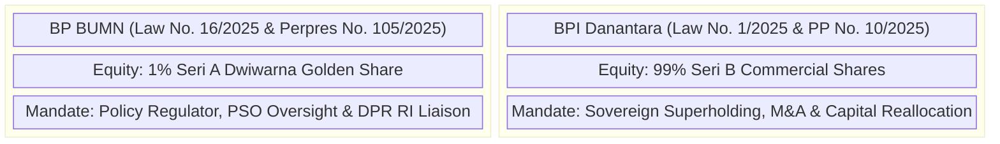

> [!IMPORTANT] Reconstructed Material Disclaimer
> **This dossier consists of reconstructed study materials, not a verbatim transcript or official slide deck.**
>
> Delivered on Tuesday, June 9, 2026, during **Phase I** of the **P3MDI Batch I Soedirman** program at **Gedung Yos Sudarso, Kodiklat TNI Serpong**, this session took place under strict military operational-security rules that prohibited mobile phones and recording devices. Accordingly, no raw audio recording or original slide deck was released. The strategic doctrine, statutory governance architecture, portfolio consolidation data, and Q&A themes below are reconstructed from verified contemporaneous public dispatches, enacted 2025 statutes (Law No. 1/2025 and Law No. 16/2025), and official policy directives issued by **[[entities/dony-oskaria|Dony Oskaria]]**.

---

## Executive Session Overview: Total Transformation Is Non-Negotiable

On June 9, 2026, **[[entities/dony-oskaria|Dony Oskaria]]**—serving concurrently as Chief Operating Officer (COO) of **[[entities/danantara|BPI Danantara]]** and Head of **Badan Pengaturan BUMN (BP BUMN)**—addressed the inaugural **P3MDI Batch I Soedirman** cohort of approximately 400 future state-enterprise executives during their Phase I foundational training at **Kodiklat TNI Serpong**.

Speaking at the height of Indonesia's structural overhaul of state capital governance, Oskaria framed the cohort not as conventional management trainees, but as an operational vanguard charged with executing an uncompromising mandate: **_Transformasi Total Harga Mati_** (Total Transformation is Non-Negotiable).

For decades, Indonesian state-owned enterprises (**BUMN**) measured institutional prestige by conglomerate headcount, sprawling subsidiary trees, and gross asset volume—often masking balance-sheet fragility, cross-subsidy opacity, and capital destruction. Oskaria's central thesis dismantled that legacy mindset: **corporate scale is worthless without capital efficiency, margin discipline, and return on invested capital ($\text{ROIC}$) exceeding the [[concepts/weighted-average-cost-of-capital|cost of capital (WACC)]].**

```mermaid
flowchart LR
    subgraph Legacy["Legacy Ministry Model (Pre-2025)"]
        direction TB
        L1["Single Ministry acts as<br/>Regulator + Shareholder + Operator"]
        L2["Over 1,000 Entities & Overlapping<br/>Subsidiaries"]
        L3["Bureaucratic Bottlenecks &<br/>Uncompensated PSO Drift"]
    end

    subgraph Reform["2025 Statutory Bifurcation"]
        direction TB
        R1["BP BUMN (Law No. 16/2025)<br/>1% Seri A Dwiwarna Regulator"]
        R2["BPI Danantara (Law No. 1/2025)<br/>99% Seri B Commercial Holding"]
        R3["Portfolio Consolidation<br/>Over 1,000 down to ~250 Focus Entities"]
    end

    subgraph Outcome["Target Sovereign Outcome"]
        direction TB
        O1["Capital Efficiency &<br/>ROIC > WACC Discipline"]
        O2["Transparent Ring-Fenced<br/>PSO Contracts"]
        O3["Market-Anchoring<br/>National Champions"]
    end

    Legacy -->|"Transformasi Total Harga Mati"| Reform --> Outcome
```

---

## Macro Imperative & Portfolio Rationalization (`>1,000` $\rightarrow$ `~250` Entities)

Oskaria opened by situating P3MDI within Indonesia's broader economic stabilization and capital-market credibility push. Because state-owned commercial banks and listed state enterprises form the structural backbone of the Indonesia Stock Exchange (**IHSG**), the fundamental solvency and earnings quality of BUMN holdings directly anchor national market confidence against external volatility.

To eliminate value-destroying organizational sprawl, Oskaria detailed the ongoing rationalization program across the state portfolio:

- **Eliminating 652 Non-Core Subsidiaries**: Pruning loss-making, overlapping, and rent-seeking subsidiaries across construction, shipping, logistics, and financial services to compress the state-owned ecosystem from **more than 1,000 corporate entities** down to approximately **250 focused enterprises**.
- **Active Execution Velocity**: By mid-June 2026, **274 subsidiaries** had already entered liquidation, merger, or divestment pipelines—demonstrating that portfolio cleanup was not an aspirational white paper, but an active balance-sheet mandate.
- **Sectoral Restructuring Anchors**:
  - **PT Danareksa (Persero)**: Repositioned from a generalized financial holding into a focused national asset manager and integrated industrial-park operator.
  - **PT Pos Indonesia (Persero)**: Consolidating **15 fragmented logistics subsidiaries** across state holdings into a unified national logistics backbone to drive down Indonesia's structural transport costs.
  - **[[entities/pt-telkom-indonesia|PT Telkom Indonesia (Persero) Tbk]]**: Trimming peripheral ventures down to **19 focused digital and infrastructure operations**.
  - **Indonesia Financial Group (IFG)**: Consolidating fragmented state insurance entities into **three specialized insurance pillars**.
  - **[[entities/pt-kereta-api-indonesia|PT Kereta Api Indonesia (Persero)]] & PT INKA (Persero)**: Advancing operational integration between national rail operations and rolling-stock manufacturing.

The operational directive to future directors was unmistakable: stop equating subsidiary sprawl with executive importance, and begin enforcing rigorous balance-sheet hygiene.

---

## The Two-Pillar Institutional Architecture (`BP BUMN` vs. `BPI Danantara`)

To cure the historical conflict of interest in which the former Ministry of BUMN acted simultaneously as policymaker, shareholder, and operational supervisor, Indonesia's 2025 statutory reform bifurcated state-enterprise governance into two distinct institutional pillars.

### Comparative Statutory Governance Matrix

| Governance Parameter       | Badan Pengaturan BUMN (BP BUMN)                                                              | BPI Danantara (Badan Pengelola Investasi Daya Anagata Nusantara)                                 |
| :------------------------- | :------------------------------------------------------------------------------------------- | :----------------------------------------------------------------------------------------------- |
| **Foundational Mandate**   | Statutory regulator, industrial policy steward, and public-interest monitor.                 | Commercial asset operator, sovereign investment holding, and turnaround execution engine.        |
| **Statutory Charter**      | Law No. 16 of 2025; Presidential Regulation No. 105 of 2025.                                 | Law No. 1 of 2025; Government Regulation No. 10 of 2025.                                         |
| **Capital & Share Class**  | **1% Seri A Dwiwarna Golden Share** (statutory negative covenants, charter & merger veto).   | **99% Seri B Equity Shares** (economic interest, commercial voting rights, dividend management). |
| **Operational Priorities** | Public Service Obligations (PSO), regulatory compliance, DPR RI liaison, BPK audit framing.  | Portfolio streamlining, debt restructuring, capital reallocation, global expansion.              |
| **Accountability Line**    | Accountable to the President and **DPR RI** for social equity and national policy execution. | Accountable to the President for commercial asset yield and return on invested capital.          |

Under this dual architecture, dividends and commercial capital are retained and reinvested by **[[entities/danantara|Danantara]]** into productive national assets rather than drained passively, while **BP BUMN** safeguards constitutional sovereignty and public-interest vetoes through its 1% golden share.

---

## Military-Grade Resilience & Boardroom Agility

Connecting the corporate restructuring mandate directly to the Phase I setting at **Kodiklat TNI Serpong**, Oskaria addressed why 400 future corporate directors were undergoing rigorous military character conditioning alongside physical endurance training.

In volatile capital markets and high-stakes corporate turnarounds, technical financial modeling alone is insufficient. When an executive must shut down an unviable subsidiary, renegotiate syndicated legacy debt, or resist entrenched rent-seeking networks, **psychological grit and operational decisiveness** determine whether transformation succeeds or stalls in bureaucratic inertia (_mental birokrat_).

Directorship, Oskaria emphasized, is not an administrative title or social sinecure—it is an unrelenting performance standard requiring executives to read financial fundamentals clearly, allocate capital without political hesitation, and execute under sustained institutional pressure.

---

## Executive Q&A Themes: Boardroom Dilemmas Under Reform

During the cohort Q&A curated by the candidate Senate, three practical tensions of the 2025–2026 reform agenda surfaced directly:

### 1. Career Trajectories in a Consolidated 250-Entity Portfolio

- **Cohort Dilemma**: If Danantara is systematically eliminating 652 non-core subsidiaries and shrinking the ecosystem from $>1,000$ to $\sim 250$ entities, does that shrink executive career pathways for the 400 P3MDI leaders?
- **Oskaria's Doctrine**: Eliminating weak, low-margin subsidiaries removes **bureaucratic dead-ends**, not leadership opportunity. Consolidated holdings concentrate capital into larger, globally competitive platforms requiring directors capable of managing complex cross-sector supply chains, international joint ventures, and institutional capital allocation. Advancement will be governed by **[[concepts/capital-capability-synergy|capital-allocation capability]]** and cross-holding mobility rather than seniority within a single silo.

### 2. Ring-Fencing Public Service Obligations (PSO) from Commercial Hurdles

- **Cohort Dilemma**: How do state-enterprise directors satisfy Danantara's market-rate $\text{ROIC}$ hurdles when BP BUMN mandates subsidized **[[concepts/pso-commercial-duality|Public Service Obligations (PSO)]]** at below-cost tariffs?
- **Oskaria's Doctrine**: Laws No. 1 and 16 of 2025 exist specifically to end blurred cross-subsidies. PSO assignments must be structured under explicit statutory contracts, **separate accounting lines**, and formal BP BUMN approvals backed transparently by state-budget compensation. Simultaneously, commercial business units under Danantara must face unvarnished market discipline without hiding operational inefficiency behind social-mandate excuses.

### 3. Business Judgment Rule (BJR) & Audit Protection During Turnarounds

- **Cohort Dilemma**: Writing off impaired legacy assets, restructuring debt, or closing unviable subsidiaries exposes directors to intense legal and audit scrutiny—how do leaders act boldly without incurring personal criminalization?
- **Oskaria's Doctrine**: Drawing directly on his turnaround experience at **PT Garuda Indonesia (Persero) Tbk** and **[[entities/injourney|InJourney]]**, Oskaria argued that executive legal vulnerability rarely stems from honest commercial risk-taking; it stems from **procedural shortcuts, undisclosed conflicts of interest, and poor documentation**. When directors ground restructuring moves in rigorous due diligence under the **Business Judgment Rule (BJR)**, align actions with approved board roadmaps, and maintain proactive audit transparency with the Supreme Audit Agency (**BPK**), they establish clear institutional protection for decisive corporate rescue.

---

## Strategic Takeaways for P3MDI Cohort Leaders

1. **Capital Efficiency Over Empire Building**: Measure enterprise stewardship by free cash flow, margin health, and $\text{ROIC} > \text{WACC}$—never by subsidiary count or headcount bloat.
2. **Navigate Dual Channels Without Confusion**: Enforce strict accounting and governance boundaries between **BP BUMN** public-mandate contracts (1% Seri A Dwiwarna) and **Danantara** commercial value creation (99% Seri B).
3. **Treat Integrity & Process Discipline as Operational Armor**: Bold balance-sheet turnarounds succeed when anchored in conflict-free governance, documented business judgment, and full BPK transparency.

---

## Knowledge Graph & Curriculum Bridges

- **Keynote Speaker Profile**: [[entities/dony-oskaria|Dony Oskaria]] (COO BPI Danantara & Head of BP BUMN)
- **Sequential Continuation**: [[rabuan/2026-09-02-oskaria-directorship-doctrine|Rabuan Masterclass (2026-09-02): Directorship as a Standard & Turnaround Sequencing Doctrine]] (Phase II Kick-Off at Kampus DCU Nawasena)
- **Institutional & Enterprise Entities**:
  - [[entities/danantara|BPI Danantara (Badan Pengelola Investasi Danantara)]]
  - [[entities/injourney|InJourney (PT Aviasi Pariwisata Indonesia)]]
  - [[entities/pt-telkom-indonesia|PT Telkom Indonesia (Persero) Tbk]]
  - [[entities/pt-kereta-api-indonesia|PT Kereta Api Indonesia (Persero)]]
- **Core Analytical Concepts**:
  - [[concepts/pso-commercial-duality|Public Service Obligation (PSO) vs Commercial Viability Duality]]
  - [[concepts/public-administration-paradigms|Public Administration Paradigms & State Enterprise Governance]]
  - [[concepts/capital-capability-synergy|Capital-Capability Synergy & Financial Discipline Engine]]
  - [[concepts/weighted-average-cost-of-capital|Weighted Average Cost of Capital (WACC)]]
- **Direct Curricular Synergies**:
  - [[courses/mk1-organizational-behavior-managing-people/week-07/index|MK 1 Week 07: Power, Politics & Governance in State-Owned Enterprises]]
  - [[courses/mk2-financial-management-strategy/week-01/index|MK 2 Week 01: Financial Management Function & BUMN Governance]]
- **Return to**: [[rabuan/index|Rabuan Executive Masterclass Hub]] | [[index|MBA Cohort Portal Home]]
