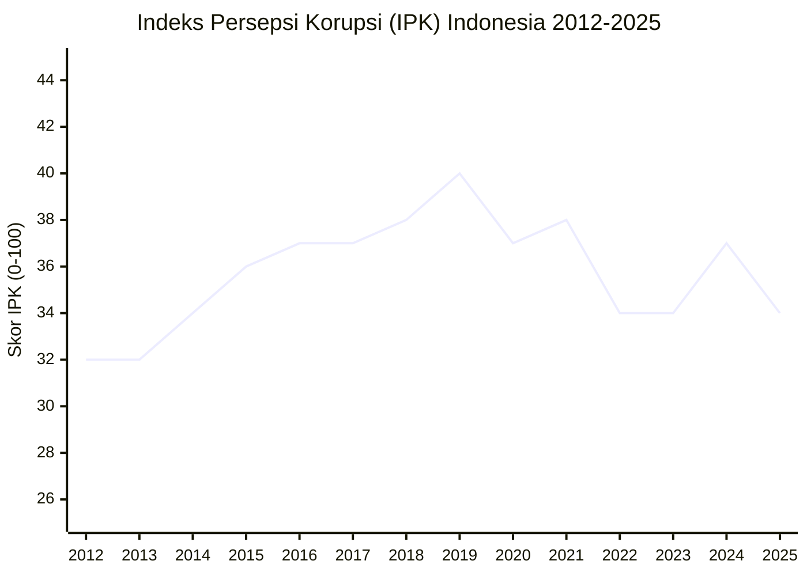
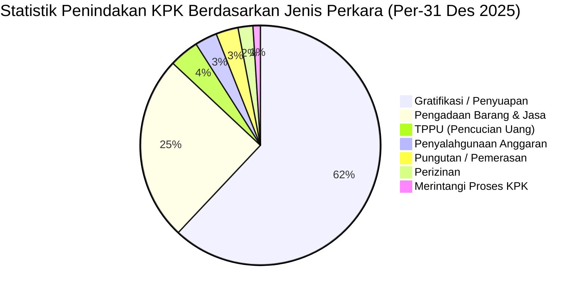
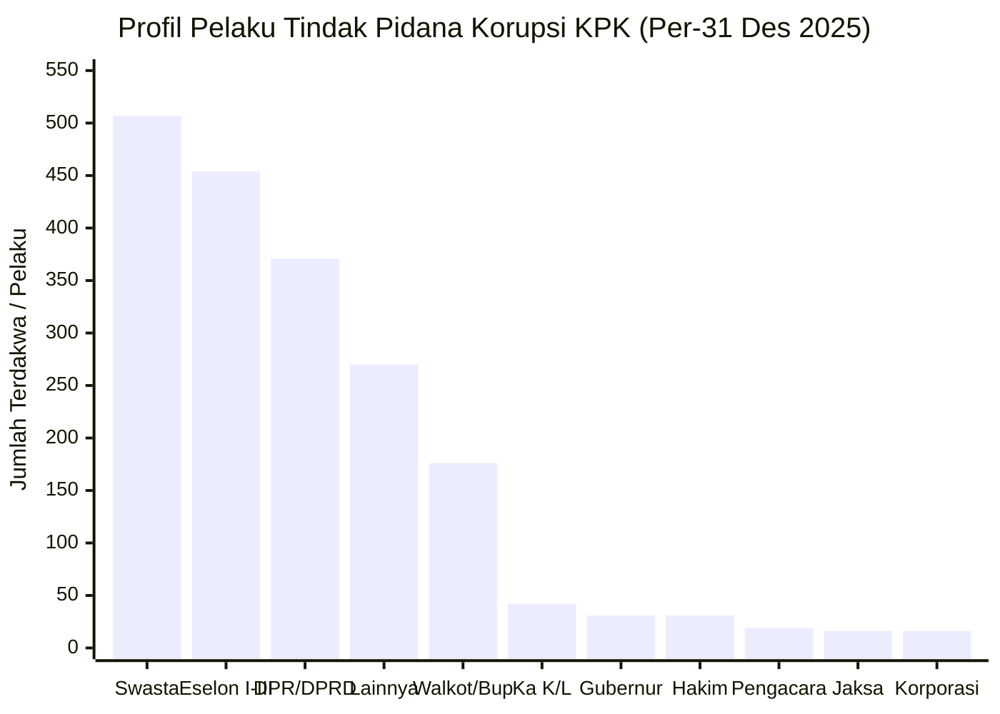
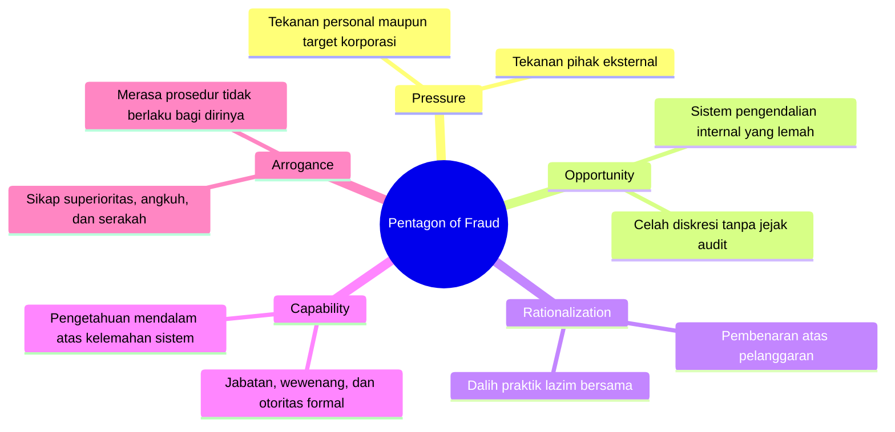
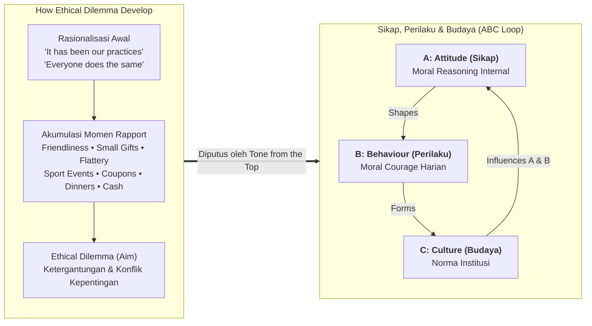
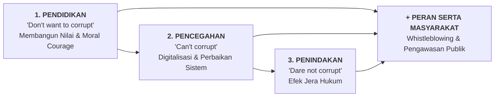

> [!NOTE] Sidang Pleno Pembekalan Fase I — Mabes TNI–Kodiklat (12 Juni 2026)
> **Sesi tatap muka doktrinal Pembekalan Latihan Dasar di Kesatrian Mabes TNI–Kodiklat, Tangerang Selatan.**
>
> Pada Jumat pagi, **12 Juni 2026 (08.00–10.20 WIB)**, kohor **P3MD Batch I Soedirman** menerima materi **"Moral Courage & Moral Reasoning"** yang disampaikan oleh **[[entities/amir-arief|Amir Arief, SST., SH., M.Si., Ak., CA, CFE.]]** (Direktur Sosialisasi dan Kampanye Antikorupsi **KPK**), didampingi oleh **Dr. It. Siti Maimunah, S.Si., M.S.E., M.A.** (Sekretaris Badan Kebijakan Transportasi, Kementerian Perhubungan).
>
> **Konteks Rangkaian Sesi 12 Juni 2026**: Pada hari yang sama pukul **13.30 / 14.10–16.00 WIB**, kohor juga mengikuti sesi lanjutan bertajuk **_Integrity Assessment dan Behavioral Red Flags_** bersama **Prof. Dr. Henndy Ginting, S.Psi., M.Si.** Salinan salindia sesi siang tersebut belum tersedia pada arsip repositori sehingga seluruh eksibit di bawah ini bersumber secara ketat dari dek resmi 29 halaman paparan KPK.

---

## 🧭 1. Executive Overview & National Integrity Baseline (Visi 2045)

Membangun daya saing BUMN dan mewujudkan visi **Indonesia Emas 2045** mustahil tercapai apabila ekosistem tata kelola publik dan korporasi masih dibebani oleh korupsi sistemik. Dalam sesi pembukaan (diikuti jajak pendapat interaktif melalui Mentimeter `bit.ly/mentikodiklat`), **[[entities/amir-arief|Amir Arief]]** memaparkan empat indikator kerentanan integritas nasional terkini:

| Indikator Integritas Nasional                 | Skor Terkini |    Skala    | Diagnosa Kelembagaan KPK & Lembaga Independen                                                     |
| :-------------------------------------------- | :----------: | :---------: | :------------------------------------------------------------------------------------------------ |
| **Indeks Persepsi Korupsi (IPK) 2025**        |    **34**    |   `0–100`   | Skor stagnan rendah; persepsi korupsi publik & pelaku usaha masih tinggi dibanding negara sejawat |
| **Indeks Integritas Nasional (SPI/IIN) 2025** |  **72.32**   |   `0–100`   | Integritas tata kelola instansi K/L dan pemerintah daerah belum merata kuat                       |
| **Indeks Integritas Pendidikan 2024**         |  **69.50**   |   `0–100`   | Kerapuhan integritas masih tampak dari perilaku peserta didik hingga tata kelola sekolah          |
| **Indeks Perilaku Antikorupsi (IPAK) 2024**   |   **3.85**   | `1.00–5.00` | Perilaku antikorupsi di tingkat masyarakat belum terbentuk secara konsisten                       |

### Lintasan IPK Indonesia 2012–2025 & Dekomposisi Sumber Data

Data **Transparency International Indonesia (2026)** menunjukkan pola kenaikan bertahap dari **32** (2012) menuju puncak **40** (2019), sebelum terkoreksi kembali ke **34** pada 2022–2023, sempat memantul ke **37** pada 2024, dan kembali turun menjadi **34** pada 2025:

Penurunan skor IPK 2025 sebesar 3 poin (dari **37** ke **34**) didorong oleh kontraksi tajam pada persepsi daya saing bisnis dan transformasi kelembagaan:

| Sumber Data Penyusun IPK Indonesia 2025               | Skor 2024 | Skor 2025 |  Arah Perubahan   |
| :---------------------------------------------------- | :-------: | :-------: | :---------------: |
| **World Economic Forum EOS**                          |    61     |  **65**   |     +4 (Naik)     |
| **Economist Intelligence Unit (EIU) Country Ratings** |    35     |  **34**   |    -1 (Turun)     |
| **PERC Asia Risk Guide**                              |    38     |  **34**   |    -4 (Turun)     |
| **PRS International Country Risk Guide**              |    33     |  **33**   |     0 (Tetap)     |
| **Global Insight Country Risk Ratings**               |    32     |  **32**   |     0 (Tetap)     |
| **Bertelsmann Foundation Transform Index**            |    39     |  **30**   |    -9 (Turun)     |
| **World Justice Project – Rule of Law Index**         |    26     |  **27**   |     +1 (Naik)     |
| **IMD World Competitiveness Yearbook**                |    45     |  **26**   | -19 (Turun Tajam) |
| **Varieties of Democracy (V-Dem) Project**            |    22     |  **23**   |     +1 (Naik)     |

---

## ⚖️ 2. Klasifikasi Hukum & Anatomi Penindakan KPK (Per-31 Des 2025)

Berdasarkan **UU No. 31 Tahun 1999 jo. UU No. 20 Tahun 2001 (UU Tipikor)**, **UU No. 1 Tahun 2023**, dan **UU No. 1 Tahun 2026 (KUHP)**, terdapat **30 jenis tindak pidana korupsi** yang dikelompokkan ke dalam **7 klaster utama**:

|  No.   | Klasifikasi Tindak Pidana Korupsi        | Rujukan Pasal Kunci (`UU Tipikor` & `KUHP Baru`)                                                     |
| :----: | :--------------------------------------- | :--------------------------------------------------------------------------------------------------- |
| **01** | **Merugikan Keuangan Negara**            | KUHP: Ps. 603, Ps. 604 _(penyalahgunaan wewenang)_                                                   |
| **02** | **Penggelapan dalam Jabatan**            | UU Tipikor: Ps. 8, Ps. 9, Ps. 10 huruf a, b, c                                                       |
| **03** | **Perbuatan Curang**                     | UU Tipikor: Ps. 7 ayat (1) a–d, Ps. 7, Ps. 12 huruf h                                                |
| **04** | **Benturan Kepentingan dalam Pengadaan** | UU Tipikor: Ps. 12 huruf i                                                                           |
| **05** | **Pemerasan**                            | UU Tipikor: Ps. 12 huruf e, f, g                                                                     |
| **06** | **Suap-Menyuap**                         | KUHP: Ps. 605(1) a–b, 605(2), 606(1)–(2); UU Tipikor: Ps. 12 a–b, Ps. 6(1) a–b, Ps. 6(2), Ps. 12 c–d |
| **07** | **Gratifikasi**                          | UU Tipikor: Ps. 12B juncto Ps. 12C                                                                   |

### Titik Rawan, Modus & Profil Pelaku Penindakan KPK

Statistik penindakan KPK hingga **31 Desember 2025** menegaskan bahwa kerentanan terbesar bagi eksekutif BUMN terletak pada transaksi komersial, relasi vendor swasta, dan proses pengadaan barang dan jasa:

Secara komposisi pelaku (_Berdasarkan Profesi/Jabatan_, per-31 Desember 2025), pihak **Swasta (507)** dan pejabat birokrasi **Eselon I/II/III (454)** menempati dua peringkat teratas, melampaui aktor politik maupun penegak hukum, serta mencakup **16 entitas Korporasi**:

_(Catatan kelengkapan data grafik: kategori Komisioner tercatat **8**, Polisi **6**, dan Duta Besar **4**)._

---

## 🛡️ 3. Aturan Gratifikasi, Pentagon of Fraud & Biaya Sosial Korupsi

### Matriks Pengambilan Keputusan Gratifikasi (`Peraturan KPK RI No. 02/2019`)

| Kategori Gratifikasi                   | Kriteria Hukum                                                                                                                                                                                                                                         | Kaidah Tindakan Eksekutif                                                          |
| :------------------------------------- | :----------------------------------------------------------------------------------------------------------------------------------------------------------------------------------------------------------------------------------------------------- | :--------------------------------------------------------------------------------- |
| **Gratifikasi Wajib Dilaporkan**       | Berhubungan dengan jabatan **atau** berlawanan dengan kewajiban/tugasnya                                                                                                                                                                               | **TOLAK!** Jika tidak dapat ditolak secara langsung, **wajib laporkan ke KPK/UPG** |
| **Gratifikasi Tidak Wajib Dilaporkan** | Tidak berhubungan dengan jabatan/kewajiban **serta** memenuhi 4 syarat kumulatif: (1) berlaku umum (jenis/syarat/nilai sama & wajar), (2) tidak bertentangan dengan UU, (3) dalam ranah adat/kebiasaan masyarakat, (4) wujud ekspresi & keramahtamahan | **Boleh diterima**, tidak wajib dilaporkan                                         |

### Pentagon of Fraud: Lima Akar Pemicu Korupsi

Melampaui teori klasik segitiga kecurangan, KPK memetakan lima simpul penyebab korupsi dalam **[[concepts/fraud-pentagon-governance|Pentagon of Fraud]]**:

### Teori Biaya Sosial Korupsi (Model Gunung Es)

Korupsi tidak pernah hanya merugikan negara sebesar uang yang dicuri. Menggunakan model gunung es (**Teori Biaya Sosial Korupsi**), nilai uang yang dikorupsi hanyalah puncak kecil yang tampak di permukaan, sementara beban masif tersembunyi di bawah air:

$$\mathbf{\text{SC}_{\text{corruption}} = C_{\text{explicit}} + C_{\text{anticipation}} + C_{\text{reaction}} + C_{\text{implicit}}}$$

#### 💡 Intuisi & Dekoder Variabel (Tanpa Prasyarat Ekonomi)

Bayangkan sebuah kapal menabrak bongkahan es saat proyek pengadaan BUMN berlangsung. **Biaya Eksplisit** hanyalah bongkahan es di permukaan air—uang _kickback_ yang masuk kantong pelaku. Di bawah permukaan laut, negara menanggung biaya membangun sistem agar tidak terulang, biaya membongkar kasus di pengadilan, serta hilangnya pertumbuhan ekonomi yang seharusnya lahir dari modal tersebut.

- **$C_{\text{explicit}}$ (Biaya Eksplisit)**: Nilai nominal uang yang dikorupsi (baik dinikmati sendiri maupun mengalir ke pihak lain) sebagai kerugian keuangan negara yang tercatat langsung.
- **$C_{\text{anticipation}}$ (Biaya Antisipasi)**: Biaya sosialisasi korupsi sebagai bahaya laten serta biaya reformasi birokrasi untuk menurunkan hasrat korupsi (memisahkan pelaku karena terpaksa vs keserakahan).
- **$C_{\text{reaction}}$ (Biaya Reaksi)**: Biaya penyidikan (KPK, PPATK, auditor forensik) dan biaya peradilan (Jaksa, Hakim, lembaga pemasyarakatan).
- **$C_{\text{implicit}}$ (Biaya Implisit)**: _Opportunity costs_ akibat korupsi—mencakup beban cicilan bunga utang di masa datang akibat pemborosan masa lalu—serta selisih _economic multiplier_ antara kondisi bersih dan kondisi terkorupsi.

#### ⚙️ Mekanisme & Contoh Numerik 10 Detik

Karena seluruh komponen bersifat aditif dan $C_{\text{implicit}}$ bekerja lewat efek pengganda ekonomi, kerugian sosial selalu jauh melampaui nilai suap. Jika sebuah pengadaan anak usaha BUMN bocor akibat _mark-up_ **Rp 10 miliar** ($C_{\text{explicit}} = 10$), lalu memicu **Rp 2 miliar** pembenahan kontrol ($C_{\text{anticipation}}$), **Rp 3 miliar** biaya penyidikan dan peradilan ($C_{\text{reaction}}$), serta **Rp 15 miliar** kehilangan _multiplier_ proyek dan bunga pembiayaan ($C_{\text{implicit}}$), total kehancuran nilai sosial mencapai **Rp 30 miliar**—tiga kali lipat dari uang yang dikorupsi.

---

## 🔥 4. Penguatan Integritas: Eskalasi Dilema Etik, Loop ABC & LHKPN

Memasuki bagian kedua materi (_Penguatan Integritas_), peserta diajak membedah studi kasus video KPK **"Dari Lensa Integritas Terjaga: 'Mendingan Buat Kita'"** ([akses video Google Drive](https://drive.google.com/file/d/1EEjCyKA6jg_KzBazgOUiyjL0_dw3KaJ0/view?usp=sharing)) serta renungan klasik **Abraham Lincoln**:

> _"Nearly all men can stand adversity, but if you want to test a man's character, give him power."_ — **Abraham Lincoln**

### Bagaimana Dilema Etik Berkembang (_The Slippery Slope_) & Sikap–Perilaku–Budaya

Dilema etik jarang muncul dalam bentuk suap bernilai miliaran rupiah di hari pertama. Ia berkembang secara bertahap dari rasionalisasi sosial (_"It has been our practices..."_, _"Everyone does the same..."_) melalui akumulasi momen **Rapport** yang mengikat kewajiban balas budi hingga melumpuhkan objektivitas (**Dilemma**). Memutus siklus ini menuntut penguatan **Sikap (Attitude)** yang membentuk **Perilaku (Behaviour)** dan membangun **Budaya (Culture)**:

### Integritas Kepemimpinan & Audit Dini LHKPN (`elhkpn.kpk.go.id`)

_"Keteladanan menggerakkan budaya, bukan sekadar perintah."_ Pemimpin wajib menjadi _role model_ yang memancarkan _tone from the top_ sembari membangun sistem transparansi, akuntabilitas, dan pengendalian risiko. Salah satu instrumen deteksi dini terhadap kenaikan kekayaan tidak wajar, gratifikasi, atau suap adalah **LHKPN** (`https://elhkpn.kpk.go.id`):

| Unit Institusi                       | Tingkat Pelaporan | Rincian Pelaporan | Tingkat Kepatuhan (Verifikasi Lengkap) | Rincian Kepatuhan |
| :----------------------------------- | :---------------: | :---------------: | :------------------------------------: | :---------------: |
| **Tentara Nasional Indonesia (TNI)** |    **66.41%**     |   `781 / 1.176`   |               **47.87%**               |   `563 / 1.176`   |
| **Mabes TNI**                        |    **65.17%**     |    `116 / 178`    |               **41.57%**               |    `74 / 178`     |
| **Kodiklat TNI**                     |    **100.00%**    |      `6 / 6`      |               **33.33%**               |      `2 / 6`      |

Data ini memperlihatkan celah penting bagi pemimpin organisasi: **kepatuhan administratif (sekadar melapor 100%) belum otomatis berarti kepatuhan substantif (verifikasi lengkap dan akurat baru 33.33%–47.87%)**.

---

## 🧭 5. Delapan Kebiasaan Pemicu, 9 Nilai Antikorupsi & Trisula KPK

### Delapan Kebiasaan Pemicu Korupsi di Lingkungan Kerja

| Kebiasaan Pemicu                             | Manifestasi Perilaku Sehari-Hari                                                            | Risiko Tata Kelola yang Ditimbulkan                           |
| :------------------------------------------- | :------------------------------------------------------------------------------------------ | :------------------------------------------------------------ |
| **1. Gaya hidup berbiaya mahal**             | Perkumpulan hobi mahal (motor besar/offroad), lomba olahraga luar kota, gaya hidup hedonis  | Memicu _Pressure_ melebihi penghasilan sah                    |
| **2. Pelayanan bermental rente**             | _"Kalau bisa jadi duit, mengapa gratis"_ — mewajarkan uang terima kasih dari pemohon/vendor | Pemerasan terselubung & rusaknya standar layanan              |
| **3. Pengadaan _mark-up_**                   | _"Kalau bisa beli mahal, mengapa beli murah"_ — praktik titip harga dan _kickback_          | Merugikan keuangan negara/korporasi secara langsung           |
| **4. Layanan istimewa keluarga**             | Memakai fasilitas dinas untuk urusan non-kedinasan, _privilege_ belanja & wisata keluarga   | Penggelapan fasilitas jabatan & hilangnya teladan             |
| **5. Pungutan kepegawaian**                  | "Tips / uang terima kasih / salam tempel" pada urusan kenaikan pangkat, mutasi, atau diklat | Merusak meritokrasi dan menormalisasi suap internal           |
| **6. Pemberian "hadiah" ke atasan**          | Kebiasaan kecil memberi bingkisan pribadi kepada pimpinan                                   | Memupuk konflik kepentingan & budaya _ewuh pakewuh_           |
| **7. Kegiatan non-kedinasan tanpa anggaran** | Menyelenggarakan acara di luar pagu resmi sehingga membuka celah sokongan dana "pihak" lain | Menjerat institusi dalam utang budi kepada sponsor            |
| **8. Jamuan tamu berlebihan**                | Membiayai perjalanan, penginapan, makan/minum, oleh-oleh, dan uang saku di luar ketentuan   | Pembengkakan biaya tidak akuntabel & gratifikasi timbal balik |

### 9 Nilai Antikorupsi: _"JUMAT BERSEPEDA KK"_

Untuk memagari diri dari delapan kebiasaan pemicu di atas, KPK menanamkan sembilan nilai karakter inti melalui akronim **JUMAT BERSEPEDA KK**:

| Pilar Karakter   | Nilai Inti                              | Makna Operasional bagi Calon Direktur BUMN                                                               |
| :--------------- | :-------------------------------------- | :------------------------------------------------------------------------------------------------------- |
| **JU–MA–T**      | **Jujur, Mandiri, Tanggung Jawab**      | Menolak manipulasi data RKAP, tidak bergantung pada rente pihak ketiga, siap menanggung risiko keputusan |
| **BER–SE–PED–A** | **Berani, Sederhana, Peduli, Disiplin** | Memiliki _moral courage_ menolak suap, hidup bersahaja, peka pada dampak publik, taat prosedur & waktu   |
| **KK**           | **Adil, Kerja Keras**                   | Menilai vendor & talenta secara objektif-meritokratis serta menuntaskan amanah tanpa jalan pintas        |

### Best Practice Pencegahan & Strategi Trisula KPK

Data yang dibuka, proses yang didigitalkan, dan kolaborasi lintas lembaga terbukti mempersempit ruang korupsi (_"Kinerja terlihat, alur terkendali, kepercayaan meningkat"_):

- **Open Government & Transparansi Data**: Keterbukaan informasi publik proaktif seperti aplikasi **_Sentuh Tanahku_** dan kanal **`prod.lapor.go.id`**.
- **Digitalisasi Layanan Publik**: Mengubah proses manual rawan rente menjadi alur _end-to-end_ digital dengan kontrol internal otomatis.
- **Kolaborasi Pencegahan & Penegakan**: Sinergi tata kelola agar perbaikan sistem dan efek jera berjalan beriringan.

### Etika Kepercayaan, Larangan _Ghulul_ & Saluran Pengaduan Resmi

Sesi ditutup dengan tiga penegasan etis—bahwa kepercayaan membutuhkan waktu bertahun-tahun untuk dibangun namun hancur dalam hitungan detik (_"Trust take years to build, seconds to break, and forever to repair"_), hadis shahih **HR. Abu Daud** tentang larangan _ghulul_ (pengambilan di luar upah sah yang menjadi pengkhianatan amanah), serta semboyan **Pusat Edukasi Antikorupsi KPK**:

> **"Biasakan yang Benar, Jangan Benarkan yang Biasa."**

| Kanal Pengaduan             | Komisi Pemberantasan Korupsi (KPK)                                                           | Tentara Nasional Indonesia (TNI) |
| :-------------------------- | :------------------------------------------------------------------------------------------- | :------------------------------- |
| **Email Resmi**             | `pengaduan@kpk.go.id`                                                                        | `ppidtni@puspen.tni.mil.id`      |
| **Portal / Whistleblowing** | `http://kws.kpk.go.id`                                                                       | `http://www.tni.mil.id`          |
| **Call Center / Telepon**   | `198`                                                                                        | `(021) 8459-5576`                |
| **WhatsApp / SMS**          | `0811 9595 75` \| `0855 8575 575`                                                            | —                                |
| **Edukasi Digital KPK**     | `@suaraantikorupsi.kpk` (IG) \| `Suara Antikorupsi` (YT/FB) \| `@suara.antikorupsi` (TikTok) | —                                |

---

## 📂 Primary Source Media & Digital Archives

| Dokumen / Media Sumber                                            |     Format     | Lokasi Repositori / Tautan                                                                                          |
| :---------------------------------------------------------------- | :------------: | :------------------------------------------------------------------------------------------------------------------ |
| **Materi Pembekalan Moral Courage & Moral Reasoning (29 Slides)** |     `.pdf`     | `archive/rabuan/2026-06-12-amir-arief-moral-courage/00004599-Mabes TNI_12 Juni 2026_AA.pdf`                         |
| **Ekstraksi Teks Lengkap Paparan KPK**                            |     `.txt`     | `archive/rabuan/2026-06-12-amir-arief-moral-courage/.extracted/texts/00004599-Mabes TNI_12 Juni 2026_AA.txt`        |
| **Video Studi Kasus: _"Mendingan Buat Kita"_**                    | Video (GDrive) | [Dari Lensa Integritas Terjaga](https://drive.google.com/file/d/1EEjCyKA6jg_KzBazgOUiyjL0_dw3KaJ0/view?usp=sharing) |
| **Jajak Pendapat Mentimeter Sesi**                                |    Web Poll    | `bit.ly/mentikodiklat`                                                                                              |

---

## 🔗 Knowledge Graph & Cross-Curricular Bridges

- **Profil Pembicara**: [[entities/amir-arief|Amir Arief, SST., SH., M.Si., Ak., CA, CFE.]]
- **Konsep Utama & Kerangka Terkait**:
  - [[concepts/fraud-pentagon-governance|Fraud Pentagon, Social Cost of Corruption & Anti-Corruption Governance]]
  - [[concepts/the-integrity-triangle|The Integrity Triangle: Character Diagnostic Framework]]
  - [[concepts/values-congruence|Values Congruence & Executive Friction]]
  - [[concepts/agency-theory|Agency Theory & Multi-Tiered State Ownership Governance]]
  - [[concepts/psychological-safety|Psychological Safety in Teams]]
  - [[concepts/best-mind-best-heart|Best Mind and Best Heart: The P3MD Leadership Doctrine]]
- **Jembatan Kurikulum MBA (MK 1 – MK 5)**:
  - [[courses/mk1-organizational-behavior-managing-people/week-01/index|MK 1 Week 01: Self-Awareness & Values Congruence]] (Kongruensi nilai pribadi vs tekanan eksekutif)
  - [[courses/mk1-organizational-behavior-managing-people/week-04/index|MK 1 Week 04: Leadership & Culture Transformation]] (_Tone from the top_ dan kejelasan tata kelola risiko)
  - [[courses/mk1-organizational-behavior-managing-people/week-05/index|MK 1 Week 05: High-Performing Teams & Psychological Safety]] (Memecah budaya diam / _Area Seram_)
  - [[courses/mk1-organizational-behavior-managing-people/week-07/index|MK 1 Week 07: Power, Politics & SOE Governance]] (Mekanisme _whistleblowing_ dan kontrol penyalahgunaan wewenang)
  - [[courses/mk2-financial-management-strategy/week-01/index|MK 2 Week 01: Corporate Governance & Financial Agency]] (Proteksi arus kas & disiplin _ROIC vs WACC_)
  - [[courses/mk3-marketing-management/week-04/index|MK 3 Week 04: B2B Marketing & WIKA Procurement]] (Kepatuhan tender publik terhadap audit BPKP/LKPP)
  - [[courses/mk3-marketing-management/week-08/index|MK 3 Week 08: PT KAI Service Transformation]] (Digitalisasi proses & WBS untuk memutus rente)
  - [[courses/mk5-decision-making-negotiation/week-02/index|MK 5 Week 02: Rational Decision Framework & AKHLAK]] (Operasionalisasi nilai _Amanah_ dan SLA investigasi WBS $< 14$ hari)
- **Sesi Fase I & Integritas Terkait**:
  - [[rabuan/2026-11-12-operasi-integritas-soedirman|Operasi Integritas Soedirman (OIS P3MD 2026)]]
  - [[rabuan/2026-07-03-budhi-achmadi-kepemimpinan-bumn|Marsda TNI Dr. Budhi Achmadi: Kepemimpinan BUMN Abad XXI]]
  - [[rabuan/2026-06-22-kusworo-crisis-leadership|Marsdya TNI (Purn) Kusworo: Crisis Leadership]]
- **Kembali ke**: [[rabuan/index|Arsip Eksekutif Kuliah Rabuan]] | [[index|Portal Utama MBA P3MD]]
