> [!NOTE] Sidang Pleno Doktrinal Fase I Program Pendidikan Pemimpin Masa Depan Indonesia (P3MDI)
> **Sesi tatap muka doktrinal di Kesatrian Kodiklat TNI Serpong.**
>
> Pada Senin, 22 Juni 2026, calon pemimpin holding BUMN kohor **P3MDI Batch I Soedirman** (d/h **P3MD**, d/h **PFLP** / _Presidential Future Leaders Program_) menerima kuliah pleno doktrinal kepemimpinan krisis dari mantan Kepala Badan Nasional Pencarian dan Pertolongan (Kabasarnas), **[[entities/kusworo|Marsdya TNI (Purn) Kusworo, S.E., M.M.]]**, bertajuk **"Crisis Leadership — Leading Under Pressure: Decide Fast, Act Right, Save Lives"**.
>
> Berlangsung pada **Fase I (Fondasi Karakter, Kepemimpinan & Kedisiplinan Militer)** di **Kodiklat TNI Serpong**, sesi pleno ini memberikan doktrin komando operasional penyelamatan jiwa di medan ekstrem Indonesia. Dipadukan dengan jam terbang beliau sebagai instruktur penerbang tempur TNI AU dan Komandan Sesko TNI, Marsdya Kusworo mentransformasikan protokol pencarian dan pertolongan (SAR) menjadi kerangka kerja pengambilan keputusan taktis (_tactical decision making_) bagi eksekutif korporasi negara yang menghadapi disrupsi sistemik, bencana industri, dan krisis multi-pemangku kepentingan.

---

## 🧭 Executive Session Overview: The Crisis Horizon

Sebagai mantan perwira tinggi penerbang militer berlatar belakang instruktur penerbang tempur, Asisten Personel Panglima TNI, Komandan Sesko TNI, dan Kepala Badan Nasional Pencarian dan Pertolongan (Basarnas), **[[entities/kusworo|Marsdya TNI (Purn) Kusworo, S.E., M.M.]]** membuka sidang pleno dengan merumuskan hakikat sejati krisis: **keadaan ekstrem di mana waktu sangat terbatas, informasi tidak lengkap, variabel medan terus bergolak, dan taruhan akhir adalah nyawa manusia**.

Dalam situasi tanggap darurat, manajemen konvensional yang bersifat deliberatif dan birokratis runtuh. Keberhasilan penanganan krisis ditentukan oleh kualitas **[[concepts/crisis-leadership-framework|Crisis Leadership]]**: kemampuan seorang komandan untuk tetap tenang di bawah tekanan, membangun pemahaman situasi (_situational awareness_) secara kilat, mengambil keputusan yang berani dan terukur, serta mengorkestrasi seluruh kekuatan lintas instansi tanpa terhambat sekat kelembagaan.

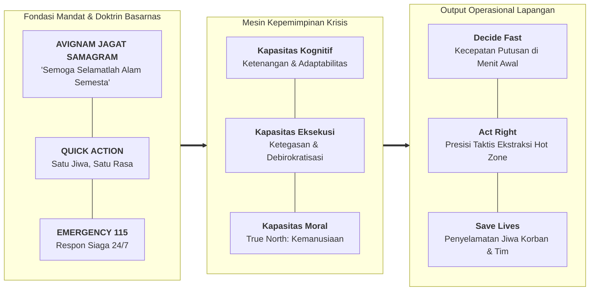

### Konteks Visual & Rekam Jejak Instruktur Tempur

Paparan Marsdya Kusworo didukung dokumentasi visual komprehensif yang memadukan rekam jejak karier militer udara dan komando lapangan Basarnas:

- **Disiplin Kokpit & Jam Terbang Operasional**: Visual pembuka menampilkan perjalanan biografis beliau sejak lulus Akademi Angkatan Udara (AAU 1988), Sekolah Instruktur Penerbang (1996), hingga Lemhannas RI (PPRA LIII 2015), berdampingan dengan foto beliau di dalam kokpit pesawat tempur dengan helm penerbang lengkap. Doktrin penerbangan tempur—di mana kesalahan satu detik berakibat fatal—menjadi DNA pembentukan ketenangan emosional beliau saat memimpin operasi SAR berskala masif.
- **Kehadiran Komando di Hot Zone**: Dokumentasi lapangan memperlihatkan kunjungan kerja beliau di lokasi erupsi Gunung Lewotobi Laki-Laki (bersama Menko PMK dan Kepala BNPB), penyisiran personel berseragam oranye SAR di hamparan lahar dingin Sumatera Barat, serta tinjauan taktis di medan longsor tambang Desa Tulabolo, Gorontalo.

Pesan sentral sesi ini sangat tegas bagi calon direksi BUMN:

> _“Teknologi canggih dan aturan hukum memfasilitasi operasi, tetapi karakter pemimpinlah yang menyelamatkan nyawa.”_

---

## 🌋 Indonesia Sebagai "Laboratorium Bencana": Posisi Tektonik & Anatomi Risiko

Indonesia secara absolut merupakan **"Laboratorium Bencana"** dunia. Terletak di pertemuan tiga lempeng tektonik aktif utama (Indo-Australia, Eurasia, dan Pasifik) serta diselimuti oleh Cincin Api Pasifik (_Pacific Ring of Fire_), kepulauan nusantara berada dalam kondisi kerentanan geologis dan hidrometeorologis permanen.

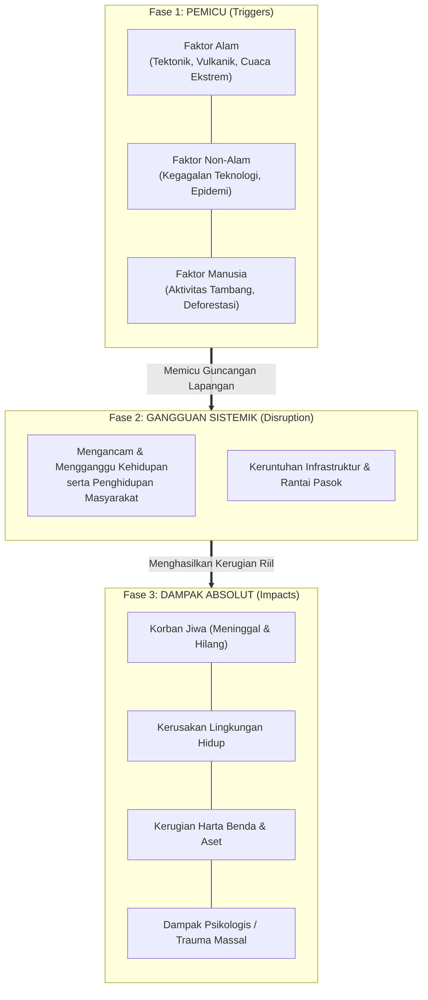

### Empat Pilar Spektrum Kerawanan Basarnas

Berdasarkan mandat Undang-Undang, spektrum operasi Basarnas melampaui bencana alam murni, mencakup empat domain risiko nasional:

| Kategori Ancaman                       | Karakteristik Kejadian Lapangan                                                      | Contoh Ancaman Spesifik                                                                                           |
| :------------------------------------- | :----------------------------------------------------------------------------------- | :---------------------------------------------------------------------------------------------------------------- |
| **Bencana Hidrometeorologi**           | Dipicu oleh anomali cuaca, curah hujan ekstrem, dan dinamika atmosfer maritim.       | Banjir bandang, tanah longsor lereng bukit, gelombang tinggi samudra, badai tropis, dan angin puting beliung.     |
| **Bencana Geologi**                    | Dipicu oleh aktivitas lempeng bumi tektonik dan dapur magma vulkanik.                | Gempa bumi dangkal/dalam, tsunami pantai, dan erupsi eksplosif gunung api.                                        |
| **Kecelakaan Transportasi**            | Kegagalan teknis, cuaca buruk, atau kelalaian manusia pada moda transportasi massal. | Laka pesawat udara komersial/perintis, laka kapal feri/nelayan, laka kereta api, dan tabrakan beruntun jalan tol. |
| **Kondisi Membahayakan Manusia (KMM)** | Insiden darurat non-transportasi di mana keselamatan warga terancam langsung.        | Wisatawan hanyut di pesisir/air terjun, pendaki tersesat di gunung, warga jatuh ke sumur tua/jurang terisolasi.   |

---

## 📊 Studi Kasus Angka Operasi SAR Nasional (2024 vs. 2025)

Marsdya Kusworo menyajikan data audit statistik operasional riil yang dihimpun oleh Pusat Data dan Informasi Basarnas serta aplikasi terintegrasi **QR-SAR**:

### Rekapitulasi Operasi SAR Tahun 2024 (Januari – Desember)

| Kategori Operasi SAR (2024)            | Jumlah Operasi (Kejadian) | Total Korban Terdampak (Jiwa) | Korban Selamat (Jiwa) | Meninggal Dunia (Jiwa) | Hilang (Jiwa) | Tingkat Keselamatan (%) |
| :------------------------------------- | :------------------------ | :---------------------------- | :-------------------- | :--------------------- | :------------ | :---------------------- |
| **Kondisi Membahayakan Manusia (KMM)** | 1.474                     | 2.349                         | 999                   | 1.186                  | 164           | 42,53%                  |
| **Kecelakaan Kapal**                   | 868                       | 6.252                         | 5.599                 | 350                    | 303           | 89,56%                  |
| **Bencana Alam**                       | 146                       | 31.487                        | 31.170                | 282                    | 35            | 98,99%                  |
| **Kecelakaan Penanganan Khusus**       | 65                        | 393                           | 338                   | 55                     | 0             | 86,01%                  |
| **Kecelakaan Pesawat**                 | 7                         | 67                            | 56                    | 11                     | 0             | 83,58%                  |
| **TOTAL KESELURUHAN (2024)**           | **2.560**                 | **40.548**                    | **38.162**            | **1.884**              | **502**       | **94,12%**              |

### Rekapitulasi Operasi SAR Tahun 2025 (Januari – Oktober via Aplikasi QR-SAR)

| Kategori Operasi SAR (Jan–Okt 2025)    | Jumlah Operasi (Kejadian) | Total Korban Terdampak (Orang) | Korban Selamat (Orang) | Meninggal Dunia (Orang) | Hilang (Orang) | Tingkat Keselamatan (%) |
| :------------------------------------- | :------------------------ | :----------------------------- | :--------------------- | :---------------------- | :------------- | :---------------------- |
| **Kondisi Membahayakan Manusia (KMM)** | 1.339                     | 2.020                          | 729                    | 1.099                   | 192            | 36,09%                  |
| **Kecelakaan Kapal**                   | 753                       | 3.656                          | 3.075                  | 328                     | 253            | 84,11%                  |
| **Bencana Alam**                       | 129                       | 3.741                          | 3.550                  | 162                     | 29             | 94,89%                  |
| **Kecelakaan Penanganan Khusus**       | 68                        | 499                            | 417                    | 80                      | 2              | 83,57%                  |
| **Kecelakaan Pesawat**                 | 3                         | 14                             | 1                      | 13                      | 0              | 7,14%                   |
| **TOTAL KESELURUHAN (10 Bulan 2025)**  | **2.292**                 | **9.930**                      | **7.772**              | **1.682**               | **476**        | **78,27%**              |

```mermaid
xychart-beta
    title "Frekuensi Operasi SAR per Kategori (2024 vs Jan-Okt 2025)"
    x-axis ["KMM", "Laka Kapal", "Bencana Alam", "Laka Khusus", "Laka Pesawat"]
    y-axis "Jumlah Operasi Kejadian" 0 --> 1600
    bar [1474, 868, 146, 65, 7]
    bar [1339, 753, 129, 68, 3]
```

### Wawasan Analitis bagi Punggawa BUMN:

1. **Dominasi Frekuensi KMM & Maritim**: Kejadian SAR paling sering terjadi pada ranah Kondisi Membahayakan Manusia (1.474 kejadian di 2024; 1.339 di 2025) dan Kecelakaan Kapal (868 di 2024; 753 di 2025). Ini membuktikan bahwa keselamatan operasional maritim dan aktivitas masyarakat di alam terbuka menuntut kesiapan komando terdesentralisasi setiap hari.
2. **Skala Korban Massal pada Bencana Geologi/Hidrometeorologi**: Kendati jumlah kejadian bencana alam relatif lebih kecil (146 di 2024), jumlah korban terdampak mencapai angka raksasa: **31.487 jiwa** dalam satu tahun. Dalam kategori ini, keberhasilan evakuasi massal (31.170 jiwa selamat atau 98,99%) bergantung penuh pada peringatan dini dan kecepatan orkestrasi evakuasi multisektor.
3. **Fatalitas Ekstrem pada Insiden Udara**: Pada kecelakaan pesawat tahun 2025, dari 14 korban terdampak hanya 1 orang yang selamat (13 meninggal dunia). Pada krisis berenergi kinetik tinggi, margin kesalahan manusia adalah nol.

---

## 🔍 Dua Studi Kasus Lapangan Komparatif: Agam vs. Tulabolo

Untuk memberikan pemahaman nyata kepada kohor, Marsdya Kusworo membedah dua operasi SAR besar yang dipimpin Basarnas sepanjang tahun 2024:

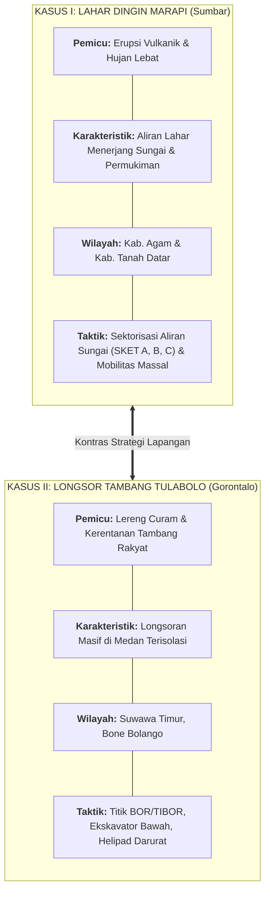

### Studi Kasus I: Banjir Lahar Dingin Gunung Marapi (Sumatera Barat)

- **Waktu & Durasi**: Kejadian 11 Mei 2024; durasi operasi SAR berlangsung selama 14 hari penuh (18–31 Mei 2024).
- **Lokasi**: Kabupaten Agam dan Kabupaten Tanah Datar, Provinsi Sumatera Barat.
- **Dinamika Ancaman**: Material piroklastik vulkanik di puncak gunung bercampur dengan curah hujan tinggi, meluncur menuruni tiga lembah sungai besar menuju kawasan permukiman padat penduduk.
- **Solusi Taktis Komando**: Kantor SAR Padang membagi wilayah pencarian menjadi tiga sektor operasi presisi (**SKET A, SKET B, SKET C**), mengerahkan alat berat ekskavator untuk membuka sumbatan sedimen kayu gelondongan, serta menyisir bantaran sungai sepanjang puluhan kilometer untuk mengevakuasi korban dan mencegah korban susulan akibat tanggul alam yang jebol.

### Studi Kasus II: Tanah Longsor Tambang Emas Tradisional Desa Tulabolo (Gorontalo)

- **Waktu Kejadian**: 6 Juli 2024.
- **Lokasi**: Area tambang rakyat Desa Tulabolo, Kecamatan Suwawa Timur, Kabupaten Bone Bolango, Gorontalo.
- **Dampak Korban**: **27 Meninggal Dunia**, **283 Orang Selamat**, **15 Orang Hilang**.
- **Tantangan Medan Ekstrem**: Terletak di pegunungan terpencil dengan lereng sangat curam dan tanah labil yang mudah tererosi, diperparah oleh lorong-lorong galian tambang bawah tanah.
- **Solusi Taktis Komando**:
  - Memetakan poligon guguran longsor secara digital dan membaginya ke dalam sektor lubang bor: **TIBOR 1**, **TIBOR 3**, dan **TIBOR 9**.
  - Sektor atas (**TIBOR 3 & 9**): Dilakukan penyisiran manual oleh personel penyelamat karena alat berat tidak dapat menembus kemiringan lereng.
  - Sektor bawah (**TIBOR 1**): Dikerahkan ekskavator untuk membongkar timbunan sedimen tebal.
  - **Evakuasi Ajaib**: Penyelamatan spektakuler **5 korban selamat** yang terjebak di dalam rongga lubang tambang tertimbun ($0^\circ 26'44.62''\text{U} - 123^\circ 20'4.10''\text{T}$).
  - **Aset Penyelamat Nyawa**: Pembangunan **Helipad Darurat (H)** dan Posko Tim SAR Gabungan di tepi zona bahaya untuk memangkas waktu evakuasi medis udara (_medevac_) bagi korban kritis dan mengamankan rute penyelamatan bagi _rescuers_.

### Matriks Diagnostik Komparatif: Agam vs. Tulabolo

| Parameter Diagnostik          | Kasus Agam (Banjir Lahar Dingin)                                                                           | Kasus Gorontalo (Longsor Tambang Rakyat)                                                                                     |
| :---------------------------- | :--------------------------------------------------------------------------------------------------------- | :--------------------------------------------------------------------------------------------------------------------------- |
| **Pemicu Utama (_Triggers_)** | Murni faktor alam: interaksi material vulkanik Gunung Marapi dan hidrometeorologi curah hujan ekstrem.     | Kombinasi faktor alam (lereng pegunungan curam, tanah labil) dan faktor manusia (lubang tambang tanpa rekayasa geoteknik).   |
| **Profil Risiko Lapangan**    | Area terdampak membentang puluhan kilometer; ancaman banjir bandang susulan sewaktu-waktu menerjang hilir. | Area titik terkonsentrasi di lembah pegunungan terisolasi; ancaman longsor susulan sangat tinggi menimbun personel penolong. |
| **Fokus Evakuasi**            | Masyarakat umum dan warga permukiman pedesaan berskala luas.                                               | Pekerja tambang yang terperangkap di dalam lubang-lubang galian bawah tanah.                                                 |
| **Kebutuhan Taktis Utama**    | Kecepatan mobilitas penyisiran di sepanjang aliran sungai dan pembersihan puing jembatan.                  | Presisi penggalian di titik koordinat sempit dan jaminan keselamatan tim SAR melalui dukungan helipad darurat.               |

---

## 🏛️ Arsitektur Hukum & Orkestrasi Lintas Instansi (Hub-and-Spoke)

Dalam penanganan tanggap darurat, wewenang tidak boleh tumpang tindih. Marsdya Kusworo memaparkan arsitektur hukum Indonesia yang kokoh:

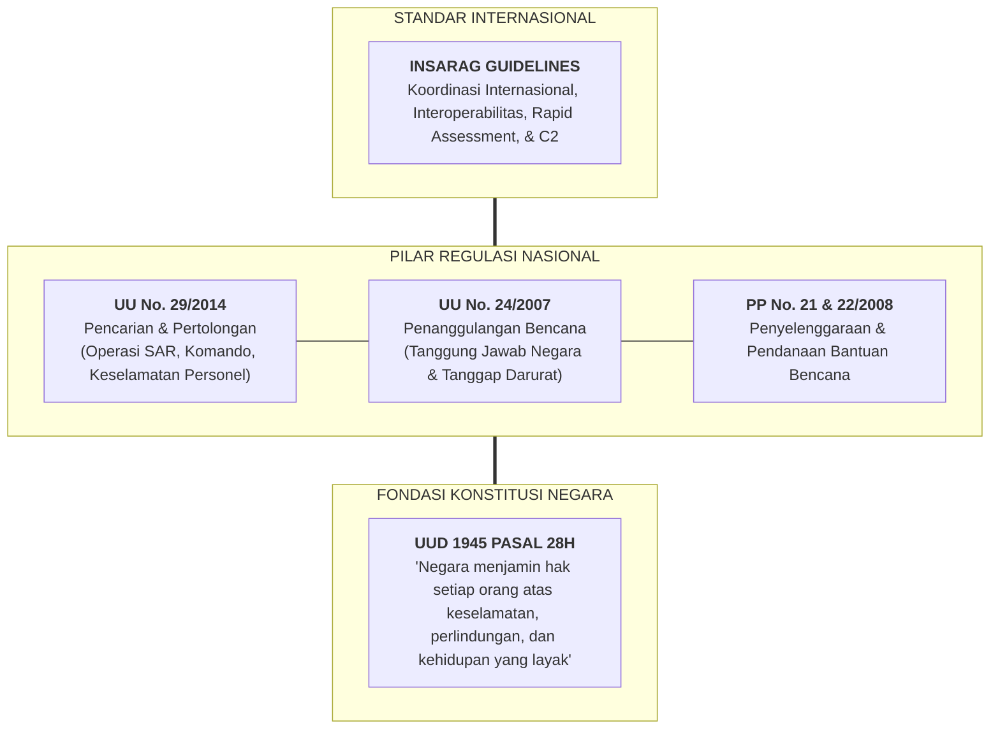

Berdasarkan **Perpres No. 83 Tahun 2016 (Pasal 3 huruf e)**, Basarnas memegang fungsi koordinasi penyelenggaraan Operasi SAR terpadu. Model hubungan antar-lembaga dijalankan melalui arsitektur terpusat (_Hub-and-Spoke_):

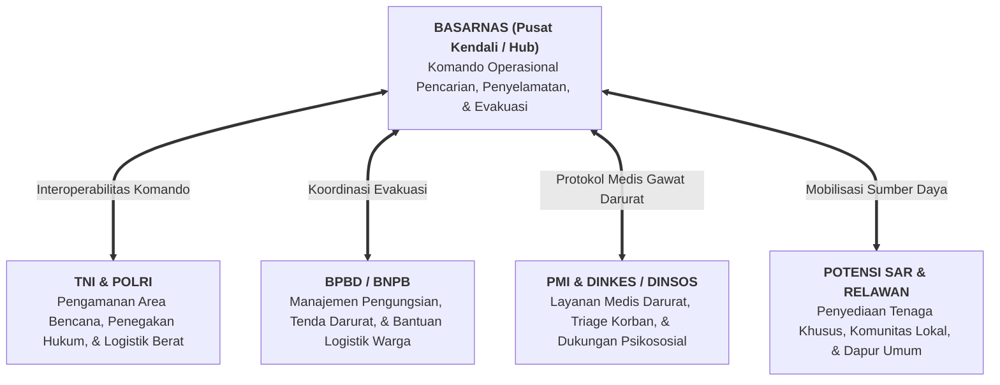

---

## ⚙️ Mesin Kepemimpinan Krisis: Rumus Risiko & Siklus 4-Fase

Inti dari doktrin kepemimpinan Marsdya Kusworo adalah **Persamaan Risiko Bencana** yang diadopsi dari standar internasional:

$$\text{Risk} = \frac{\text{Hazard} \times \text{Vulnerability}}{\text{Capacity}}$$

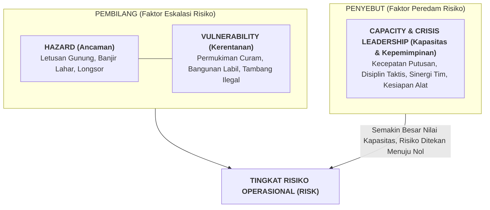

### 6 Dimensi Kekacauan di Medan Bencana (_The Hexagon of Chaos_)

Pemimpin krisis tidak pernah beroperasi dalam kondisi ideal. Mereka selalu dikepung oleh enam dimensi kekacauan:

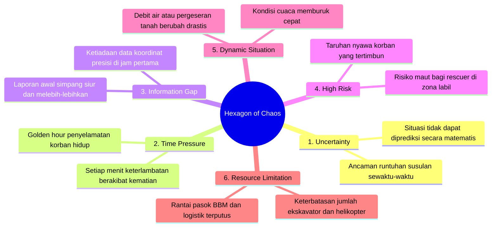

> [!WARNING] Prinsip Pengambilan Keputusan Lapangan
> _“Dalam situasi bencana, **tidak ada keputusan yang sempurna**. Yang dibutuhkan adalah **keputusan terbaik berdasarkan informasi yang tersedia saat itu**.”_

---

### Empat Fase Mesin Kepemimpinan Krisis

Untuk mengubah kekacauan menjadi kendali teratur, Incident Commander menggerakkan siklus empat fase:

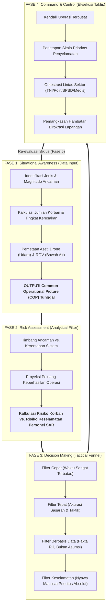

---

## 🎯 Tactical Decision Tree & Prioritas Ekstraksi

Dalam Fase 3, pengambilan keputusan diturunkan ke dalam bagan alur pohon keputusan taktis (_Tactical Decision Tree_):

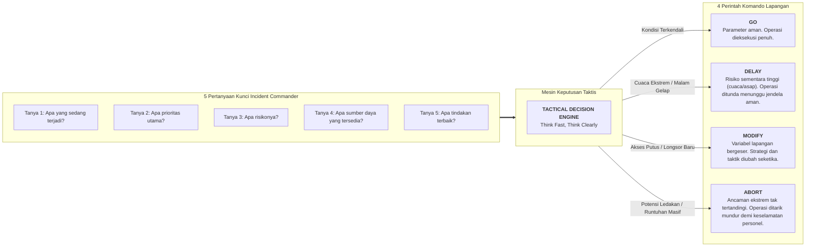

### Hierarki Prioritas Mutlak & Alur Ekstraksi

Ketika sumber daya dan waktu berada pada titik nadir, Incident Commander wajib memegang teguh piramida prioritas:

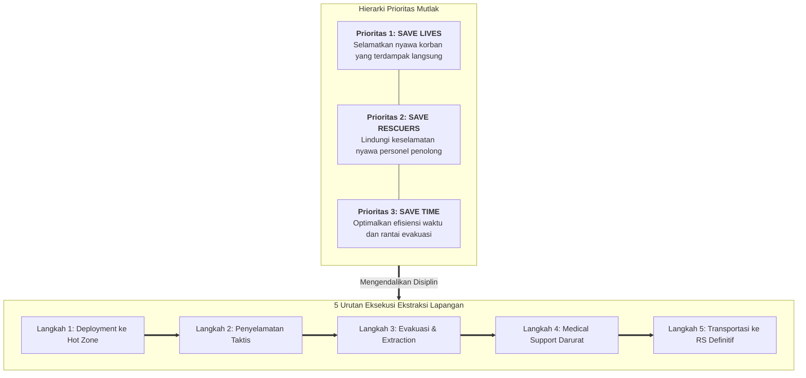

---

## 🧭 Pergeseran Paradigma & Tiga Pilar Pemimpin Krisis

Marsdya Kusworo menekankan transformasi mental yang wajib dilalui seorang manajer ketika melangkah menjadi pemimpin krisis:

| Dimensi Operasional    | Manajemen Operasional Standar                                      | Kepemimpinan Krisis (_Crisis Leadership_)                                   |
| :--------------------- | :----------------------------------------------------------------- | :-------------------------------------------------------------------------- |
| **Kondisi Lingkungan** | Dapat diprediksi, data historis melimpah, parameter stabil.        | **Ketidakpastian Tinggi**, medan bergolak liar, data terfragmentasi.        |
| **Laju Keputusan**     | Terencana, deliberatif, melalui persetujuan komite bertingkat.     | **Tekanan Waktu Berbahaya**, hitungan detik menentukan hidup-mati.          |
| **Taruhan Akhir**      | Pencapaian target KPI kuartalan, margin laba, dan efisiensi biaya. | **Risiko Nyawa Manusia**, kehancuran aset strategis, reputasi eksistensial. |

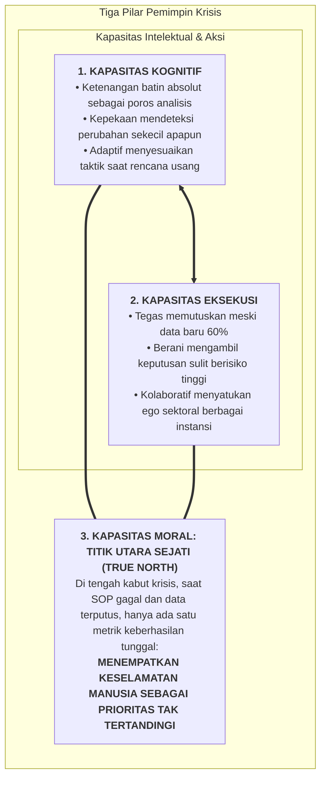

### Roda Navigasi Krisis (Protokol Tindakan 5-Simpul)

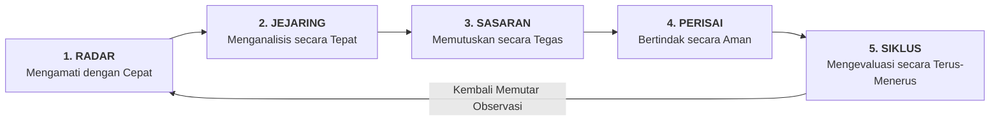

---

## 🏢 Implikasi Strategis bagi Punggawa BUMN di Bawah Holding Danantara

Bagi calon pemimpin holding BUMN di kohor **P3MDI Batch I Soedirman**, seluruh doktrin krisis Marsdya Kusworo memiliki padanan langsung di ruang rapat direksi dan lapangan operasional korporasi negara:

1. **Memperbesar Denominator Kapasitas BUMN**:  
   Ketika ancaman makro ($H$) meningkat akibat perang dagang global atau volatilitas nilai tukar rupiah, dan kerentanan neraca ($V$) terbebani belanja modal tinggi, **direksi tidak boleh pasif meratapi keadaan**. Direksi wajib memperbesar kapasitas organisasi ($C$) melalui pembentukan satuan tugas krisis likuiditas, lindung nilai valas yang disiplin, dan efisiensi belanja non-esensial.
2. **Incident Command System di BUMN Sektor Strategis**:  
   BUMN infrastruktur energi (PLN, Pertamina), transportasi publik (KAI, Pelindo, Jasa Marga), dan perbankan (Mandiri, BRI, BNI) harus mengadopsi struktur _Incident Commander_ saat terjadi kegagalan jaringan listrik pulau, kebakaran kilang minyak, tabrakan moda transportasi, atau serangan siber perbankan. Garis komando harus ditarik lurus ke satu penanggung jawab krisis tanpa terhambat rapat birokrasi bertele-tele.
3. **Penerapan Opsi Taktis (GO / DELAY / MODIFY / ABORT) pada Proyek Strategis**:  
   Ketika proyek ekspansi atau investasi korporasi mengalami lonjakan biaya (_cost overrun_) atau sengketa sosial yang parah, pemimpin BUMN harus berani memutuskan: menunda sementara menunggu restrukturisasi kontrak (**DELAY**), mengubah skema pendanaan menjadi kemitraan KPBU (**MODIFY**), atau menghentikan proyek bermasalah sebelum menguras modal negara (**ABORT**).
4. **Kapasitas Moral True North dalam Pengelolaan BUMN**:  
   Mengacu pada amanat **Pasal 33 UUD 1945**, orientasi tertinggi punggawa BUMN bukanlah dividen finansial jangka pendek yang mengorbankan keselamatan rakyat atau keselamatan pekerja lapangan. Integritas moral dan perlindungan hajat hidup orang banyak adalah titik utara kompas (_True North_) yang tidak boleh dikompromikan.

---

## 🔗 Direktori Sumber Daya & Jembatan Semantik

- **Konsep Analitis Terkait**:
  - [[concepts/crisis-leadership-framework|Crisis Leadership Framework & Tactical Decision Architecture]]
  - [[concepts/kepner-tregoe-problem-analysis|Kepner-Tregoe Problem Analysis & Decision Making]]
  - [[concepts/public-administration-paradigms|Public Administration Paradigms & State Enterprise Governance]]
  - [[concepts/growth-mindset|Growth Mindset & Adaptive Capacity]]
  - [[concepts/pso-commercial-duality|PSO vs Commercial Viability Duality]]
- **Profil Tokoh Terkait**:
  - [[entities/kusworo|Marsdya TNI (Purn) Kusworo, S.E., M.M.]]
  - [[entities/budhi-achmadi|Marsda TNI Dr. Budhi Achmadi, M.Sc.]]
  - [[entities/anton-palaguna|Marsma TNI Dr. Anton 'Sioux' Palaguna]]
  - [[entities/prabowo-subianto|Jenderal TNI (Purn.) H. Prabowo Subianto]]
- **Kembali ke**: [[rabuan/index|Arsip Eksekutif Kuliah Rabuan]] | [[entities/index|Direktori Entitas]] | [[concepts/index|Direktori Konsep]]
