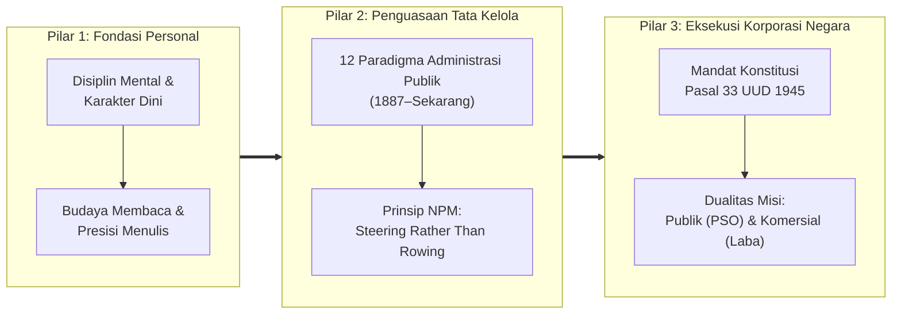
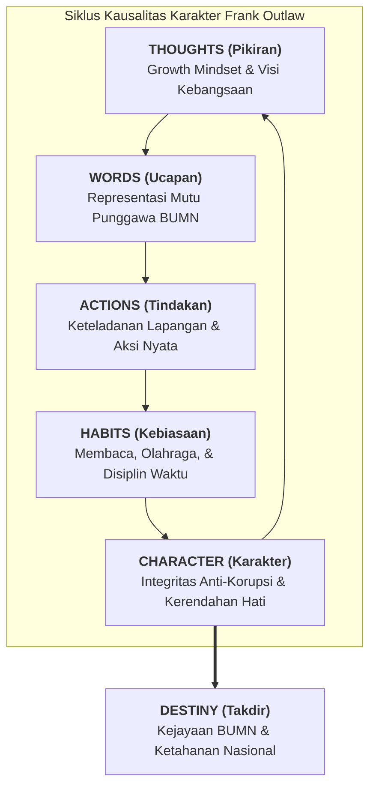
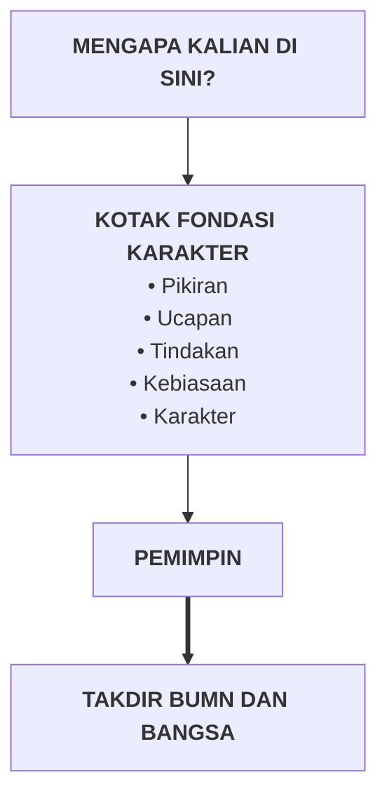
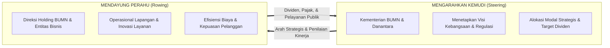
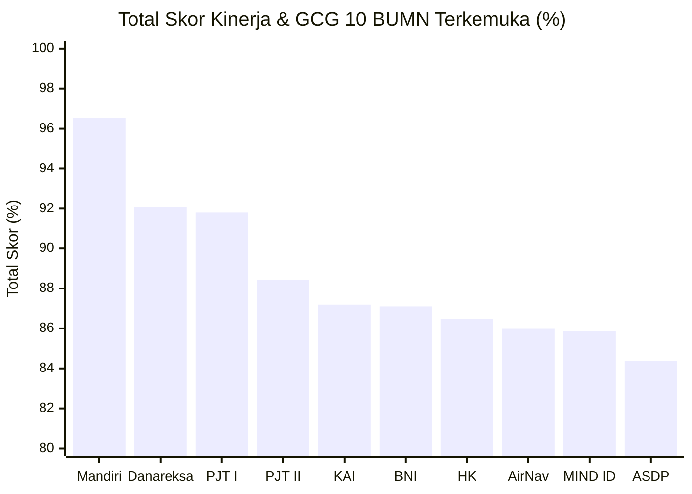
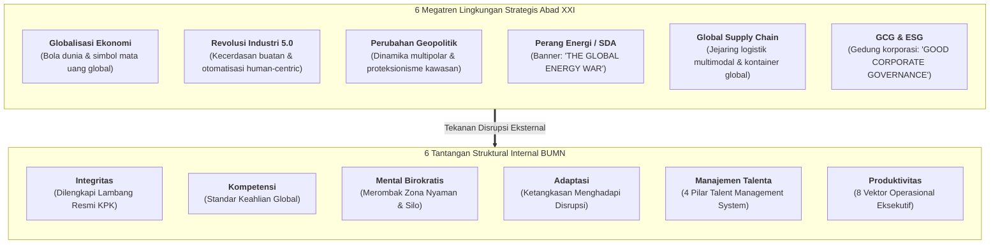
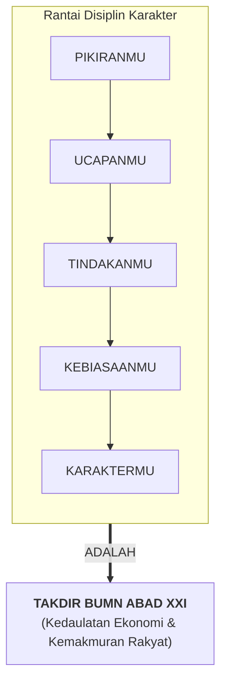

> [!NOTE] Sidang Pleno Doktrinal Fase I Program Pendidikan Pemimpin Masa Depan Indonesia (P3MDI)
> **Sesi tatap muka doktrinal di Kesatrian Kodiklat TNI Serpong.**
>
> Pada Jumat, 3 Juli 2026, calon pemimpin holding BUMN kohor **P3MDI Batch I Soedirman** (d/h **P3MD**, d/h **PFLP** / _Presidential Future Leaders Program_) menerima kuliah kepemimpinan strategis dari Asisten Strategi Panglima TNI, **[[entities/budhi-achmadi|Marsda TNI Dr. Budhi Achmadi, M.Sc.]]**, bertajuk **"Kepemimpinan BUMN Abad XXI"**.
>
> Program P3MDI dirancang dalam **tiga fase pembinaan terpadu**:
>
> 1. **Fase I — Fondasi Karakter, Kepemimpinan & Kedisiplinan Militer** di **Kodiklat TNI Serpong** (lokasi diselenggarakannya sesi pleno ini).
> 2. **Fase II — Penguatan Akademis, Manajemen Bisnis & Tata Kelola Korporat** di **Kampus DCU Nawasena, Serpong** (perkuliahan kurikulum MBA SBM ITB, masterclass direksi BUMN, dan kepemimpinan Danantara).
> 3. **Fase III — Penerjunan Strategis & Eksekusi Lapangan** (intervensi korporasi lewat _Action Learning Project_ / ALP dan pengawalan portofolio BUMN).
>
> Berlangsung pada Fase I sebelum perpindahan kohor ke Kampus DCU Nawasena untuk memulai perkuliahan formal semester satu, kuliah pleno ini menyatukan disiplin kepemimpinan perwira tempur angkatan udara, evolusi 140 tahun paradigma administrasi publik, dualitas konstitusional Pasal 33 UUD 1945, serta rantai kausalitas pembentukan karakter eksekutif: dari disiplin pikiran hingga takdir korporasi negara.

---

## 🧭 Executive Session Overview: The Strategic Horizon

Sebagai perwira tinggi penerbang tempur berlatar belakang komando operasional (mantan Komandan Skadron Udara 14 F-5 Tiger, Pangkoopsud II, dan Kapusjianstralitbang TNI), **[[entities/budhi-achmadi|Marsda TNI Dr. Budhi Achmadi, M.Sc.]]** membuka sesi pleno dengan meruntuhkan sekat artifisial antara integritas militer, keilmuan administrasi publik, dan profesionalisme bisnis korporasi.

Beliau menegaskan bahwa kader P3MDI bukan sekadar manajer korporasi biasa yang mengejar margin laba kuartalan semata, melainkan punggawa strategis negara yang diamanatkan mengelola cabang-cabang produksi vital bangsa. Dalam lanskap abad ke-21 yang diwarnai perang energi global (_The Global Energy War_), disrupsi rantai pasok maritim, dan perebutan sumber daya alam (SDA), kepemimpinan BUMN menuntut sintesis tiga pilar utama: ketajaman intelektual (_warrior-scholar_), pemahaman mendalam atas evolusi tata kelola negara (_New Public Management_), dan keteguhan karakter moral (_moral rectitude_).

### Konteks Visual & Simbolisme Militer-Akselerasi

Paparan dibuka dengan menyandingkan lambang segilima institusional Mabes TNI dan potret resmi kepemimpinan, merefleksikan posisi pembicara sebagai perwira tinggi perumus strategi pertahanan nasional. Pada slide transisi berikutnya, tampak foto penerbang tempur berhelm di garis depan dengan latar sepasang jet tempur supersonik yang sedang mengangkasa. Visual ini secara tegas menghubungkan nilai-nilai _Karakter, Profesional, dan Berwawasan_ dengan standar nol-kesalahan (_zero-tolerance for error_) pada dunia penerbangan tempur militer.

Di tengah paparan, transisi menuju materi administrasi publik ditandai dengan foto pesawat angkut militer berbadan besar yang menaungi sekelompok perwira di pangkalan udara. Ini melambangkan pergeseran fokus analitis: dari disiplin individual penerbang di dalam kokpit menuju kapasitas angkut institusional skala makro dalam mengelola korporasi negara.

---

## 🧠 Fondasi Karakter Pemimpin: Rantai Pikiran hingga Takdir

Marsda Budhi Achmadi menegaskan bahwa keruntuhan suatu institusi bisnis atau kedaulatan negara hampir tidak pernah disebabkan oleh keterbatasan modal atau teknologi; kehancuran selalu berakar pada kerapuhan karakter para pengambil keputusannya. Mengutip adagium klasik Frank Outlaw, beliau memetakan arsitektur umpan balik (_feedback loop_) pembentukan kepemimpinan:

> _“Watch your thoughts; they become your words. Watch your words; they become your actions. Watch your actions; they become your habits. Watch your habits; they become your character. Watch your character; it becomes your destiny.”_  
> — **Frank Outlaw**

Visual paparan menyajikan lima tahapan tersebut dalam lingkaran tertutup searah jarum jam (_clockwise feedback loop_), di mana **Takdir (_Destiny_)** berada tepat di titik pusat sebagai muara akhir yang tak terhindarkan. Karakter yang terasah terus-menerus meregenerasi kualitas pikiran baru yang lebih matang, mengunci arah takdir organisasi.

### Empat Pertanyaan Eksistensial bagi Calon Pemimpin BUMN

Marsda Budhi menguji kesiapan mental kohor melalui empat pertanyaan reflektif yang diilustrasikan dengan montase visual yang kuat:

1. **Pikiran Bertumbuh (_Growth Mindset_)**:  
   _“Apakah kalian sudah membangun pikiran bertumbuh ('growth thoughts' atau 'growth mindset') hebat sejak dini?”_  
   _Konteks visual_: Ruang kelas studi, potret masa muda, latihan fisik militer, dan penerbang yang berdiri di samping pesawat tempur, mengaitkan _growth mindset_ dengan pembelajaran disiplin tanpa henti.
2. **Visi Masa Depan Korporasi Negara**:  
   _“Apakah kalian sudah membangun gagasan dan pikiran hebat untuk kejayaan BUMN RI di masa depan?”_  
   _Konteks visual_: Kerumunan masyarakat perkotaan, armada bus transportasi publik, pertemuan bilateral pejabat negara, situs pertambangan mineral raksasa, dan pesawat komersial—menunjukkan spektrum operasional di mana gagasan BUMN menentukan nasib jutaan rakyat.
3. **Standar Integritas Ucapan dan Tindakan**:  
   _“Apakah kualitas ucapan dan tindakan kalian sudah merepresentasikan diri kalian sebagai punggawa BUMN RI yang hebat, juga calon pemimpin BUMN RI yang hebat?”_  
   _Konteks visual_: Enam potret tokoh pemimpin bisnis dan negarawan terkemuka dalam dua baris, menegaskan bahwa legitimasi kepemimpinan dinilai dari keselarasan antara retorika publik dan rekam jejak integritas.
4. **Pembiasaan Disiplin Harian**:  
   _“Apakah kalian sudah membangun kebiasaan hebat agar nantinya mampu menjadi pemimpin BUMN RI yang hebat?”_  
   _Konteks visual_: Montase aktivitas harian: berenang (ketahanan fisik), memilih buku di perpustakaan, membaca mendalam, mengetik laporan kerja, serta keharmonisan keluarga dan ibadah berjamaah. Kebiasaan kecil yang diulang setiap hari adalah fondasi stamina kepemimpinan.

### Imperatif Budaya Membaca dan Presisi Menulis

Seorang pemimpin yang berhenti membaca secara fungsional telah kehilangan hak moral untuk memimpin. Marsda Budhi menyandingkan tiga tradisi peradaban besar:

- **Napoleon Bonaparte**:
  > _“Tunjukkan kepadaku sebuah keluarga yang mencintai membaca dan saya pastikan merekalah yang memindahkan dunia.”_  
  > _(Slide menampilkan tumpukan buku-buku tebal sebagai bukti fisik budaya literasi yang mengakumulasi peradaban)._
- **Jenderal James N. Mattis (Mantan Menteri Pertahanan AS & Jenderal Korps Marinir AS)**:
  > _“Jika kamu belum membaca ratusan buku dan juga tidak mau bertanya kepada para pendahulu, secara fungsional kamu buta huruf. Maka kamu tidak boleh melatih & tidak boleh memimpin.”_  
  > _(Slide menampilkan potret Jenderal Mattis, menekankan bahwa tanpa membaca sejarah militer dan bisnis, seorang komandan akan mengulang kesalahan fatal pendahulunya dengan mengorbankan nyawa atau modal)._
- **Wahyu Perdana (QS. Al-’Alaq: 1)**:
  

    اقْرَأْ بِاسْمِ رَبِّكَ الَّذِي خَلَقَ
  

  > _“Bacalah dengan (menyebut) nama Tuhanmu yang menciptakan!”_

Membaca harus diimbangi secara seimbang dengan tradisi **menulis**. Menulis memaksa gagasan yang abstrak dan berantakan menjadi terstruktur, sistematis, dan siap diuji:

- **Francis Bacon**: _“Menulis membuat seseorang mampu berpikir lebih teliti, sistematis, dan presisi.”_  
  Slide menyertakan visual buku catatan bertajuk _"How to Keep Writing When Life Gets Busy"_ dengan tiga pedoman praktis bagi eksekutif yang sibuk:
  1. _Small, realistic habits_ (Membangun kebiasaan menulis ringkas namun konsisten setiap hari).
  2. _Letting go of perfection_ (Melepaskan ilusi draf pertama yang langsung sempurna).
  3. _Starting again without guilt_ (Segera melanjutkan ritme mencatat tanpa terjebak penyesalan saat rutinitas terputus).
- **Ali bin Abi Thalib**: _“Ikatlah ilmu dengan menuliskannya.”_  
  _(Slide mengilustrasikan kedua tangan yang sedang mengetik di laptop, melambangkan pembukuan pengetahuan agar tidak menguap ditelan kesibukan operasional)._

### Mengapa Kalian di Sini?

Marsda Budhi merangkum dialektika pembentukan kader melalui bagan alur komando:

Di samping bagan ini, foto audiens yang memberikan tepuk tangan riuh (_applause_) kepada pembicara menggarisbawahi bahwa kepemimpinan sejati adalah tentang memikul tanggung jawab atas harapan dan kesejahteraan orang banyak.

---

## 🏛️ Evolusi 12 Paradigma Administrasi Publik (1887 – Abad XXI)

Pemimpin BUMN modern wajib memahami akar teoritis tata kelola negara agar tidak terjebak dalam romantisisme birokrasi kuno. Marsda Budhi membentangkan **12 Paradigma Administrasi Publik** yang memetakan evolusi relasi antara negara, birokrasi, pasar, dan warga negara:

| Periode           | Paradigma / Perkembangan                          | Tokoh Pelopor                          | Pokok Pemikiran & Relevansi Tata Kelola BUMN                                                                                                                                                                          |
| :---------------- | :------------------------------------------------ | :------------------------------------- | :-------------------------------------------------------------------------------------------------------------------------------------------------------------------------------------------------------------------- |
| **1887–1926**     | **Dikotomi Politik-Administrasi**                 | Woodrow Wilson                         | Administrasi publik harus dipisahkan secara tegas dari politik partisan; birokrasi wajib bekerja secara profesional, teknis, netral, dan efisien.                                                                     |
| **1900–1930**     | **Administrasi Ilmiah (_Scientific Management_)** | Frederick Winslow Taylor               | Standardisasi kerja, pembagian tugas terukur, studi gerak-waktu, dan pemaksimalan produktivitas tenaga kerja operasional.                                                                                             |
| **1927–1937**     | **Prinsip-Prinsip Administrasi**                  | Henri Fayol & Luther Gulick            | Formalisasi fungsi eksekutif modern melalui taksonomi **POSDCORB** (_Planning, Organizing, Staffing, Directing, Coordinating, Reporting, Budgeting_).                                                                 |
| **1920–1940**     | **Teori Birokrasi**                               | Max Weber                              | Rasional-legal birokrasi, tatanan hierarki formal, kepatuhan prosedur tertulis, asas impersonalitas, dan sistem meritokrasi murni.                                                                                    |
| **1940–1950**     | **Kritik terhadap Prinsip Administrasi**          | Herbert A. Simon                       | Meruntuhkan prinsip administrasi klasik sebagai "peribahasa administratif" yang kontradiktif; mengembangkan Teori Pengambilan Keputusan (_Decision Making Theory_) dan rasionalitas terbatas (_bounded rationality_). |
| **1950–1970**     | **Administrasi Publik sebagai Ilmu Politik**      | Dwight Waldo                           | Menegaskan bahwa administrasi negara tidak dapat diisolasi dari perdebatan nilai moral, demokrasi, distribusi kekuasaan, dan konflik kebijakan publik.                                                                |
| **1968–1970**     | **New Public Administration (NPA)**               | Dwight Waldo & H. George Frederickson  | Gerakan Minnowbrook: menyuntikkan keadilan sosial (_social equity_), responsivitas aparatur, dan keberpihakan etis kepada masyarakat yang termarjinalkan.                                                             |
| **1980–1990**     | **New Public Management (NPM)**                   | David Osborne & Ted Gaebler            | Pemerintahan wirausaha (_entrepreneurial government_), privatisasi parsial, efisiensi mekanisme pasar, manajemen berbasis kinerja, dan doktrin _"steering rather than rowing"_.                                       |
| **1990–2000**     | **Governance & Good Governance**                  | World Bank & UNDP                      | Tata kelola multisektor: akuntabilitas publik, transparansi pelaporan, penegakan hukum, partisipasi pemangku kepentingan, dan anti-korupsi.                                                                           |
| **2000–Sekarang** | **New Public Service (NPS)**                      | Janet V. Denhardt & Robert B. Denhardt | Pemerintah bertugas melayani warga negara (_"serving rather than steering"_), memulihkan demokrasi deliberatif, dan mendahulukan kepentingan bersama di atas logika konsumen semata.                                  |
| **2010–Sekarang** | **Collaborative Governance**                      | Chris Ansell & Alison Gash             | Penyelesaian persoalan publik lintas batas melalui kemitraan terstruktur dan konsensus antara instansi pemerintah, sektor swasta, dan masyarakat sipil.                                                               |
| **2010–Sekarang** | **Digital Era Governance (DEG)**                  | Patrick Dunleavy                       | Reintegrasi layanan publik berbasis teknologi digital, interoperabilitas data nasional (_big data_), otomatisasi birokrasi, dan platform layanan terpadu (_e-government_).                                            |

### Doktrin Inti NPM: “Steering Rather Than Rowing”

Slide kuliah menampilkan sampul buku legendaris _Reinventing Government: How the Entrepreneurial Spirit Is Transforming the Public Sector_ karya David Osborne dan Ted Gaebler, lengkap dengan kutipan dukungan Presiden Bill Clinton:  
_“NATIONAL BESTSELLER — Should be read by every elected official in America. This book gives us the blueprint.”_

Sampul tersebut disandingkan dengan foto tim pendayung perahu (_rowing crew_) yang bergerak kompak di atas air. Perumpamaan ini menegaskan pemisahan peran fundamental dalam kepemimpinan publik:

- **Pemerintah Berperan Mengarahkan (_Steering_)**: Menentukan ke mana perahu negara berlayar, menetapkan standar keselamatan pelayaran, dan mengawasi akuntabilitas nahkoda.
- **BUMN Berperan Mendayung (_Rowing_)**: Mengerahkan seluruh tenaga profesional, efisiensi teknologi, dan ketangkasan komersial untuk menggerakkan perahu secepat mungkin tanpa intervensi mikro birokrasi di setiap ayunan dayung.

---

## 🇮🇩 Posisi Istimewa BUMN: Amanah Konstitusi & Dualitas Peran

BUMN didirikan atas amanah filosofis tertinggi Republik Indonesia: **Pasal 33 Undang-Undang Dasar Negara Republik Indonesia Tahun 1945**:

1. _Cabang-cabang produksi yang penting bagi negara dan yang menguasai hajat hidup orang banyak dikuasai oleh negara._
2. _Bumi dan air dan kekayaan alam yang terkandung di dalamnya dikuasai oleh negara dan dipergunakan untuk sebesar-besar kemakmuran rakyat._

### Dualitas Peran BUMN: Dua Sisi Mata Uang

BUMN mengemban dua mandat yang saling bersitegang secara permanen:

- **Tugas Birokrat / Misi Publik**: Berfungsi sebagai instrumen pembangunan nasional, menjaga keterjangkauan tarif pangan, listrik, dan transportasi, menyalurkan pupuk bersubsidi, serta membuka konektivitas di wilayah tertinggal, terdepan, dan terluar (3T) melalui [[concepts/pso-commercial-duality|Public Service Obligation (PSO)]].
- **Misi Bisnis / Komersial**: Beroperasi dengan disiplin pasar, membukukan laba (_profitability_), menjaga imbal hasil modal (_return on invested capital_ / ROIC), menyetor dividen dan pajak bagi APBN, serta mempertahankan kelayakan kredit tanpa ketergantungan pada Penyertaan Modal Negara (PMN).

### Benchmark Skor Kinerja & Tata Kelola Korporasi BUMN

Slide menyajikan grafik batang horizontal (_horizontal bar chart_) yang memeringkat capaian **Total Skor Kinerja & GCG** dari sepuluh BUMN unggulan nasional:

| Peringkat | Badan Usaha Milik Negara (BUMN)                                             | Total Skor | Sektor Industri & Mandat Utama                                     |
| :-------: | :-------------------------------------------------------------------------- | :--------: | :----------------------------------------------------------------- |
|   **1**   | **PT Bank Mandiri (Persero) Tbk**                                           | **96,55%** | Konglomerasi Jasa Keuangan & Pembiayaan Korporasi Terbesar         |
|   **2**   | **[[entities/danantara\|PT Danareksa (Persero)]]**                          | **92,07%** | Holding Transformasi Aset, Kawasan Industri & Pasar Modal          |
|   **3**   | **Perum Jasa Tirta I**                                                      | **91,80%** | Konservasi Sumber Daya Air & Pengendalian Banjir Wilayah Sungai    |
|   **4**   | **Perum Jasa Tirta II**                                                     | **88,43%** | Ketahanan Pangan Irigasi Waduk Juanda Jatiluhur & PLTA             |
|   **5**   | **[[entities/pt-kereta-api-indonesia\|PT Kereta Api Indonesia (Persero)]]** | **87,19%** | Modernisasi Layanan Penumpang & Angkutan Batubara Curah Rel        |
|   **6**   | **PT Bank Negara Indonesia (Persero) Tbk (BNI)**                            | **87,10%** | Perbankan Global, Diaspora Banking & Pembiayaan Konsumer           |
|   **7**   | **PT Hutama Karya (Persero)**                                               | **86,48%** | Penugasan PSN Pembangunan & Operasi Jalan Tol Trans Sumatera       |
|   **8**   | **AirNav Indonesia (Perum LPPNPI)**                                         | **86,01%** | Pengelolaan Ruang Udara & Keselamatan Navigasi Penerbangan         |
|   **9**   | **Mining Industry Indonesia (MIND ID)**                                     | **85,86%** | Hilirisasi Mineral Strategis, Nikel, Tembaga, Bauksit & Batubara   |
|  **10**   | **PT ASDP Indonesia Ferry (Persero)**                                       | **84,39%** | Tol Laut Penyeberangan Nusantara, Kapal Ro-Ro & Logistik Kepulauan |

Data ini membuktikan bahwa misi publik dan disiplin komersial bukanlah kontradiksi tanpa solusi. BUMN dengan mandat pelayanan publik yang sangat berat (seperti Perum Jasa Tirta, AirNav, dan KAI) tetap mampu meraih skor kepatuhan tata kelola di atas 85–90%, sejajar dengan bank-bank publik komersial.

---

## 🌐 Lanskap Strategis Abad XXI & Tantangan Struktural BUMN

Slide kuliah merangkum enam kekuatan eksternal abad ke-21 dalam format kisi-kisi enam panel (_six-panel grid_), lengkap dengan ikonografi visual otentik:

### Empat Pilar Sistem Manajemen Talenta BUMN

Infografik bertajuk _“4 Pilar Talent Management System”_ menegaskan bahwa suksesi kepemimpinan BUMN harus berbasis tatanan kelembagaan yang baku:

1. **Recruitment Management**: Akuisisi talenta nasional terbaik secara transparan, bebas dari titipan politik atau nepotisme internal.
2. **Performance Management**: Penilaian berbasis hasil nyata (_key performance indicators_ / OKRs) yang dikalibrasi secara periodik.
3. **Learning and Development**: Pembelajaran akseleratif terstruktur melalui 3 fase terpadu P3MDI (Fase I Karakter di Kodiklat TNI Serpong, Fase II Akademis di Kampus DCU Nawasena, dan Fase III Intervensi BUMN / ALP).
4. **Compensation Management**: Desain remunerasi yang adil dan kompetitif, mengaitkan bonus eksekutif dengan keberhasilan jangka panjang (_long-term incentive plan_).

### Delapan Vektor Produktivitas Eksekutif

Panel produktivitas (_PRODUCTIVITY_) mengurai delapan indikator manajemen yang wajib dipantau oleh setiap direksi BUMN:
$$\mathbf{Strategy \longrightarrow Goal \longrightarrow Time \ Management \longrightarrow To\text{-}do \ list \longrightarrow Project \longrightarrow Performance \longrightarrow Process \longrightarrow Profit}$$

- **Strategy**: Ketepatan arah bisnis jangka panjang yang selaras dengan rencana induk nasional.
- **Goal**: Sasaran kuantitatif tahunan yang jelas dan dapat dipahami oleh seluruh jenjang karyawan.
- **Time Management**: Efisiensi waktu eksekutif, menghindari rapat berkepanjangan tanpa keputusan.
- **To-do list**: Penjabaran prioritas kerja harian yang terdisiplin dan terukur tuntas.
- **Project**: Manajemen tenggat waktu, risiko mitigasi, dan pengendalian anggaran proyek infrastruktur.
- **Performance**: Pemantauan metrik operasional secara waktu-nyata (_real-time dashboard_).
- **Process**: Penyederhanaan alur birokrasi, otomatisasi sistem, dan penghapusan pemborosan (_lean operations_).
- **Profit**: Penciptaan laba bersih yang berkelanjutan untuk memperkuat permodalan dan dividen negara.

---

## ⚔️ Patologi Kepemimpinan vs 6 Prinsip Luhur BUMN

Pada bagian penutup doktrinal, slide kuliah menampilkan sampul buku militer klasik: **_Kepemimpinan Militer: Catatan dari Pengalaman Letnan Jenderal TNI (Purn.) Prabowo Subianto_** dengan foto perwira yang memberikan penghormatan militer (_salute_). Doktrin ini digunakan untuk membedah etika komando dalam memimpin organisasi besar di tengah krisis.

### Lima Ciri Kepemimpinan yang Salah (_Leadership Anti-Patterns_)

Marsda Budhi merinci lima tabiat kepemimpinan destruktif yang merusak masa depan organisasi:

1. **Mengkhianati Amanah**: Mengkhianati kepercayaan yang diberikan oleh negara, dewan komisaris, rekan sejawat, dan keluarga demi kepentingan pribadi atau kelompok.
2. **Melempar Tanggung Jawab (_Passing the Buck_)**: Mengalihkan risiko dan kesalahan jabatan kepada staf bawahan ketika menghadapi audit hukum, kegagalan proyek, atau tekanan krisis.
3. **Mengambil Keuntungan Pribadi**: Memanfaatkan fasilitas dinas, wewenang tanda tangan, dan informasi orang dalam (_insider information_) untuk keuntungan finansial diri sendiri (_rent-seeking_).
4. **Malas Membangun Profesionalisme**: Berhenti belajar, enggan membaca buku terkini, menolak teknologi baru, dan merasa cukup dengan wawasan masa lalu yang usang.
5. **Perilaku Tercela**: Melakukan tindakan asusila, arogansi kekuasaan, pemborosan anggaran seremonial, atau perbuatan yang melukai rasa keadilan masyarakat luas.

### Enam Prinsip Kepemimpinan BUMN Abad XXI

Sebagai antitesis dari patologi kepemimpinan di atas, Marsda Budhi memformulasikan enam doktrin moral bagi perwira siswa P3MDI:

1. **Kepemimpinan Berarti Melayani Rakyat**: Hakikat kekuasaan adalah pelayanan publik (_servant leadership_); pemimpin ada untuk menyelesaikan kesulitan rakyat, bukan untuk dilayani oleh protokoler.
2. **Mandat Bersumber dari Tuhan YME**: Kekuasaan adalah amanah ilahi yang fana dan kelak dipertanggungjawabkan di hadapan Tuhan untuk menegakkan kebenaran, keadilan, dan kejujuran.
3. **Memberi Manfaat Tanpa Pandang Golongan**: BUMN beroperasi untuk seluruh tumpah darah Indonesia, menolak diskriminasi suku, agama, ras, maupun afiliasi politik.
4. **Pendekatan Transformatif**: Pemimpin tidak boleh sekadar menjaga status-quo (_caretaker_), melainkan harus berani merombak inefisiensi, memotong mata rantai pemburu rente, dan menciptakan nilai tambah baru.
5. **Rendah Hati, Berintegritas, dan Berani di Garis Terdepan**: Pemimpin sejati memimpin dengan keteladanan fisik dan moral (_leading from the front_), menjadi perisai bagi anak buah di masa krisis, dan tetap bersahaja dalam keseharian.
6. **Tulus, Ikhlas, dan Tanpa Pamrih**: Bekerja tuntas dengan keikhlasan tertinggi demi kejayaan merah putih, tanpa mengharapkan sanjungan semu atau imbalan terselubung.

---

## 🎯 Sintesis Eksekutif: Takdir BUMN di Pundak Punggawa Bangsa

Kuliah pleno ini dipungkasi dengan diagram rantai komando moral yang menghubungkan disiplin batiniah individu dengan kedaulatan ekonomi negara:

> _“Kalian berada di Kodiklat TNI Serpong bukan karena kebetulan. Kalian disaring dari ribuan putra-putri terbaik bangsa untuk memegang kemudi korporasi negara di masa depan. Jika pikiranmu kerdil dan korup, runtuhlah pilar ekonomi negeri ini. Tetapi jika kalian tegak dengan karakter ksatria, integritas tanpa kompromi, dan profesionalisme kelas dunia, BUMN Indonesia akan tegak berdiri sebagai benteng kemakmuran dan kedaulatan bangsa di abad ke-21.”_  
> — **Marsda TNI Dr. Budhi Achmadi, M.Sc.**

---

## 📂 Primary Source Media & Digital Archives

| Judul Dokumen & Berkas Sumber                                |             Format Berkas              | Lokasi Arsip Repositori                                                                                             |
| :----------------------------------------------------------- | :------------------------------------: | :------------------------------------------------------------------------------------------------------------------ |
| **Kepemimpinan BUMN Abad XXI (Slide Resmi Kuliah)**          |    Paparan Presentasi Asli (`.pdf`)    | `archive/rabuan/2026-07-03-budhi-achmadi-kepemimpinan-bumn/Jul-3-2026_Kepemimpinan BUMN Abad XXI.pptx.pdf`          |
| **Expanded Presentation Transcript & Visual Syntax**         |     Transkripsi Akademis (`.tex`)      | `archive/rabuan/2026-07-03-budhi-achmadi-kepemimpinan-bumn/expanded_Jul-3-2026_Kepemimpinan BUMN Abad XXI.pptx.tex` |
| **Compiled Lecture Visual Notes & Typographic Proof**        |    Dokumen Cetak Kompilasi (`.pdf`)    | `archive/rabuan/2026-07-03-budhi-achmadi-kepemimpinan-bumn/compiled_Jul-3-2026_Kepemimpinan BUMN Abad XXI.pdf`      |
| **Dokumen Rujukan: Kepemimpinan Militer (Prabowo Subianto)** | Monograf Doktrin Kepemimpinan (`.pdf`) | _Arsip Kepustakaan Doktrin P3MDI Kodiklat TNI Serpong_                                                              |

---

## 🔗 Knowledge Graph & Curriculum Bridges

- **Profil Pembicara Pleno**: [[entities/budhi-achmadi|Marsda TNI Dr. Budhi Achmadi, M.Sc.]]
- **Kerangka Konseptual Terkait**:
  - [[concepts/public-administration-paradigms|Public Administration Paradigms & State Enterprise Governance]]
  - [[concepts/pso-commercial-duality|Public Service Obligation (PSO) vs Commercial Viability Duality]]
  - [[concepts/growth-mindset|Growth Mindset & Adaptive Capacity]]
  - [[concepts/identity-based-living|Identity-Based Living & Strategy]]
  - [[concepts/best-mind-best-heart|Doktrin Best Mind & Best Heart]]
- **Korelasi Mata Kuliah MBA SBM ITB**:
  - [[courses/mk1-organizational-behavior-managing-people/index|MK 1: Organizational Behavior & Managing People]] (Karakter, budaya organisasi, dan kepemimpinan transformatif)
  - [[courses/mk5-decision-making-negotiation/index|MK 5: Decision Making & Negotiation]] (Pengambilan keputusan Simon, tata kelola, dan etika)
- **Kembali ke**: [[rabuan/index|Arsip Eksekutif Kuliah Rabuan]] | [[index|Portal Utama MBA P3MD]]
