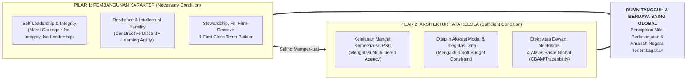
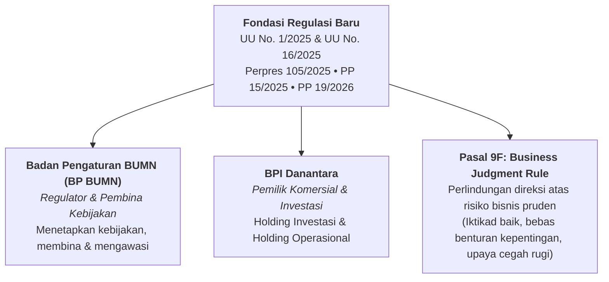

> [!NOTE] Bahan Bacaan Wajib Pra-Sesi (Makalah Akademik 28 Halaman)
> **Disiapkan sebelum Kuliah Pleno Fase I di Kodiklat TNI Serpong (19 Agustus 2026).**
>
> Makalah komprehensif bertajuk **"Tantangan Kepemimpinan & Tata Kelola BUMN"** ini ditulis langsung oleh **[[entities/agus-gumiwang-kartasasmita|Dr. Agus Gumiwang Kartasasmita, M.Si.]]** sebagai landasan teoretis dan doktrinal bagi peserta **Diklat Program Presiden untuk Pemimpin Masa Depan (P3MD) Pegawai BUMN Batch 1 Tahun 2026**.
>
> Untuk eksibit data makroekonomi, peringkat _Manufacturing Value Added_ (MVA), peta jalan RIPIN 2025–2045, serta instrumen perlindungan industri (P3DN/TKDN, HGBT, TBT, dan KBLBB) yang dipresentasikan pada hari pelaksanaan sesi, lihat dossier pleno pendamping: **[[rabuan/2026-08-19-agus-gumiwang-industrialisasi-nasional|Foundation Plenary (2026-08-19): BUMN dan Industrialisasi Nasional]]**.

---

## 🎯 Tesis Utama: Karakter Kuat di Dalam Sistem yang Kuat

Dalam makalah ini, Menteri Perindustrian merumuskan satu proposisi sentral: **transformasi BUMN tidak dapat bertumpu pada kualitas individu saja ataupun perubahan struktur kelembagaan semata.**

$$\mathbf{\text{\ldquo Karakter menentukan bagaimana kewenangan digunakan, sedangkan tata kelola menentukan bagaimana kewenangan tersebut diarahkan, diuji, dan dipertanggungjawabkan.\rdquo}}$$

Keberhasilan BUMN pada akhirnya ditentukan oleh kemampuan membangun **pemimpin berkarakter kuat di dalam sistem tata kelola yang sama kuatnya**, sekaligus melembagakan perubahan agar mampu bertahan melampaui pergantian individu dan masa jabatan kepemimpinan.

---

## 🌐 Pendahuluan: Era _Compound Risks_ dan Mandat Ganda BUMN

Lingkungan bisnis abad ke-21 tidak lagi bergerak secara linear atau stabil. BUMN kini menghadapi **risiko majemuk (_compound risks_)**—di mana berbagai guncangan datang secara simultan dan saling memperbesar dampak satu sama lain:

- Geopolitik mengubah harga energi dalam hitungan hari.
- Perang dagang menggeser rantai pasok global.
- Fluktuasi suku bunga dan nilai tukar merombak kelayakan investasi.
- _Artificial Intelligence_ mengubah struktur biaya industri secara mendadak.
- Transisi energi membuat aset lama yang hari ini bernilai tinggi berisiko kehilangan daya saing.
- Serangan siber dan regulasi baru menuntut adaptasi cepat.

Berbeda dari korporasi swasta yang memiliki fungsi relatif tunggal (memaksimalkan _economic value_ bagi pemegang saham), BUMN memikul **mandat ganda** di persimpangan empat tarikan kepentingan:

1. Menghasilkan laba (_profit_) sekaligus menjaga keterjangkauan (_affordability_) masyarakat.
2. Mengejar efisiensi operasional sekaligus memastikan kemudahan akses (_accessibility_) layanan publik.
3. Berani mengambil risiko bisnis (_risk-taking_) sekaligus menjaga aset negara secara pruden (_prudence_).

Dari kompleksitas ini lahir **dua pertanyaan fundamental** bagi setiap calon pemimpin BUMN:

1. _Bagaimana memastikan BUMN tetap relevan, kompetitif, tangguh, dan dipercaya ketika lingkungan eksternal terus berubah?_
2. _Bagaimana BUMN berani mengambil peluang tanpa mengabaikan prinsip kehati-hatian?_

---

## 📚 Tinjauan Teoritis Integratif: 7 Teori Kepemimpinan & 5 Perspektif Kelembagaan

Karena dualitas BUMN tidak dapat dijelaskan oleh satu model kepemimpinan universal, makalah ini mengintegrasikan **tujuh teori kepemimpinan kontemporer** dengan **lima perspektif ekonomi kelembagaan**.

### A. Tujuh Perspektif Kepemimpinan & Manajemen Strategis

| Teori / Konsep                   | Tokoh Kunci                                      | Esensi Konseptual                                                                                                                                    | Implikasi Praktis bagi Direksi BUMN                                                                                                                                                                        |
| :------------------------------- | :----------------------------------------------- | :--------------------------------------------------------------------------------------------------------------------------------------------------- | :--------------------------------------------------------------------------------------------------------------------------------------------------------------------------------------------------------- |
| **Transformational Leadership**  | Burns (1978); Bass (1985); Bass & Riggio (2006)  | Empat dimensi: _idealized influence_, _inspirational motivation_, _intellectual stimulation_, _individualized consideration_.                        | Direksi bukan sekadar administrator pencapai RKAP; keberhasilan transformasi bergantung pada perubahan _organizational mindset_, bukan hanya _organizational chart_.                                       |
| **Adaptive Leadership**          | Heifetz (1994); Heifetz, Grashow & Linsky (2009) | Membedakan _technical problems_ (solusi prosedural/teknis jelas) vs. _adaptive challenges_ (solusi menuntut perubahan nilai, asumsi, dan perilaku).  | Transisi energi & transformasi digital adalah _adaptive challenges_. Pemimpin tidak harus punya semua jawaban, tetapi wajib memastikan organisasi punya kapasitas menemukan jawaban.                       |
| **Authentic Leadership**         | Avolio & Gardner (2005); Luthans                 | Empat komponen: _self-awareness_, _internalized moral perspective_, _balanced processing_, _relational transparency_.                                | Keberanian mengevaluasi kebijakan saat bukti berubah untuk mencegah _leadership blind spot_ (Shaw, 2014), _groupthink_ (Janis, 1982), dan budaya "asal bapak senang".                                      |
| **Ethical Leadership**           | Brown, Treviño & Harrison (2005)                 | Berbasis _Social Learning Theory_: pemimpin sebagai _moral person_ sekaligus _moral manager_ (_tone at the top_).                                    | Menolak _conflict of interest_, melindungi _whistleblower_. Integritas bukan indikator yang bisa ditukar dengan laba: **no integrity, no leadership**.                                                     |
| **Complexity Leadership**        | Uhl-Bien, Marion & McKelvey (2007)               | Tiga fungsi dalam sistem adaptif kompleks: _administrative_, _adaptive_, dan _enabling leadership_.                                                  | Mengurangi _command-and-control_; mendorong _decision rights_ ke _frontline_. Tugas pemimpin bukan menjadi _the smartest person in the room_, melainkan membangun _the smartest organization in the room_. |
| **Organizational Ambidexterity** | March; O'Reilly & Tushman (2013)                 | Menyeimbangkan _exploitation_ (efisiensi bisnis _existing_) dan _exploration_ (eksperimen model bisnis baru & masa depan).                           | BUMN energi menjaga _cash flow_ fosil sambil membangun _renewable energy_; bank BUMN menjaga perbankan inti sambil membangun AI. Lihat [[concepts/leadership-ambidexterity\|Leadership Ambidexterity]].    |
| **Dynamic Capabilities**         | Teece, Pisano & Shuen (1997)                     | Tiga kapabilitas inti: _sensing_ (deteksi peluang/ancaman), _seizing_ (alokasi capex/kemitraan), dan _transforming_ (rekonfigurasi aset & struktur). | Pemimpin BUMN harus bertindak sebagai _reconfigurator of resources_, termasuk berani menghentikan lini bisnis yang tidak lagi prospektif.                                                                  |

### B. Lima Perspektif Kelembagaan & Perilaku Organisasi

1. **[[concepts/agency-theory|Agency Theory]]** — _Jensen & Meckling (1976); Shleifer & Vishny (1994)_:  
   Rantai keagenan BUMN berlapis panjang (Rakyat $\rightarrow$ Presiden $\rightarrow$ Lembaga Pengelola $\rightarrow$ Holding $\rightarrow$ Perusahaan Operasional), memperlebar asimetri informasi dan potensi tawar-menawar politis. Mandat publik harus dirumuskan eksplisit, diukur, dan dikompensasikan secara terpisah dari tujuan komersial.
2. **[[concepts/soft-budget-constraint|Soft Budget Constraint]]** — _Kornai (1986); Kornai, Maskin & Roland (2003)_:  
   Ekspektasi bahwa kerugian BUMN akan selalu diselamatkan oleh negara melalui subsidi, PMN, atau restrukturisasi utang melumpuhkan disiplin alokasi modal dan mendorong ekspansi tanpa rasionalitas strategis.
3. **Corporate Governance** — _OECD Guidelines (2019, 2024); IIA Three Lines Model (2020)_:  
   Negara bertindak sebagai pemilik yang aktif, profesional, dan terinformasi, sekaligus memisahkan fungsi kepemilikan dari fungsi regulasi agar dewan independen dan tidak terjadi distorsi pasar.
4. **Organizational Change Theory** — _Lewin (1947); Kotter (1995)_:  
   Proses _unfreezing–change–refreezing_ serta delapan langkah perubahan Kotter (_sense of urgency_, _guiding coalition_, _short-term wins_, _institutionalization_) menegaskan bahwa perubahan regulasi tidak otomatis mengubah perilaku tanpa integrasi ke sistem kinerja, promosi, dan insentif.
5. **[[concepts/psychological-safety|Psychological Safety]]** — _Edmondson (1999)_:  
   Risiko terbesar hierarki BUMN adalah tersaringnya kabar buruk ke atas. Pemimpin yang menghukum pembawa kabar buruk menciptakan organisasi yang menyembunyikan masalah hingga terlambat ditangani.

---

## 🧭 Pilar 1: Pembangunan Karakter Pemimpin BUMN

Kepemimpinan BUMN dimulai dari **self-leadership before corporate leadership**—kemampuan mengelola ego, emosi, nilai, dan kepentingan pribadi sebelum memimpin organisasi. Karakter bukan dimensi lunak (_soft dimension_), melainkan **infrastruktur strategis kepemimpinan (_strategic infrastructure of leadership_)**:

1. **Integrity & Moral Courage**:  
   Tidak cukup hanya mengetahui apa yang benar, melainkan berani menolak benturan kepentingan, menghentikan transaksi yang tidak pruden, dan menyampaikan fakta tidak populer. _Integrity without courage is fragile leadership._
2. **Resilience & Adaptability**:  
   Tidak mencari kambing hitam atau mempertahankan keputusan keliru demi menjaga reputasi pribadi. Pemimpin tangguh mengubah kegagalan menjadi informasi, informasi menjadi pembelajaran, dan pembelajaran menjadi perubahan organisasi.
3. **Humility & Learning Agility**:  
   Kerendahan hati intelektual untuk berkata _"Saya mungkin salah"_, _"Saya belum tahu"_, dan _"Siapa yang mempunyai pandangan berbeda?"_. Memberi ruang bagi _constructive dissent_ mencegah _groupthink_ dan membangun organisasi yang lebih cerdas dari pemimpinnya.
4. **Stewardship & Membangun Legacy**:  
   Melampaui orientasi jangka pendek masa jabatan dengan bertanya: _"Seberapa kuat perusahaan yang saya tinggalkan setelah masa jabatan saya selesai?"_—berinvestasi pada talenta, suksesi, teknologi, dan kapabilitas institusional.
5. **Fit, Firm-Decisive, & First-Class Team Builder**:
   - **Fit**: Prima secara fisik (_physical fitness_) dan tangguh secara psikologis (_Psychological Capital_ Luthans: ketahanan psikologis, stabilitas emosi, dan kesadaran diri).
   - **Firm-Decisive**: Menempatkan kecepatan dan ketegasan pada fase keputusan dan eksekusi setelah mendiagnosis sistem secara mendalam: **listen broadly, diagnose deeply, decide firmly, execute consistently**.
   - **First-Class Team Builder**: Selaras dengan _Upper Echelons Theory_ (Hambrick & Mason), pemimpin memagari dirinya dengan _top management team_ yang kompeten dan berintegritas, bukan sekadar bergantung pada figur CEO tunggal.

---

## 🏛️ Pilar 2: Arsitektur Tata Kelola & Kerangka Hukum 2025–2026

Dari perspektif Kementerian Perindustrian, tata kelola BUMN bukan sekadar persoalan neraca korporasi, melainkan bagian vital dari **kebijakan industri nasional**: jika BUMN baja tidak kompetitif, industri otomotif dan konstruksi hilir lumpuh; jika BUMN pupuk tidak efektif, ketahanan pangan terancam.

### Prinsip Inti Tata Kelola Negara sebagai Pemilik

> _“Transformasi tata kelola merupakan proses menempatkan negara sebagai pemilik yang aktif, profesional, dan terinformasi, tetapi tetap menjaga jarak dari pengelolaan operasional sehari-hari, seraya memastikan bahwa jarak tersebut tidak berubah menjadi lemahnya pengawasan dan akuntabilitas.”_

### Penataan Ulang Kelembagaan & Perlindungan Hukum (2025–2026)

**Catatan Kritis atas Pasal 9F (_Business Judgment Rule_):**  
Menperin mengingatkan agar BJR tidak disalahpahami sebagai imunitas hukum otomatis atas setiap kerugian bisnis. Direksi dilindungi **hanya** apabila memenuhi empat syarat kumulatif: kerugian bukan karena kesalahan/kelalaian, pengurusan dilakukan dengan iktikad baik dan kehati-hatian, bebas benturan kepentingan, serta telah diambil tindakan pencegahan kerugian. **Notulen rapat yang rapi bukan pengganti substansi** jika keputusan sejak awal dilandasi itikad buruk atau kelalaian.

### Uji Praktis Asimetri Informasi

Tata kelola yang efektif bukanlah tumpukan sertifikat kepatuhan formal. Uji praktisnya sederhana: **berapa lama waktu yang diperlukan sebuah kabar buruk untuk sampai ke meja pimpinan?** Jika informasi material baru tiba setelah berbulan-bulan akibat penyaringan birokratis, terdapat kegagalan mendasar dalam arsitektur tata kelola.

---

## 🌍 Empat Studi Kasus Berhasil & Lima Benang Merah Lintas Negara

Makalah ini membedah empat studi kasus empiris yang membuktikan bahwa perusahaan negara mampu mencapai kinerja unggul secara berkelanjutan tanpa resep kelembagaan yang seragam:

| Entitas & Negara                                     | Konteks Kelembagaan                                                                                              | Bukti Kinerja & Transformasi                                                                                                       | Pelajaran Strategis Kunci                                                                                                                                   |
| :--------------------------------------------------- | :--------------------------------------------------------------------------------------------------------------- | :--------------------------------------------------------------------------------------------------------------------------------- | :---------------------------------------------------------------------------------------------------------------------------------------------------------- |
| **Temasek Holdings** _(Singapura, berdiri 1974)_ | Dimiliki penuh Menteri Keuangan; pembatasan ketat intervensi pemerintah atas investasi harian.                   | Portofolio investasi komersial kelas dunia dengan standar tata kelola independen.                                                  | Jarak profesional berjalan beriringan dengan pengawasan pemilik yang aktif. Pemerintah menetapkan tujuan, dewan & manajemen mengeksekusi.                   |
| **PETRONAS** _(Malaysia, berdiri 1974)_          | Perusahaan migas nasional yang tetap menjalankan fungsi regulasi hulu via _Malaysia Petroleum Management_ (MPM). | Dividen terjadwal **RM32 miliar** (2025); kontribusi total sejak 1974 mencapai hampir **RM1,6 triliun**.                           | Pembangunan kapabilitas teknis internal, profesionalisme tinggi, dan keseimbangan antara setoran fiskal negara dengan kebutuhan reinvestasi jangka panjang. |
| **Equinor (d/h Statoil)** _(Norwegia, IPO 2001)_ | Privatisasi sebagian (negara tetap pemegang saham mayoritas **67%**); tercatat di Bursa Oslo & NYSE.             | Efisiensi dan transparansi tinggi di bawah pengawasan analis, investor publik, dan keterbukaan pasar modal.                        | Kepemilikan negara dapat berdampingan harmonis dengan disiplin pasar modal jika batas peran pemilik dan tanggung jawab dewan dirumuskan jelas.              |
| **PT Bank Mandiri Tbk** _(Indonesia, 2005–2010)_ | Perusahaan terbuka sejak 2003; menjalankan restrukturisasi budaya, pengendalian kredit agresif, & aliansi unit.  | **NPL bersih konsolidasi turun dari 15,34% (2005) menjadi 0,62% (2010)**; laba bersih melonjak dari **Rp 0,6 T menjadi Rp 9,2 T**. | Transformasi wajib berurutan: fase pemulihan fondasi (**Back on Track**, 2006–2007) harus mendahului fase ekspansi (**Outperform the Market**, 2008–2009).  |

### Lima Benang Merah Lintas Studi Kasus

1. **Kejelasan mandat**: Tujuan komersial, tujuan kepemilikan negara, dan penugasan publik dipisahkan eksplisit.
2. **Disiplin akuntabilitas eksternal**: Melalui pasar modal, pelaporan publik, kontrak kinerja, atau pengawasan pemilik yang profesional.
3. **Dewan yang berwenang nyata**: Kompeten, independen dalam penilaian, dan berani menguji strategi direksi.
4. **Pembenahan fondasi sebelum ekspansi**: Keberanian menuntaskan krisis operasional dan keuangan mendasar terlebih dahulu.
5. **Konsistensi kelembagaan lintas individu**: Transformasi ditanamkan ke dalam sistem sehingga tidak runtuh saat pimpinan berganti.

---

## 🚀 Rekomendasi Aksi: Lima Agenda Tata Kelola untuk Daya Saing Global

Dari sudut pandang kebijakan industri nasional, terdapat lima agenda konkret yang wajib dijalankan pemimpin BUMN:

1. **Memisahkan Tujuan Komersial dan Penugasan Negara Secara Kuantitatif**:  
   Setiap direksi harus mampu menjawab: berapa persen kinerja tahun berjalan berasal dari aktivitas komersial, dan berapa persen dari mandat pelayanan publik ([[concepts/pso-commercial-duality\|PSO]])? Tanpa pemisahan ini, inefisiensi berlindung di balik penugasan, sementara biaya nyata mandat publik tidak transparan.
2. **Memperkuat Disiplin Alokasi Modal**:  
   Menghindari pola "diversifikasi pelarian"—di mana BUMN yang belum kompetitif di bisnis intinya justru berekspansi ke sektor baru yang tidak dikuasai. Penyertaan Modal Negara (PMN) harus diperlakukan sebagai modal publik langka yang diuji ketat terhadap biaya modal (_WACC_) dan alternatif penggunaan lain.
3. **Menjamin Integritas Data & Kualitas Pelaporan**:  
   Prinsip operasional mutlak: **satu angka, satu sumber, dan satu penanggung jawab**. Keberadaan tiga versi angka produksi untuk satu periode yang sama bukan sekadar masalah administratif, melainkan indikasi kegagalan sistem pengendalian internal.
4. **Memastikan Dewan Berfungsi & Sistem Talenta Berbasis Merit**:  
   Dewan komisaris yang tidak pernah menguji atau menolak usulan direksi berubah menjadi forum stempel konfirmasi semata. Komite audit harus memiliki akses penuh kepada auditor internal, dan direksi wajib membangun sistem kaderisasi yang melahirkan penerus lebih unggul.
5. **Menjadikan Tata Kelola sebagai Prasyarat Akses Pasar Global (_Traceability_)**:  
   Daya saing ekspor per Agustus 2026 tidak lagi ditentukan hanya oleh harga dan mutu fisik produk, melainkan oleh **keterlacakan (_traceability_)** asal bahan baku, jejak emisi karbon, kepatuhan ketenagakerjaan, dan standar antisuap:
   - **EU CBAM (_Carbon Border Adjustment Mechanism_)**: Sudah memasuki rezim definitif sejak **1 Januari 2026**.
   - **EU CSDDD (_Corporate Sustainability Due Diligence Directive_)**: Mewajibkan uji tuntas rantai pasok berkelanjutan.
   - **EU Forced Labour Regulation**: Akan berlaku penuh mulai **Desember 2027**.
   - Tata kelola data rantai pasok yang matang juga menurunkan persepsi risiko kreditur sehingga memperbaiki efisiensi dan akses pembiayaan.

---

## 🔄 Manajemen Perubahan: 6 Aspek Mengubah Aturan Menjadi Perilaku

Perubahan undang-undang dapat merombak struktur kelembagaan dalam hitungan bulan, tetapi tidak otomatis mengubah perilaku ribuan karyawan. Mengintegrasikan model **Kurt Lewin** dan **John Kotter**, Menperin merumuskan enam aspek kunci eksekusi perubahan:

1. **Menciptakan Urgensi dengan Tolok Ukur Eksternal**:  
   Dalam organisasi berproteksi tinggi, jangan sekadar membandingkan kinerja dengan tahun lalu. Bandingkan biaya produksi, produktivitas per pekerja, dan waktu siklus secara objektif dengan **pesaing terbaik di kawasan**.
2. **Menjaga Urutan Transformasi (Stabilisasi $\rightarrow$ Fondasi $\rightarrow$ Ekspansi)**:
   - _Fase 1 (Stabilisasi)_: Hentikan sumber kerugian, perbaiki neraca, tetapkan fakta bersama sejak 100 hari pertama.
   - _Fase 2 (Pembangunan Fondasi)_: Perkuat sistem, integritas data, proses bisnis, dan talenta.
   - _Fase 3 (Pertumbuhan & Ekspansi)_: Melompat ke ekspansi tanpa menyelesaikan Fase 1–2 hanya mengulang krisis dengan biaya lebih mahal.
3. **Membangun Koalisi Perubahan (Fokus Manajer Lapis Menengah)**:  
   Direksi mencanangkan perubahan dan staf muda umumnya antusias, tetapi keberhasilan eksekusi sangat ditentukan oleh **manajer lapis menengah** yang kerap bersikap menunggu (_wait-and-see_) karena trauma melihat program masa lalu gagal. Koalisi pemandu harus melibatkan figur-figur kredibel yang dipercaya rekan kerjanya.
4. **Mengubah Sistem, Bukan Sekadar Slogan**:  
   Budaya organisasi tidak dibentuk oleh poster di dinding, melainkan oleh tiga instrumen konkret: **apa yang diukur, apa yang diberi penghargaan, dan siapa yang dipromosikan**. Jika integritas dijadikan slogan tetapi individu bermasalah yang mencapai target tetap dipromosikan, karyawan akan memercayai keputusan promosi tersebut, bukan pidato pimpinan.
5. **Menghasilkan Kemenangan Awal Terukur (_Short-Term Wins_)**:  
   Rancang capaian realistis dalam **6 hingga 12 bulan pertama** dengan indikator jelas dan komunikasikan secara terbuka untuk membangun kredibilitas perubahan.
6. **Melembagakan Perubahan Lintas Kepemimpinan**:  
   Terjemahkan perubahan ke dalam piagam mengikat, komite berwenang nyata, sistem data anti-manipulasi, kontrak kinerja multi-tahun, dan sistem kaderisasi. Ujian sejatinya: _"Apabila Saudara meninggalkan perusahaan besok, seberapa besar bagian dari perubahan yang telah dibangun akan tetap berjalan pada tahun berikutnya?"_

---

## 🧠 Lima Pergeseran Pola Pikir Pemimpin BUMN

Sebagai penutup makalah, Menperin merumuskan lima transformasi _mindset_ yang harus diinternalisasi oleh perwira P3MD:

| No  | Pola Pikir Lama                                           | Pola Pikir Baru Pemimpin BUMN                                   | Esensi Perubahan Perilaku                                                                                                                                                                                 |
| :-: | :-------------------------------------------------------- | :-------------------------------------------------------------- | :-------------------------------------------------------------------------------------------------------------------------------------------------------------------------------------------------------- |
|  1  | **Penjaga Aset** _(Asset Keeper)_                     | **Pencipta Nilai** _(Value Creator)_                        | Menjaga aset adalah kewajiban dasar, tetapi keberhasilan sejati diukur dari kemampuan meningkatkan nilai perusahaan melalui keputusan bisnis yang terukur, bersih, dan akuntabel.                         |
|  2  | **Kepatuhan Prosedural** _(Procedural Compliance)_    | **Akuntabilitas Hasil** _(Outcome Accountability)_          | Prosedur adalah instrumen memastikan keputusan diambil benar, bukan tujuan akhir yang menyibukkan organisasi secara administratif sambil kehilangan daya saing.                                           |
|  3  | **Horizon Jabatan** _(Tenure Horizon)_                | **Horizon Institusi** _(Institutional Horizon)_             | Berani mengambil keputusan sulit yang menanggung biaya hari ini (hapus buku aset macet, investasi sistem, hentikan lini simbolik) demi kejayaan institusi puluhan tahun ke depan.                         |
|  4  | **Menghindari Kabar Buruk** _(Information Filtering)_ | **Aktif Mencari Informasi Kritis** _(Psychological Safety)_ | Rutin bertanya kepada tim: _"Apa yang tidak berjalan baik bulan ini, dan informasi apa yang belum berani disampaikan kepada saya?"_ serta melindungi pembawa pesan jujur.                                 |
|  5  | **Meminta Perlindungan** _(Permanent Protection)_     | **Membangun Kemampuan** _(Building Capability)_             | Nasionalisme ekonomi yang produktif bukan meminta pasar terjamin selamanya, melainkan memanfaatkan proteksi sementara untuk membangun produktivitas hingga mampu bersaing tanpa bergantung pada proteksi. |

---

## 📖 Daftar Pustaka Lengkap (28 Rujukan Primer)

### A. Buku dan Artikel Ilmiah

1. Avolio, B. J., & Gardner, W. L. (2005). Authentic leadership development: Getting to the root of positive forms of leadership. _The Leadership Quarterly_, 16(3), 315–338.
2. Bass, B. M. (1985). _Leadership and performance beyond expectations_. Free Press.
3. Bass, B. M., & Riggio, R. E. (2006). _Transformational leadership_ (2nd ed.). Lawrence Erlbaum Associates.
4. Brown, M. E., Treviño, L. K., & Harrison, D. A. (2005). Ethical leadership: A social learning perspective for construct development and testing. _Organizational Behavior and Human Decision Processes_, 97(2), 117–134.
5. Edmondson, A. (1999). Psychological safety and learning behavior in work teams. _Administrative Science Quarterly_, 44(2), 350–383.
6. Heifetz, R. A. (1994). _Leadership without easy answers_. Harvard University Press.
7. Heifetz, R. A., Grashow, A., & Linsky, M. (2009). _The practice of adaptive leadership: Tools and tactics for changing your organization and the world_. Harvard Business Press.
8. Kornai, J. (1986). The soft budget constraint. _Kyklos_, 39(1), 3–30.
9. Kotter, J. P. (1995). Leading change: Why transformation efforts fail. _Harvard Business Review_, 73(2), 59–67.
10. Lewin, K. (1947). Frontiers in group dynamics: Concept, method and reality in social science; social equilibria and social change. _Human Relations_, 1(1), 5–41.
11. O’Reilly, C. A., III, & Tushman, M. L. (2013). Organizational ambidexterity: Past, present, and future. _Academy of Management Perspectives_, 27(4), 324–338.
12. Shleifer, A., & Vishny, R. W. (1994). Politicians and firms. _The Quarterly Journal of Economics_, 109(4), 995–1025.
13. Teece, D. J., Pisano, G., & Shuen, A. (1997). Dynamic capabilities and strategic management. _Strategic Management Journal_, 18(7), 509–533.
14. Uhl-Bien, M., Marion, R., & McKelvey, B. (2007). Complexity leadership theory: Shifting leadership from the industrial age to the knowledge era. _The Leadership Quarterly_, 18(4), 298–318.

### B. Pedoman Tata Kelola dan Sumber Institusional

15. Badan Pengaturan Badan Usaha Milik Negara Republik Indonesia. (n.d.). _Nilai-nilai utama (Core Values) SDM BUMN: AKHLAK_.
16. OECD. (2019). _Guidelines on anti-corruption and integrity in state-owned enterprises_. OECD Publishing.
17. OECD. (2024). _OECD guidelines on corporate governance of state-owned enterprises 2024_. OECD Publishing.
18. The Institute of Internal Auditors. (2020). _The IIA’s three lines model: An update of the three lines of defense_.

### C. Peraturan Perundang-undangan Republik Indonesia

19. Undang-Undang Nomor 1 Tahun 2025 tentang Perubahan Ketiga atas Undang-Undang Nomor 19 Tahun 2003 tentang BUMN.
20. Undang-Undang Nomor 16 Tahun 2025 tentang Perubahan Keempat atas Undang-Undang Nomor 19 Tahun 2003 tentang BUMN.
21. Peraturan Presiden Nomor 105 Tahun 2025 tentang Badan Pengaturan Badan Usaha Milik Negara.
22. Peraturan Pemerintah Nomor 15 Tahun 2025 tentang Penambahan Penyertaan Modal Negara ke dalam Saham PT Biro Klasifikasi Indonesia (Holding Operasional).
23. Peraturan Pemerintah Nomor 19 Tahun 2026 tentang Perubahan atas PP Nomor 10 Tahun 2025 tentang Organisasi dan Tata Kelola BPI Danantara.

### D. Studi Kasus dan Perkembangan Pasar Global

24. European Commission: _Carbon Border Adjustment Mechanism (CBAM)_, _Corporate Sustainability Due Diligence Directive (CSDDD)_, dan _Forced Labour Regulation_.
25. Equinor ASA: _Our shareholders_ & _The Norwegian state as shareholder_; Government of Norway (2024), _State Ownership Report 2024_.
26. Ministry of Finance Singapore: _Who manages the reserves?_ & Temasek Holdings, _Corporate governance_.
27. PETRONAS: _PETRONAS Integrated Report 2025_ & _Malaysia Petroleum Management Overview_.
28. PT Bank Mandiri (Persero) Tbk: _Profil perusahaan & Data Transformasi 2005–2010_.

---

## 🔗 Rujukan Terkait

- **Dossier Kuliah Pleno (19 Agustus 2026)**: [[rabuan/2026-08-19-agus-gumiwang-industrialisasi-nasional|Foundation Plenary: BUMN dan Industrialisasi Nasional]]
- **Profil Pemateri**: [[entities/agus-gumiwang-kartasasmita|Dr. Agus Gumiwang Kartasasmita, M.Si.]]
- **Konsep Inti Terkait**:
  - [[concepts/agency-theory|Agency Theory & Multi-Tiered State Ownership Governance]]
  - [[concepts/soft-budget-constraint|Soft Budget Constraint & Capital Discipline]]
  - [[concepts/psychological-safety|Psychological Safety]]
  - [[concepts/leadership-ambidexterity|Leadership Ambidexterity]]
  - [[concepts/pso-commercial-duality|PSO vs Commercial Duality]]
