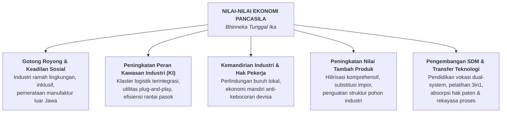
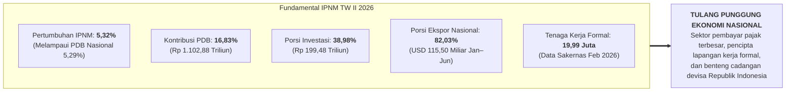
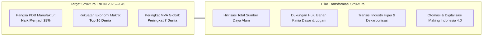
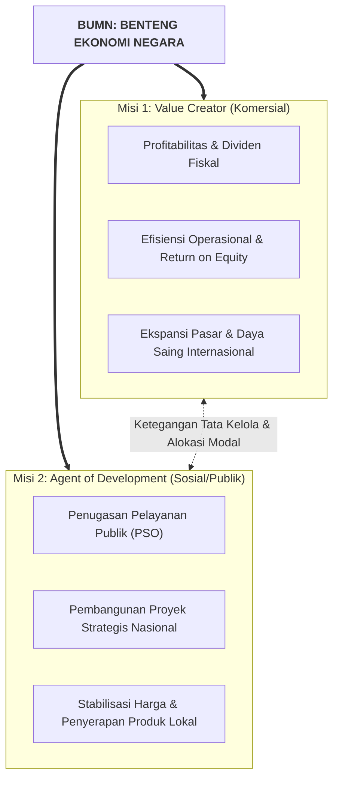
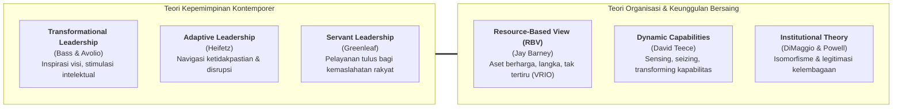
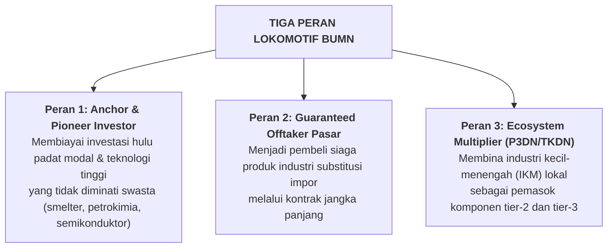
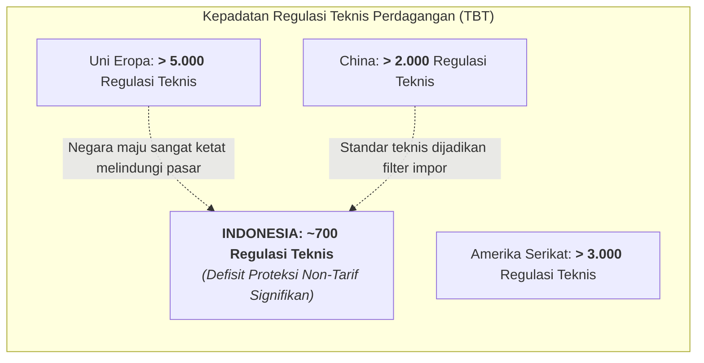
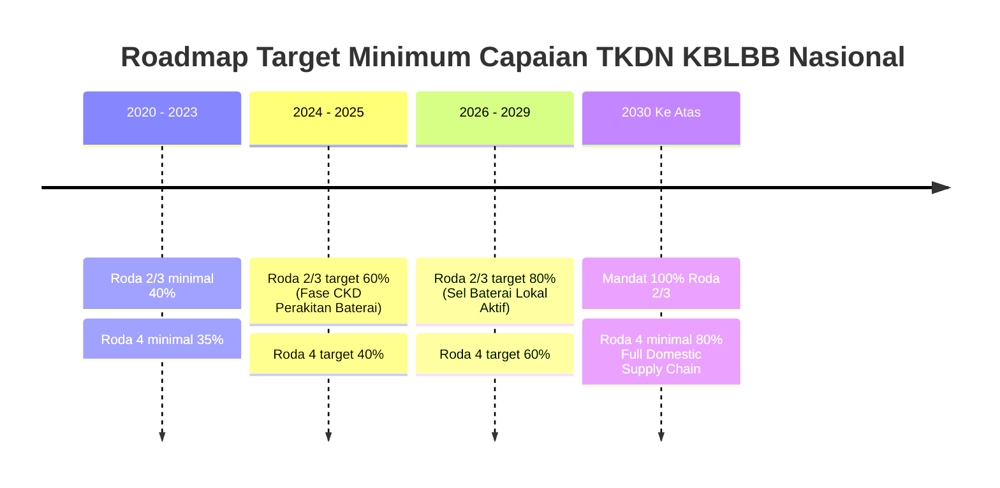

> [!NOTE] Sidang Pleno Doktrinal Fase I Program Pendidikan Pemimpin Masa Depan Indonesia (P3MDI)
> **Sesi tatap muka doktrinal di Kesatrian Kodiklat TNI Serpong.**
>
> Pada Rabu, 19 Agustus 2026, calon pemimpin holding BUMN kohor **P3MDI Batch I Soedirman** menerima kuliah kepemimpinan strategis dan pembekalan industrialisasi nasional dari Menteri Perindustrian Republik Indonesia, **[[entities/agus-gumiwang-kartasasmita|Dr. Agus Gumiwang Kartasasmita, M.Si.]]**, bertajuk **"BUMN dan Industrialisasi Nasional: Membangun Pemimpin Berkarakter, Tata Kelola Kuat, dan Daya Saing Menuju Indonesia Emas 2045"**.
>
> Diselenggarakan pada **Fase I — Fondasi Karakter, Kepemimpinan & Kedisiplinan Militer** di Kodiklat TNI Serpong, kuliah pleno ini menyajikan cetak biru transformasi industri nasional, pembongkaran mitos deindustrialisasi dini, penegakan kedaulatan pasar domestik melalui instrumen perlindungan non-tarif, serta revitalisasi peran BUMN sebagai lokomotif rantai pasok industri bernilai tambah tinggi menuju target Indonesia Emas 2045.

---

## 🧭 Executive Session Overview: The Sovereign Industrial Mandate

Menteri Perindustrian **[[entities/agus-gumiwang-kartasasmita|Dr. Agus Gumiwang Kartasasmita, M.Si.]]** membuka sesi pembekalan pleno di hadapan 400 calon pemimpin BUMN dengan merujuk pada landasan filosofis dan mandat sejarah para pendiri bangsa. Beliau menegaskan bahwa industrialisasi bukan semata-mata pilihan teknis ekonomi, melainkan **jalan mutlak menuju kedaulatan dan kesejahteraan rakyat**.

Mengutip Begawan Ekonomi Indonesia, **Prof. Sumitro Djojohadikusumo**:

> _“Industrialisasi dan pembangunan industri merupakan kegiatan usaha untuk meningkatkan kesejahteraan masyarakat — standar hidup yang lebih maju serta mutu kehidupan yang lebih tinggi.”_  
> — **Prof. Sumitro Djojohadikusumo**

Landasan historis ini dipertegas dengan arahan doktrinal **Presiden Prabowo Subianto** pada Sidang Paripurna DPR RI, 20 Mei 2026:

> _“Kita harus industrialisasi... Kita tidak boleh hanya jadi pasar untuk bangsa lain, dan kita akan lakukan. Industrialisasi kita mulai dengan hilirisasi sumber daya alam, kita tidak mau sumber daya alam kita diekspor gelondongan.”_  
> — **Presiden Prabowo Subianto**

Menperin menekankan bahwa para perwira eksekutif BUMN masa depan tidak boleh lagi berpikir dengan mentalitas pedagang (_trader mindset_) yang puas menjadi importir perantara barang jadi. Kedaulatan ekonomi nasional menuntut keberanian membangun kapasitas produksi domestik yang mandiri, berdaya tahan tinggi, dan mampu menguasai rantai pasok global.

---

## 🏛️ Landasan Filosofis: Industri Berbasis Nilai-Nilai Ekonomi Pancasila

Pembangunan industri nasional Republik Indonesia didasarkan pada **Ekonomi Pancasila** yang berakar pada semangat gotong royong, keadilan sosial, dan kedaulatan bangsa, berporos pada semboyan **Bhinneka Tunggal Ika**.

Menteri Perindustrian meletakkan satu aksioma fundamental yang membedakan proyek fisik sesaat dengan strategi industrialisasi peradaban:

> $$\mathbf{\text{\ldquo Membangun sebuah pabrik adalah hal yang berbeda dengan menciptakan ekosistem Industri.\rdquo}}$$  
> — **Dr. Agus Gumiwang Kartasasmita, M.Si.**

Sebuah pabrik yang berdiri terisolasi tanpa integrasi bahan baku hulu, tanpa konektivitas logistik, tanpa pasokan energi berbiaya kompetitif, dan tanpa pasokan tenaga kerja terampil vokasi hanyalah instalasi mesin yang rentan kolaps. Industrialisasi sejati menuntut penciptaan **ekosistem industri holistik** yang dipancarkan melalui lima pilar implementasi strategis:

### Definisi dan Esensi Industri

Dalam doktrin Kementerian Perindustrian, **Industri** didefinisikan secara presisi sebagai:

> _"Proses mengolah dan memproduksi barang yang bermanfaat atau bernilai ekonomi (meningkatkan nilai tambah) dari bahan mentah, bahan baku, atau barang setengah jadi."_

Tujuan konstitusional pembangunan industri mencakup:

1. Menghasilkan devisa ekspor bernilai tambah tinggi (_export-led industrialization_).
2. Memperluas kesempatan kerja formal berkualitas (_high-wage employment generation_).
3. Melipatgandakan nilai ekonomi sumber daya alam nasional (_resource wealth multiplier_).
4. Menjadi motor penggerak utama pertumbuhan ekonomi (_engine of growth_).

---

## 📊 Kinerja Makroekonomi & Industri Pengolahan Non-Migas (IPNM) 2026

Untuk membedah kondisi riil manufaktur Indonesia, Menperin memaparkan data indikator makroekonomi triwulanan dan semesteran tahun 2026:

### Empat Indikator Tulang Punggung IPNM Nasional

| Indikator Utama Manufaktur                    | Periode Pencapaian  | Pangsa / Persentase | Nilai Riil Nominal      |
| :-------------------------------------------- | :------------------ | :-----------------: | :---------------------- |
| **Kontribusi Terhadap PDB Nasional**          | Triwulan II 2026    |     **16,83%**      | **Rp 1.102,88 Triliun** |
| **Realisasi Investasi PMDN & PMA**            | Triwulan II 2026    |     **38,98%**      | **Rp 199,48 Triliun**   |
| **Penyerapan Tenaga Kerja Langsung**          | Februari 2026       |          —          | **19,99 Juta Orang**    |
| **Kontribusi Ekspor Terhadap Total Nasional** | Januari – Juni 2026 |     **82,03%**      | **USD 115,50 Miliar**   |

Data di atas menunjukkan fakta empiris bahwa **82 dari setiap 100 dolar devisa ekspor Indonesia dihasilkan oleh sektor industri pengolahan non-migas**, bukan oleh ekspor komoditas mentah.

### Analisis Metodologis: PMI (S&P Global) vs. IKI (Kemenperin)

Menperin menguraikan perdebatan persepsi terkait penurunan _Purchasing Managers' Index_ (PMI) manufaktur Indonesia versi S&P Global yang terkontraksi ke angka 49,1 (April 2026) dan 46,9 (Juli 2026). Beliau mengkontraskannya dengan **Indeks Kepercayaan Industri (IKI)** yang dikembangkan resmi oleh Kemenperin berbasis data sensus perusahaan pada Sistem Informasi Industri Nasional (SIINas).

| Parameter Analisis            | Purchasing Managers' Index (PMI)                                                                                                                 | Indeks Kepercayaan Industri (IKI)                                                                            |
| :---------------------------- | :----------------------------------------------------------------------------------------------------------------------------------------------- | :----------------------------------------------------------------------------------------------------------- |
| **Lembaga Penerbit**          | S&P Global (Swasta Multinasional)                                                                                                                | Kementerian Perindustrian RI                                                                                 |
| **Metode Pengumpulan Data**   | _Sampling_ terbatas (panel manajer pembelian)                                                                                                    | Sensus & survei ribuan pabrik aktif di SIINas                                                                |
| **Variabel Pembentuk Indeks** | - Permintaan Baru (30%) - Output Produksi (25%) - Penyerapan Naker (20%) - Waktu Pengiriman Pemasok (15%) - Stok Pembelian (10%) | - Pesanan Baru / Domestik & Ekspor (50%) - Produksi Riil Pabrik (30%) - Persediaan Produk Jadi (20%) |
| **Posisi Juli 2026**          | **46,90 (Zona Kontraksi < 50)**                                                                                                                  | **53,10 (Zona Ekspansi > 50)**                                                                               |
| **Karakteristik Sinyal**      | Sangat sensitif terhadap persepsi sentimen pasar global, nilai tukar, dan isu makro eksternal.                                                   | Mengukur volume fisik pesanan buku riil, utilisasi kapasitas mesin, dan stok gudang domestik.                |

Menperin menegaskan bahwa IKI berada stabil di zona ekspansi sepanjang 2026 (Jan: 54,1; Feb: 54,0; Mar: 51,9; Apr: 51,8; Mei: 53,6; Jun: 52,9; Jul: 53,1). Penurunan PMI pada bulan Juli 2026 lebih mencerminkan perlambatan permintaan ekspor negara maju akibat suku bunga tinggi dan hambatan logistik Laut Merah, sementara pesanan domestik industri Indonesia tetap berada dalam fase ekspansif.

---

## 🌍 Manufacturing Value Added (MVA): Posisi Global & Puncak ASEAN

Dalam pemeringkatan global nilai tambah industri manufaktur (_Manufacturing Value Added_ / MVA) tahun 2025 yang dirilis Bank Dunia dan UNIDO, Indonesia mencatatkan tonggak sejarah industrial:

$$\mathbf{\text{Nilai MVA Indonesia 2025: } \mathbf{USD\ 275{,}61\text{ Miliar}} \quad \longrightarrow \quad \text{Peringkat 12 Dunia & Peringkat 1 ASEAN}}$$

Total MVA global tercatat sebesar **USD 17.601,08 Miliar**. Nilai tambah manufaktur Indonesia menyumbang **1,57%** dari total output industri bersih seluruh planet bumi.

```mermaid
flowchart LR
    subgraph GlobalDistribution ["Pangsa MVA Dunia (USD 17.601 Miliar)"]
        direction TB
        C1["China: 27,40% (USD 4.822,7 B)"]
        C2["USA: 15,46% (USD 2.497,1 B)"]
        C3["Jerman: 5,05% (USD 889,6 B)"]
        C4["Jepang: 4,74% (USD 788,5 B)"]
        C5["India: 3,03% (USD 532,9 B)"]
        C6["Korea Selatan: 2,29% (USD 513,5 B)"]
        C12["<b>INDONESIA: 1,57% (USD 275,6 B)</b><br/><i>Peringkat 12 Dunia</i>"]
    end

    subgraph AseanLeadership ["Dominasi MVA Kawasan Asia Tenggara"]
        direction TB
        A1["<b>#1 Indonesia: USD 275,61 B (100%)</b>"]
        A2["#2 Thailand: USD 137,01 B (49,7%)"]
        A3["#3 Vietnam: USD 126,24 B (45,8%)"]
        A4["#4 Singapura: USD 105,25 B (38,2%)"]
        A5["#5 Malaysia: USD 104,33 B (37,9%)"]
        A6["#6 Filipina: USD 74,67 B (27,1%)"]
    end

    GlobalDistribution -.-> AseanLeadership
```

### Tabel Komparasi Peringkat MVA Dunia vs. ASEAN 2025

| Peringkat Dunia | Negara          | MVA (Miliar USD) | Pangsa Global | Peringkat ASEAN | Negara        | MVA (Miliar USD) | Rasio thd Indonesia |
| :-------------: | :-------------- | :--------------: | :-----------: | :-------------: | :------------ | :--------------: | :-----------------: |
|        1        | China           |     4.822,73     |    27,40%     |      **1**      | **Indonesia** |    **275,61**    | **1,00x (Leader)**  |
|        2        | Amerika Serikat |     2.497,13     |    15,46%     |        2        | Thailand      |      137,01      |        0,50x        |
|        3        | Jerman          |      889,63      |     5,05%     |        3        | Vietnam       |      126,24      |        0,46x        |
|        4        | Jepang          |      788,45      |     4,74%     |        4        | Singapura     |      105,25      |        0,38x        |
|        5        | India           |      532,92      |     3,03%     |        5        | Malaysia      |      104,33      |        0,38x        |
|        6        | Korea Selatan   |      513,52      |     2,29%     |        6        | Filipina      |      74,67       |        0,27x        |
|        7        | Italia          |      382,77      |     2,77%     |        7        | Myanmar       |      20,49       |        0,07x        |
|        8        | Meksiko         |      366,08      |     2,08%     |        8        | Kamboja       |      14,88       |        0,05x        |
|        9        | Rusia           |      349,77      |     1,99%     |        9        | Laos          |       1,67       |        0,01x        |
|       10        | Prancis         |      319,34      |     1,81%     |       10        | Brunei        |       1,49       |        0,01x        |
|       11        | Inggris         |      307,30      |     1,75%     |       11        | Timor-Leste   |       0,04       |       0,0001x       |
|     **12**      | **Indonesia**   |    **275,61**    |   **1,57%**   |        —        | —             |        —         |          —          |
|       13        | Brasil          |      268,40      |     1,52%     |        —        | —             |        —         |          —          |
|       14        | Irlandia        |      244,84      |     1,39%     |        —        | —             |        —         |          —          |
|       15        | Türkiye         |      228,91      |     1,38%     |        —        | —             |        —         |          —          |

> _Catatan Analitis:_ Nilai tambah manufaktur Indonesia mencapai **dua kali lipat negara peringkat kedua ASEAN (Thailand)** dan mengungguli negara industri maju seperti Brasil, Irlandia, dan Türkiye. Keberhasilan ini menjadi fondasi bagi BUMN untuk memimpin integrasi rantai nilai regional.

---

## 🎯 Arah Pembangunan Industri Nasional (RIPIN 2025–2045)

Menuju satu abad kemerdekaan Indonesia pada tahun 2045 (**Indonesia Emas 2045**), Rencana Induk Pembangunan Industri Nasional (RIPIN) menetapkan tiga target indikator makro industri:

1. **Pangsa PDB Manufaktur**: Meningkat dari 16,83% saat ini menjadi **28% terhadap PDB Nasional pada 2045**.
2. **Kekuatan Ekonomi Dunia**: Mengantarkan Indonesia menembus jajaran **10 Besar Ekonomi Terbesar Dunia**.
3. **Peringkat Manufaktur Global**: Melesatkan posisi MVA Indonesia dari peringkat ke-12 menuju **Peringkat 7 Kekuatan Manufaktur Dunia**.

### 8 Kelompok Industri Prioritas RIPIN 2025–2045

Pemerintah memfokuskan alokasi sumber daya fiskal, riset, kawasan industri, dan mandat BUMN pada delapan kelompok industri prioritas:

1. **Industri Pangan**: Ketahanan pangan nasional, hilirisasi sawit (_oleofood_ & _oleochemical_), bio-industri, dan industri makanan-minuman berdaya saing global.
2. **Industri Farmasi, Kosmetik & Alat Kesehatan**: Kemandirian bahan baku obat (BBO) sintesis dan fitofarmaka, alat kesehatan berteknologi tinggi, serta ekspansi industri halal internasional.
3. **Industri Tekstil, Kulit & Alas Kaki**: Revitalisasi permesinan, penguasaan serat sintetis hulu (_polyester_ & _rayon_), serta penguatan industri padat karya padat ekspor.
4. **Industri Alat Transportasi**: Ekosistem Kendaraan Bermotor Listrik Berbasis Baterai (KBLBB), perakitan sarana perkeretaapian nasional ([[entities/pt-kereta-api-indonesia|PT KAI]]–PT INKA), industri perkapalan, dan kedirgantaraan.
5. **Industri Elektronika & Telematika**: Perakitan semikonduktor, komponen pasif/aktif, perangkat telekomunikasi, dan perangkat keras digital pertahanan.
6. **Industri Pembangkit Energi**: Manufaktur modul fotovoltaik (_solar cell_), turbin air/angin, transformator daya transmisi, dan baterai penyimpanan energi skala grid (BESS).
7. **Industri Barang Modal, Komponen, Bahan Penolong & Jasa Industri**: Penguasaan industri permesinan perkakas, fabrikasi bejana tekan, dan jasa rekayasa keteknikan.
8. **Industri Hulu Dasar (Kimia & Logam)**: Pembangunan pabrik _olefin cracker_ baru (etilen, propilen), industri kimia aromatik, serta peleburan dan pemurnian logam dasar (baja tahan karat, tembaga katoda, aluminium ingot).

---

## ⛓️ Pendekatan Hulu-Hilir & Klasterisasi Kawasan Industri

Kelemahan historis manufaktur Indonesia terletak pada **kerapuhan struktur industri antara (_intermediate industries_)**. Selama beberapa dekade, Indonesia mengekspor mineral mentah atau minyak kelapa sawit mentah (CPO) di sisi hulu, lalu mengimpor bahan kimia murni, bijih plastik, dan komponen elektronika di sisi hilir.

Menperin menjabarkan pendekatan rantai pasok terintegrasi untuk menutup celah struktural tersebut:

```mermaid
flowchart LR
    subgraph Upstream ["Fase 1: INDUSTRI HULU (Bahan Mentah)"]
        direction TB
        U1["Pertambangan Mineral<br/>(Nikel, Bauksit, Tembaga)"]
        U2["Sektor Perkebunan<br/>(Kelapa Sawit CPO, Karet)"]
        U3["Minyak & Gas Bumi<br/>(Kondensat, Nafta, Metana)"]
    end

    subgraph Intermediate ["Fase 2: INDUSTRI ANTARA (Intermediate Materials)"]
        direction TB
        M1["Logam Dasar:<br/>Slab, Billet, Katoda Cu, Ingot Al"]
        M2["Petrokimia Dasar:<br/>Etilen, Propilen, Benzena, Metanol"]
        M3["Bahan Kimia Khusus:<br/>Asam Sulfat, Soda Kaustik, Pigmen"]
    end

    subgraph Downstream ["Fase 3: INDUSTRI HILIR (Finished Goods)"]
        direction TB
        D1["Otomotif & Baterai EV"]
        D2["Komponen Elektronika & Alkes"]
        D3["Tekstil Teknis & Barang Konsumsi"]
    end

    Upstream ==>|Smelting & Refining| Intermediate
    Intermediate ==>|Precision Fabrication| Downstream
```

### Peran Sentral Kawasan Industri (KI)

Penguatan hulu-hilir tidak dapat diserahkan pada lokasi pabrik yang terpencar-pencar. Kementerian Perindustrian mendorong percepatan **Kawasan Industri Terpadu (KI)** yang memiliki:

- Akses pelabuhan laut dalam (_deep-sea port_) dan terminal kargo terintegrasi.
- Pembangkit listrik mandiri dengan keandalan tinggi dan tarif industri bersaing.
- Instalasi pengolahan air bersih dan fasilitas pengelolaan limbah terpusat (IPAL/B3).
- Efisiensi simbiosis industri: limbah produk satu pabrik (misalnya _slag_ peleburan tembaga atau abu batubara _fly ash_) langsung diserap sebagai bahan baku semen pabrik tetangga.

---

## ⚖️ Kompleksitas BUMN: Menjembatani Dilema Nilai & Penugasan Publik

Di hadapan peserta P3MD, Menperin mengupas anatomi dilema yang dihadapi direksi BUMN di Indonesia. Berbeda dengan korporasi swasta murni yang hanya memiliki satu tujuan tunggal (_shareholder wealth maximization_), BUMN memikul **dua mandat konstitusional yang saling bertegangan**:

### Tiga Persoalan Struktural Tata Kelola BUMN

Menperin memetakan tiga friksi tata kelola yang kerap melumpuhkan pengambilan keputusan direksi BUMN:

1. **Agency Problem & Intervensi Non-Korporasi**:  
   Kepemilikan modal negara sering kali menimbulkan bias keagenan (_agency problem_), di mana direksi dihadapkan pada tumpang tindih kepentingan antara kementerian sektoral, kementerian teknis, lembaga legislatif, dan regulator keuangan. Keputusan bisnis yang membutuhkan kecepatan tinggi kerap terganjal pertimbangan birokratis.
2. **Asimetri Informasi & Akuntabilitas Multi-Lembaga**:  
   Direksi BUMN diawasi secara simultan oleh berbagai lembaga pemeriksa (BPK, BPKP, Kejaksaan, KPK, serta internal komisaris). Ketiadaan perlindungan yang tegas terhadap _Business Judgment Rule_ (BJR) membuat manajemen enggan mengambil risiko investasi teknologi atau inovasi berani karena takut risiko bisnis dikriminalisasi sebagai kerugian negara.
3. **Sub-Optimal Capital Allocation**:  
   BUMN kerap ditugaskan mengeksekusi proyek infrastruktur padat modal dengan periode pengembalian (_payback period_) puluhan tahun tanpa kompensasi subsidi operasional yang memadai, sehingga menekan solvabilitas neraca keuangan (_leverage risk_).

---

## 🏛️ Teori Kontemporer Rujukan & Arsitektur Solusi Tata Kelola

Menperin membekali perwira P3MD dengan kerangka teoretis manajemen global untuk memecahkan kompleksitas BUMN:

### 1. Landasan Teori Kepemimpinan & Organisasi Modern

### 2. Dua Pilar Arsitektur BUMN Unggul

Untuk mentransformasi BUMN menjadi korporasi berdaya saing global, Menperin menetapkan dua pilar aksi struktural:

#### Pilar I: Pembangunan Karakter Pemimpin

- **Integritas Nir-Kompromi**: Nol toleransi terhadap gratifikasi, suap, dan _moral hazard_.
- **Nasionalisme Berbasis Aksi**: Menempatkan kepentingan kedaulatan industri merah-putih di atas kenyamanan transaksi impor.
- **Ketahanan Mental & Kedisiplinan Militer**: Buah pendidikan Fase I di Kodiklat TNI yang menumbuhkan ketahanan fisik, ketenangan di bawah tekanan krisis, dan ketepatan eksekusi.
- **Pembelajar Tangguh (_Growth Mindset_)**: Adaptif terhadap revolusi kecerdasan artifisial, transisi energi hijau, dan material baru.

#### Pilar II: Arsitektur Tata Kelola yang Kuat

- **Pemisahan Tegas Kewenangan**: Mendukung arsitektur pemisahan antara pengawas regulasi/kebijakan publik (Badan Pengaturan BUMN) dan pengelola portofolio investasi komersial ([[entities/danantara|BPI Danantara]]).
- **Penerapan Sistem Pengupahan Tunggal (_Single Grade System_)**: Standarisasi remunerasi berbasis kinerja objektif dan kapabilitas manajerial lintas holding.
- **Digitalisasi Tata Kelola Terintegrasi**: Mengintegrasikan sistem internal ERP BUMN dengan SIINas Kemenperin guna transparansi rantai pasok dan pemantauan belanja TKDN secara _real-time_.

---

## 🚀 BUMN sebagai Lokomotif Industrialisasi & Ekosistem P3DN

Menperin menggarisbawahi bahwa BUMN tidak boleh menjadi penonton atau pesaing predator bagi industri swasta domestik. BUMN harus memainkan tiga peran lokomotif utama:

### Doktrin P3DN & Multiplier TKDN (Anti-Leakage)

Program **Peningkatan Penggunaan Produk Dalam Negeri (P3DN)** adalah instrumen pengaman devisa negara paling vital. Setiap tahun, belanja gabungan APBN, APBD, dan BUMN bernilai ribuan triliun rupiah. Jika anggaran belanja barang dan modal ini dibelanjakan untuk produk impor, maka uang pajak rakyat Indonesia justru membiayai pabrik, menggaji buruh, dan memajukan teknologi negara lain.

Kemenperin mewajibkan seluruh pengadaan belanja modal BUMN mengutamakan produk yang memiliki sertifikat **Tingkat Komponen Dalam Negeri (TKDN)**. Melalui pengawasan digital SIINas, BUMN yang nekat mengimpor barang yang sudah dapat diproduksi di dalam negeri akan dikenakan sanksi audit kepatuhan.

---

## 🛡️ Perlindungan Industri Dalam Negeri & Safeguards Non-Tarif

Pasar Indonesia dengan **280 juta populasi** adalah pasar terbesar di Asia Tenggara dan salah satu yang paling menggiurkan di dunia. Tanpa pertahanan perdagangan yang kokoh, pasar domestik akan dibanjiri oleh produk surplus manufaktur global yang dijual dengan harga _dumping_.

### Kesenjangan Regulasi Teknis: Indonesia Defisit TBT

Menperin mengungkap data perbandingan instrumen **Technical Barriers to Trade (TBT)** antara Indonesia dengan negara-negara mitra dagang utama:

Uni Eropa memberlakukan lebih dari 5.000 regulasi teknis untuk mencegah masuknya barang yang tidak memenuhi standar lingkungan dan keselamatan mereka. China memiliki lebih dari 2.000 regulasi TBT. Sebaliknya, Indonesia baru memiliki sekitar 700 regulasi teknis. Kesenjangan ini membuat pasar Indonesia sangat mudah diterobos barang impor murah berkualitas rendah.

### Empat Instrumen Perlindungan Industri Nasional

Kementerian Perindustrian menggelar empat instrumen pengamanan:

1. **Bea Masuk Tindakan Pengamanan (BMTP / Safeguard)**: Pengenaan tarif tambahan sementara terhadap lonjakan volume impor yang mengancam kelangsungan industri sejenis di dalam negeri.
2. **Bea Masuk Anti-Dumping (BMAD)**: Penalti tarif terhadap barang impor yang dijual di Indonesia dengan harga lebih murah daripada harga jual di negara asalnya.
3. **Pemberlakuan Standar Nasional Indonesia (SNI) Wajib**: Mewajibkan seluruh produk yang beredar (baik lokal maupun impor) memenuhi standar teknis, kesehatan, dan keselamatan yang ketat, mengeliminasi barang impor sub-standar.
4. **Kebijakan Pembatasan Pelabuhan Masuk (_Restricted Port of Entry_)**: Mengalihkan pintu masuk impor untuk tujuh komoditas sensitif (tekstil, pakaian jadi, keramik, alas kaki, kosmetik, elektronika, dan obat tradisional) ke pelabuhan di kawasan Indonesia Timur (seperti Pelabuhan Bitung, Sorong, atau Tenau Kupang). Kebijakan ini meningkatkan biaya logistik bagi importir barang jadi impor dan sekaligus mengoptimalkan _Yard Occupancy Ratio_ (YOR) pelabuhan timur yang selama ini kurang termanfaatkan.

---

## 🧠 Transformasi Mindset Pemimpin BUMN: Menghapus Mentalitas Importir

Sebagai penutup kuliah pleno, Menperin mengajak perwira P3MD untuk melakukan revolusi mental dalam kepemimpinan korporasi negara:

| Dimensi                     | Pola Pikir Lama (_Trader / Import Mindset_)                                              | Pola Pikir Baru Pemimpin P3MD (_Industrial Builder_)                                                 |
| :-------------------------- | :--------------------------------------------------------------------------------------- | :--------------------------------------------------------------------------------------------------- |
| **Sumber Pengadaan**        | Mencari jalan termudah dengan mengimpor barang jadi dari luar negeri.                    | Mencari mitra fabrikasi lokal dan berkomitmen membina kapabilitas komponen dalam negeri.             |
| **Sikap thd Regulasi TKDN** | Menganggap TKDN sebagai beban administratif (_checklist compliance_) yang harus diakali. | Menjadikan TKDN sebagai strategi penciptaan keunggulan bersaing dan patriotisme korporasi.           |
| **Pilihan Investasi**       | Takut mengambil risiko modal jangka panjang; mengejar laba instan dari perdagangan.      | Berani menanamkan modal pada teknologi proses, riset terapan, dan kemandirian bahan baku.            |
| **Hubungan dengan Swasta**  | Menggunakan dominasi negara untuk memonopoli proyek dan mematikan vendor swasta kecil.   | Menjadi pembina ekosistem (_anchor_), merangkul industri swasta nasional dalam rantai nilai bersama. |

Menperin menegaskan bahwa masa depan Indonesia sebagai negara adidaya manufaktur berada di pundak para perwira P3MD:

> _"Jika para pemimpin BUMN bangga memakai produk bangsa sendiri, berani berinvestasi pada teknologi hulu, dan menjaga integritas tata kelola, maka cita-cita Indonesia Emas 2045 bukan lagi fatamorgana, melainkan kepastian sejarah."_

---

## 📑 Lampiran Analisis Strategis & Eksibit Data (A s.d. L)

Dokumen ini merangkum data primer, tabel statistik, dan kertas kebijakan teknis yang disajikan Kementerian Perindustrian pada lampiran sesi pembekalan:

### Lampiran A: Potensi Ekonomi Syariah & Industri Halal Global

Perekonomian halal global menawarkan ruang ekspansi masif bagi BUMN:

- **Konsumsi Produk Halal Global (6 Sektor Utama)**: Meningkat dari **USD 2,60 Triliun (2024)** menuju **USD 3,56 Triliun (2029)** dengan CAGR **6,5%** (_State of the Global Islamic Economy Report / SGIER_).
- **Aset Keuangan Syariah**: Diproyeksikan tumbuh dari USD 5,99 Triliun (2024) menjadi **USD 9,72 Triliun pada 2029**.
- **Impor Negara OIC (Organisasi Kerjasama Islam)**: Mencapai **USD 421,5 Miliar** pada 2024, di mana 52% pangsa impor tersebut masih dikuasai oleh lima negara eksportir non-OIC. Ini adalah peluang substitusi ekspor raksasa bagi manufaktur Indonesia.
- **Top 3 Sektor Industri Halal Indonesia (per 31 Des 2025)**: Makanan-Minuman (dominan), Kosmetik/Farmasi Halal, dan Fesyen Muslim (_Modest Fashion_).

---

### Lampiran B: Pemetaan Subsektor Kinerja Kuat vs. Lemah

Kemenperin memetakan portofolio industri manufaktur dalam dua kuadran kinerja:

1. **Subsektor Berkinerja Kuat (_High Resilience & Expansion_)**:
   - Industri Logam Dasar (pertumbuhan dua digit didorong hilirisasi nikel, tembaga, bauksit).
   - Industri Makanan dan Minuman (konsumsi domestik stabil dan pasar ekspor luas).
   - Industri Kimia, Farmasi, dan Obat Tradisional (permintaan domestik tinggi dan investasi bahan aktif obat).
   - Industri Alat Angkutan (ekspansi perakitan otomotif dan rantai pasok EV).
2. **Subsektor Mengalami Tekanan (_Vulnerable & Contracting_)**:
   - Industri Tekstil dan Produk Tekstil (tertekan banjir pakaian impor ilegal dan lesunya pasar ritel konvensional).
   - Industri Alas Kaki Tradisional (persaingan ketat dari negara berbiaya tenaga kerja rendah seperti Kamboja dan Bangladesh).
   - Industri Kayu, Barang dari Kayu dan Gabus (penurunan permintaan properti global dan sertifikasi ekspor yang ketat).

---

### Lampiran C: Multiplier TKDN & Penyelarasan Asta Cita

Kalkulasi makroekonomi Kemenperin membuktikan efek pengganda (_multiplier effect_) dari kebijakan belanja ber-TKDN:

- Setiap **Rp 1 Triliun belanja negara yang dialihkan dari produk impor ke produk ber-TKDN minimal 40%** menghasilkan:
  - Pertambahan output ekonomi nasional sebesar **Rp 2,27 Triliun** (_multiplier output 2,27x_).
  - Penyerapan tenaga kerja baru sebanyak **6.500 hingga 8.200 tenaga kerja formal**.
  - Peningkatan penerimaan kembali pajak pusat dan daerah sebesar **Rp 180 Miliar hingga Rp 240 Miliar**.
- Kebijakan ini secara langsung merealisasikan **Asta Cita ke-2** (memantapkan sistem pertahanan keamanan negara dan mendorong kemandirian bangsa) dan **Asta Cita ke-5** (melanjutkan hilirisasi dan industrialisasi untuk meningkatkan nilai tambah di dalam negeri).

---

### Lampiran D: Ketahanan Manufaktur terhadap Ancaman Iklim "Godzilla El Niño"

Perubahan iklim global memicu anomali cuaca ekstrem (_Godzilla El Niño_) yang mengancam operasional manufaktur nasional:

- **Krisis Pasokan Air Pendingin Industri**: Kawasan industri di pesisir utara Jawa menghadapi intrusi air laut dan penurunan debit air baku tawar untuk boiler dan utilitas pendingin pabrik.
- **Fluktuasi Pasokan Bahan Baku Agroindustri**: Penurunan hasil panen tebu (gula rafinasi), kelapa sawit, dan kakao meningkatkan biaya produksi industri makanan-minuman.
- **Rekomendasi BUMN**: BUMN infrastruktur air dan energi ([[entities/danantara|Danantara Asset Mgmt]]) harus mempercepat investasi pada fasilitas desalinasi air laut terpusat, bendungan industri, serta efisiensi sirkulasi air tertutup (_zero liquid discharge_).

---

### Lampiran E: Kebijakan Pelabuhan Pintu Masuk Impor (_Port of Entry_)

Untuk melindungi industri padat karya domestik di pulau Jawa dari penyelundupan dan predatory pricing impor borongan:

- **Tujuh Komoditas Dibatasi**: Tekstil, Pakaian Jadi, Keramik, Alas Kaki, Kosmetik, Elektronika, dan Obat Tradisional.
- **Pengalihan ke Indonesia Timur**: Pelabuhan masuk dialihkan dari Tanjung Priok (Jakarta) dan Tanjung Perak (Surabaya) ke **Pelabuhan Bitung (Sulawesi Utara)**, **Pelabuhan Sorong (Papua Barat Daya)**, dan **Pelabuhan Tenau Kupang (NTT)**.
- **Optimalisasi Kapasitas Terpasang**: Data semester I 2024 menunjukkan _Yard Occupancy Ratio_ (YOR) pelabuhan-pelabuhan timur masih di bawah 40%. Pengalihan komoditas impor ini sekaligus menstimulasi arus balik muatan logistik barat-ke-timur dan menyeimbangkan biaya angkut tol laut nasional.

---

### Lampiran F: Realisasi Alokasi & Disparitas Harga Gas Industri (HGBT)

Gas bumi adalah bahan baku (_feedstock_) dan sumber energi mutlak bagi 7 sektor industri utama (pupuk, petrokimia, oleochemical, baja, keramik, kaca, dan sarung tangan karet):

- **Mandat Harga Gas Bumi Tertentu (HGBT)**: Ditetapkan sebesar **USD 6,00 per MMBTU** di plant gate melalui Kepmen ESDM.
- **Kendala Realisasi Pasokan**: Data Asosiasi Gas Industri Indonesia (AGIT) menunjukkan volume gas yang disalurkan secara riil sering kali berada di bawah kuota alokasi Kepmen (hanya terealisasi 70% s.d. 85%), memaksa industri membeli sisa kebutuhan gas dengan tarif komersial penuh (USD 10 s.d. 14 per MMBTU).
- **Perbandingan Regional**:
  - Indonesia (HGBT): USD 6,00 / MMBTU (tarif resmi).
  - Malaysia: USD 6,50 s.d. 7,20 / MMBTU.
  - Thailand: USD 9,00 s.d. 11,00 / MMBTU.
  - Singapura: USD 11,50 s.d. 14,00 / MMBTU.
- **Rekomendasi Kebijakan**: Perluasan alokasi HGBT ke seluruh 23 subsektor manufaktur dan penegakan komitmen pasokan dari Kontraktor Kontrak Kerja Sama (KKKS) migas demi menjaga daya saing produk ekspor nasional.

---

### Lampiran G: Bantahan Empiris Deindustrialisasi Dini di Indonesia

Menperin mematahkan narasi pesimistis sejumlah pengamat yang menuduh Indonesia mengalami deindustrialisasi dini (_premature deindustrialization_):

| Argumen Penuduh Deindustrialisasi                                                 | Fakta Empiris & Realitas Manufaktur Nasional                                                                                                                                                      |
| :-------------------------------------------------------------------------------- | :------------------------------------------------------------------------------------------------------------------------------------------------------------------------------------------------ |
| **Penurunan Porsi PDB Manufaktur** (Dari ~22% era 2000-an ke ~16,8% saat ini) | Penurunan persentase pangsa PDB terjadi akibat **pertumbuhan sektor jasa, transportasi, dan telekomunikasi yang melonjak sangat cepat pasca-pandemi**, bukan karena industri manufaktur menyusut. |
| **Pabrik Diklaim Tutup & Mati**                                                   | **Kapasitas fisik dan output riil manufaktur terus mencetak rekor tertinggi sepanjang sejarah.** Nilai tambah bruto (MVA) mencapai USD 275,61 Miliar (Peringkat 12 dunia).                        |
| **Ekspor Komoditas Mentah Saja**                                                  | Ekspor industri pengolahan non-migas menyumbang **82,03% dari total ekspor Indonesia** (USD 115,50 Miliar pada semester I 2026). Komoditas mentah sudah dilarang.                                 |
| **Minim Investasi Baru**                                                          | Realisasi investasi sektor industri triwulan II 2026 mencapai **Rp 199,48 Triliun (38,98% dari total investasi nasional)**, membuktikan kepercayaan investor global tetap sangat masif.           |

---

### Lampiran H: Ringkasan Nilai Ekspor 8 Sektor Utama Manufaktur

Pada periode Januari–Juni 2026, ekspor industri pengolahan non-migas membukukan total **USD 115,50 Miliar**. Delapan sektor kontributor terbesar meliputi:

1. Industri Logam Dasar & Produk Turunan Smelter (USD 28,4 Miliar)
2. Industri Makanan dan Minuman (USD 22,8 Miliar)
3. Industri Kimia dan Barang Kimia (USD 14,2 Miliar)
4. Industri Tekstil dan Pakaian Jadi (USD 11,6 Miliar)
5. Industri Alat Angkutan & Komponen Otomotif (USD 9,8 Miliar)
6. Industri Komputer, Barang Elektronik & Optik (USD 8,5 Miliar)
7. Industri Karet, Barang dari Karet dan Plastik (USD 6,1 Miliar)
8. Industri Kertas dan Barang dari Kertas (USD 4,7 Miliar)

---

### Lampiran I: Struktur Tenaga Kerja Industri Manufaktur

Sektor industri manufaktur mempekerjakan **19,99 juta orang tenaga kerja formal** per Februari 2026. Tiga subsektor penyerap tenaga kerja terbesar adalah:

- **Industri Makanan dan Minuman**: Menyerap sekitar **38,2%** dari total buruh manufaktur nasional.
- **Industri Tekstil, Pakaian Jadi, dan Alas Kaki**: Menyerap sekitar **22,4%** tenaga kerja (sektor padat karya vital pencegah pengangguran massal).
- **Industri Kayu, Furnitur, dan Hasil Hutan**: Menyerap sekitar **8,1%** tenaga kerja.

---

### Lampiran J: Rincian Indeks Kepercayaan Industri (IKI) Juli 2026

Nilai agregat IKI Juli 2026 berada pada level **53,10 (Ekspansi)**. Rincian kinerja 23 subsektor:

- **19 Subsektor Berada dalam Fase Ekspansi (> 50,0)**: Dipimpin oleh Industri Logam Dasar (58,4), Industri Minuman (56,2), dan Industri Alat Angkutan (55,8).
- **4 Subsektor Berada dalam Fase Kontraksi (< 50,0)**: Mencakup Industri Percetakan dan Reproduksi Media Rekaman (48,1), Industri Tekstil (47,4), Industri Pengolahan Tembakau (46,8), dan Industri Reparasi & Pemasangan Mesin (49,2).

---

### Lampiran K: Skema Subsidi Bunga Kredit Industri Padat Karya (KIPK)

Menghadapi tekanan likuiditas dan ancaman pemutusan hubungan kerja (PHK) pada sektor tekstil dan alas kaki:

- **Plafon Alokasi Pembiayaan 2026**: Pemerintah mengalokasikan plafon pinjaman modal kerja dan investasi sebesar **Rp 30 Triliun hingga Rp 50 Triliun**.
- **Skema Subsidi Bunga**: Pemerintah menanggung subsidi suku bunga pinjaman perbankan sebesar **3% s.d. 5%**, sehingga suku bunga efektif yang ditanggung debitur industri padat karya hanya berkisar 4% s.d. 5% per tahun.
- **Cakupan Bidang Usaha**: Menjangkau 157 Klasifikasi Baku Lapangan Usaha Indonesia (KBLI) dan 33 Klasifikasi Lapangan Usaha (KLU) yang mempekerjakan minimal 200 buruh lokal.

---

### Lampiran L: Ekosistem KBLBB & Roadmap TKDN Kendaraan Listrik

Peta jalan percepatan Kendaraan Bermotor Listrik Berbasis Baterai (_Battery Electric Vehicle_ / KBLBB) diatur melalui harmonisasi **Perpres No. 55/2019 jo No. 79/2023** dan **Permenperin No. 6/2022 jo No. 28/2023**:

- **Peran BUMN Ekosistem (PT LEN Industri / Defend ID & IBC)**:
  - PT LEN Industri dan BUMN holding memimpin standardisasi sistem propulsi listrik, sistem kontrol motor (_motor controller_), serta baterai kendaraan dinas pemerintah dan militer (_Molinas_).
  - Indonesia Battery Corporation (IBC) mengintegrasikan penambangan nikel, pemurnian prekursor, manufaktur sel baterai, hingga daur ulang baterai (_closed-loop battery recycling_).
- **Evaluasi Program Bantuan Pembelian Motor Listrik**: Menyalurkan insentif potongan harga sebesar Rp 7 juta per unit motor listrik ber-TKDN minimal 40%, berhasil mengakselerasi populasi kendaraan listrik nasional dan menarik investasi fasilitas perakitan baterai baru di Karawang dan Batang.

---

## 🔗 Rujukan Terkait & Lembar Hubung

- **Profil Tokoh & Pemateri**:
  - [[entities/agus-gumiwang-kartasasmita|Dr. Agus Gumiwang Kartasasmita, M.Si. (Menteri Perindustrian RI)]]
  - [[entities/prabowo-subianto|Jenderal TNI (Purn.) H. Prabowo Subianto (Presiden Republik Indonesia)]]
  - [[entities/dony-oskaria|Dony Oskaria (COO BPI Danantara & Kepala BP BUMN)]]
- **Konsep Makroekonomi Terkait**:
  - [[concepts/manufacturing-value-added|Manufacturing Value Added (MVA)]]
  - [[concepts/incremental-capital-output-ratio|Incremental Capital Output Ratio (ICOR)]]
  - [[concepts/pso-commercial-duality|PSO vs Commercial Duality]]
- **Sesi Pleno Fase I Terkait**:
  - [[rabuan/2026-06-09-oskaria-bumn-transformation-danantara|Foundation Plenary (2026-06-09): Transformasi Total BUMN & Arsitektur Tata Kelola BPI Danantara]]
  - [[rabuan/2026-06-22-kusworo-crisis-leadership|Foundation Plenary (2026-06-22): Crisis Leadership — Leading Under Pressure]]
  - [[rabuan/2026-07-03-budhi-achmadi-kepemimpinan-bumn|Foundation Plenary (2026-07-03): Kepemimpinan BUMN Abad XXI — Doktrin Karakter, Paradigma Administrasi Publik, dan Tata Kelola Korporasi Negara]]
  - [[rabuan/index|Hub Direktori Kuliah Rabuan]]
