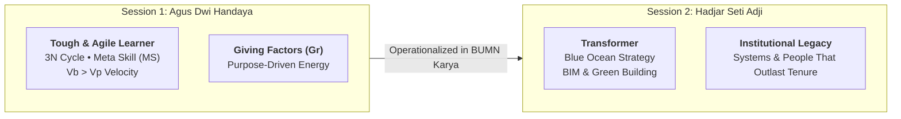
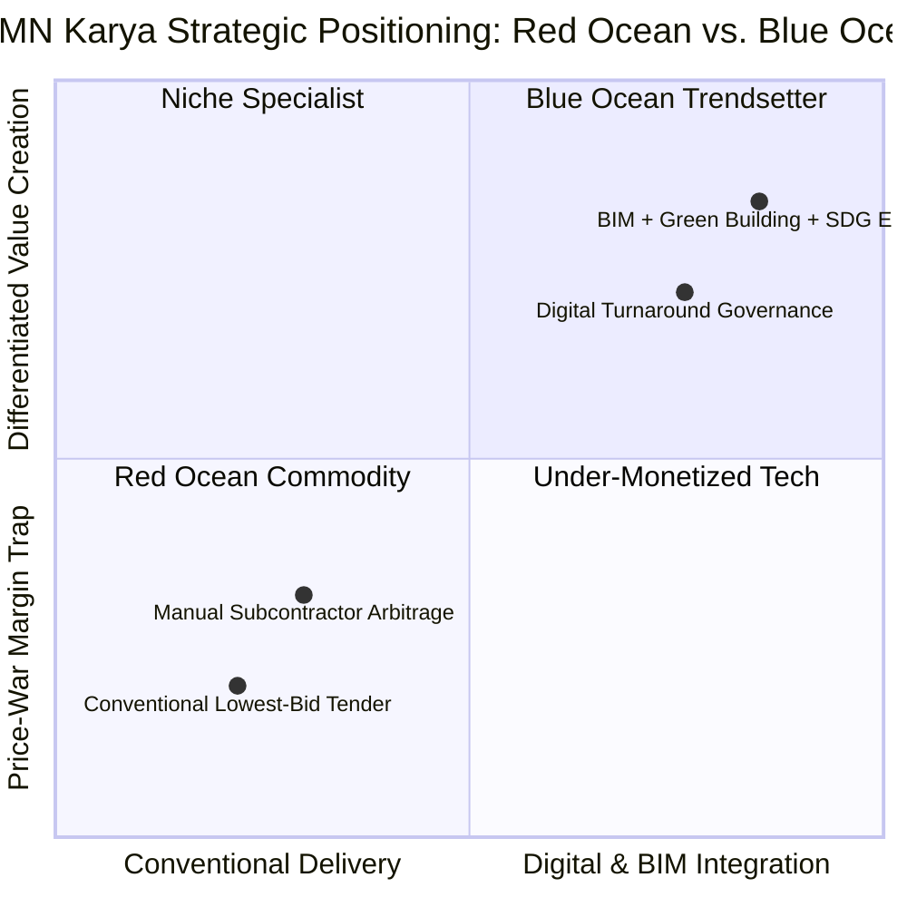
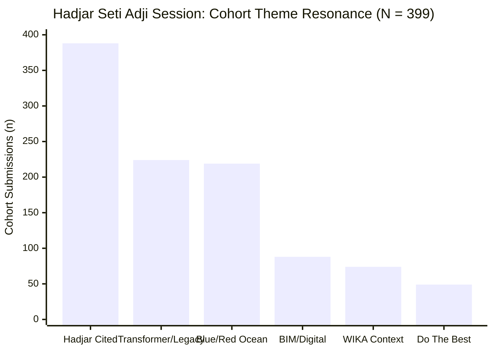

## Executive Session Overview

On **Monday, August 31, 2026**, **[[entities/hadjar-seti-adji|Hadjar Seti Adji]]**—Director of Human Capital and Transformation (_Direktur Manajemen Sumber Daya Manusia dan Transformasi_) at **[[entities/pt-wijaya-karya|PT Wijaya Karya (Persero) Tbk]] (WIKA)**—delivered the second half of the landmark **PeopleMath** executive briefing to the **P3MD Batch I Soedirman** cohort, immediately following **[[entities/agus-dwi-handaya|Agus Dwi Handaya (ADH)]]**'s theoretical masterclass on **[[rabuan/2026-09-02-adh-peoplemath|PeopleMath & Tough & Agile Learner]]**.

Where ADH provided the architectural equations explaining _how_ human capability, character, and motivation compound into sustainable productivity ($PPH$), Hadjar provided the **pragmatic field proof** from two decades of turning around Indonesia's state-owned construction enterprises (**PT PP**, **PT Waskita Karya**, and **PT WIKA**). His session answered the decisive executive question: _once an individual becomes a Tough & Agile Learner, what is that learning velocity actually for?_

> _"Cara terbaik memprediksi masa depan adalah dengan menciptakan masa depan itu sendiri. Jadilah pemimpin yang jujur dan amanah, berani mencoba, tetapi berani juga bertanggung jawab."_
> — **Hadjar Seti Adji**

---

## Core Pedagogical Architecture

### 1. The Escalation Arc: Learner $\rightarrow$ Transformer $\rightarrow$ Legacy

In traditional corporate training, learning is treated as an individual credentialing exercise—collecting certificates, memorizing frameworks, or optimizing personal KPIs. Hadjar dismantled that narrow view by framing personal growth as a three-stage institutional escalation:

1. **Learner (Self-Mastery)**: Building the psychological toughness and cognitive agility ($TAL$) to learn faster than technological and regulatory disruption ($Vb > Vp$).
2. **Transformer (Systemic Leverage)**: Refusing to keep learning confined to personal performance. A transformer uses **Giving Factors** ($Gr$)—a deliberate desire to mentor, teach, and elevate teams—to redesign broken workflows and challenge industry orthodoxy.
3. **Legacy (Institutional Permanence)**: Legacy is not a commemorative plaque or personal title. As synthesized across the cohort, legacy is **an improved system, capability, or culture that continues generating value after the leader has moved on**.

### 2. Escaping the Red Ocean: Blue Ocean Strategy in BUMN Construction

Indonesia's state-owned construction and EPC sector (**BUMN Karya**) historically operated in a brutal **Red Ocean**: multiple state and private contractors competing on nearly identical conventional civil-works tenders, compressing margins through price-cutting and absorbing balance-sheet strain.

- **Plain-English Intuition**: A _Red Ocean_ is a crowded market where rivals fight over the same shrinking pool of customers using the same methods, turning the water "red" with margin-destroying price wars. A _Blue Ocean_ is an uncontested value space created by changing _how_ the work is delivered—making traditional price competition irrelevant.
- **Pragmatic Execution — Building Information Modeling (BIM) & Green Building**: Drawing on his transformation track record at **PT PP (Persero) Tbk**, **PT Waskita Karya**, and **PT WIKA**, Hadjar demonstrated how championing **BIM** (digital 3D/4D/5D lifecycle modeling that detects engineering clashes before concrete is poured), **Green Building** standards, and **SDG-aligned construction** moved state contractors from reactive tender-chasers to digital trendsetters.

| Strategic Dimension      | Red Ocean Contracting (Legacy Norm)                         | Blue Ocean Transformation (Hadjar Doctrine)                              |
| :----------------------- | :---------------------------------------------------------- | :----------------------------------------------------------------------- |
| **Basis of Competition** | Lowest tender price on conventional drawings                | Digital precision, lifecycle efficiency, and sustainability credentials  |
| **Engineering Workflow** | Fragmented 2D blueprints; costly on-site clash rework       | Integrated **BIM** modeling; clash detection before field mobilization   |
| **Market Positioning**   | Reactive follower waiting for government tender specs       | Proactive **trendsetter** shaping Green Building & SDG project standards |
| **Leadership Posture**   | Risk-averse compliance; protecting legacy silos             | Ambidextrous leadership: stabilizing core operations while innovating    |
| **Long-Term Outcome**    | Margin erosion, schedule delays, and working-capital stress | Defensible capability moat and transferable institutional **legacy**     |

### 3. Pragmatic Proof of PeopleMath in the Field

A central insight highlighted across the cohort was that Hadjar's field anecdotes occurred _before_ the formal publication of ADH's _PeopleMath_ book—yet mapped cleanly onto its mathematical structure:

- **Giving Factors ($Gr$) as Fuel for Learning Energy ($LE$)**: Hadjar shared his personal ambition to serve as a mentor, teacher, and inspirator. Because you cannot credibly teach what you have not mastered, that giving-oriented purpose forced him to accelerate his own learning velocity ($Vb > Vp$) to pioneer new construction technologies.
- **Ambidextrous Leadership & Helicopter View**: Leading transformation inside heavily regulated BUMN Karya enterprises requires **[[concepts/leadership-ambidexterity|ambidexterity]]**—maintaining operational discipline on active projects (_exploitation_) while simultaneously building digital BIM and sustainability capabilities for the future (_exploration_).
- **Micro-Example of $Vb > Vp$ in EPC**: If construction project complexity ($Vp$) rises by $20\%$ due to multi-utility urban infrastructure demands, a project manager relying solely on legacy 2D drafting experiences widening schedule delays. Adopting BIM early pushes learning velocity ($Vb$) ahead of complexity, eliminating field rework before it compounds into cost overruns.

### 4. The Ethical Execution Triad & Non-Transactional Generosity

To ensure rapid innovation never degenerates into reckless shortcuts, Hadjar anchored transformation in two moral commitments:

1. **The Ethical Execution Triad**: _"Jadilah pemimpin yang jujur dan amanah, berani mencoba, tetapi berani juga bertanggung jawab."_ Cohort participants immediately connected this triad to the **P3MD** core ethos (**Berani, Cepat, Terhormat**):
   - _Jujur & Amanah_ (Truthful & Trustworthy) $\rightarrow$ grounds **Courage** (_Berani_).
   - _Berani Mencoba_ (Courage to Experiment) $\rightarrow$ drives **Speed & Innovation** (_Cepat_).
   - _Berani Bertanggung Jawab_ (Accountability for Outcomes) $\rightarrow$ preserves **Honor** (_Terhormat_).
2. **Non-Transactional Excellence**: _"Do the best and the best will find its way back to you."_ Leaders must deliver their highest standard of work and treat colleagues with generosity—even when no immediate career reward or supervisor visibility is attached.

---

## Full-Corpus Empirical Census & Cohort Synthesis ($N = 399$)

Following the August 31, 2026 dual session, **399 P3MD Batch I Soedirman participants** across all 4 Groups (`Grup 1`: 91, `Grup 2`: 89, `Grup 3`: 90, `Grup 4`: 129) and 12 Elements submitted individual reflective essays (396 PDFs + 3 DOCXs; 24 submissions from MIND ID & subsidiaries).

### Empirical Resonance Matrix Across Cohort Reflections ($N = 399$)

| Session Theme / Executive Framework                                            | Submissions Citing ($n$) | Cohort Resonance (%) | Primary Analytical Focus in Cohort Reflections                        |
| :----------------------------------------------------------------------------- | :----------------------: | :------------------: | :-------------------------------------------------------------------- |
| **Hadjar Seti Adji Cited (Keynote Speaker)**                                   |         **388**          |      **97.2%**       | Bridging PeopleMath theory to real-world BUMN transformation.         |
| **Learner $\rightarrow$ Transformer $\rightarrow$ Legacy Arc**                 |         **224**          |      **56.1%**       | Shifting from personal achievement to enduring institutional systems. |
| **Blue Ocean vs. Red Ocean Strategy**                                          |         **219**          |      **54.9%**       | Escaping commodity price competition through value innovation.        |
| **BIM & Digital Construction Transformation**                                  |          **88**          |      **22.1%**       | Pioneering digital engineering at PT PP (34), Waskita (21), and WIKA. |
| **PT Wijaya Karya (WIKA) Turnaround Context**                                  |          **74**          |      **18.5%**       | Human capital & transformation governance inside BUMN Karya.          |
| **_"Do the best and the best will find its way back to you"_**                 |          **49**          |      **12.3%**       | Non-transactional work ethic and treating all peers with respect.     |
| **Green Building & Sustainable Construction**                                  |          **13**          |       **3.3%**       | Aligning EPC delivery with long-term environmental stewardship.       |
| **_"Cara terbaik memprediksi masa depan adalah menciptakannya"_**              |          **11**          |       **2.8%**       | Proactive trendsetting rather than passive adaptation.                |
| **Ethical Execution Triad (_Jujur, Amanah, Berani Mencoba & Tanggung Jawab_)** |          **8**           |       **2.0%**       | Linking integrity to psychological courage and P3MD honor.            |

### Thematic Deep-Dive & Cohort Questions

Across the 399 essays, three recurring analytical realizations emerged:

1. **De-mystifying "Legacy" for Early-Career & Mid-Level Leaders**:
   - Many participants initially assumed _legacy_ was reserved for CEOs or retiring directors. Hadjar's framing reframed legacy as **daily system-building**: documenting SOPs, mentoring junior analysts, eliminating repetitive friction, and building tools that empower the next person in the role.
2. **Problems as Blue Ocean Catalysts**:
   - Rather than viewing legacy BUMN bottlenecks (fragmented data, manual reporting, bureaucratic handoffs) as excuses for cynicism, cohort engineers, bankers, and agro-industrial specialists identified those exact friction points as their local _Blue Ocean_ opportunities.
3. **Synthesized Cohort Questions Addressed to Pak Hadjar**:
   - _Measuring Objective Legacy_: How can a leader objectively verify that a change genuinely creates organizational legacy rather than merely satisfying personal ambition or short-term visibility?
   - _Overcoming Cultural Inertia_: What tactical first steps persuade entrenched, risk-averse teams to adopt Blue Ocean innovations (like BIM) when legacy habits resist disruption?
   - _Limits of Innovation Under Governance_: Up to what boundary can bold experimentation proceed inside state-owned enterprises without colliding with rigid audit and regulatory constraints?

### Cohort 30-Day Transformation Commitments

As synthesized by **the Portal Maintainer** and cohort peers across the 399 reflections:

| Leadership Arena        | Legacy Passive Reflex                                      | 30-Day Transformer Commitment                                                                       |
| :---------------------- | :--------------------------------------------------------- | :-------------------------------------------------------------------------------------------------- |
| **Daily Work Standard** | Completing assigned tasks solely when supervisors observe. | Practicing _"Do the best"_ consistently—delivering clean, documented work regardless of visibility. |
| **Process Innovation**  | Accepting repetitive manual workflows as "tradition."      | Identifying one operational bottleneck per unit to prototype a Blue Ocean digital improvement.      |
| **Knowledge Transfer**  | Hoarding technical know-how as individual job security.    | Documenting workflows and mentoring peers so capabilities outlast personal rotation.                |
| **Ethical Courage**     | Avoiding bold proposals for fear of blame if imperfect.    | Applying the triad: grounding proposals in truth (_amanah_), testing boldly, and owning outcomes.   |

---

## Archival Staging & Primary Sources

All 399 cohort submission artifacts from the dual PeopleMath & Hadjar Seti Adji session have been extracted, safety-scanned, and archived for institutional traceability:

| Archive Repository                                    |    File Count     | Primary Contents                                                                   |
| :---------------------------------------------------- | :---------------: | :--------------------------------------------------------------------------------- |
| `archive/rabuan/2026-08-31-peoplemath-hadjar/Grup 1/` |  91 Submissions   | Individual reflection essays across Elements 1, 2, and 3 (`.pdf`).                 |
| `archive/rabuan/2026-08-31-peoplemath-hadjar/Grup 2/` |  89 Submissions   | Individual reflection essays across Elements 1, 2, and 3 (`.pdf`).                 |
| `archive/rabuan/2026-08-31-peoplemath-hadjar/Grup 3/` |  90 Submissions   | Individual reflection essays across Elements 1, 2, and 3 (`.pdf`).                 |
| `archive/rabuan/2026-08-31-peoplemath-hadjar/Grup 4/` |  129 Submissions  | Individual reflection essays across Elements 1, 2, and 3 (126 `.pdf` + 3 `.docx`). |
| **Total Ingested Submissions**                        |   **399 Files**   | Complete cohort reflections for P3MD Batch I Soedirman (`PeopleMath`).             |
| **Extracted Text Corpus**                             | **399 TXT Files** | Located at `.extracted/texts/` (safety-scanned; zero prompt injections).           |
| **Full-Census Summary**                               | **JSON Manifest** | Located at `.extracted/cohort-summary.json` with empirical census metrics.         |

---

## Knowledge Graph & Curriculum Bridges

- **Featured Keynote Speaker**:
  - [[entities/hadjar-seti-adji|Hadjar Seti Adji]] (Direktur Manajemen SDM dan Transformasi, PT Wijaya Karya (Persero) Tbk)
- **Primary Enterprise Context**:
  - [[entities/pt-wijaya-karya|PT Wijaya Karya (Persero) Tbk (WIKA)]]
  - [[entities/danantara|BPI Danantara & PT Danantara Asset Management]]
- **Companion Session (Same Day)**:
  - [[rabuan/2026-09-02-adh-peoplemath|Rabuan 01: PeopleMath — Produktivitas Berkualitas, Kebahagiaan Tanpa Batas & Strategi Tough & Agile Learner]] ([[entities/agus-dwi-handaya|Agus Dwi Handaya]])
- **Compounding Core Concepts**:
  - [[concepts/peoplemath-framework|PeopleMath Framework & PPH Architecture]]
  - [[concepts/tough-and-agile-learner|Tough & Agile Learner (TAL) & 3N Growth Engine]]
  - [[concepts/leadership-ambidexterity|Leadership Ambidexterity]]
- **Direct Curricular Synergies**:
  - [[courses/mk3-marketing-management/week-04/index|MK 3 Week 04: B2B Marketing & WIKA EPC Champion Program]] (WIKA strategic positioning & B2B differentiation)
  - [[courses/mk1-organizational-behavior-managing-people/index|MK 1: Organizational Behavior & Managing People]] (Organizational culture & change leadership)
- Return to **[[rabuan/index|Rabuan Executive Masterclass Hub]]** | **[[index|MBA Cohort Portal Home]]**
