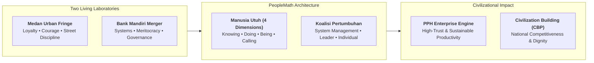
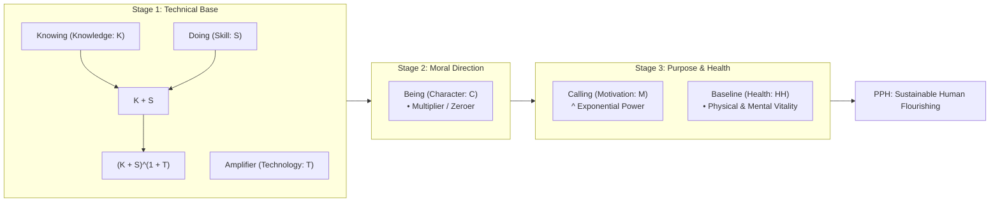
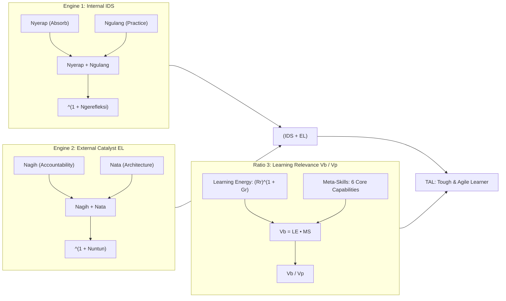
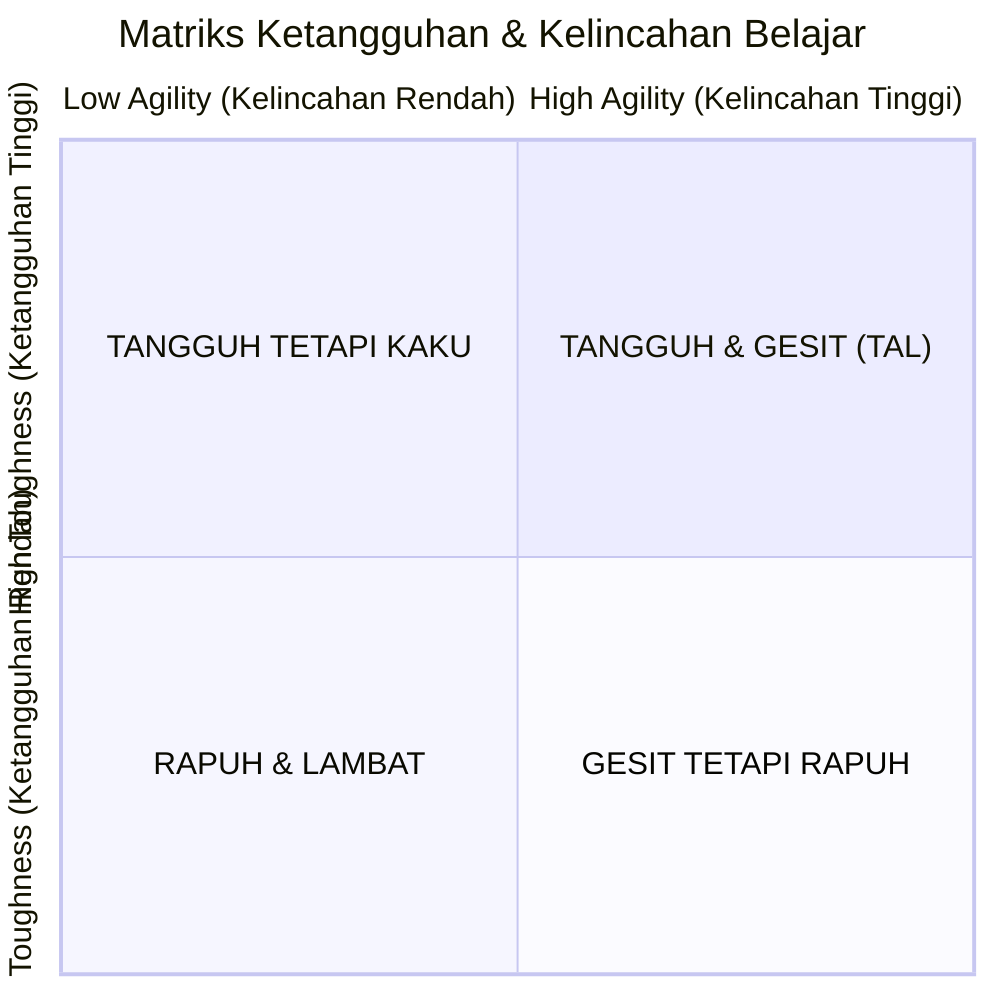
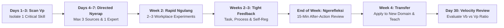

## Executive Session Overview

On September 2, 2026, **Agus Dwi Handaya** (widely known as **ADH**)—Managing Director of Human Capital at **[[entities/danantara|PT Danantara Asset Management]]** and former Director of Human Capital & Compliance at **PT Bank Mandiri (Persero) Tbk**—delivered the inaugural masterclass of the **P3MD Batch I Soedirman** executive plenary series (_Kuliah Rabuan_) at Kampus DCU Nawasena.

Titled **"PeopleMath: Produktivitas Berkualitas, Kebahagiaan Tanpa Batas"**, the masterclass introduced a paradigm shift in how leaders in Indonesia's state-owned enterprises (**BUMN**) and public institutions evaluate human potential. ADH demonstrated that human capital decisions cannot be governed by intuitive sentiment or rigid bureaucratic mandates. Instead, human productivity must be read through an architectural mathematical framework that honors the whole human being while enforcing accountability.

Opening the session, ADH articulated the core dilemma of modern enterprise management:

> _"Di banyak organisasi hari ini, angka bisa naik ketika manusianya justru menurun. Target tercapai, laporan tampak rapi, dan dashboard berwarna hijau. Tetapi di bawahnya tumbuh kelelahan kronis, keterputusan makna, relasi yang rapuh, dan hilangnya trust. Produktivitas sejati bukanlah peristiwa di ujung pekerjaan, melainkan buah dari cara manusia dibentuk. Produktivitas terbaik adalah yang membangun manusia, bukan membakar manusia."_
> — **Agus Dwi Handaya**

---

## The Two Productivity Paradoxes & The Two Living Laboratories

### 1. The Two Productivity Paradoxes of Modern Enterprise

ADH grounded the session in two systemic paradoxes observed across Indonesian corporations and civil bureaucracies:

1. **Paradoks Kinerja Naik, Kualitas Manusia Menurun**: An organization accelerates its operational output like an automobile driven at top speed across a highway, without monitoring engine temperature, oil pressure, tire integrity, or driver exhaustion. Performance metrics appear outstanding in the short run, but internal human capital accumulates silent operational debt—loss of trust, cynicism, and burnout.
2. **Paradoks Tuntutan Naik, Daya Hidup Tergerus**: Enterprises demand agility, innovation, error-free compliance, and cross-functional collaboration. Simultaneously, workplace psychological safety collapses, employee engagement plummets, and promising talent fails to mature into resilient leadership.

### 2. The Two Living Laboratories

The PeopleMath framework was not synthesized inside an academic vacuum; it was forged across two disparate real-world crucibles:

- **Laboratorium Hidup 1: Lingkungan Keras Pinggiran Kota Medan**: In the tough environment of his youth, ADH witnessed how fierce loyalty, courage, street-level discipline, peer protection, and psychological resilience were developed organically without formal managerial jargon.
- **Laboratorium Hidup 2: Transformasi Bank Hasil Merger (Bank Mandiri)**: Over decades of executive stewardship, ADH engineered corporate systems, meritocratic performance management, cultural cohesion, and leadership pipelines that transformed Bank Mandiri into Indonesia's leading banking institution and a key national talent supplier (_talent supplier_).

From both environments, ADH extracted an identical universal truth: **productive greatness is never the product of technical skill alone; it emerges when human capability is anchored in character, ignited by purpose, and cultivated through aligned leadership and systemic governance.**

---

## Generic Mathematical Architecture & The Master Equations

### 1. The Generic Three-Variable Formula Logic

PeopleMath translates human capital dynamics into equations using a consistent three-variable algebraic structure:

$$\mathbf{\text{Output} = \left[ (A + B) \times C \right]^{(1 + D)}}$$

To understand how PeopleMath functions across all 20 formulas, leaders must decode the distinct behavioral role played by each mathematical operator:

- **Additive Foundations ($A + B$)**: Complementary technical or cognitive components (e.g., Knowledge $K$ plus Skill $S$). They reinforce one another. A deficit in one variable impairs performance, but does not wipe out total output.
- **Multiplicative Multiplier & Zeroer ($\times C$)**: Variables acting as ethical or directional filters (e.g., Character $C$, Integrity $In$, or Relevance $Rk$). When $C > 1$, output multiplies; when $C \to 0$ (such as fraud, bad attitude, or deceit), the entire enterprise output collapses to zero regardless of technical excellence.
- **Exponential Accelerator ($^{(1 + D)}$)**: Variables acting as psychological, reflective, or developmental power multipliers (e.g., Motivation $M$, Reflection $R$, or Nuntun $N3$). If $D = 0$, base value remains intact ($Base^1 = Base$); if $D > 0$, output scales exponentially.

A micro-numerical example illustrates the profound risk of ignoring multiplier and exponential dynamics: an associate with 10 units of Knowledge and 10 units of Skill who commits fraud ($C = 0$) produces $[(10 + 10) \times 0]^{(1 + 2)} = 0$. Conversely, an associate with moderate competence ($K=6, S=6$) guided by high integrity ($C = 1.5$) and deep purpose ($D = 1$) delivers $[(6 + 6) \times 1.5]^{(1 + 1)} = 18^2 = 324$.

---

### 2. Rumus Utama 1: People Productivity & Happiness (PPH)

The intellectual centerpiece of PeopleMath is the **PPH Equation**, which unifies corporate performance with human well-being:

$$\mathbf{PPH = \left[ \left( (K + S)^{(1 + T)} \right) \times C \right]^{(1 + M)} \times HH}$$

This formula asserts that sustainable enterprise value generation requires reading human beings across four holistic dimensions, safeguarded by physical and psychological vitality:

#### Table P-1. Functional Architecture of the PPH Variables

| Variable                | Human Dimension | Functional Role in Architecture                             | Failure Mode if Compromised                                       |
| :---------------------- | :-------------- | :---------------------------------------------------------- | :---------------------------------------------------------------- |
| **$K$ — Knowledge**     | **Knowing**     | Contextual depth, cognitive models, industry principles     | Superficial action without understanding causality                |
| **$S$ — Skill**         | **Doing**       | Executable muscle memory and operational dexterity          | Theoretical paralysis; unable to deliver tangible results         |
| **$T$ — Technology**    | _Amplifier_     | Digital tooling, workflow automation, analytical platforms  | Exponential scaling of flawed, manual mistakes                    |
| **$C$ — Character**     | **Being**       | Moral compass, ethics, values, and uncompromising integrity | Catastrophic enterprise damage through fraud or arrogance         |
| **$M$ — Motivation**    | **Calling**     | Purpose-driven resilience fueled by giving factors ($Gr$)   | Transactional mercenaries who exit at the first obstacle          |
| **$HH$ — Human Health** | _Sustainer_     | Physical stamina ($Ph^*$) and emotional stability ($Mh$)    | Severe executive burnout, cognitive fatigue, and health breakdown |

In the logic of $PPH$, **happiness is not a sentimental post-target bonus** disbursed after financial milestones are achieved. Happiness is a **process health marker** proving that productivity is functioning humanely: that people work with meaning, retain dignity, and develop personal agency.

---

### 3. Rumus Utama 2: People Development Role (PDR)

Workforce development is never the exclusive responsibility of Human Capital departments. ADH formulated the **Growth Coalition** principle:

$$\mathbf{PDR = (SM)^{(1 + L + I)}}$$

The growth of human beings requires a three-way multiplicative pact:

1. **System Management ($SM$)**: The corporate architecture providing clear rules, fair meritocracy, transparent KPIs, and learning infrastructure.
2. **Leader ($L$)**: The direct manager practicing 3N leadership (**Nagih**, **Nata**, **Nuntun**).
3. **Individual ($I$)**: The employee exercising personal agency through the 3N learning cycle (**Nyerap**, **Ngulang**, **Ngerefleksi**).

If management relies solely on systems ($SM$), learning becomes cold and mechanistic; if it relies solely on leaders ($L$), employee growth turns into a subjective lottery; if it burdens only the individual ($I$), workers face structural frustration. All three must operate as an interconnected coalition.

---

## Complete Taxonomy of the 20 PeopleMath Formulas

The foundational volume _PeopleMath: Produktivitas Berkualitas, Kebahagiaan Tanpa Batas_ details **20 Human Equations** organized across five distinct architectural clusters:

### The 20-Formula Master Catalog

|   No   | Formula Name                              | Mathematical Formulation                                                 | Operational Significance                                                                                    |
| :----: | :---------------------------------------- | :----------------------------------------------------------------------- | :---------------------------------------------------------------------------------------------------------- |
| **1**  | **People Productivity & Happiness (PPH)** | $$PPH = [((K + S)^{(1 + T)}) \times C]^{(1 + M)} \times HH$$             | Master Equation 1: Unifying knowing, doing, being, and calling with health.                                 |
| **2**  | **People Development Role (PDR)**         | $$PDR = (SM)^{(1 + L + I)}$$                                             | Master Equation 2: Multiplicative growth coalition of System, Leader, and Individual.                       |
| **3**  | **Knowledge Element Composition (KEC)**   | $$KEC = Rk \times (1 + Dk + Sk)$$                                        | Knowledge must be relevant ($Rk$), deep ($Dk$), and supported by breadth ($Sk$).                            |
| **4**  | **Knowledge Element Acquisition (KEA)**   | $$KEA = \{[(Aab + As + Aa) \times (1 + Ex)]^{(1 + R)}\}^{(1 + Gm)}$$     | Knowledge is absorbed, curated, analyzed, experienced, and reflected via growth mindset.                    |
| **5**  | **Skill Element Composition (SEC)**       | $$SEC = [Ts \times (1 + Ss + Ps)]^{(1 + Ms)}$$                           | Skills unite technical mastery ($Ts$), soft ($Ss$), and people skills ($Ps$) powered by meta-skills ($Ms$). |
| **6**  | **Skill Element Acquisition (SEA)**       | $$SEA = [(K + Et) \times (1 + Ec)]^{(1 + R)}$$                           | Skills stick through training ($Et$), executive coaching ($Ec$), and deliberate reflection ($R$).           |
| **7**  | **Character Element Composition (CEC)**   | $$CEC = (Mor + Eth + Val) \times In$$                                    | Morality, ethics, and values zero out if integrity ($In = 0$) collapses.                                    |
| **8**  | **Belief Element Acquisition (BEA)**      | $$BEA = (Bs + Ex + Rm)^{(1 + R)}$$                                       | Core beliefs crystallize from stories ($Bs$), lived trials ($Ex$), and role models ($Rm$).                  |
| **9**  | **Belief Element Composition (BEC)**      | $$BEC = (Bais + Baip + Brw)$$                                            | Beliefs span social propriety ($Bais$), professional ethics ($Baip$), and moral truth ($Brw$).              |
| **10** | **Leader Development Role (LDR)**         | $$LDR = (N1 + N2)^{(1 + N3)}$$                                           | Leadership balances Nagih ($N1$), Nata ($N2$), and exponential Nuntun ($N3$).                               |
| **11** | **Individual Development Role (IDR)**     | $$IDR = (N4 + N5)^{(1 + N6)}$$                                           | Personal agency drives growth through Nyerap ($N4$), Ngulang ($N5$), and Ngerefleksi ($N6$).                |
| **12** | **System Management Role (SMR)**          | $$SMR = \{[(SMPP + SMRm) \times (1 + SMK + SMKI + SMTS)]^{(1 + SMB)}\}$$ | Coherent HR system architecture harmonized by cultural governance ($SMB$).                                  |
| **13** | **Nuntun Technique (N3)**                 | $$N3 = (Ch + Tk)^{(1 + Tr)}$$                                            | Coaching scales through stretch challenge ($Ch$), tacit wisdom ($Tk$), and human treatment ($Tr$).          |
| **14** | **Technology Effectiveness (TE)**         | $$TE = (Rt)^{(1 + At)}$$                                                 | Technology advances ($At$) only when aligned with relevant operational problems ($Rt$).                     |
| **15** | **Character Element Acquisition (CEA)**   | $$CEA = [B + Ex^{(1 + Rm)}]^{(1 + R)}$$                                  | Character is forged when beliefs face temptation, guided by role models and reflection.                     |
| **16** | **Motivation Element Composition (MEC)**  | $$MEC = (Rr)^{(1 + Gr)}$$                                                | Motivation combines extrinsic baseline ($Rr$) with exponential intrinsic purpose ($Gr$).                    |
| **17** | **Motivation Element Acquisition (MEA)**  | $$MEA = [B + Ex^{(1 + Rm)}]^{(1 + R)}$$                                  | Calling matures through meaningful experience, exemplary leadership, and self-inquiry.                      |
| **18** | **Human Health (HH)**                     | $$HH = (Mh \times Ph^*)$$                                                | Mental health ($Mh$) and physical health ($Ph^*$) form an uncompromising multiplier.                        |
| **19** | **PeopleMath Diagnosis (PMD)**            | $$PMD = (Gs + Vt)^{(1 + Pr)}$$                                           | Tracing surface symptoms ($Gs$) to variable roots ($Vt$) through pattern reflection ($Pr$).                 |
| **20** | **Civilization Building Process (CBP)**   | $$CBP = (PPH \times \text{Institution})^{Gi}$$                           | High human productivity institutionalized under noble national governance ($Gi$).                           |

---

### The Seven Common Corporate Mistakes in Managing People

ADH identified seven chronic distortions where organizations appear busy on the surface but hollow inside:

|  No   | Corporate Distortion                                  | Surface Symptom                                   | Root Architecture Deficit                                                          | PeopleMath Prescription                                                                |
| :---: | :---------------------------------------------------- | :------------------------------------------------ | :--------------------------------------------------------------------------------- | :------------------------------------------------------------------------------------- |
| **1** | **Equating Productivity with Gross Output**           | Target achieved; dashboard green.                 | Burnout, cynicism, fractured collaboration.                                        | Evaluate $PPH$ holistically: audit $C$, $M$, and $HH$, not just $K+S$.                 |
| **2** | **Treating Symptoms Instead of Root Causes**          | Dropping sales $\to$ pressure doubled.            | Actual gap lies in missing training ($Et$), low trust, or toxic leadership ($Tr$). | Deploy _Variable Tracing_ ($Vt$) before prescribing interventions.                     |
| **3** | **Assuming Training Equals Competence**               | Packed seminars, certificates issued.             | Zero behavioral change; lack of practice and coaching.                             | Implement $SEA = [(K+Et)\times(1+Ec)]^{(1+R)}$ and deliberate practice.                |
| **4** | **Tolerating Toxic Character for High Output**        | Defending top producers who cheat or abuse peers. | Systematic destruction of organizational trust ($In \to 0$).                       | Treat Character ($C$) as a strict zeroing filter; zero tolerance for integrity breach. |
| **5** | **Restricting Motivation to Financial Bonus**         | Passive workers $\to$ compensation boosted.       | Short-lived transactional response; purpose extinguished.                          | Activate Giving Factors ($Gr$) through meaningful work and professional impact.        |
| **6** | **Operating Incoherent Sub-Systems**                  | Employees confused by conflicting signals.        | Training teaches agility, KPIs reward compliance, leaders micromanage.             | Harmonize all modules of $SMR$ into a singular cultural doctrine ($SMB$).              |
| **7** | **Demanding Results Without Reflecting on Treatment** | Intimidating staff to hit quarterly quotas.       | Subordinates operate from fear, hiding bad news and errors.                        | Balance $LDR = (N1+N2)^{(1+N3)}$; evaluate executive treatment quality ($Tr$).         |

---

## Strategi Membentuk Tough & Agile Learner (TAL)

### The Urgent Need for Adaptive Capability

The World Economic Forum projects that **39% of core workforce skills will be transformed by 2030**. In this environment, being an enthusiastic _lifelong learner_ is insufficient. Professionals need to be **Tough & Agile Learners**:

- **Tough (Tangguh)**: Enduring learning friction—ambiguity, awkwardness during early practice, harsh feedback, failed experiments, and slow initial gains—without abandoning the pursuit.
- **Agile (Gesit)**: Detecting emerging signals, updating mental models, unlearning outmoded habits, and transferring principles rapidly into unfamiliar business contexts.

$$\mathbf{TAL = (IDS + EL) \times \left( \frac{Vb}{Vp} \right)}$$

The macro formulation establishes that adaptive capability is the product of human developmental foundation ($IDS + EL$) multiplied by the learning velocity ratio ($Vb/Vp$). The velocity ratio serves as an existential scaling factor: if environmental market change ($Vp$) outpaces internal acquisition speed ($Vb$), the fraction drops below $1.0$, eroding organizational readiness despite high baseline potential.

To operationalize the abstract learning speed $Vb$ into concrete executive levers, Agus Dwi Handaya decomposes the numerator into two measurable behavioral forces: raw emotional-volitional drive (Learning Energy, $LE$) multiplied by structural cognitive and reflective toolkits (Meta-Skills, $MS$):

$$\mathbf{TAL = (IDS + EL) \times \left( \frac{LE \times MS}{Vp} \right), \quad \text{where } Vb = LE \times MS}$$

---

### The Four-Quadrant Toughness & Agility Matrix

| Quadrant Profile          | Core Behavioral Traits                                                 | Critical Organizational Risk                          | Prescribed Intervention                                         |
| :------------------------ | :--------------------------------------------------------------------- | :---------------------------------------------------- | :-------------------------------------------------------------- |
| **Rapuh & Lambat**        | Avoids difficulty, passive compliance, defensive when corrected        | Widening capability gap; blames the external system   | Establish psychological safety; small achievable milestones     |
| **Tangguh tetapi Kaku**   | Highly disciplined and tireless; stubbornly loyal to legacy habits     | Enormous effort wasted mastering obsolete methods     | Scanning exercises; unlearning routines; multi-angle feedback   |
| **Gesit tetapi Rapuh**    | Enthusiastic about novel trends; abandons tasks at first major failure | Chronic dabbling without achieving depth or transfer  | Deliberate practice cadence; commit to single skill mastery     |
| **Tangguh & Gesit (TAL)** | Welcomes new challenges; absorbs feedback; iterates rapidly            | Potential burnout if recovery intervals are neglected | Safeguard purpose; enforce physical recovery; deploy as mentors |

---

### The Sub-Engine Mechanics: IDS, EL, LE, and MS

#### 1. Individual Development Strategy (IDS — 3N Individu)

$$\mathbf{IDS = (\text{Nyerap} + \text{Ngulang})^{(1 + \text{Ngerefleksi})}}$$

- **Nyerap (Absorb)**: Active environmental scanning and critical curation of high-value signals rather than passive consumption of content.
- **Ngulang (Practice)**: Deliberate practice, spaced retrieval, and iterative testing in real work scenarios (Ericsson et al., 1993; Roediger & Karpicke, 2006).
- **Ngerefleksi (Reflect)**: Exponential accelerator through structured After-Action Reviews (AAR) answering five causal questions: (1) What was my goal? (2) What actually happened? (3) Why did it happen? (4) What should be sustained or stopped? (5) What single change will I execute in the next cycle? (DeRue et al., 2012).

#### 2. Effective Leader (EL — 3N Leader)

$$\mathbf{EL = (\text{Nagih} + \text{Nata})^{(1 + \text{Nuntun})}, \quad \text{where } N3 = (Ch + Tk)^{(1 + Tr)}}$$

- **Nagih (Accountability)**: Demanding verifiable workplace application rather than mere classroom attendance (Locke & Latham, 2002).
- **Nata (Architecture)**: Removing bureaucratic friction, structuring stretch assignments, and prioritizing cognitive loads.
- **Nuntun (Guidance)**: Exponential multiplier synthesizing challenging stretch assignments ($Ch$), tacit wisdom transfer ($Tk$), and dignified human treatment ($Tr$) that builds psychological safety (Edmondson, 1999; Hattie & Timperley, 2007).

#### 3. Learning Energy (LE)

$$\mathbf{LE = (\text{Receiving Factors})^{(1 + \text{Giving Factors})} = (Rr)^{(1 + Gr)}}$$

- **Receiving Factors ($Rr$)**: Extrinsic hygiene baseline (fair compensation, tools, schedule allocation, psychological safety).
- **Giving Factors ($Gr$)**: Exponential intrinsic driver (purpose, societal contribution, service to family, nation, and calling; Ryan & Deci, 2000).

#### 4. The Six Core Meta-Skills (MS)

1. **Self-Awareness**: Identifying competence boundaries, emotional triggers, and cognitive blind spots.
2. **Metacognition**: Planning, monitoring, and evaluating the efficacy of one's own learning techniques.
3. **Critical Thinking & Problem Framing**: Discerning signal from noise and framing root problems before solving.
4. **Self-Regulation**: Disciplining attention, emotional state, energy rhythms, and focus.
5. **Transfer & Adaptive Application**: Abstracting principles from one domain and applying them to another.
6. **Unlearning & Relearning**: Consciously letting go of obsolete frameworks and mental models.

#### 5. Compressing the Five Learning Friction Times

Maximizing learning velocity ($Vb$) requires systematically shrinking five operational delays:

1. **Signal-to-Priority Time**: Lag between market shift detection and skill prioritization.
2. **Priority-to-First-Practice Time**: Lag between setting priorities and initiating the first real-world trial.
3. **Practice-to-Feedback Time**: Lag between trial execution and receiving objective critique.
4. **Feedback-to-Adjustment Time**: Lag between receiving feedback and updating operational strategy.
5. **Adjustment-to-Performance Time**: Time required for corrected behaviors to stabilize into reliable execution.

---

## 30-Day TAL Operating Rhythm & Implementation Cadence

### The 3-Actor Operating Model Table

| Actor          | Core Developmental Duty                                             | Minimum Operational Rhythm                          | Primary Evidence of Success                      |
| :------------- | :------------------------------------------------------------------ | :-------------------------------------------------- | :----------------------------------------------- |
| **Individu**   | Owns skill agenda; runs 3N loop; seeks feedback; sustains LE and MS | Weekly practice; weekly AAR; monthly skill audit    | Measurable behavior shift; reduced learning lag  |
| **Leader**     | Nagih outcome; Nata stretch projects; Nuntun reflection             | Weekly check-in; immediate task feedback; team AAR  | Subordinate independence; rapid error recovery   |
| **Organisasi** | Scans $Vp$; provides skill platforms, experts, and meritocracy      | Quarterly skill review; updated competency pathways | Decreased time-to-proficiency; internal mobility |

---

### Illustrative Case Vignette: Bank Branch Manager Digital Turnaround

To illustrate the diagnostic power of the framework, consider a seasoned branch manager in a major commercial bank facing an aggressive digital banking transition:

- **Initial Diagnosis**: The manager was categorized as **Tangguh tetapi Kaku** (High Toughness, Low Agility). His _Nyerap_ was high in volume (attending dozens of seminars) but low in curation. His _Ngulang_ repeated legacy branch routines. His reflection was non-existent because he assumed 20 years of experience proved his methods were permanent. His supervisor practiced heavy _Nagih_ without _Nata_ or _Nuntun_. His learning velocity lagged the technological shift ($\frac{Vb}{Vp} < 1$).
- **The 30-Day TAL Intervention**: The manager selected one critical skill: _utilizing branch digital transaction data to design targeted client interventions_. He reviewed three curated data analytics briefings, partnered with a junior data analyst (_tutor effect_), launched two micro-campaigns, solicited weekly feedback, and conducted a 15-minute weekly AAR. His regional director agreed to evaluate transfer evidence rather than routine activity logs.
- **Outcome**: Within 30 days, branch deposit growth accelerated, customer conversion improved, and the manager successfully trained three peer branch heads in analytical targeting.

---

## Three Empirical Living Proofs of Tough & Agile Learners

```mermaid
flowchart LR
    subgraph Case1 ["Case 1: José M. Hernández"]
        direction TB
        C1A["Migrant farmworker to astronaut"]
        C1B["11 NASA rejections = 11 skill audits"]
        C1C["Mission Specialist STS-128"]
    end

    subgraph Case2 ["Case 2: André Sougarret"]
        direction TB
        C2A["700m mine collapse (33 miners)"]
        C2B["1:80 odds • Failed holes as data"]
        C2C["All 33 saved in 69 days"]
    end

    subgraph Case3 ["Case 3: The Golden Thirteen"]
        direction TB
        C3A["16 weeks compressed to 8 weeks"]
        C3B["Zero competition • Nocturnal peer teaching"]
        C3C["Historic 3.89/4.00 retest record"]
    end

    Case1 --- Case2 --- Case3
```

### Case 1: José M. Hernández — From Migrant Farm Fields to NASA Astronaut

- **Context**: Born to Mexican migrant farmworkers, working in crop fields during childhood and not speaking fluent English until age twelve. Inspired by Apollo 17, he dreamed of becoming an astronaut. His father gave him a 5-step recipe: (1) Define the goal, (2) Acknowledge the distance, (3) Create a roadmap, (4) Prepare relentlessly, (5) Build an unmatched work ethic. José added the sixth: **perseverance**.
- **The Crucible of 11 Rejections**: After completing electrical engineering degrees, NASA rejected his application **11 consecutive times**. Rather than giving up, Hernández audited successful applicants: he acquired a commercial pilot license, earned scuba certification, mastered Russian, and relocated to Johnson Space Center as an engineer. When his laser research program was cancelled, he transferred signal processing principles into digital mammography for early breast cancer detection (_adaptive skill transfer_).
- **Outcome**: Selected in 2004 on his twelfth attempt; flew as Mission Specialist on Space Shuttle Discovery STS-128 (2009), logging 14 days and 5.7 million miles in orbit.
- **TAL Diagnosis**:
  - $IDS$: Nyerap from NASA profiles; Ngulang flight and diving drills; Ngerefleksi rejections into capability audits.
  - $EL$: Father who structured roadmap; NASA leaders who set high standards and provided feedback.
  - $LE$: Giving Factors ($Gr$) rooted in uplifting migrant communities.
  - $MS$: Adaptive transfer from defense radar to medical mammography; unlearning traditional application patterns.
  - $\frac{Vb}{Vp} > 1$: Closing the gap between astronaut candidate criteria and personal capability.

---

### Case 2: André Sougarret — The San José Mine Rescue (Operación San Lorenzo)

- **Context**: On August 5, 2010, 700,000 tons of rock collapsed inside the San José mine in Chile, trapping 33 miners 700 meters underground. Mining engineer André Sougarret was dispatched to lead technical rescue operations amidst chaos, outdated maps, and political pressure.
- **The Analytical Pivot**: Initial drilling odds of finding the refuge chamber were 1 in 80. When early boreholes missed, Sougarret treated each failure not as zero-progress, but as valuable geological data on rock strata and drill deviation. He overturned standard protocol: instead of waiting for a borehole to finish, the team measured drill angles every few hours, instantly terminating off-target holes to eliminate sunk-cost waste.
- **Cross-Discipline Collaboration**: Sougarret embraced outside technology from young geologist Felipe Matthews, integrated NASA psychological confinement protocols, and coordinated the Chilean Navy's design of the _Fénix_ rescue capsule.
- **Outcome**: On October 13, 2010, **all 33 miners were retrieved alive after 69 days**, months ahead of initial engineering forecasts.
- **TAL Diagnosis**:
  - $IDS$: Continuous reflection loops every few hours; treating operational failures as expensive diagnostic data.
  - $EL$: Executing 3N leadership—Nagih safety standards; Nata parallel rescue plans (Plan A, B, C); Nuntun by empowering outside experts.
  - $LE$: Supreme Giving Factors ($Gr$)—saving 33 human lives.
  - $MS$: Rapid unlearning of standard mining timelines; dynamic problem framing under acute pressure.
  - $\frac{Vb}{Vp} > 1$: Learning faster than the physical and psychological deterioration of the trapped miners.

---

### Case 3: The Golden Thirteen — US Navy Officers Breaking Institutional Bias

- **Context**: In January 1944, the US Navy selected 16 African-American sailors for officer training at Camp Robert Smalls. Standard officer curriculum spanned 16 weeks; **they were forced to complete it in 8 weeks**. The compressed timeline was widely designed to engineer their failure.
- **Collective Learning Without Internal Competition**: The candidates established an uncompromising pact: **no one left behind**. Recognizing that an individual failure would be weaponized against their entire race, they eliminated internal ranking competition. They divided textbook modules, mastered specific disciplines, and taught each other every night under blankets using flashlights after lights-out (_tutor effect_ and _coach effect_).
- **The Retest Crucible**: All 16 passed with unprecedented marks. Suspecting cheating, the Navy forced them to retake examinations under armed invigilation. On the retest, their cohort average rose to **3.89 out of 4.00**—the highest class average recorded in naval training history.
- **Outcome**: Thirteen were commissioned as officers and warrant officers in March 1944, shattering racial barriers and paving the way for President Truman's Executive Order 9981 desegregating the armed forces.
- **TAL Diagnosis**:
  - $IDS$: Nocturnal reciprocal teaching; continuous retrieval practice; collective reflection.
  - $EL$: Distributed leadership where peers rotated roles of Nagih, Nata, and Nuntun.
  - $LE$: Giving Factors ($Gr$) of monumental historical significance—becoming the "foot in the door" for future generations.
  - $MS$: Extreme self-regulation in the face of racial hostility; metacognitive learning design.
  - $\frac{Vb}{Vp} > 1$: Doubling learning speed to conquer a 16-week curriculum in 8 weeks with record-breaking mastery.

---

### Cross-Case Comparative Synthesis

| Dimension                 | José M. Hernández                                                        | André Sougarret                                                                 | The Golden Thirteen                                                           |
| :------------------------ | :----------------------------------------------------------------------- | :------------------------------------------------------------------------------ | :---------------------------------------------------------------------------- |
| **Operational Crisis**    | Individual career aspiration vs. 11 consecutive rejections               | Humanitarian crisis: 33 miners trapped 700m underground                         | Institutional discrimination & 50% time compression (16 to 8 weeks)           |
| **Toughness Anchor**      | Refused to abandon dream; converted rejection letters into skill audits  | Absorbed 80 borehole failures without panic or loss of composure                | Bore humiliating accusations and forced retest with stoic dignity             |
| **Agility Anchor**        | Added pilot, scuba, Russian, and transferred radar skills to mammography | Ran 3 parallel drilling plans; adopted new seismic tools from junior geologists | Transformed competitors into peer teachers; studied under blankets            |
| **Giving Factors ($Gr$)** | Uplifting migrant family and inspiring under-represented youth           | Returning 33 men safely to their waiting families                               | Breaking racial barriers for all future African-American sailors              |
| **Documented Outcome**    | Space Shuttle Discovery STS-128 Mission Specialist (2009)                | All 33 miners rescued alive in 69 days (2010)                                   | Historic 3.89/4.00 record average; commissioned as first black naval officers |

---

## The Five Reminders of a Tough & Agile Learner

1. **Sudden breakthrough is an illusion**: High mastery is the compounding result of long, disciplined, accelerated learning cycles.
2. **Toughness is not stubbornness**: True toughness means staying faithful to the ultimate purpose while remaining flexible about the operational method.
3. **Rejection is diagnostic data**: Rejection highlights capability gaps that must be closed before returning as a transformed professional.
4. **Giving factors sustain long journeys**: Enduring energy emerges when personal growth serves a calling greater than individual ambition.
5. **TAL never chooses between standing firm and adapting**: It stands firm on principles, flexes on methods, remains humble before facts, and acts rapidly on feedback.

> ### Best Heart, Best Mind, Best Contribution.
>
> #### _Belajar. Bertahan. Berubah. Bertumbuh._
>
> — **Agus Dwi Handaya**

---

## Archival Staging & Primary Sources

All primary study documents, book chapters, and pre-synthesized modules from the session are archived in the repository for academic lineage:

| Archive Repository Location                                                          |       Content Type        | Document Scope & Description                                         |
| :----------------------------------------------------------------------------------- | :-----------------------: | :------------------------------------------------------------------- |
| `archive/rabuan/2026-09-02-adh-peoplemath/Teaser Buku PeopleMath-ADH.pdf`            |   Book Teaser (`.pdf`)    | 36-page teaser: 2 Paradoxes, 7 Mistakes, 20 Formulas, 17 Chapters.   |
| `archive/rabuan/2026-09-02-adh-peoplemath/strategi-membentuk-tough-agile-learner.md` | Executive Reading (`.md`) | Official P3MD reading module on TAL, 3N, LE, MS, and 3 case studies. |
| `archive/rabuan/2026-09-02-adh-peoplemath/peoplemath/`                               |    Sub-Wiki Directory     | Pre-synthesized concept, entity, source, and synthesis notes.        |
| `archive/rabuan/2026-09-02-adh-peoplemath/.extracted/intake-manifest.json`           | Safety Manifest (`.json`) | Cryptographic SHA-256 hash manifest and zero-width safety report.    |

---

## Knowledge Graph & Curriculum Bridges

- **Featured Keynote Speaker**:
  - [[entities/agus-dwi-handaya|Agus Dwi Handaya]] (Managing Director Human Capital, PT Danantara Asset Management)
- **Primary Institutional Entity**:
  - [[entities/danantara|PT Danantara Asset Management & BPI Danantara]]
- **Compounding Core Concepts**:
  - [[concepts/peoplemath-framework|PeopleMath Framework & PPH Architecture]]
  - [[concepts/tough-and-agile-learner|Tough & Agile Learner (TAL) & 3N Growth Engine]]
  - [[concepts/capital-capability-synergy|Capital-Capability Synergy & Financial Discipline Engine]]
  - [[concepts/four-drive-model|Lawrence & Nohria Four-Drive Model]]
- **Parallel Rabuan Masterclasses**:
  - [[rabuan/2026-09-04-indayati-professional-image|Special Masterclass: Building Professional Image & Executive Communication]] (Indayati Oetomo)
  - [[rabuan/2026-09-23-sahala-financial-discipline|Rabuan 04: Memimpin dengan Financial Discipline]] (Sahala Tua Paulus Situmorang)
  - [[rabuan/2026-09-30-buckingham-minto-method|Rabuan 05: Strategic Execution & The Minto Method]] (Prof. Edward Buckingham)
  - [[rabuan/2026-10-14-ric-roi-impact-career|Rabuan 07: Making an Impact, Making a Career]] (Dr. Ric Roi, IMD)
- **Direct Curricular Synergies**:
  - [[courses/mk1-organizational-behavior-managing-people/index|MK 1: Organizational Behavior & Managing People]] (Leadership, Motivation & Culture)
  - [[courses/mk4-operations-supply-chain-management/week-06/index|MK 4: Operations & Supply Chain]] (Process Friction, Little's Law & Cycle Time)
  - [[courses/mk5-decision-making-negotiation/index|MK 5: Decision Making & Negotiation]] (Unlearning, Problem Framing & Cognitive Biases)
  - [[courses/mk6-business-analytics/week-08/index|MK 6: Business Analytics]] (People Analytics & Diagnostic Tracing)
- Return to **[[rabuan/index|Rabuan Executive Masterclass Hub]]** | **[[index|MBA Cohort Portal Home]]**
