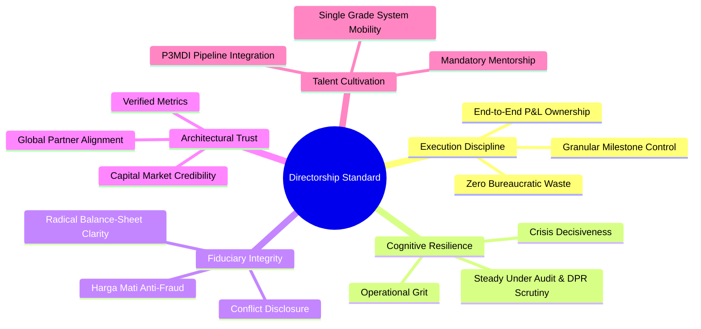

> [!IMPORTANT] Reconstructed Material Disclaimer
> **This dossier consists of reconstructed study materials, not a verbatim session transcript or complete slide archive.**
>
> Delivered on Wednesday, September 2, 2026, as part of the **Phase II Kick-Off** at **Kampus DCU Nawasena** (following the cohort's transition from Phase I at Kodiklat TNI), this masterclass note is anchored on **two verbatim presentation slide texts** preserved from **[[entities/dony-oskaria|Dony Oskaria]]'s** session. Surrounding analytical frameworks—including the five directorship capabilities, the Single Grade System, the eight BP BUMN conduct rules, and the four-phase turnaround sequencing model—are reconstructed from contemporaneous 2026 Danantara executive standards, BP BUMN regulatory mandates, and Oskaria's documented turnaround doctrine across Garuda Indonesia, InJourney, and Danantara.

---

## Executive Session Overview: From Macro Blueprint to Boardroom Standard

Having completed Phase I character and military-discipline conditioning at Kodiklat TNI Serpong, the **P3MDI Batch I Soedirman** cohort convened at **Kampus DCU Nawasena** on September 2, 2026, to launch Phase II—the academic and strategic corporate governance phase delivered in partnership with **Danantara Corporate University** and **SBM ITB**.

Whereas Oskaria's **[[rabuan/2026-06-09-oskaria-bumn-transformation-danantara|June 9, 2026 Phase I Foundation Plenary]]** established the macro-institutional architecture separating **BP BUMN** and **[[entities/danantara|BPI Danantara]]**, his September 2 Phase II Kick-Off masterclass turned the lens inward onto the **individual executive**. Alongside **[[rabuan/2026-09-02-adh-peoplemath|Agus Dwi Handaya's PeopleMath session]]** on the same kick-off day, Oskaria dismantled ceremonial notions of state-enterprise leadership and defined directorship through two uncompromising standards: **operational capability** and **sovereign civic responsibility**.

---

## The Two Foundational Directorship Mandates (Verbatim Slide Principles)

The intellectual spine of the September 2 session rests on two verbatim statements preserved from Oskaria's presentation slides:

### 1. Directorship as Capability and Performance Standard

> _"Being a Director isn’t just a title. It is a set of capabilities one possesses to ensure the work expected by the company gets done to reach its vision. Director is not a title you hold; it is a standard you uphold."_
> — **Dony Oskaria** _(Slide 1, September 2, 2026)_

This thesis confronts a historical pathology inside state-owned enterprises: treating directorships and commissionerships as ceremonial prestige, seniority rewards, or political sinecures. Oskaria strips the role of status entitlement and reduces it to two testable obligations:

1. **Closing the Execution Gap**: Strategic visions across Indonesian SOEs rarely fail from lack of ambition; they fail in the execution gap between policy mandates and daily operational delivery. A director exists solely to guarantee that required work gets completed.
2. **Continuous Standard Maintenance**: Because directorship is _"a standard you uphold"_ rather than a static legal appointment, legitimacy must be re-earned continuously through capital discipline, balance-sheet transparency, and operational delivery.

### 2. Leadership as Chosen Sovereign Responsibility

> _"Becoming a leader in BUMN and our government is not just a Job.... It is a decision to carry something larger than yourself — the livelihoods of millions, the ambitions of a nation, and the legacy you will one day leave behind. It is not a title you hold. It is a responsibility you choose."_
> — **Dony Oskaria** _(Slide 2, September 2, 2026)_

This second mandate establishes the ethical boundary between private corporate management and state-enterprise stewardship. Because Indonesian BUMNs control critical energy infrastructure, national logistics, agricultural supply chains, and financial liquidity, executive negligence inside a major state holding triggers systemic welfare and fiscal shocks across millions of citizens. Framing leadership as _"a responsibility you choose"_ grounds executive authority in voluntary moral accountability rather than careerist entitlement.

---

## The Five Core Capabilities of Directorship & Single Grade System

Operationalizing the principle that directorship is _"a set of capabilities"_, Danantara's executive evaluation framework benchmarks leaders across five core capabilities—contrasting legacy bureaucratic norms against the Danantara-Oskaria standard:

### Capability Benchmark: Legacy Norm vs. Danantara-Oskaria Standard

| Capability Dimension                        | Traditional SOE Administrative Norm                                                                 | The Danantara-Oskaria Executive Standard                                                                   |
| :------------------------------------------ | :-------------------------------------------------------------------------------------------------- | :--------------------------------------------------------------------------------------------------------- |
| **Execution Discipline & Project Delivery** | Procedural box-ticking, risk-averse delay, and focus on budget absorption over operational results. | High-velocity execution, granular milestone tracking, end-to-end accountability, elimination of waste.     |
| **Cognitive & Mental Resilience**           | Retreat into bureaucratic paralysis under parliamentary scrutiny or market volatility.              | Psychological composure under asymmetric public pressure; decisive action during crisis turnarounds.       |
| **Fiduciary Integrity & Governance**        | Formalistic compliance tolerating subtle rent-seeking, patronage, or off-balance-sheet obfuscation. | Uncompromising integrity (_harga mati_), radical balance-sheet transparency, zero tolerance for conflicts. |
| **Architectural Stakeholder Trust**         | Reactive lobbying toward patrons and defensive public relations.                                    | Proactive credibility with capital markets, rating agencies, global investors, and regulators via metrics. |
| **Talent Cultivation & Succession**         | Turf protection, seniority-locked promotions, and siloed enterprise career ladders.                 | Cross-sector mentorship, **Single Grade System** talent mobility, and active integration of P3MDI cadres.  |

### Cross-Holding Mobility: Danantara's Single Grade System

To translate capability standards into an integrated talent market across consolidated BUMN holdings, Danantara introduced the **Single Grade System**—harmonizing executive job grading, competency benchmarks, and performance evaluation across all portfolio enterprises. Rather than trapping capable leaders inside legacy subsidiary silos or inflating titles across minor entities, the Single Grade System enables meritocratic deployment of proven turnaround talent across holdings based on verified execution capability.

---

## The Eight BP BUMN Executive Conduct Directives

To ensure that _"a standard you uphold"_ carries enforceable institutional teeth, BP BUMN codified **eight binding executive conduct mandates** governing Directors and Commissioners across the state enterprise ecosystem:

| No. | Conduct Directive                                    | Operational Restriction & Requirement                                                                                | Governance Objective                                                                    |
| :-: | :--------------------------------------------------- | :------------------------------------------------------------------------------------------------------------------- | :-------------------------------------------------------------------------------------- |
|  1  | **Mandatory Conflict-of-Interest Elimination**       | Annual legally binding zero-conflict declaration; total ban on using corporate data or procurement for self/family.  | Terminates patronage diversion and nepotistic vendor arrangements.                      |
|  2  | **Strict Demarcation of Corporate Facilities**       | Prohibition on using company vehicles, staff, residences, or operational assets for personal or domestic use.        | Dismantles institutional entitlement and aligns privilege with public accountability.   |
|  3  | **Continuous Professional Certification**            | Mandatory completion of accredited executive education, technical governance training, and global benchmarking.      | Elevates technical capabilities to match global private conglomerates.                  |
|  4  | **Mandatory Internal Mentorship & Succession**       | Compulsory formal mentoring duties and tracked readiness of internal next-generation leadership pipelines.           | Reduces dependence on unvetted external appointees by cultivating internal bench depth. |
|  5  | **Mitigation of Public Ostentation (Anti-Hedonism)** | Strict ban on public or social-media displays of luxury goods, extravagant travel, or ostentatious wealth.           | Preserves public trust and social solidarity across state institutions.                 |
|  6  | **Enforced Political Neutrality**                    | Total prohibition on partisan campaigning, public political alignment, or deploying corporate resources politically. | Insulates enterprise operations from electoral cycles.                                  |
|  7  | **Segregation of Personal Avocations**               | Strict ban on channeling SOE budgets, sponsorships, or supplier favors into personal sports, clubs, or hobbies.      | Stops covert subsidization of executive lifestyles via marketing/operational budgets.   |
|  8  | **Unrestricted Audit & Performance Accountability**  | Full cooperation with internal controls and **BPK** audits; executive tenure tied directly to verified metrics.      | Anchors leadership survival in balance-sheet integrity and measurable delivery.         |

---

## Turnaround Doctrine: Four-Phase Transformation Sequencing Model

Drawing on his operational track record—restructuring **PT Garuda Indonesia (Persero) Tbk**, consolidating aviation and tourism holdings into **[[entities/injourney|InJourney]]**, and architecting portfolio rationalization at **[[entities/danantara|BPI Danantara]]**—Oskaria articulated a strict sequential turnaround blueprint.

```mermaid
flowchart LR
    subgraph P1["Phase 1: Years 1-2<br/>Restructuring & Consolidation"]
        direction TB
        P1A["Cleanse balance sheets:<br/>write-downs & debt restructuring"]
        P1B["Merge overlapping subsidiaries<br/>& prune non-core assets"]
        P1C["Stabilize cash flow &<br/>re-establish financial control"]
    end

    subgraph P2["Phase 2: Years 2-3<br/>People, Culture & Systems"]
        direction TB
        P2A["Dismantle ceremonial culture;<br/>enforce meritocracy"]
        P2B["Codify 8 conduct rules &<br/>fiduciary integrity protocols"]
        P2C["Deploy Single Grade System<br/>& P3MDI turnaround cadres"]
    end

    subgraph P3["Phase 3: Years 3-4<br/>Tech & Operational Innovation"]
        direction TB
        P3A["Modernize ERP, supply-chain<br/>visibility & risk controls"]
        P3B["Scale unit productivity to<br/>global peer benchmarks"]
        P3C["Integrate core technology<br/>across strategic operations"]
    end

    subgraph P4["Phase 4: Years 4-5<br/>Sovereign Value Creation"]
        direction TB
        P4A["Expand balance sheets without<br/>state bailout dependency"]
        P4B["Compete across ASEAN &<br/>global strategic markets"]
        P4C["Compound sustainable dividends<br/>for sovereign reinvestment"]
    end

    P1 --> P2 --> P3 --> P4
```

### Operational Sequencing Logic

The strategic lesson of this four-phase sequence is **non-negotiable order of operations**:

1. **Phase 1 — Restructuring & Consolidation (Years 1–2)**: Stop financial bleeding first. Management must execute realistic asset impairments, restructure unsustainable debt maturities, merge redundant subsidiaries, and restore cash-flow visibility before attempting expansion.
2. **Phase 2 — People, Culture & Behavioral Systems (Years 2–3)**: Replace entitlement with accountability. Institutionalize the **Single Grade System**, enforce the eight conduct mandates, and embed accelerated leadership cadres (such as P3MDI) into core transformation units.
3. **Phase 3 — Technology Integration & Operational Innovation (Years 3–4)**: Scale digitized workflows, supply-chain visibility, and operational excellence only _after_ clean balance sheets and meritocratic culture are locked in—preventing technology from merely automating broken processes.
4. **Phase 4 — Sovereign Value Creation & Global Competitiveness (Years 4–5)**: Deploy strengthened, self-funding balance sheets to compete regionally across Southeast Asia and generate compounding sovereign dividends for national reinvestment.

---

## Synthesis: From Macro Reform to Boardroom Execution

Together, Oskaria's Phase I plenary (`2026-06-09`) and Phase II Kick-Off masterclass (`2026-09-02`) form a unified executive doctrine linking national institutional architecture to individual boardroom conduct:

| Analytical Dimension        | Phase I Plenary (`2026-06-09`, Kodiklat TNI)                                           | Phase II Kick-Off (`2026-09-02`, Kampus DCU Nawasena)                                  |
| :-------------------------- | :------------------------------------------------------------------------------------- | :------------------------------------------------------------------------------------- |
| **Primary Strategic Focus** | Macro-institutional reform: rationalizing $>1,000$ entities down to $\sim 250$.        | Micro-fiduciary execution: personal directorship capabilities & behavioral discipline. |
| **Governance Lever**        | Statutory separation: **BP BUMN** (1% Seri A Dwiwarna) vs. **Danantara** (99% Seri B). | Internal enforcement: **Single Grade System** & **8 BP BUMN Executive Conduct Rules**. |
| **Definition of Director**  | Economic vanguard defending capital efficiency and market stability under pressure.    | _"Not a title you hold; a standard you uphold"_ and _"a responsibility you choose."_   |
| **Operational Objective**   | Liquidate non-core subsidiaries, ring-fence PSO contracts, restore BPK transparency.   | Execute 4-phase turnaround sequencing from balance-sheet cleanup to global yield.      |

---

## Knowledge Graph & Curriculum Bridges

- **Featured Speaker Profile**: [[entities/dony-oskaria|Dony Oskaria]] (COO BPI Danantara & Head of BP BUMN)
- **Foundational Predecessor**: [[rabuan/2026-06-09-oskaria-bumn-transformation-danantara|Foundation Plenary (2026-06-09): Transformasi Total BUMN & Arsitektur Tata Kelola BPI Danantara]]
- **Same-Day Phase II Kick-Off Companion**: [[rabuan/2026-09-02-adh-peoplemath|Rabuan 01: PeopleMath — Produktivitas Berkualitas & Strategi Tough & Agile Learner]] (Agus Dwi Handaya)
- **Institutional & Enterprise Entities**:
  - [[entities/danantara|BPI Danantara (Badan Pengelola Investasi Danantara)]]
  - [[entities/injourney|InJourney (PT Aviasi Pariwisata Indonesia)]]
- **Core Analytical Concepts**:
  - [[concepts/pso-commercial-duality|Public Service Obligation (PSO) vs Commercial Viability Duality]]
  - [[concepts/leadership-ambidexterity|Leadership Ambidexterity]]
  - [[concepts/capital-capability-synergy|Capital-Capability Synergy & Financial Discipline Engine]]
  - [[concepts/talent-density|Talent Density]]
- **Direct Curricular Synergies**:
  - [[courses/mk1-organizational-behavior-managing-people/index|MK 1: Organizational Behavior & Managing People]] (Executive Character, Governance & Culture Change)
  - [[courses/mk2-financial-management-strategy/index|MK 2: Financial Management & Strategy]] (Balance Sheet Restructuring & Capital Allocation)
- **Return to**: [[rabuan/index|Rabuan Executive Masterclass Hub]] | [[index|MBA Cohort Portal Home]]
