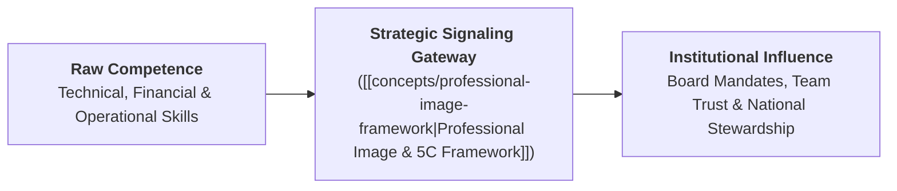
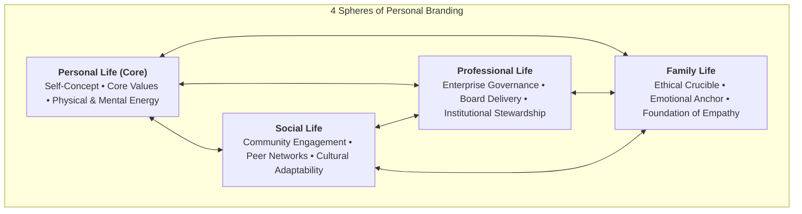
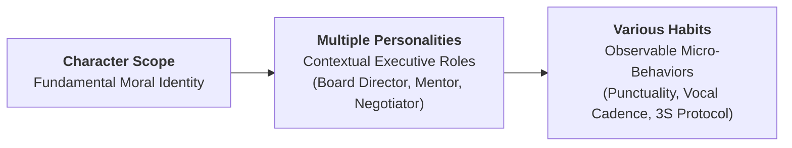
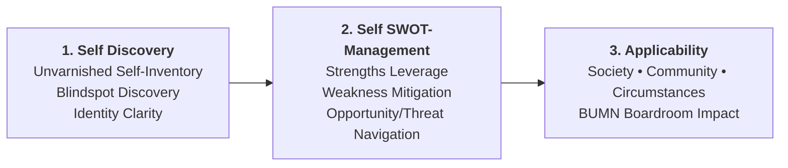
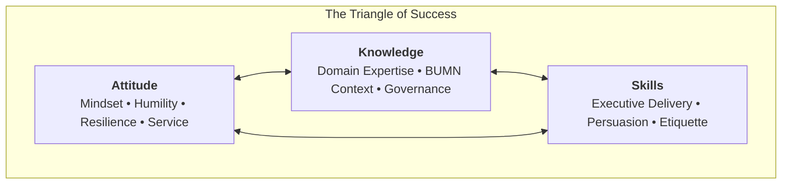
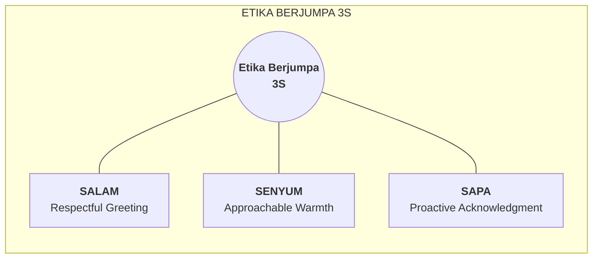
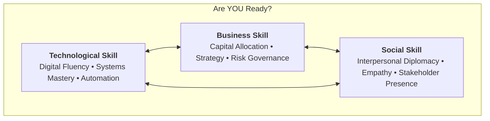
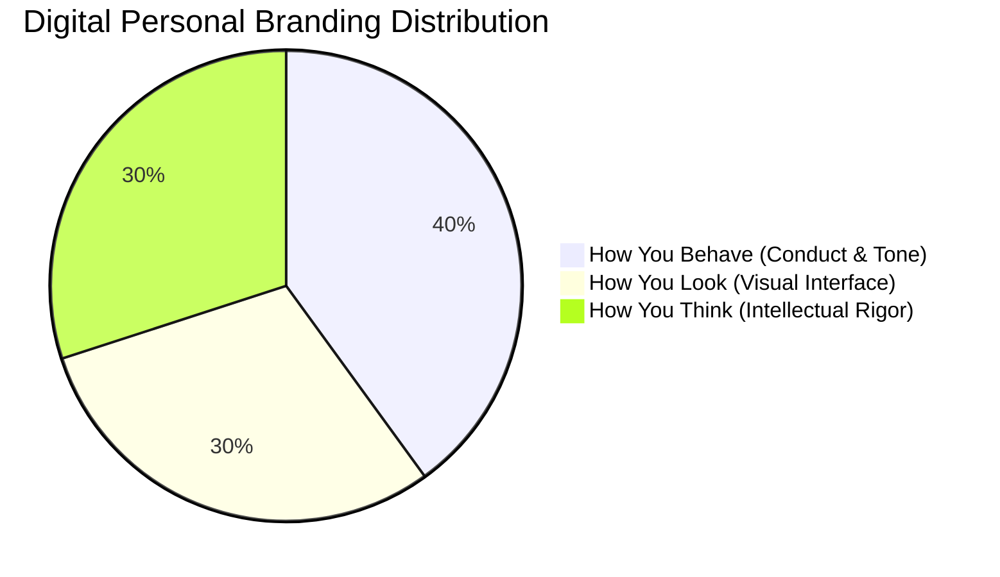
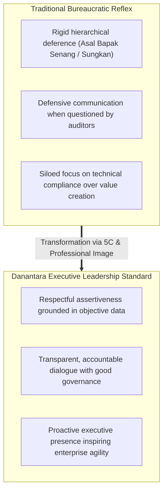

## Executive Session Overview

On September 4, 2026, **Indayati Oetomo** (Executive Director of **John Robert Powers Indonesia**) delivered an intensive cohort-wide executive masterclass to the **P3MD Batch I Soedirman** cohort at Kampus DCU Nawasena. Titled **"Building Professional Image & Executive Communication Skills"**, the session addressed one of the most critical inflection points in senior executive development: the bridge between internal technical competence and external leadership presence.

Ibu Indayati opened the masterclass with a foundational principle attributed to **John F. Kennedy**:

$$\mathbf{\text{\ldquo All of us do not have equal talent, but all of us should have an equal opportunity to develop those talents.\rdquo}}$$

This premise anchors professional presence not as an inborn privilege or superficial flair, but as an acquired, practiced discipline accessible to every professional willing to commit to continuous self-mastery. In large Indonesian state-owned enterprises (BUMN) and the emerging **Danantara** institutional architecture, leaders are entrusted with monumental national assets and public accountability. Technical brilliance in engineering, financial modeling, or supply chain logistics is a necessary prerequisite, but insufficient on its own. Without an articulate, composed, and trustworthy executive image, high-value strategic recommendations fail to win board consensus, inspire cross-functional teams, or secure public confidence.

---

## Core Pedagogical Foundations & Operating Principles

### 1. "Look As Good As You Can Deliver"

The session's central operating maxim dismantles the false dichotomy between substance and style:

$$\mathbf{\text{\ldquo Look As Good As You Can Deliver\rdquo}}$$

- **The Under-Signaling Failure**: A brilliant engineer or financial analyst who dresses carelessly, mumbles during board presentations, or avoids eye contact forces the listener to expend cognitive energy deciphering their credibility. The organization discounts their contribution.
- **The Over-Signaling Failure**: An articulate presenter who projects charisma without operational competence or ethical grounding (_pencitraan semata_) quickly erodes credibility upon delivery failure.
- **The Equilibrium**: Professional presence is an act of institutional respect. Looking and communicating at the level of your actual delivery ensures that your substantive insights receive the serious evaluation they deserve.

### 2. Servant Leadership: "Leader Adalah Pelayan"

A leader's image must never project superiority, arrogance, or detached hierarchy. Grounded in the principle that true authority stems from service:

- Leadership in BUMN is not about personal vanity or ceremonial privilege; it is about providing clear direction, removing roadblocks for subordinates, and stewarding stakeholder trust.
- Executive demeanor must combine **gravitas with warmth**, replacing defensive intimidation with empathetic clarity.

---

## Brand Image and Personal Branding Architecture

### 1. The Brand Image Axiom

$$\mathbf{\text{\ldquo Our Brand Image is a major factor that controls our lives.\rdquo}}$$

In executive leadership, reputation precedes physical presence. Long before an enterprise director steps into a ministry boardroom, parliamentary hearing, or international partner briefing, stakeholders form perceptual heuristics based on prior interactions, public track records, and digital correspondence. Far from being a trivial aesthetic concern, your brand image directly governs access to capital, the credibility of strategic counsel, and the level of autonomy granted by supervisory boards.

### 2. The 4-Sphere Personal Branding Map

An executive's brand image is not isolated inside the workplace. It is an interconnected system anchored by **Personal Life** at its core, surrounded and influenced by three vital arenas:

- **Personal Life (The Core Hub)**: The internal self-concept, physical vitality, emotional stability, and foundational philosophy. If the core hub is unstable, external signaling in all other spheres deteriorates.
- **Family Life**: The primary crucible where moral values, unconditional respect, listening habits, and emotional resilience are cultivated.
- **Social Life**: Community relations, civic responsibilities, and peer networks that condition social intelligence and cultural flexibility.
- **Professional Life**: The formal arena of corporate governance, strategic delivery, and executive accountability.

### 3. The Scope of Character Cascade

The masterclass established that character is expansive in scope and contains layered behavioral manifestations:

While foundational character remains immutable, enterprise leaders possess multiple situational personas adapted to diverse institutional demands—commanding resolve in crisis, empathetic inquiry in mentorship, and analytical rigor in audit committees. These roles translate directly into daily habits: micro-behaviors executed consistently until they define perceived leadership maturity.

---

## Personality Development Process & The Triangle of Success

### 1. The 3-Stage Personality Development Process

Framed by a **Positive Attitude**, sustainable personality development moves through three disciplined phases:

1. **Self Discovery**: Stripping away defensive biases to conduct an honest diagnostic of one's natural temperament, emotional triggers, and cognitive tendencies.
2. **Self SWOT-Management**: Systematically organizing personal strengths, weaknesses, developmental opportunities, and career threats into a dynamic management plan.
3. **Applicability in Society, Community & Circumstances**: Translating internal self-awareness into adaptable, value-generating behavior suited to complex BUMN operating environments.

### 2. The Mirror Diagnostic ("What To Do?")

Looking into the executive mirror requires asking three operational questions:

- **Know Your Self**: Deep self-awareness; identifying strengths to leverage and blindspots that invite conflict.
- **Optimize Your Self**: Continuous learning, seeking candid executive feedback, and expanding cross-functional fluency.
- **Control Your Self**: Emotional regulation, maintaining composure during high-stakes pressure, and mastering impulse restraint.

### 3. The Maturity Dyad: Self-Control & Self-Confidence

Executive maturity is anchored by two mutually reinforcing vectors:

- **Self-Control**: The discipline to govern speech tempo, facial micro-expressions, posture, and emotional reactivity during crisis.
- **Self-Confidence**: Grounded internal certainty built upon preparation, competence, and clarity of purpose. Without self-control, confidence degrades into arrogance; without self-confidence, self-control becomes paralyzing hesitation.

### 4. The Triangle of Success

Executive performance is governed by three co-equal vectors:

- **Attitude**: The foundational multiplier. Dictates how a leader responds to adversity, audits, feedback, and organizational conflict.
- **Knowledge**: The intellectual foundation. Encompasses industry economics, regulatory nuances, and enterprise strategy.
- **Skills**: The execution toolkit. Comprises technological fluency, strategic articulation, and interpersonal diplomacy.

---

## Executive Etiquette, First Impressions & Communication Dynamics

### 1. The 5-Element First Impression Gate

Within the first 7 to 30 seconds of an encounter, stakeholders make enduring subconscious assessments through five perceptual channels:

| First Impression Element         | Executive Manifestation                                                                       | Failure Mode / Trap                                                                       |
| :------------------------------- | :-------------------------------------------------------------------------------------------- | :---------------------------------------------------------------------------------------- |
| **1. Appearance**                | Well-groomed, appropriate professional dress aligned with the solemnity of enterprise duties. | Disheveled attire, wrinkled clothing, casual indifference signaling lack of respect.      |
| **2. Facial Expression (Smile)** | Genuine, warm facial engagement that conveys psychological safety and approachability.        | Cold grimace, scowl, or nervous fidgeting signaling hostility or anxiety.                 |
| **3. Personal Contact**          | Firm, confident handshake, upright posture, and comfortable personal distance.                | Limp handshake or aggressive invasion of physical boundaries.                             |
| **4. Words**                     | Clear, courteous opening greeting using positive, professional language without hesitation.   | Mumbling, slang, evasive filler words (_"anu"_, _"gimana ya"_), or arrogant declarations. |
| **5. Voice**                     | Resonant, steady vocal pitch with controlled volume and deliberate cadence.                   | Shrill pitch, trembling vocal cord tension, or inaudible whispering.                      |

### 2. What Defines Your Personality? (_Apa yang Mendefinisikan Kepribadian Kita_)

The masterclass defined personality through three concrete observable competencies:

- **WELL GROOMED (_Knowing how to dress properly_)**: Understanding dress codes (black tie, business formal, batik resmi, smart casual), immaculate personal hygiene, and polished details that eliminate visual noise.
- **WELL BEHAVED (_Knowing how to communicate with empathy & choice of words_)**: Displaying emotional intelligence, active listening, courteous phrasing, and constructive disagreement.
- **WELL KNOWLEDGE / KNOWLEDGEABLE (_Have broad minded_)**: Cultivating intellectual curiosity beyond one's narrow functional specialty, understanding macroeconomic context, global industry trends, and national statecraft.

### 3. Manners, Customer Service & Executive Communication

#### Good Manners Mean Good Business

$$\mathbf{\text{\ldquo Kesuksesan menjalin hubungan dengan rekan kerja / client adalah kesuksesan karier Anda.\rdquo}}$$

This corporate maxim establishes that relational competence is directly tied to upward mobility. To operationalize this relationship across day-to-day managerial encounters, the masterclass summarized the overarching behavioral rule into a single executive posture:

$$\mathbf{\text{Prinsip Manners: \ldquo Always be a pleasant person.\rdquo}}$$

In enterprise environments, technical skill solves mechanical bottlenecks, but interpersonal manners build institutional consensus. Being a pleasant person is not weakness; it is the strategic lubricator that dissolves friction between disparate divisions and external regulators.

#### Etiket Menyambut Pelanggan: Etika Berjumpa 3S

- **Senyum (Smile)**: Genuine facial micro-expression of openness that disarms tension and signals approachable confidence.
- **Sapa (Acknowledge)**: Proactively greeting colleagues, security personnel, frontline operators, and board members alike, dismantling toxic hierarchy.
- **Salam (Respectful Greeting)**: Formal, culturally respectful greeting that establishes psychological safety.

#### Elemen-Elemen Penting dalam Komunikasi & The 3V Architecture

In interpersonal delivery, human cognitive processing evaluates signals through five observable elements across the **3V Architecture** (Visual, Vocal, Verbal):

1. **Ekspresi Wajah (Facial Expression)**: Approachable, engaged, and composed micro-expressions.
2. **Artikulasi Jelas (Clear Voice)**: Controlled cadence ($120 - 150 \text{ words/minute}$) and deliberate pauses before answering tough questions.
3. **Sikap Tubuh (Body Position)**: Upright, grounded stance with open shoulders conveying stability and alertness.
4. **Pemilihan Kata (Choice of Words)**: Professional, concise vocabulary devoid of passive-aggressive or evasive phrasing.
5. **Kontak Mata (Ways of Using the Eyes)**: Sustained 3–5 second focused engagement per person across boardroom participants.

---

## Behavioral Economics of Reputation: The "Remember Me?" Philosophy

### 1. The 6 Pillars of the "Remember Me?" Philosophy

The masterclass articulated a customer service and stakeholder framework designed for long-term equity:

1. **Treat each customer/colleague as if he/she is special**: Recognizing individual dignity across all organizational tiers.
2. **Know who your customers are and how your work adds value**: Understanding downstream impact; every division produces an output relied upon by others.
3. **Customer experience & moments of truth**: Every point of contact—from email response times to crisis handling—is a moment of truth that tests institutional reliability.
4. **One bad experience leads to 67 bad impressions**: The viral compounding of negative experiences.
5. **One good experience leads to 10 good impressions**: The steady, gradual accumulation of positive goodwill.
6. **"Remember me and I will remember you" (Customer insight)**: Proactive empathy and recognition foster reciprocal loyalty.

### 2. First-Principles Pedagogical Architecture of Reputational Asymmetry

The $1:67$ versus $1:10$ perception ratio formalizes why reputation takes years to build but seconds to destroy:

$$\mathbf{\text{Reputational Asymmetry Ratio} = \frac{\text{Corrective Impressions per Negative Event}}{\text{Goodwill Impressions per Positive Event}} = \frac{67}{10} = 6.7\times}$$

#### 💡 Plain-English Intuition & Everyday Analogy

Imagine a pristine white silk shirt. You can wear it immaculately to work for ten consecutive days, and colleagues will register a quiet impression of tidiness. But spill a single drop of black ink onto the collar, and that solitary blemish dominates every conversation; cleaning the stain requires dozens of intense wash cycles, and observers will continue scrutinizing the spot long after it has been scrubbed. In enterprise leadership, trust functions like silk: positive actions build goodwill incrementally, but an acute breach of integrity or explosive emotional outburst instantly anchors stakeholder memory.

#### 🔑 Prerequisite Concepts & Jargon Decoder

- **Moment of Truth**: Any organizational touchpoint where a stakeholder interacts with an enterprise representative and forms or alters an impression of competency and service quality.
- **Reputational Asymmetry**: The cognitive bias whereby humans weigh negative experiences significantly heavier than positive ones (loss aversion applied to interpersonal trust).
- **Corrective Impressions**: The subsequent consistent, defect-free interactions required to overwrite a stored negative memory.

#### ⚙️ Mechanics & Structural Anatomy

- **Numerator (67 Impressions)**: Driven by the evolutionary human threat-detection mechanism. A single instance of arrogance, deceit, or severe failure signals operational unpredictability, prompting stakeholders to share warnings across their networks (negative word-of-mouth spreads to up to 67 contacts).
- **Denominator (10 Impressions)**: Positive encounters are expected as baseline performance, compounding goodwill at a standard arithmetic rate of approximately 10 impressions.
- **10-Second Mental-Math Micro-Example**:
  If a project director commits 1 acute breach of trust (costing $67$ corrective units) and delivers $3$ subsequent positive project milestones ($3 \times 10 = 30$ units), the executive remains in a net trust deficit of $-37$ units ($30 - 67 = -37$). Overcoming the deficit requires at least $4$ additional defect-free milestones ($4 \times 10 = 40$, bringing the net total to $+3$).

### 3. The TRUSJ Yield & The Most Basic Human Need

Disciplined interpersonal engagement unlocks five compounding institutional assets:

$$\mathbf{\text{Trust} \longrightarrow \text{Respect} \longrightarrow \text{Understanding} \longrightarrow \text{Satisfaction} \longrightarrow \text{Joy (TRUSJ)}}$$

When asked to identify the single most fundamental psychological human need in organizational life, the masterclass delivered an unambiguous verdict:

$$\mathbf{\text{What is the Most Basic Human Need? \ldquo BEING RESPECTED\rdquo}}$$

Leaders who satisfy this core need across internal teams and external counterparties unlock extraordinary discretionary effort, loyalty, and psychological safety.

### 4. The Face-to-Face Communication Protocol

In direct executive dialogue, Ibu Indayati mandated four operational rules:

1. **Asertif (Empati dan Simpatik)**: State positions clearly with factual data while actively acknowledging the counterparty's feelings, operational constraints, and institutional pressures.
2. **Dapat Dipercaya & Meyakinkan**: Speak with verifiable evidence; anchor assertions in audited figures, operational reality, and clear logic.
3. **Jangan Bersikap Superior**: Eliminate condescending tones, patronizing glances, or weaponized seniority; treat frontline workers and board members with equal courtesy.
4. **Jangan Emosional**: Separate personal ego from professional critique; remain composed, analytical, and steady when challenged.

---

## Executive Readiness, Digital Branding & Personal Skills Inventory

### 1. The Executive Readiness Triad ("Are YOU Ready?")

Enterprise leadership in the modern economy requires mastering three overlapping competencies:

- **Technological Skill**: Mastery of modern enterprise digital platforms, data interpretation, AI tools, and process automation.
- **Business Skill**: Strategic acumen, balance sheet awareness, market analysis, and risk-adjusted decision-making.
- **Social Skill**: Emotional intelligence, negotiation finesse, high-impact presentation delivery, and empathetic leadership.

### 2. Digital Personal Branding: The 30–40–30 Architecture

In an omnichannel enterprise environment where hybrid meetings, digital memos, and executive WhatsApp governance channels precede face-to-face contact, personal branding is evaluated through three quantifiable lenses:

$$\mathbf{\text{Total Digital Presence} = 0.30 \cdot (\text{How You Look}) + 0.40 \cdot (\text{How You Behave}) + 0.30 \cdot (\text{How You Think})}$$

#### 💡 Plain-English Intuition & Everyday Analogy

Think of an executive's digital footprint like an enterprise smartphone app. The visual user interface (Look) attracts initial downloads, but if the app freezes or exhibits buggy behavior (Behave), users delete it instantly. Even if the UI is slick and the behavior smooth, the app is useless unless its underlying database and algorithms provide real value (Think). The 30–40–30 formula ensures that digital executive presence balances aesthetic professionalism with responsive conduct and intellectual rigor.

#### 🔑 Prerequisite Concepts & Jargon Decoder

- **How You Look (30%)**: Professional digital headshots, camera framing, lighting, and neat personal grooming during video conferences.
- **How You Behave (40%)**: Digital etiquette; promptness in acknowledging memos, tone in messaging, respect for meeting schedules, and emotional restraint in chat groups.
- **How You Think (30%)**: The intellectual footprint; concise strategic writing, structured logic (BLUF), and adherence to good corporate governance.

#### ⚙️ Mechanics & Structural Anatomy

- **Behavior Multiplier (0.40)**: Why is behavior weighted highest? Because in digital communication, tone is easily misinterpreted; rude, delayed, or aggressive behavior quickly alienates remote stakeholders.
- **Look & Think Weights (0.30 each)**: Look serves as the initial perceptual gateway, while Think provides the substantive value that sustains executive credibility.
- **10-Second Mental-Math Micro-Example**:
  An executive scores $9/10$ on Look and $9/10$ on Think, but only $4/10$ on Behave (e.g., erratic WhatsApp replies, abrasive emails):
  $$\text{Presence} = (0.30 \times 9) + (0.40 \times 4) + (0.30 \times 9) = 2.7 + 1.6 + 2.7 = 7.0 / 10$$
  Improving digital behavior to $8/10$ elevates the score to $8.6 / 10$, an immediate $23\%$ boost in perceived executive reliability.

### 3. The 8 Core Personal Skills Inventory & Executive Self-Audit Rubric

The masterclass concluded with eight core personal competencies required of high-performing leaders:

|   #   | Personal Skill                   | Executive Definition & Behavioral Anchor                                                                   | Self-Audit Diagnostic Question                                                                 |
| :---: | :------------------------------- | :--------------------------------------------------------------------------------------------------------- | :--------------------------------------------------------------------------------------------- |
| **1** | **Self Motivation**              | Internal drive to excel without external prodding; sustaining initiative under ambiguity.                  | _Do I take initiative on strategic challenges before a directive is issued?_                   |
| **2** | **Adaptability**                 | Agility in navigating organizational restructuring, market volatility, and changing leadership priorities. | _How quickly do I adjust my operating approach when corporate strategy pivots?_                |
| **3** | **Product Knowledge**            | Comprehensive mastery of enterprise offerings, operational cost drivers, and value propositions.           | _Can I explain our enterprise's core revenue engines without referring to notes?_              |
| **4** | **Listening Skills**             | Attentive, non-defensive listening that seeks to understand underlying concerns before answering.          | _Do I listen fully to team critiques before formulating my counter-argument?_                  |
| **5** | **Interpersonal Skill**          | Diplomacy and emotional rapport that build cross-functional alliances across siloed divisions.             | _Can I resolve operational friction with peer division heads without escalating to directors?_ |
| **6** | **Customer Knowledge**           | Deep empathy for internal and external user pain points, regulatory expectations, and market needs.        | _Do I know the specific operational friction experienced by our end-users?_                    |
| **7** | **Problem Solving Capabilities** | Structured root-cause diagnosis using rigorous frameworks rather than symptomatic band-aids.               | _Do I address underlying system causes or merely patch visible symptoms?_                      |
| **8** | **Presentation Skill**           | Delivering persuasive, concise presentations using BLUF, clear visuals, and composed body language.        | _Can I pitch a complex multi-billion capital request to the board in under 10 minutes?_        |

The session closed with the signature John Robert Powers call to action:

$$\mathbf{\text{\ldquo WE MAKE IT HAPPEN!\rdquo}}$$

---

## The 5C Leadership & Influence Architecture

Influence without formal coercive power is built across five interdependent dimensions:

| 5C Vector         | Leadership Manifestation                                                               | Concrete Executive Indicator                                                  | Failure Mode                                        |
| :---------------- | :------------------------------------------------------------------------------------- | :---------------------------------------------------------------------------- | :-------------------------------------------------- |
| **Character**     | Moral compass, transparency, and consistency between words and actions (_integritas_). | Refuses ethical compromises; models Danantara good corporate governance.      | Hypocrisy, hidden agendas, loss of moral authority. |
| **Competence**    | Proven analytical mastery and ability to solve difficult operational bottlenecks.      | Produces rock-solid business cases and resilient strategic architectures.     | Incompetence shielded by rhetoric.                  |
| **Communication** | Structuring complex ideas into clear, actionable, bottom-line conclusions.             | Employs BLUF (Bottom-Line-Up-Front); active listening with authentic empathy. | Rambling monologues, bureaucratic obfuscation.      |
| **Conviction**    | Deep belief in the institutional vision and courage to take calculated risks.          | Defends strategic reforms with data-backed firmness and passion.              | Opportunistic vacillation, fear of accountability.  |
| **Charisma**      | Magnetic executive presence that energizes and inspires discretionary effort.          | Projects warmth, attentive eye contact, and uplifting energy in every room.   | Cold detachment or self-aggrandizing theatrics.     |

Perceived executive credibility ($C_{\text{exec}}$) operates as a multiplicative engine:

$$\mathbf{C_{\text{exec}} = \frac{\text{Character} \times \text{Competence} \times \text{Communication} \times \text{Conviction} \times \text{Charisma}}{\text{Ego Drag} + \text{Defensive Friction}}}$$

---

## Managerial Crucible: Indonesian BUMN & Danantara Governance

The transition of Indonesian state-owned enterprises under the **Danantara** investment management and holding governance framework requires a fundamental evolution in executive behavior:

1. **Bridging the "Sungkan" Gap**:
   In traditional Javanese corporate culture, younger high-potential managers often confuse professional respect with complete silence or submissive agreement (_sungkan_). The masterclass demonstrated that true respect to senior directors involves **respectful assertiveness**: presenting data-backed counterarguments and alternative strategic options politely but clearly.
2. **Operationalizing Danantara Values**:
   - **Good Corporate Governance (GCG)**: Personal integrity is not a theoretical abstraction; it is visible in honest progress reporting and refusing to mask delays.
   - **Prudent Approach**: Communicating risks early with proposed mitigations rather than presenting false optimism.
   - **Accountability**: Taking full ownership of team mistakes rather than blaming external economic factors or subordinates.

---

## Cohort-Wide Reflection Synthesis Dossier (P3MD Batch I Soedirman)

Following the masterclass, **394 participants** across all 4 Groups and 12 Elements submitted individual reflective essays analyzing their personal branding, executive presence, and behavioral habits across Indonesia's major state-owned enterprises (including **PT Perkebunan Nusantara**, **PT Kereta Api Indonesia**, **PT Pertamina**, **PT Semen Indonesia**, **PT Krakatau Steel**, **PT Bank Mandiri**, **PT Bank Rakyat Indonesia**, **PT Bank Negara Indonesia**, **PT Pelabuhan Indonesia**, **PT Pupuk Indonesia**, **MIND ID Holding**, **PT Bukit Asam**, **PT Aneka Tambang**, and **PT Timah**).

An automated batch extraction across the full corpus of 394 submissions reveals the core framework resonance rates and behavioral priorities across the cohort:

### Core Framework Resonance & Frequency Index

| Core Framework / Teaching Concept                             | Submissions Citing | Cohort Resonance | Core Qualitative Takeaway                                                                                      |
| :------------------------------------------------------------ | :----------------: | :--------------: | :------------------------------------------------------------------------------------------------------------- |
| **Service Mindset (_Esensi Bekerja Adalah Melayani_)**        |        177         |      44.9%       | Reframing all professional interactions—internal colleagues and external partners alike—as customer service.   |
| **Triangle of Success (Attitude, Skills, Knowledge)**         |        156         |      39.6%       | Recognizing Attitude as the foundational multiplier, followed by communication skills and technical knowledge. |
| **5C Leadership & Influence Architecture**                    |         96         |      24.4%       | Balancing Character, Competence, Communication, Conviction, and Charisma to build sustainable executive trust. |
| **3S Cultural Protocol (Senyum, Sapa, Salam)**                |         76         |      19.3%       | Deploying micro-etiquette to dismantle bureaucratic stiffness and foster psychological safety across ranks.    |
| **Maturity Dyad (Self-Control & Self-Confidence)**            |         66         |      16.8%       | Pairing emotional/physical impulse restraint with grounded technical preparation.                              |
| **JFK Talent vs. Opportunity Principle**                      |         49         |      12.4%       | Viewing professional image as a democratized discipline of daily practice rather than an inborn trait.         |
| **3 Spheres of Personal Life (Family, Social, Professional)** |         35         |       8.9%       | Aligning private values, community conduct, and enterprise governance into a coherent identity.                |
| **1:67 Reputational Asymmetry Rule ("Remember Me")**          |         27         |       6.9%       | Understanding that a single acute breach of respect requires up to 67 positive encounters to restore.          |

---

### Key Cross-Cutting Cohort Insights

#### 1. The "Competence Trap" in Technical Disciplines

A dominant realization among engineers, IT architects, and financial analysts was their historical vulnerability to the **Competence Trap**:

- Participants confessed to believing that _"as long as my calculations are right, my appearance and delivery do not matter."_
- Cohort reflections highlighted multiple past instances where high-value operational recommendations were rejected by boards or cross-functional peers simply because they were delivered with cluttered slides, monotone delivery, or arrogant dismissal of non-technical questions.
- **Cohort Consensus**: Developing communication and executive grooming is not a distraction from technical mastery, but the essential **transmission mechanism** without which technical competence remains inert.

#### 2. The Service Mindset: Internal Peers as Customers

Nearly half of the cohort (44.9%) emphasized Ibu Indayati's principle that _"the primary purpose of every profession is to serve others"_:

- In large holding companies and multi-subsidiary conglomerates, cross-functional requests often encounter bureaucratic gatekeeping.
- Treating internal colleagues with the same empathy, responsiveness, and good manners (_good manner means good business_) traditionally reserved for external buyers breaks down departmental silos and accelerates operational velocity.

#### 3. The "Listening First" Discipline Before Responding

Multiple reflections noted a common behavioral blindspot in high-achieving corporate environments: premature debate:

- When challenged in meetings, managers frequently formulate defensive replies while the other party is still speaking.
- Practicing **listening first**—attentively observing non-verbal cues, maintaining eye contact, and pausing for three seconds before responding—disarms hostility and builds deep interpersonal respect (_TRUSJ: Trust, Respect, Understanding, Satisfaction, Joy_).

#### 4. De-stigmatizing "Personal Branding" via Danantara Values

Many participants noted an initial cultural skepticism toward the phrase "personal branding":

- In state enterprise environments, personal branding is frequently stigmatized as opportunistic self-promotion or superficial showmanship (_"cari panggung"_ or _"pencitraan"_).
- The masterclass successfully reframed personal branding around **authenticity and integrity**: building a reputation as a leader who consistently delivers on promises, communicates transparently, and treats peers with unconditional dignity.

#### 5. "Our Look Speaks Volumes Before We Speak"

Participants underscored that executive appearance is the initial visual envelope of institutional credibility:

- Upholding the tripartite standard—**well-groomed**, **well-behaved**, and **well-knowledge**—removes perceptual distraction so that listeners can focus entirely on the substance of strategic recommendations.

---

### Cohort Action Commitments: 30-Day Executive Habit Transformation

Across the 390+ reflections, participants committed to concrete behavioral adjustments:

| Habit Area                     | Previous Unconscious Reflex                                                       | 30-Day Executive Habit Commitment                                                                                              |
| :----------------------------- | :-------------------------------------------------------------------------------- | :----------------------------------------------------------------------------------------------------------------------------- |
| **Morning Routine & Grooming** | Minimal preparation; informal attire during virtual and hybrid internal calls.    | Establishing an executive standard: well-groomed, professional business attire aligned with corporate representational duties. |
| **Meeting Contribution**       | Passive listening; withholding opinions until explicitly called upon.             | Speaking early in meetings; formulating at least one structured, value-adding question or synthesis using BLUF.                |
| **Emotional Regulation**       | Visibly defensive or frustrated when challenged by auditors or partner divisions. | Taking a deliberate 3-second pause; acknowledging the validity of the question before answering calmly with data.              |
| **Digital Hygiene**            | Casual, unstructured WhatsApp messages regarding strategic corporate matters.     | Drafting concise, professional messages with clear context, action required, and deadline; proofreading before sending.        |

---

## Archival Staging & Primary Sources

All primary submission artifacts from the cohort and the official masterclass materials have been archived for institutional traceability:

| Archive Repository                                                                                                        |     File Count      | Primary Contents                                                                        |
| :------------------------------------------------------------------------------------------------------------------------ | :-----------------: | :-------------------------------------------------------------------------------------- |
| `archive/rabuan/2026-09-04-indayati-professional-image/MAKALAH BUILDING PROFESSIONAL IMAGE DANANTARA (2026).pdf`          | 1 Presentation Deck | Official 23-slide masterclass presentation by John Robert Powers Indonesia.             |
| `archive/rabuan/2026-09-04-indayati-professional-image/expanded_MAKALAH BUILDING PROFESSIONAL IMAGE DANANTARA (2026).tex` |     1 Document      | Complete LaTeX & TikZ structural diagram transcription of the official presentation.    |
| `archive/rabuan/2026-09-04-indayati-professional-image/Grup 1/`                                                           |   98 Submissions    | Individual reflection essays across Elements 1, 2, and 3 (`.pdf`).                      |
| `archive/rabuan/2026-09-04-indayati-professional-image/Grup 2/`                                                           |   100 Submissions   | Individual reflection essays across Elements 1, 2, and 3 (`.pdf`).                      |
| `archive/rabuan/2026-09-04-indayati-professional-image/Grup 3/`                                                           |   99 Submissions    | Individual reflection essays across Elements 1, 2, and 3 (`.pdf`).                      |
| `archive/rabuan/2026-09-04-indayati-professional-image/Grup 4/`                                                           |   97 Submissions    | Individual reflection essays across Elements 1, 2, and 3 (`.pdf`).                      |
| **Total Ingested Artifacts**                                                                                              |    **396 Files**    | Official slide presentation + full cohort reflection corpus for P3MD Batch I Soedirman. |

---

## Knowledge Graph & Curriculum Bridges

- **Featured Keynote Speaker**:
  - [[entities/indayati-oetomo|Indayati Oetomo]] (Executive Director, John Robert Powers Indonesia)
- **Compounding Core Concepts**:
  - [[concepts/professional-image-framework|Professional Image & Leadership 5C Framework]]
  - [[concepts/self-awareness|Self-Awareness & Blindspot Discovery]]
  - [[concepts/emotional-intelligence|Emotional Intelligence in Executive Leadership]]
  - [[concepts/french-and-raven-power-bases|French & Raven Power Bases (Referent & Expert Power)]]
- **Related Executive Masterclasses (Rabuan Series)**:
  - [[rabuan/2026-09-02-adh-peoplemath|Rabuan 01: PeopleMath — Produktivitas Berkualitas & Strategi Tough & Agile Learner]] (Agus Dwi Handaya)
  - [[rabuan/2026-10-14-ric-roi-impact-career|Rabuan 02: Making an Impact, Making a Career — The 5 Levels of Career Trajectory]] (Dr. Ric Roi)
- **Direct Curricular Synergies**:
  - [[courses/mk1-organizational-behavior-managing-people/index|MK 1: Organizational Behavior & Managing People]] (Foundations of Leadership & Self-Management)
  - [[courses/mk5-decision-making-negotiation/index|MK 5: Problem Solving, Decision Making and Negotiation]] (Executive Influence & Composure)
- Return to **[[rabuan/index|Rabuan Executive Masterclass Hub]]**
