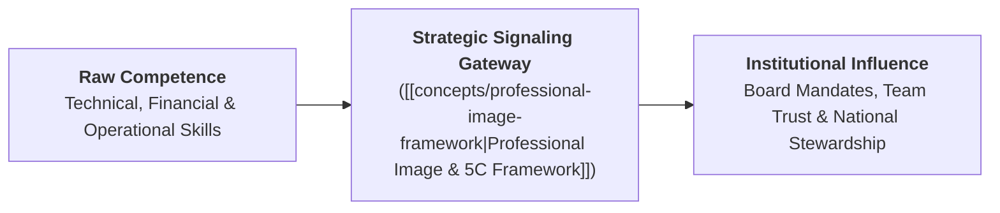
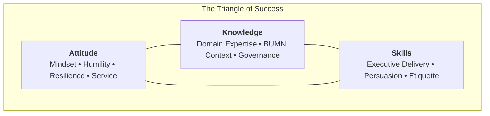
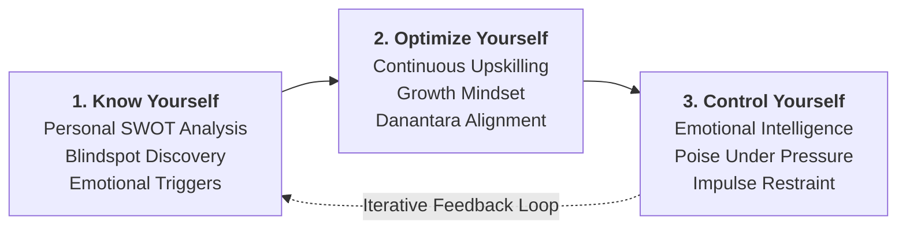
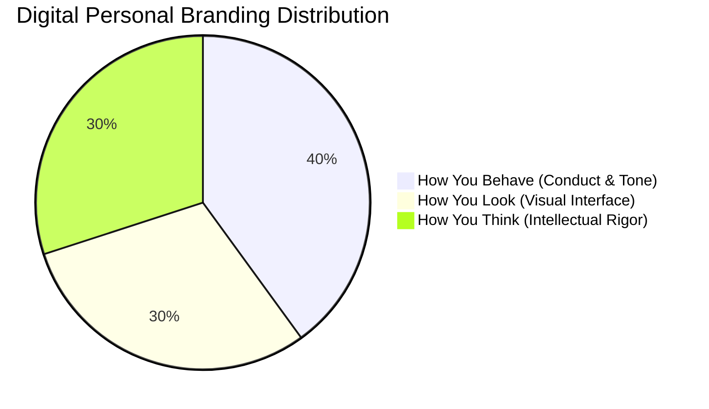
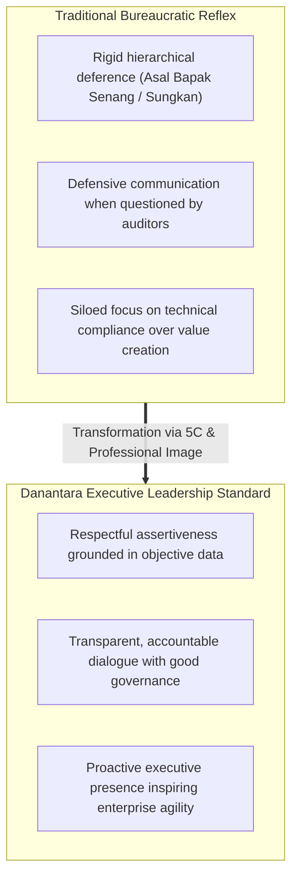

## 🎤 Executive Session Overview

On September 4, 2026, **Indayati Oetomo** (Executive Director of **John Robert Powers Indonesia**) delivered an intensive cohort-wide executive masterclass to the **P3MD Batch I Soedirman** cohort at Kampus DCU Nawasena. Titled **"Building Professional Image & Executive Communication Skills"**, the session addressed one of the most critical inflection points in senior executive development: the bridge between internal technical competence and external leadership presence.

Ibu Indayati opened the masterclass with a foundational principle attributed to **John F. Kennedy**:

$$\mathbf{\text{\ldquo All of us do not have equal talent, but all of us should have an equal opportunity to develop our talents.\rdquo}}$$

This premise anchors professional presence not as an inborn privilege or superficial flair, but as an acquired, practiced discipline accessible to every professional willing to commit to continuous self-mastery. In large Indonesian state-owned enterprises (BUMN) and the emerging **Danantara** institutional architecture, leaders are entrusted with monumental national assets and public accountability. Technical brilliance in engineering, financial modeling, or supply chain logistics is a necessary prerequisite, but insufficient on its own. Without an articulate, composed, and trustworthy executive image, high-value strategic recommendations fail to win board consensus, inspire cross-functional teams, or secure public confidence.

---

## 💡 Core Pedagogical Foundations & Operating Principles

### 1. "Look As Good As You Can Deliver"

The session's central operating maxim dismantles the false dichotomy between substance and style:

$$\mathbf{\text{\ldquo Look As Good As You Can Deliver\rdquo}}$$

- **The Under-Signaling Failure**: A brilliant engineer or financial analyst who dresses carelessly, mumbles during board presentations, or avoids eye contact forces the listener to expend cognitive energy deciphering their credibility. The organization discounts their contribution.
- **The Over-Signaling Failure**: An articulate presenter who projects charisma without operational competence or ethical grounding (_pencitraan semata_) quickly erodes credibility upon delivery failure.
- **The Equilibrium**: Professional presence is an act of institutional respect. Looking and communicating at the level of your actual delivery ensures that your substantive insights receive the serious evaluation they deserve.

### 2. Servant Leadership: "Leader Adalah Pelayan"

A leader's image must never project superiority, arrogance, or detached hierarchy. Grounded in the principle that true authority stems from service:

- Leadership in BUMN is not about personal vanity or ceremonial privilege; it is about providing clear direction, removing roadblocks for subordinates, and stewarding stakeholder trust.
- Executive demeanor must combine **gravitas with warmth**, replacing defensive intimidation with empathetic clarity.

---

## 📐 Theoretical Architecture & Core Frameworks

### 1. The Triangle of Success

Executive performance is governed by three co-equal vectors:

- **Attitude**: The foundational multiplier. Dictates how a leader responds to adversity, audits, feedback, and organizational conflict.
- **Knowledge**: The intellectual foundation. Encompasses industry economics, regulatory nuances, and enterprise strategy.
- **Skills**: The execution toolkit. Comprises technological fluency, strategic articulation, and interpersonal diplomacy.

---

### 2. The 3-Step Self-Mastery Engine & The Maturity Dyad

Building a sustainable executive reputation begins with structured introspective discipline:

1. **Know Yourself**: Conducting an objective, unvarnished **Personal SWOT Analysis**. Identifying strengths to leverage, blindspots to mitigate, and emotional triggers that induce defensive behavior.
2. **Optimize Yourself**: Actively seeking feedback, expanding intellectual horizons beyond one's native functional silo, and cultivating executive agility.
3. **Control Yourself**: Practicing [[concepts/emotional-intelligence|emotional self-regulation]]. Maintaining composed vocal cadence, steady breathing, and measured speech even when challenged in high-stakes parliamentary hearings or contentious board meetings.

#### The 3 Spheres of Personal Life

An executive's visible persona is the cumulative product of three interacting environments:

- **Family Life**: The foundational crucible shaping core moral values, early behavioral habits, and empathy.
- **Social Life**: Cultural norms, community engagements, and peer interactions that condition social adaptability.
- **Professional Life**: The formal arena of institutional governance, strategic delivery, and executive accountability.

#### The Maturity Dyad: Self-Control & Self-Confidence

Executive maturity is anchored by two reinforcing pillars:

- **Self-Control**: The rigorous discipline to govern physical impulses, dietary habits, speech tempo, and emotional reactivity during crisis.
- **Self-Confidence**: Grounded internal certainty built upon preparation, competence, and clarity of purpose. Without self-control, confidence becomes arrogance; without self-confidence, self-control becomes paralyzing hesitation.

---

### 3. The 5C Leadership & Influence Architecture

Influence without formal coercive power is built across five interdependent dimensions:

| 5C Vector         | Leadership Manifestation                                                               | Concrete Executive Indicator                                                  | Failure Mode                                        |
| :---------------- | :------------------------------------------------------------------------------------- | :---------------------------------------------------------------------------- | :-------------------------------------------------- |
| **Character**     | Moral compass, transparency, and consistency between words and actions (_integritas_). | Refuses ethical compromises; models Danantara good corporate governance.      | Hypocrisy, hidden agendas, loss of moral authority. |
| **Competence**    | Proven analytical mastery and ability to solve difficult operational bottlenecks.      | Produces rock-solid business cases and resilient strategic architectures.     | Incompetence shielded by rhetoric.                  |
| **Communication** | Structuring complex ideas into clear, actionable, bottom-line conclusions.             | Employs BLUF (Bottom-Line-Up-Front); active listening with authentic empathy. | Rambling monologues, bureaucratic obfuscation.      |
| **Conviction**    | Deep belief in the institutional vision and courage to take calculated risks.          | Defends strategic reforms with data-backed firmness and passion.              | Opportunistic vacillation, fear of accountability.  |
| **Charisma**      | Magnetic executive presence that energizes and inspires discretionary effort.          | Projects warmth, attentive eye contact, and uplifting energy in every room.   | Cold detachment or self-aggrandizing theatrics.     |

Perceived executive credibility ($C_{\text{exec}}$) operates as a multiplicative engine:

$$\mathbf{C_{\text{exec}} = \frac{\text{Character} \times \text{Competence} \times \text{Communication} \times \text{Conviction} \times \text{Charisma}}{\text{Ego Drag} + \text{Defensive Friction}}}$$

---

### 4. Executive Etiquette: The 3V Architecture, 3S Baseline & Non-Verbal Dynamics

Professional image is communicated non-verbally long before a word is spoken.

#### The 3V Communication Architecture (Visual, Vocal, Verbal)

In interpersonal engagement, human cognitive processing evaluates signals through three channels:

- **Visual (Look)**: Physical grooming, body posture, facial expression, and eye contact. Operates as the initial perceptual gatekeeper.
- **Vocal (Sound)**: Pitch, pacing, tone modulation, and clarity of articulation. Establishes emotional safety and conviction.
- **Verbal (Content)**: The actual intellectual message, vocabulary choice, and structured argument.

#### The 5 Pillars of Interpersonal Delivery

1. **Facial Expression**: Approachable, engaged, and composed micro-expressions.
2. **Clear Vocal Articulation**: Controlled cadence ($120 - 150 \text{ words/minute}$) and deliberate pauses before answering tough questions.
3. **Body Posture & Carriage**: Upright, grounded stance with open shoulders conveying stability and alertness.
4. **Intentional Word Choice**: Professional, concise vocabulary devoid of passive-aggressive or evasive phrasing.
5. **Sustained Eye Contact**: 3–5 second focused engagement per person across boardroom participants.

#### The 3S Cultural Protocol

- **Senyum (Smile)**: A genuine micro-expression of openness that disarms tension and signals approachable confidence.
- **Sapa (Acknowledge)**: Proactively greeting colleagues, security personnel, frontline operators, and board members alike, dismantling toxic hierarchy.
- **Salam (Respectful Greeting)**: Formal, culturally respectful greeting that establishes psychological safety.

---

### 5. The "Remember Me" Asymmetry Principle (Behavioral Economics of Reputation)

In client, partner, and stakeholder management, impressions compound asymmetrically:

$$\mathbf{\text{Reputational Asymmetry} \implies 1 \text{ Negative Experience} \approx 67 \text{ Corrective Impressions}}$$

- **The Asymmetry**: While it requires approximately **10 positive experiences** to establish a baseline of good customer/stakeholder perception, a single acute breach of respect, arrogance, or broken promise requires **up to 67 subsequent positive interactions** to repair.
- **The TRUSJ Yield**: Disciplined interpersonal engagement reliably unlocks five compounding institutional assets:
  $$\mathbf{\text{Trust} \longrightarrow \text{Respect} \longrightarrow \text{Understanding} \longrightarrow \text{Satisfaction} \longrightarrow \text{Joy (TRUSJ)}}$$
- **The Core Psychological Truth**: The deepest fundamental human desire in organizations is **the need to be valued and respected** (_rasa dihargai_). Leaders who make stakeholders feel valued unlock immense discretionary effort.

---

### 6. The Digital Personal Branding Architecture (30–40–30 Rule)

In an omnichannel enterprise environment where hybrid meetings, digital memos, and WhatsApp governance channels dominate executive operations, personal branding is evaluated through three quantifiable lenses:

$$\mathbf{\text{Total Digital Presence} = 0.30 \cdot (\text{How You Look}) + 0.40 \cdot (\text{How You Behave}) + 0.30 \cdot (\text{How You Think})}$$

1. **30% How You Look**: Professional digital headshots, executive camera positioning during virtual conferences, appropriate background framing, and neat personal grooming.
2. **40% How You Behave**: Tone in email and messaging, promptness in acknowledging communications, respect for meeting schedules, and emotional calmness in digital group chats.
3. **30% How You Think**: Intellectual clarity reflected in concise, well-structured memos, constructive framing of organizational problems, and steadfast adherence to ethical standards.

---

## 🏢 Managerial Crucible: Indonesian BUMN & Danantara Governance

The transition of Indonesian state-owned enterprises under the **Danantara** investment management and holding governance framework requires a fundamental evolution in executive behavior:

1. **Bridging the "Sungkan" Gap**:
   In traditional Javanese corporate culture, younger high-potential managers often confuse professional respect with complete silence or submissive agreement (_sungkan_). The masterclass demonstrated that true respect to senior directors involves **respectful assertiveness**: presenting data-backed counterarguments and alternative strategic options politely but clearly.
2. **Operationalizing Danantara Values**:
   - **Good Corporate Governance (GCG)**: Personal integrity is not a theoretical abstraction; it is visible in honest progress reporting and refusing to mask delays.
   - **Prudent Approach**: Communicating risks early with proposed mitigations rather than presenting false optimism.
   - **Accountability**: Taking full ownership of team mistakes rather than blaming external economic factors or subordinates.

---

## 👥 Cohort-Wide Reflection Synthesis Dossier (P3MD Batch I Soedirman)

Following the masterclass, **394 participants** across all 4 Groups and 12 Elements submitted individual reflective essays analyzing their personal branding, executive presence, and behavioral habits across Indonesia's major state-owned enterprises (including **PT Perkebunan Nusantara**, **PT Kereta Api Indonesia**, **PT Pertamina**, **PT Semen Indonesia**, **PT Krakatau Steel**, **PT Bank Mandiri**, **PT Bank Rakyat Indonesia**, **PT Bank Negara Indonesia**, **PT Pelabuhan Indonesia**, **PT Pupuk Indonesia**, **MIND ID Holding**, **PT Bukit Asam**, **PT Aneka Tambang**, and **PT Timah**).

An automated batch extraction across the full corpus of 394 submissions reveals the core framework resonance rates and behavioral priorities across the cohort:

### Core Framework Resonance & Frequency Index

| Core Framework / Teaching Concept                             | Submissions Citing | Cohort Resonance | Core Qualitative Takeaway                                                                                      |
| :------------------------------------------------------------ | :----------------: | :--------------: | :------------------------------------------------------------------------------------------------------------- |
| **Service Mindset (_Esensi Bekerja Adalah Melayani_)**        |        177         |      44.9%       | Reframing all professional interactions—internal colleagues and external partners alike—as customer service.   |
| **Triangle of Success (Attitude, Skills, Knowledge)**         |        156         |      39.6%       | Recognizing Attitude as the foundational multiplier, followed by communication skills and technical knowledge. |
| **5C Leadership & Influence Architecture**                    |         96         |      24.4%       | Balancing Character, Competence, Communication, Conviction, and Charisma to build sustainable executive trust. |
| **3S Cultural Protocol (Senyum, Sapa, Salam)**                |         76         |      19.3%       | Deploying micro-etiquette to dismantle bureaucratic stiffness and foster psychological safety across ranks.    |
| **Maturity Dyad (Self-Control & Self-Confidence)**            |         66         |      16.8%       | Pairing emotional/physical impulse restraint with grounded technical preparation.                              |
| **JFK Talent vs. Opportunity Principle**                      |         49         |      12.4%       | Viewing professional image as a democratized discipline of daily practice rather than an inborn trait.         |
| **3 Spheres of Personal Life (Family, Social, Professional)** |         35         |       8.9%       | Aligning private values, community conduct, and enterprise governance into a coherent identity.                |
| **1:67 Reputational Asymmetry Rule ("Remember Me")**          |         27         |       6.9%       | Understanding that a single acute breach of respect requires up to 67 positive encounters to restore.          |

---

### Key Cross-Cutting Cohort Insights

#### 1. The "Competence Trap" in Technical Disciplines

A dominant realization among engineers, IT architects, and financial analysts was their historical vulnerability to the **Competence Trap**:

- Participants confessed to believing that _"as long as my calculations are right, my appearance and delivery do not matter."_
- Cohort reflections highlighted multiple past instances where high-value operational recommendations were rejected by boards or cross-functional peers simply because they were delivered with cluttered slides, monotone delivery, or arrogant dismissal of non-technical questions.
- **Cohort Consensus**: Developing communication and executive grooming is not a distraction from technical mastery, but the essential **transmission mechanism** without which technical competence remains inert.

#### 2. The Service Mindset: Internal Peers as Customers

Nearly half of the cohort (44.9%) emphasized Ibu Indayati's principle that _"the primary purpose of every profession is to serve others"_:

- In large holding companies and multi-subsidiary conglomerates, cross-functional requests often encounter bureaucratic gatekeeping.
- Treating internal colleagues with the same empathy, responsiveness, and good manners (_good manner means good business_) traditionally reserved for external buyers breaks down departmental silos and accelerates operational velocity.

#### 3. The "Listening First" Discipline Before Responding

Multiple reflections noted a common behavioral blindspot in high-achieving corporate environments: premature debate:

- When challenged in meetings, managers frequently formulate defensive replies while the other party is still speaking.
- Practicing **listening first**—attentively observing non-verbal cues, maintaining eye contact, and pausing for three seconds before responding—disarms hostility and builds deep interpersonal respect (_TRUSJ: Trust, Respect, Understanding, Satisfaction, Joy_).

#### 4. De-stigmatizing "Personal Branding" via Danantara Values

Many participants noted an initial cultural skepticism toward the phrase "personal branding":

- In state enterprise environments, personal branding is frequently stigmatized as opportunistic self-promotion or superficial showmanship (_"cari panggung"_ or _"pencitraan"_).
- The masterclass successfully reframed personal branding around **authenticity and integrity**: building a reputation as a leader who consistently delivers on promises, communicates transparently, and treats peers with unconditional dignity.

#### 5. "Our Look Speaks Volumes Before We Speak"

Participants underscored that executive appearance is the initial visual envelope of institutional credibility:

- Upholding the tripartite standard—**well-groomed**, **well-behaved**, and **well-knowledge**—removes perceptual distraction so that listeners can focus entirely on the substance of strategic recommendations.

---

### Cohort Action Commitments: 30-Day Executive Habit Transformation

Across the 390+ reflections, participants committed to concrete behavioral adjustments:

| Habit Area                     | Previous Unconscious Reflex                                                       | 30-Day Executive Habit Commitment                                                                                              |
| :----------------------------- | :-------------------------------------------------------------------------------- | :----------------------------------------------------------------------------------------------------------------------------- |
| **Morning Routine & Grooming** | Minimal preparation; informal attire during virtual and hybrid internal calls.    | Establishing an executive standard: well-groomed, professional business attire aligned with corporate representational duties. |
| **Meeting Contribution**       | Passive listening; withholding opinions until explicitly called upon.             | Speaking early in meetings; formulating at least one structured, value-adding question or synthesis using BLUF.                |
| **Emotional Regulation**       | Visibly defensive or frustrated when challenged by auditors or partner divisions. | Taking a deliberate 3-second pause; acknowledging the validity of the question before answering calmly with data.              |
| **Digital Hygiene**            | Casual, unstructured WhatsApp messages regarding strategic corporate matters.     | Drafting concise, professional messages with clear context, action required, and deadline; proofreading before sending.        |

---

## 📂 Archival Staging & Primary Sources

All primary submission artifacts from the cohort have been archived for institutional traceability:

| Archive Repository                                              |   File Count    | Primary Contents                                                   |
| :-------------------------------------------------------------- | :-------------: | :----------------------------------------------------------------- |
| `archive/rabuan/2026-09-04-indayati-professional-image/Grup 1/` | 98 Submissions  | Individual reflection essays across Elements 1, 2, and 3 (`.pdf`). |
| `archive/rabuan/2026-09-04-indayati-professional-image/Grup 2/` | 100 Submissions | Individual reflection essays across Elements 1, 2, and 3 (`.pdf`). |
| `archive/rabuan/2026-09-04-indayati-professional-image/Grup 3/` | 99 Submissions  | Individual reflection essays across Elements 1, 2, and 3 (`.pdf`). |
| `archive/rabuan/2026-09-04-indayati-professional-image/Grup 4/` | 97 Submissions  | Individual reflection essays across Elements 1, 2, and 3 (`.pdf`). |
| **Total Ingested Submissions**                                  |  **394 PDFs**   | Complete cohort reflections for P3MD Batch I Soedirman.            |

---

## 🔗 Knowledge Graph & Curriculum Bridges

- **Featured Keynote Speaker**:
  - [[entities/indayati-oetomo|Indayati Oetomo]] (Executive Director, John Robert Powers Indonesia)
- **Compounding Core Concepts**:
  - [[concepts/professional-image-framework|Professional Image & Leadership 5C Framework]]
  - [[concepts/self-awareness|Self-Awareness & Blindspot Discovery]]
  - [[concepts/emotional-intelligence|Emotional Intelligence in Executive Leadership]]
  - [[concepts/french-and-raven-power-bases|French & Raven Power Bases (Referent & Expert Power)]]
- **Related Executive Masterclasses (Rabuan Series)**:
  - [[rabuan/2026-09-02-adh-peoplemath|Rabuan 01: PeopleMath — The Financial & Strategic Calculus of Human Capital]] (Agus Dwi Handaya)
  - [[rabuan/2026-10-14-ric-roi-impact-career|Rabuan 02: Making an Impact, Making a Career — The 5 Levels of Career Trajectory]] (Dr. Ric Roi)
- **Direct Curricular Synergies**:
  - [[courses/mk1-organizational-behavior-managing-people/index|MK 1: Organizational Behavior & Managing People]] (Foundations of Leadership & Self-Management)
  - [[courses/mk5-decision-making-negotiation/index|MK 5: Problem Solving, Decision Making and Negotiation]] (Executive Influence & Composure)
- Return to **[[rabuan/index|Rabuan Executive Masterclass Hub]]**
