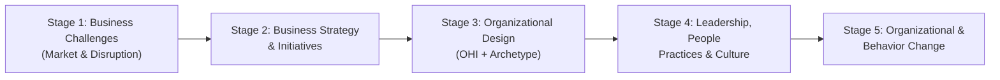
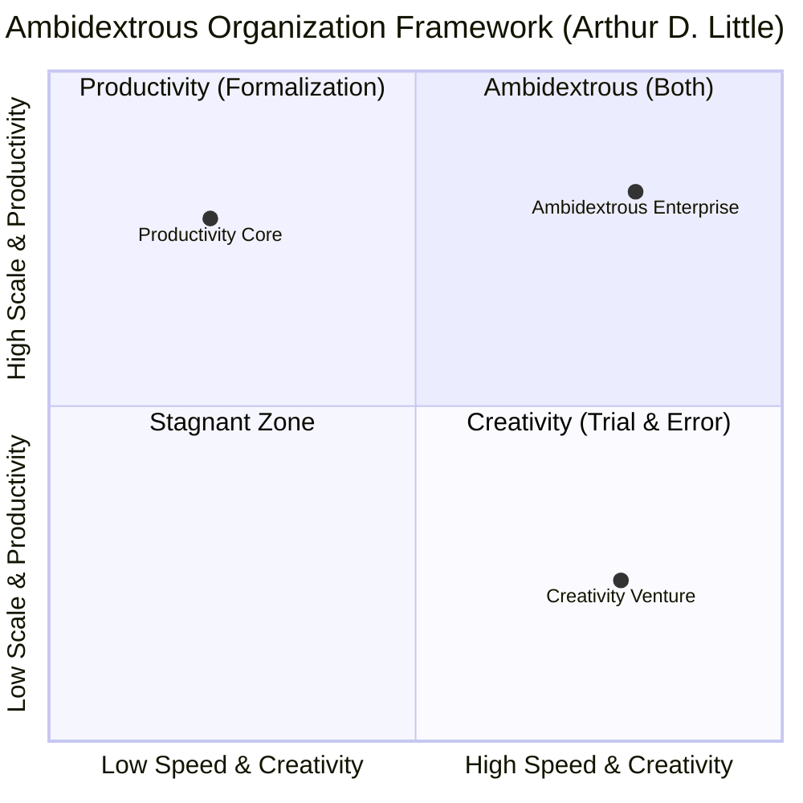
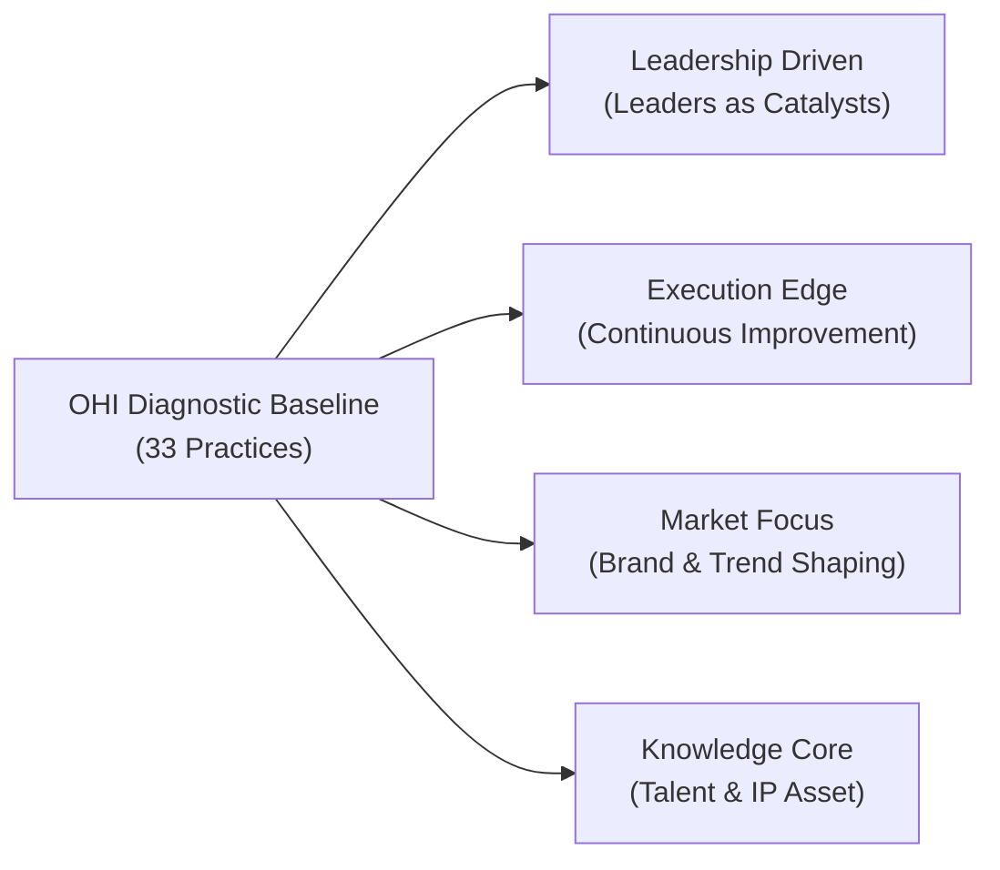

> [!NOTE] Kuliah Rabuan — Morning Plenary Session (09 September 2026)
> **Sesi tatap muka eksekutif P3MD Batch I Soedirman** bersama **[[entities/aurik-gustomo|Prof. Dr. Aurik Gustomo]]** (Dekan & Guru Besar People Development, **SBM ITB**).
>
> - **Topik Utama**: _Driving Sustainable Business Growth through Organizational Ambidexterity_
> - **Arsip Sumber Primer**: Salindia resmi 25 halaman (`00004770-Leading an Ambidextrous Organization P3MD by Aurik Gustomo.pptx` & `drive-phase2/Leading an Ambidextrous Organization P3MD by Aurik Gustomo.pdf`), tersimpan pada `archive/rabuan/2026-09-09-aurik-gustomo-ambidextrous/`. Tautan pra-bacaan Google Drive eksternal (`1m2l75ugtaA86A7W9Sg4WrfcvFwn0suRR`) telah ditutup oleh penyelenggara; seluruh analisis di bawah merekonstruksi secara penuh 100% isi dek resmi termasuk seluruh tabel visual dan matriks 33 praktik OHI.
> - **Konteks Rangkaian 09 September 2026**: Sesi pagi ini berpasangan dengan sesi siang bersama Mendiktisaintek (diindeks pada unit terpisah).

---

## 🧭 1. Executive Opening Challenge & Framework of Organizational Design

Memulai sesi, **[[entities/aurik-gustomo|Prof. Dr. Aurik Gustomo]]** menempatkan seluruh peserta kohor di kursi CEO melalui tiga pertanyaan pembuka (_"Put yourself in the chair. What would you actually do?"_):

|  No.  | Perusahaan / BUMN                              | Sektor Industri                              | Pertanyaan Strategis CEO                                                      |
| :---: | :--------------------------------------------- | :------------------------------------------- | :---------------------------------------------------------------------------- |
| **1** | **[[entities/pt-perkebunan-nusantara\|PTPN]]** | Produsen _Crude Palm Oil_ (CPO) / Agribisnis | _"If you were the CEO, what would be your strategy for growing the company?"_ |
| **2** | **PT INL** (_Industri Nabati Lestari_)         | Produsen _Cooking Oil_ / Hilirisasi Sawit    | _"If you were the CEO, what would be your strategy for growing the company?"_ |
| **3** | **PTDI** (_PT Dirgantara Indonesia_)           | Manufaktur Dirgantara & Pertahanan           | _"If you were the CEO, what would be your strategy for growing the company?"_ |

Menjawab pertanyaan tersebut tidak boleh dimulai dengan menggambar ulang kotak struktur organisasi (_boxes and lines_). Desain organisasi harus diturunkan secara berurutan dari tantangan bisnis eksternal menuju perubahan perilaku (_Framework of Organizational Design_):

---

## 🌐 2. External Context: Market Structures & The Five Drivers of Uncertainty

Sebelum memilih inisiatif strategis, pemimpin wajib membaca struktur pasar klasik serta lima gelombang disrupsi kontemporer yang mengubah logika korporasi abad ke-20.

### A. Klasifikasi Struktur Pasar Klasik

| Diferensiasi Produk?           | Satu Produsen (_One_) | Sedikit Produsen (_Few_) | Banyak Produsen (_Many_)     |
| :----------------------------- | :-------------------- | :----------------------- | :--------------------------- |
| **Tidak (_Undifferentiated_)** | **Monopoly**          | **Oligopoly**            | **Perfect Competition**      |
| **Ya (_Differentiated_)**      | _Not applicable_      | **Oligopoly**            | **Monopolistic Competition** |

### B. Lima Pendorong Ketidakpastian (_The Driver_)

Mengutip **Don Tapscott** (_Author of Blockchain Revolution_) dan **Boston (2015)**—bahwa _"a new enterprise is emerging — one that innovates, creates value, orchestrates capability and builds relationships differently than the corporation that has dominated the 20th century"_—paparan memetakan lima pendorong perubahan:

1. **The Technological Revolution**: Gelombang _Industry 4.0_, otomasi, dan transformasi digital.
2. **Employee Demographic Shifts**: Masuknya _The Net Generation_, penuaan populasi global (_World is Aging_), tuntutan _Diversity & Inclusiveness_, serta pertumbuhan _Gig Worker_.
3. **Pandemic COVID-19 & Sustainability Issues**: Tekanan ketahanan rantai pasok dan mandat keberlanjutan (_Profit, People, and Planet_).
4. **The Economic Revolution**: Pergeseran menuju _Collaborative Economy_, _Ecosystem-Based_, _Knowledge-Based_, di tengah eskalasi _Trade War_.
5. **The Social Revolution**: Dominasi _Social Media_, era _Post-Truth_, dan pergeseran ke _Digital Marketing_.

---

## ⚖️ 3. Generic Strategic Initiatives: Efficiency (Exploit) vs. Growth (Explore)

### A. Jembatan Laporan Laba Rugi (_Sustainability-Driven Organization_)

Untuk menautkan tujuan keberlanjutan (_Profit, People, Planet_) dengan bahasa yang langsung dipahami jajaran direksi, Prof. Aurik membedah dampaknya melalui laporan laba rugi (_Income and Expense Statement_).

- **Intuisi Sederhana**: Laba bersih adalah selisih antara uang masuk dan uang keluar. Anda dapat memperlebar jaraknya dengan menekan biaya (_Efficiency / Exploit_) atau memperbesar pendapatan meski biaya awal sempat naik (_Growth / Explore_).
- **Dekoder Variabel**:
  - **Revenue (Income)**: Total pemasukan operasional dari penjualan produk/jasa.
  - **COGS & OpEx (Expense)**: Biaya pokok produksi (_Cost of Goods Sold_) dan beban operasional (_Operating Expenses_, termasuk investasi R&D/ekspansi).
  - **Balance (Net Income)**: Sisa laba bersih per periode.

$$\text{Net Income (Balance)} = \text{Revenue (Income)} - \left(\text{COGS} + \text{OpEx}\right)$$

- **Mekanisme Struktural**: Strategi _Efficiency_ langsung memangkas sisi pengurang ($\text{COGS} + \text{OpEx}$) untuk menaikkan laba jangka pendek, sedangkan strategi _Growth_ bersedia menanggung lonjakan sementara pada $\text{OpEx}$ (misal pada bulan Maret atau Juni) agar $\text{Revenue}$ melonjak jauh lebih tinggi pada siklus berikutnya.
- **Contoh Angka Dek Resmi (Proyek Jan–Juni)**: Data eksibit pada Salindia 9 menunjukkan bagaimana fluktuasi biaya dan pendapatan membentuk saldo kumulatif enam bulan sebesar `1,090.00` (`Total Income 3,310.00` dikurangi `Total Expense 2,220.00`), dengan defisit sementara pada Maret (`-250.00`) dan Juni (`-40.00`):

```mermaid
xychart-beta
    title "Income, Expense & Balance Trajectory (Jan-June Exhibit)"
    x-axis ["Jan", "Feb", "Mar", "Apr", "May", "June"]
    y-axis "Value (Unit)" -300 --> 900
    bar [500, 600, 200, 850, 600, 560]
    bar [200, 250, 450, 420, 300, 600]
    line [300, 350, -250, 430, 300, -40]
```

| Metrik (Unit) |   Jan    |   Feb    |    Mar    |   Apr    |   May    |   June   |     Total      |
| :------------ | :------: | :------: | :-------: | :------: | :------: | :------: | :------------: |
| **Income**    | `500.00` | `600.00` | `200.00`  | `850.00` | `600.00` | `560.00` | **`3,310.00`** |
| **Expense**   | `200.00` | `250.00` | `450.00`  | `420.00` | `300.00` | `600.00` | **`2,220.00`** |
| **Balance**   | `300.00` | `350.00` | `-250.00` | `430.00` | `300.00` | `-40.00` | **`1,090.00`** |

### B. Pilar Operasional Exploit vs. Explore

1. **EXPLOIT — Efficiency Strategy (_Maximizing Profitability_)**:
   - **Cost Reduction**: Mengidentifikasi dan mengeliminasi beban tidak perlu, merampingkan proses, serta menegosiasikan kontrak pemasok yang lebih baik.
   - **Process Optimization**: Meningkatkan efisiensi melalui otomasi, adopsi teknologi, dan prinsip _lean manufacturing_.
   - **Resource Allocation**: Memprioritaskan alokasi modal/talenta ke lini berkinerja tinggi dan menghentikan unit/proyek yang tidak menguntungkan.
2. **EXPLORE — Growth Strategy (_Investing for the Future_)**:
   - **Market Penetration**: Memperluas pangsa di pasar eksisting melalui strategi harga, penyempurnaan produk, dan kampanye pemasaran.
   - **Market Development**: Membawa produk/jasa eksisting ke segmen pelanggan baru atau ekspansi geografis baru.
   - **Product Development**: Mengembangkan produk/jasa baru untuk menjawab kebutuhan pelanggan yang berevolusi.
   - **Diversification**: Berekspansi ke industri atau pasar yang tidak terkait untuk memitigasi risiko dan menciptakan sumber pendapatan baru.

### C. Matriks 12 Dimensi Desain Organisasi: Exploit vs. Explore

Memilih strategi _Efficiency_ atau _Growth_ memaksa perubahan menyeluruh pada arsitektur organisasi:

| Dimensi Desain            | Efficiency, Exploit (_Scale & Productivity_) | Growth, Explore (_Speed & Creativity_)                          |
| :------------------------ | :------------------------------------------- | :-------------------------------------------------------------- |
| **Strategic Initiative**  | _Scale and productivity_                     | _Speed and creativity_                                          |
| **Organizational Health** | _Internal alignment; quality of execution_   | _Internal alignment; quality of execution; capacity of renewal_ |
| **Archetype**             | _Execution edge_                             | _Market focus_                                                  |
| **Structure**             | _Vertical_                                   | _Flat / horizontal_                                             |
| **Authority Level**       | _Centralization / top down_                  | _Decentralization / delegation_                                 |
| **Span of Control**       | _Narrow_                                     | _Wide_                                                          |
| **Org Characteristics**   | _Controlled, structured_                     | _Entrepreneurial, risk taking_                                  |
| **Innovation Level**      | _Continuous improvement_                     | _Invention_                                                     |
| **Organizational Glue**   | _Formal policy and regulation_               | _Commitment to innovation_                                      |
| **Strategy Focus**        | _Stability_                                  | _Resource acquisition, new challenge_                           |
| **Performance Indicator** | _Efficiency, low cost_                       | _New product and market, uniqueness_                            |

### D. The Ambidextrous Organization (Arthur D. Little / Lerner & Zieris, 2019)

Mengacu pada riset **Lerner & Zieris (2019)** (_Ambidextrous Organizations: How to Embrace Disruption and Create Organizational Advantage_, Cutter Consortium / Arthur D. Little), organisasi unggul tidak memilih salah satu kutub, melainkan memadukan **alignment** (produktivitas & kepatuhan) dan **adaptability** (kreativitas & pembaruan). Selain solusi struktural klasik (_structural ambidexterity_), organisasi modern mengintegrasikan **contextual ambidexterity** dan **dimensi kepemimpinan** (lihat pula **[[concepts/leadership-ambidexterity|Leadership Ambidexterity]]**):

---

## 🩺 4. Diagnostic Framework: Organizational Health Index (OHI)

Sebelum menetapkan desain organisasi atau melakukan restrukturisasi, pemimpin harus melakukan "pemeriksaan kesehatan" menggunakan **[[concepts/organizational-health-index|Organizational Health Index (OHI)]]** dari **Keller & Price (2011)** (_Beyond Performance_, Wiley / McKinsey & Company).

### A. Empat Luaran Kesehatan Organisasi & Tiga Klaster Diagnostik

- **Empat Luaran OHI**: **Productivity** (produktivitas & efisiensi tinggi), **Engagement** (karyawan termotivasi & terikat), **Retention** (turn-over rendah & retensi tinggi), serta **Profitability** (kinerja keuangan & profitabilitas kuat).
- **Tiga Klaster Utama**:
  1. **Internal Alignment**: Organisasi memiliki visi yang kuat dan strategi yang terartikulasi jelas, didukung oleh budaya dan nilai-nilai (_Direction, Culture and Climate, Leadership_).
  2. **Quality of Execution**: Organisasi menunjukkan keunggulan eksekusi atas strategi dan penyampaian layanan (_Accountability, Coordination and Control, Capabilities, Motivation, Leadership_).
  3. **Capacity of Renewal**: Organisasi mampu memahami, berinteraksi, merespons, dan beradaptasi secara efektif terhadap lingkungan eksternal (_External Orientation, Innovation and Learning, Capabilities, Motivation, Leadership_).

### B. Katalog Lengkap 9 Komponen & 33 Praktik Manajemen OHI

Seluruh 33 praktik manajemen OHI (beserta referensi _HKCSS & HKU-HKJC ExCEL3 NGO CEO Competency Model_) direkonstruksi lengkap di bawah ini agar dapat langsung dipakai sebagai instrumen audit kohor:

| Klaster Utama      | Komponen / Outcome           | No. | Praktik (_Practice_)               | Deskripsi Operasional (_Description_)                                                                    |
| :----------------- | :--------------------------- | :-: | :--------------------------------- | :------------------------------------------------------------------------------------------------------- |
| **Alignment**      | **Direction**                |  1  | _Shared vision_                    | Menetapkan arah melalui penciptaan dan komunikasi gambaran masa depan yang jelas dan menggugah           |
| **Alignment**      | **Direction**                |  2  | _Employee involvement_             | Melibatkan karyawan dalam dialog mengenai arah organisasi dan peran mereka dalam mewujudkannya           |
| **Alignment**      | **Direction**                |  3  | _Strategic clarity_                | Mengartikulasikan arah dan strategi menang secara jelas serta menerjemahkannya menjadi target spesifik   |
| **All 3 Clusters** | **Leadership**               |  4  | _Supportive leadership_            | Pemimpin membangun lingkungan positif yang ditandai harmoni tim, dukungan, dan kepedulian kesejahteraan  |
| **All 3 Clusters** | **Leadership**               |  5  | _Consultative leadership_          | Pemimpin melibatkan dan memberdayakan karyawan melalui komunikasi, konsultasi, dan delegasi              |
| **All 3 Clusters** | **Leadership**               |  6  | _Challenging leadership_           | Pemimpin mendorong karyawan mengambil tantangan sulit dan melampaui batas yang mereka duga               |
| **All 3 Clusters** | **Leadership**               |  7  | _Authoritative leadership_         | Pemimpin menekankan hierarki dan tekanan manajerial untuk memastikan pekerjaan tuntas                    |
| **Alignment**      | **Culture and climate**      |  8  | _Open and trusting_                | Mendorong kejujuran, transparansi, dan dialog yang terbuka serta apa adanya                              |
| **Alignment**      | **Culture and climate**      |  9  | _Creative and entrepreneurial_     | Mendukung inovasi, kreativitas, dan pengambilan inisiatif                                                |
| **Alignment**      | **Culture and climate**      | 10  | _Internally competitive_           | Menekankan hasil dan pencapaian dengan kompetisi internal yang sehat untuk memacu kinerja                |
| **Alignment**      | **Culture and climate**      | 11  | _Operationally disciplined_        | Menumbuhkan standar perilaku dan kinerja yang jelas disertai pemantauan kepatuhan yang ketat             |
| **Execution**      | **Accountability**           | 12  | _Personal ownership_               | Akuntabilitas yang digerakkan oleh rasa kepemilikan individu dan tanggung jawab pribadi yang kuat        |
| **Execution**      | **Accountability**           | 13  | _Role clarity_                     | Akuntabilitas yang digerakkan oleh kejelasan struktur, peran, dan tanggung jawab                         |
| **Execution**      | **Coordination and control** | 14  | _Financial management_             | Fokus pada KPI keuangan serta alokasi dan pengendalian sumber daya finansial secara efektif              |
| **Execution**      | **Coordination and control** | 15  | _Professional standards_           | Menggunakan standar, kebijakan, dan aturan yang jelas untuk menetapkan ekspektasi perilaku dan kepatuhan |
| **Execution**      | **Coordination and control** | 16  | _Risk management_                  | Mengidentifikasi dan memitigasi risiko yang diantisipasi serta merespons cepat masalah tak terduga       |
| **Execution**      | **Coordination and control** | 17  | _People performance review_        | Menggunakan penilaian kinerja formal, umpan balik, dan pelacakan untuk mengendalikan arus talenta        |
| **Execution**      | **Coordination and control** | 18  | _Operational management_           | Fokus pada KPI operasional, metrik, dan target untuk memantau dan mengelola kinerja bisnis               |
| **Exec & Renewal** | **Capabilities**             | 19  | _Talent acquisition_               | Merekrut talenta yang tepat sesuai kebutuhan organisasi                                                  |
| **Exec & Renewal** | **Capabilities**             | 20  | _Talent development_               | Mengembangkan pengetahuan dan keterampilan karyawan                                                      |
| **Exec & Renewal** | **Capabilities**             | 21  | _Process-based capabilities_       | Menanamkan kapabilitas dan _know-how_ melalui metode dan prosedur terkodifikasi (manual pelatihan, SOP)  |
| **Exec & Renewal** | **Capabilities**             | 22  | _Outsourced expertise_             | Menggunakan sumber daya eksternal untuk menutup celah kapabilitas (konsultan, vendor, mitra bisnis)      |
| **Exec & Renewal** | **Motivation**               | 23  | _Meaningful values_                | Menggugah motivasi karyawan melalui nilai-nilai yang bermakna secara pribadi dan menarik                 |
| **Exec & Renewal** | **Motivation**               | 24  | _Inspirational leaders_            | Menginspirasi karyawan melalui dorongan, bimbingan, dan pengakuan                                        |
| **Exec & Renewal** | **Motivation**               | 25  | _Rewards and recognition_          | Memberikan penghargaan dan pengakuan nonfinansial untuk mendorong kinerja tinggi                         |
| **Renewal**        | **Innovation and learning**  | 26  | _Top-down innovation_              | Mendorong inovasi dan pembelajaran melalui inisiatif prioritas tinggi yang disponsori pemimpin senior    |
| **Renewal**        | **Innovation and learning**  | 27  | _Bottom-up innovation_             | Mendorong dan memberi penghargaan partisipasi karyawan dalam pengembangan ide baru dan perbaikan         |
| **Renewal**        | **Innovation and learning**  | 28  | _Knowledge sharing_                | Memungkinkan kolaborasi dan berbagi pengetahuan di seluruh organisasi                                    |
| **Renewal**        | **Innovation and learning**  | 29  | _Capturing external ideas_         | Mengimpor ide dan praktik terbaik dari luar organisasi                                                   |
| **Renewal**        | **External orientation**     | 30  | _Government & community relations_ | Membangun relasi kuat dengan publik, komunitas lokal, pemerintah, dan regulator                          |
| **Renewal**        | **External orientation**     | 31  | _Competitive insights_             | Mengakuisisi dan memanfaatkan informasi tentang pesaing untuk keputusan bisnis                           |
| **Renewal**        | **External orientation**     | 32  | _Customer focus_                   | Memahami pelanggan dan merespons kebutuhan mereka                                                        |
| **Renewal**        | **External orientation**     | 33  | _Business partnerships_            | Membangun dan memelihara jaringan mitra bisnis eksternal                                                 |

---

## 🏛️ 5. Organizational Archetypes: Aligning Design with Strategy

Setelah memetakan skor OHI, pimpinan memilih **Organizational Archetype** yang paling selaras dengan prioritas strategis (Salindia 20–24). Setiap arketipe tidak menuntut keunggulan merata pada 33 praktik, melainkan berfokus pada **10 praktik inti** pembentuk keunggulan kompetitifnya:

| Arketipe Organisasi      | Tesis Utama & Logika Tata Kelola                                                                                                                                                                                                               | 10 Praktik Prioritas (_Top 10 Practices_)                                                                                                                                                                                                                                                  |
| :----------------------- | :--------------------------------------------------------------------------------------------------------------------------------------------------------------------------------------------------------------------------------------------- | :----------------------------------------------------------------------------------------------------------------------------------------------------------------------------------------------------------------------------------------------------------------------------------------- |
| **1. Leadership Driven** | Pemimpin adalah katalis kinerja dengan ekspektasi tinggi dan pemberdayaan kuat; prioritas tertinggi adalah membangun _pipeline_ pemimpin masa depan (_leadership is learned by doing_) melalui kontrak kinerja dan manajemen konsekuensi.      | 1. _Career Opportunities_, 2. _Open and Trusting_, 3. _Performance Contracts_, 4. _Inspirational Leaders_, 5. _Strategic Clarity_, 6. _People Performance Review_, 7. _Operational Management_, 8. _Operationally Disciplined_, 9. _Consultative Leadership_, 10. _Consequence Management_ |
| **2. Execution Edge**    | Disiplin, eksekusi solid, dan perbaikan berkelanjutan adalah fondasi kinerja unggul; bersemangat mengadopsi _best practices_ dengan standardisasi yang fleksibel berbasis arah dan nilai bersama.                                              | 1. _Knowledge Sharing_, 2. _Creative and Entrepreneurial_, 3. _Employee Involvement_, 4. _Talent Development_, 5. _Internally Competitive_, 6. _Personal Ownership_, 7. _Bottom-up Innovation_, 8. _Top-down Innovation_, 9. _Meaningful Values_, 10. _Consequence Management_             |
| **3. Market Focus**      | Membentuk tren pasar dan membangun portofolio merek inovatif yang kuat; fokus intens pada orientasi eksternal (pelanggan, wawasan pesaing, mitra bisnis) yang diarahkan oleh _Shared Vision_.                                                  | 1. _Business Partnerships_, 2. _Customer Focus_, 3. _Competitive Insights_, 4. _Government & Community Relations_, 5. _Financial Management_, 6. _Capturing External Ideas_, 7. _Process-based Capabilities_, 8. _Shared Vision_, 9. _Outsourced Expertise_, 10. _Strategic Clarity_       |
| **4. Knowledge Core**    | Kumpulan talenta dan pengetahuan adalah aset terpenting; perusahaan merekrut pemain tepat (_talent acquisition_), menempatkan pada posisi tepat (_role clarity_), memberi insentif tepat, menjaga fokus, dan meninjau kinerja secara disiplin. | 1. _Talent Acquisition_, 2. _Role Clarity_, 3. _Consequence Management_, 4. _Rewards and Incentives_, 5. _Personal Ownership_, 6. _People Performance Review_, 7. _Career Opportunities_, 8. _Performance Contracts_, 9. _Professional Standards_, 10. _Financial Management_              |

---

## 🏭 6. Returning to the CEO Chair: BUMN Strategic Synthesis

Menutup siklus pembelajaran, ketiga kasus pembuka di Slide 4 (**PTPN**, **PT INL**, dan **PTDI**) menunjukkan mengapa BUMN tidak boleh menerapkan satu desain organisasi seragam (_one-size-fits-all_):

- **[[entities/pt-perkebunan-nusantara|PTPN]] (Crude Palm Oil)**: Sebagai produsen komoditas perkebunan berskala besar dengan struktur pasar mendekati _Perfect Competition_ / _Oligopoly_ harga global, mesin inti membutuhkan arketipe **Execution Edge** (efisiensi rendemen, pengendalian biaya kebun, _process-based capabilities_), sementara unit hilirisasi/energi hijau membutuhkan jalur _Exploration_ terpisah.
- **PT INL (Cooking Oil / Hilirisasi Konsumer)**: Berkompetisi di pasar _Monopolistic Competition_ dengan merek ritel dan saluran distribusi padat, perusahaan membutuhkan pergeseran menuju **Market Focus** (_Customer Focus_, _Competitive Insights_, _Business Partnerships_) tanpa mengorbankan disiplin margin pabrikasi.
- **PTDI (Aerospace Manufacturer)**: Sebagai industri teknologi tinggi padat rekayasa dengan siklus pengembangan panjang dan kontrak pertahanan, keberhasilan bertumpu pada **Knowledge Core** (_Talent Acquisition_, _Role Clarity_, _Professional Standards_, _Performance Contracts_) yang mampu melindungi kapabilitas R&D jangka panjang sembari menjaga ketepatan serah terima proyek (_Project Board & Assurance_ seperti pada Slide 20).

---

## 🔗 Cross-Curricular Bridges

- **MK 1 (Organizational Behavior & Managing People)**:
  - [[courses/mk1-organizational-behavior-managing-people/week-08/index|MK 1 Week 08: Human Capital as Competitive Advantage]] — menjembatani praktik _Capabilities_ & _Knowledge Core_ dengan strategi SDM.
  - [[courses/mk1-organizational-behavior-managing-people/week-09/index|MK 1 Week 09: Organizational Design & Org DNA]] — memperdalam arsitektur struktur organisasi, otoritas, dan _span of control_.
- **MK 2 (Financial Management & Strategy)**:
  - [[courses/mk2-financial-management-strategy/week-02/index|MK 2 Week 02: Financial Forecasting & Sustainable Growth]] — menautkan trade-off _Exploit vs. Explore_ pada laporan laba rugi dengan kapasitas pertumbuhan berkelanjutan.
- **MK 3 (Marketing Management)**:
  - [[courses/mk3-marketing-management/week-01/index|MK 3 Week 01: Marketing Foundations & Value Creation]] — memperluas arketipe _Market Focus_ dan orientasi pelanggan (_Customer Focus_).
- **MK 4 (Operations & Supply Chain Management)**:
  - [[courses/mk4-operations-supply-chain-management/week-09/index|MK 4 Week 09: Lean Six Sigma & Operational Excellence]] — mengoperasionalkan arketipe _Execution Edge_ dan _Process Optimization_.
- **MK 5 (Decision Making & Negotiation)**:
  - [[courses/mk5-decision-making-negotiation/week-01/index|MK 5 Week 01: Problem Solving & Decision Framing]] — membingkai pilihan CEO antara efisiensi jangka pendek dan investasi eksplorasi.
- **Companion Rabuan & Concepts**:
  - [[rabuan/2026-10-14-ric-roi-impact-career|Rabuan 07: Making an Impact, Making a Career & Leadership Ambidexterity (Dr. Ric Roi)]]
  - [[concepts/leadership-ambidexterity|Concept: Leadership Ambidexterity]]
  - [[concepts/organizational-health-index|Concept: Organizational Health Index (OHI)]]
  - [[entities/aurik-gustomo|Speaker Profile: Prof. Dr. Aurik Gustomo]]
  - [[entities/danantara|BPI Danantara]] | [[entities/pt-perkebunan-nusantara|PT Perkebunan Nusantara III (Persero)]]
