## Executive Plenary Overview & Institutional Context

On Wednesday, September 16, 2026, **[[entities/nora-manaf|Datuk (Dr.) Nora Manaf]]**—Chairman of Manaf Gardner Associates, Independent Non-Executive Director at MBSB Group, and former Group Chief Human Capital Officer (CHCO) at **Maybank** (2008–2024)—delivered an unforgettable keynote masterclass to the **P3MD Batch I Angkatan Soedirman** cohort at **Amphitheater Indraprasta, Danantara Corporate University (Kampus DCU Nawasena)**.

Welcomed by **Marsdya TNI (Purn) Dr. Kusworo, S.E., M.M.** (Chairman of the P3MD Steering Committee), **Marsma TNI Dr. Anton "Sioux" Palaguna, S.E., M.M., OAS** (Program Commander), **Handi Kurniawan** (Director of Danantara Corporate University), and **Prof. Dr. Ir. Yos Sunitiyoso, S.T., M.Eng., Ph.D.** (SBM ITB Academic Advisor), the morning session marked **three historic milestones** for the P3MD Business & Leadership Series:

1. **First private-sector executive leader** invited to address the sovereign talent cohort.
2. **First international Human Capital executive** to bridge cross-border ASEAN governance realities.
3. **First female keynote leader** to share boardroom crucibles on transforming regional corporate giants.

Setting the moral weight of the plenary, Datuk Nora immediately reframed what executive privilege means for a cohort sponsored directly by the President of the Republic of Indonesia: leadership is never defined by title, rank, or corner-office authority. Anyone who possesses a _circle of influence_ exercises leadership over livelihoods, dignity, and societal stability.

> _"Leadership is not determined by title. Every morning, it is about waking up and asking: **Whose life can I make better today?**"_
> — **Datuk (Dr.) Nora Manaf**

```mermaid
flowchart LR
    subgraph Crucibles ["Personal & Executive Crucibles"]
        direction TB
        C1["<b>Formative Independence</b><br/>Custody Battle • Sugar Paper • SCB Mentor"]
        C2["<b>Humanitarian Conversion</b><br/>Maxis Placement • Bank Permata Pivot"]
        C3["<b>Maybank Transformation</b><br/>USD 1B PBT • >80% Engagement"]
    end

    subgraph Doctrine ["Core Strategic Architecture"]
        direction TB
        D1["<b>[[concepts/the-people-equation|The People Equation]]</b><br/>Human Multipliers ÷ Organizational Drag"]
        D2["<b>Responsible Capitalism</b><br/>Living Wages • Zero Extractive Layoffs"]
        D3["<b>Skills-Based Organization</b><br/>Unlocking 75% Latent Human Assets"]
    end

    subgraph Mandate ["P3MD & BUMN Sovereign Impact"]
        direction TB
        M1["<b>Human Potential + AI</b><br/>Amplified, Never Replaced"]
        M2["<b>Golden Indonesia 2045</b><br/>Best Heart • Best Mind • Best Contribution"]
    end

    Crucibles --> Doctrine --> Mandate
```

---

## The People Equation: Mathematical Architecture of Sustainable Growth

In the face of generative artificial intelligence, autonomous agents, and geopolitical volatility, executive teams frequently panic—treating technology either as an existential threat to ban or as a blunt instrument to slash headcount. Anchoring her keynote on a singular master slide, Datuk Nora presented **[[concepts/the-people-equation|The People Equation]]**, demonstrating mathematically why technology alone fails when human leadership and trust are neglected.

### Formal Mathematical Formulation

$$\frac{\left[(\text{AI \& Emerging Technology})^{\text{Innovation}} \times \text{Human Leadership}^{\text{Trust}} \times \text{Workforce Wellbeing}^{\text{Resilience}} \times \text{Organizational Synergy}\right]}{(\text{Change Resistance} + \text{Systemic Risk})} = \text{Sustainable Growth}$$

### 4-Layer Pedagogical Breakdown

1. **Plain-English Intuition & Everyday Analogy**:
   Refusing to adopt AI in modern organizations is like insisting that every spice paste in a busy restaurant still be pounded manually with a stone mortar (_cobek_) while an electric blender sits unplugged on the counter. AI is simply a tool—like a kitchen blender or a farmer's hoe (_cangkul_). You do not ban a hoe because it is sharp enough to cause injury; you establish safety guardrails and teach people how to plant trees that bear fruit. Yet, running a high-speed blender without a lid or recipe destroys the kitchen. Technology supplies raw speed; human wisdom supplies purpose and control.
2. **Prerequisite & Jargon Decoder**:
   - **Numerator Drivers**: _AI & Emerging Technology_ (digital agents and automation), _Human Leadership_ (moral direction and humility), _Workforce Wellbeing_ (living wages, mental resilience, dignity), and _Organizational Synergy_ (cross-silo collaboration).
   - **Exponential Multipliers**: _Innovation_, _Trust_, and _Resilience_ operate as exponents—amplifying base investments exponentially when present, or collapsing them to neutral baseline ($x^0 = 1$) when broken.
   - **Denominator Friction**: _Change Resistance_ (bureaucratic ego and legacy assumptions) plus _Systemic Risk_ (unmitigated operational, cyber, ethical, or geopolitical fragility).
3. **Structural Anatomy of the Mechanism**:
   Because numerator factors are **multiplied** rather than added, zeroing out _Workforce Wellbeing_ or _Human Leadership_ collapses the entire enterprise equation regardless of AI budget size. Meanwhile, rising internal politics and unmanaged systemic risk in the **denominator** directly divide and dilute every unit of strategic effort.
4. **10-Second Micro-Numerical Walkthrough**:
   Compare two BUMN entities deploying identical AI infrastructure (`AI = 4`):
   - _Tech-First, Low-Trust Entity_: Uses AI merely for cost-cutting (`Innovation = 1`), faces low leadership trust (`Leadership = 2, Trust = 0`), exhausted staff (`Wellbeing = 1, Resilience = 1, Synergy = 1`), and high resistance/risk (`6 + 4 = 10`):
     $$\text{Growth}_{\text{Low-Trust}} = \frac{4^1 \times 2^0 \times 1^1 \times 1}{10} = \mathbf{0.40}$$
   - _Human-Amplified Entity_: Combines AI with business-model innovation (`Innovation = 2`), trusted leadership (`Leadership = 3, Trust = 2`), supported wellbeing (`Wellbeing = 2, Resilience = 2`), cross-silo synergy (`2`), and low friction (`2 + 2 = 4`):
     $$\text{Growth}_{\text{Human-Amplified}} = \frac{4^2 \times 3^2 \times 2^2 \times 2}{4} = \mathbf{288.0}$$

---

## The Three-Column Strategic Architecture & Synthesis Doctrine

The keynote visual structure contrasts two divergent futures bridged by deliberate executive leadership:

| Dimension               | **A Future Without Humanity**                                                                      | **The Leadership Shift Ahead**                                                                                                                                                                                                      | **The Future We Choose to Build**                                                                                                    |
| :---------------------- | :------------------------------------------------------------------------------------------------- | :---------------------------------------------------------------------------------------------------------------------------------------------------------------------------------------------------------------------------------- | :----------------------------------------------------------------------------------------------------------------------------------- |
| **Visual Metaphor**     | Cold nocturnal cyberpunk skyline; towering wireframe AI giants; lone seated robot amidst data rain | Three glowing strategic action modules anchored by a gold role-hierarchy frame                                                                                                                                                      | Golden-hour sunrise over a sustainable eco-city with wind turbines, solar arrays, and diverse human collaboration                    |
| **Core Trajectory**     | Autonomous AI $\cdot$ Agents $\cdot$ Speed                                                         | 1. **Reimagine Work**: Design tomorrow's roles around human potential 2. **Rebuild Capability**: Grow adaptability, curiosity, and AI fluency 3. **Reinforce Trust**: Lead with transparency, inclusion, and accountability | • **Growth with Purpose** • **Leadership with Humanity** • **Wellbeing with Prosperity** • **Transformation with Trust** |
| **Governing Challenge** | _"Faster. Smarter. But for whom?"_                                                                 | **Three-Tier Role Division**                                                                                                                                                                                                        | **Foundational Synthesis Banner**                                                                                                    |

### The Three-Tier Role Hierarchy

To prevent strategic drift when deploying generative AI across corporate operations, Datuk Nora articulated a crisp division of labor:

1. **AI will provide intelligence**: Democratizing data instantly (_"equivalent to a three-year PhD in five minutes through disciplined prompting"_), automating routine analytics, and drafting operational baselines.
2. **Leadership will set direction**: Challenging legacy thinking, establishing ethical guardrails, aligning competing stakeholders, and protecting teams who take calculated risks.
3. **People will create the value**: Applying empathy, contextual judgment, moral courage, and human connection to transform raw intelligence into customer and societal prosperity.

> [!IMPORTANT] Governing Synthesis Doctrine
> **The Future of HR will not be Human or AI. It will be Human Potential, Amplified by AI.**

---

## Executive Heuristics & Real-World Crucibles

Datuk Nora grounded every theoretical principle in unvarnished career crucibles spanning five industries across London, Hong Kong, Malaysia, India, and Indonesia.

### 1. Formative Independence & The First Mentor (_Chris Babic_)

- **Childhood Custody Crucible**: Born into an interracial family (Malay-Japanese father, Chinese mother) in 1960s Malaysia, Nora experienced a turbulent parental divorce at age four to five—resembling the custody struggle of _Kramer vs. Kramer_ (1979), where parents snatched her between different schools. Raised alongside two sisters by a single-mother nurse working round-the-clock shifts, Nora grew up independent, devouring daily newspapers to understand the macro world and exercising her creative imagination when parents could not attend school days.
- **The Black Sugar Paper Principle**: Discovering early that being overlooked required bold differentiation, she refused standard white Manila cardboard in university presentations, using rough **black sugar paper** instead—a lesson in purposeful visibility.
- **The Standard Chartered Epiphany**: By age 30, Nora was a fiercely competitive, ultra-reliable _"kiasu"_ top performer—rewarded by bosses for delivering A-B-C-D-E when only A-C was requested, yet exhausting peers like **Sue** (later CHRO of QSR Brands—Pizza Hut & KFC Malaysia), who confessed years later: _"You weren't mean, Nora, you were just impossible to work with."_
- **Chris Babic's Intervention**: Paired at Standard Chartered with her exact opposite—Italian banker **Chris Babic** (later CEO of Standard Chartered Qatar)—Nora received Richard Carlson's book _Don't Sweat the Small Stuff_ and three transformative sentences:
  > _"Nora, let your hair down. Chill (santai). **You don't have to win all the time. You don't have to be the best all the time.**"_
  > That permission liberated her from ego-driven solo performance, marking the true birth of her leadership journey.

### 2. Ethical Downsizing & The Bank Permata Conversion

Despite holding zero prior HR credentials when tapped to join telecommunications pioneer **Maxis** (a joint venture with **US West**), Nora applied financial logic and human empathy across two defining restructuring mandates:

1. **Maxis Job Marketplace (400 Engineers)**: Tasked with retrenching 400 top engineers and technicians after mobile telephony superseded fixed-line strategy, she refused to treat human lives as mere severance numbers. Organizing a physical talent marketplace connecting all regional engineering employers, she ensured **90% of affected staff secured new jobs**.
2. **The Bank Permata Awakening (Jakarta)**: Seconded from Standard Chartered to **PT Bank Permata Tbk** on Jalan Sudirman, she encountered a stark structural asymmetry: Standard Chartered Indonesia generated **8x higher profit with 1,800 staff** than Bank Permata generated with **18,000 staff**. When inspecting voluntary separation (VSS) lists and seeing average staff salaries around **Rp 1.9 million per month**, her conscience rebelled (_"tak sampai hati"_). Defying Asia-Pacific regional chief **Wilson Chia** in Singapore, she requested time to monetize Permata's exceptionally high customer loyalty into revenue growth rather than slashing livelihoods—because _"you cannot eat love, so customer love must be paired with income."_

### 3. The Maybank Transformation & Breaking the 4-Minute Mile

Recruited unexpectedly in 2008 as Group CHCO of **Maybank** under President & CEO **Tan Sri Abdul Wahid Omar** (via an unseen referral from a Bursa Malaysia board member who had quietly observed her integrity at Maxis nine years earlier), Datuk Nora orchestrated one of Southeast Asia's landmark corporate turnarounds:

- **Shattering the Mental Threshold**: For nearly 50 years, Maybank had never surpassed **USD 1 billion in Profit Before Tax (PBT)**. Inspired by **Sir Roger Bannister** breaking the "impossible" four-minute mile in 1954, leadership reset mental ceilings and crossed **USD 1 billion PBT within two years** (by 2010).
- **Defying Big-Four Cynicism**: Global consulting firms warned that rigorous performance discipline would crush employee morale. Instead, Maybank's employee engagement surged from below 70% to **above 80%**, catapulting the bank from rank #17 to **#1 Employer of Choice** nationally and globally.
- **Fair Pay Drives Revenue**: Reviewing McKinsey compensation benchmarks in her second month, Nora discovered Maybank's 43,000 loyal staff were paid below market. Addressing the Board of Commissioners directly, she pledged: _"I am going to increase staff costs—and in return, we commit to raising revenue per employee."_ When rival bank directors accused Maybank of "spoiling the market," she countered simply: _"We are not overpaying; we are paying people right."_

### 4. Responsible Capitalism vs. Extractive Capitalism

During her Advanced Management Program at **Harvard Business School**, Datuk Nora attended a keynote by **Bank of America CEO Brian Moynihan**, surrounded by heavy security. When Moynihan casually announced cutting **6,000 jobs** to Wall Street applause, Nora challenged him from the floor microphone:

> _"Congratulations, Mr. Moynihan—by the way, do you know what happened to those 6,000 people?"_
> After stunned silence, Moynihan replied flatly: **_"We are capitalists."_**

Datuk Nora used this clash to define **Responsible Capitalism** for P3MD future directors: enterprises must generate sustainable profits, never at the expense of human dignity, pride, and survival. Suppressing the bottom of the pyramid (such as leaving minimum wages stagnant at RM 1,700) is socially and economically unsustainable.

### 5. Unlocking Latent Human Wealth: The Fazil Case Study & Micro-Credentials

Upon retiring from Maybank, Datuk Nora hired **Fazil**, a former Grab driver supporting a wife and three children, previously earning **RM 6,500/month** through grueling hours. Offering him RM 3,000 base plus RM 2,000 overtime (**RM 5,000/month**), she refused to accept that his potential stopped at the steering wheel:

- **Breaking Legacy Job Descriptions**: Recognizing that Fazil spent idle hours waiting outside meetings, she connected him to a private university co-founder to earn a **zero-code micro-credential in ethical hacking**, enabling a **RM 2,000/month** part-time cybersecurity role (after verifying with the Chief Justice that dual employment breached no laws, only legacy corporate mindsets).
- **Monetizing Multi-Dimensional Talent**: Observing peers joke that Fazil looked like a bodyguard/model, she introduced him to a commercial photography agency for weekend shoots (**+RM 2,000/month**)—elevating his household income to **RM 9,000/month** without bankrupting a single employer.
- **The Organizational Lesson**: If an enterprise employs 3,000 staff but utilizes only 25% of their skills due to rigid job descriptions, **75% of human wealth remains unrealized latent assets**.

### 6. Geopolitics, Satya Nadella's Compression, and the Tuition Fee of Progress

- **Do Not Wait for Another Crisis**: Citing Microsoft CEO **Satya Nadella** (June 2020), who observed that COVID-19 forced two years of digital transformation into two months, Datuk Nora urged leaders not to wait for another global shock to embrace AI fluency.
- **Historical Tuition Fees**: Every industrial leap extracted human casualties—from early 19th-century train passengers falling off carriage roofs designed like horse carts, to London Black Cab protests causing £150 billion in economic disruption, to Jakarta demonstrations against Uber and Grab/Gojek. When AI pioneer **Geoffrey Hinton** (_"the Godfather of AI"_) resigned out of fear that humanity might lose control over AI, his warning underscored why ethical guardrails are urgent.
- **Connecting Macro Dots**: A layoff in Balikpapan can trace directly to capital-flow shifts driven by the Russia-Ukraine conflict over global food scarcity (_"Ukraine as the breadbasket of the world"_). Executive leaders must read macro-geopolitics, act with **Political Intelligence** (_retreating three steps to build comfort with legacy leaders before leaping ten steps forward_), and build genuine **Agile Culture**—where calculated risks and iterative **MVP1 $\rightarrow$ MVP2 $\rightarrow$ MVP3** learning are celebrated rather than punished.
- **Uncompromising Integrity (_Amanah_ & _Halal_ Pay)**: Recounting how she implemented Maybank's progressive **2015 staff moonlighting policy** without seeking pre-approval from conservative ExCo members who would have vetoed it, she framed executive courage around moral accountability: _"If I ask permission to do what is right and am blocked from doing my job, then my salary (gaji) is not halal."_

---

## Cohort Dialogue & Q&A Masterclass Synthesis

Three P3MD Serdik participants challenged Datuk Nora on deeply personal and strategic dilemmas during the interactive plenary forum:

| Questioner                         | Core Leadership Dilemma                                                                                                                                                                | Datuk Nora's Strategic Synthesis & Precedent                                                                                                                                                                                                                                                                                                                                                                                                                                                                                                                                                                                                                                                                                                                                   |
| :--------------------------------- | :------------------------------------------------------------------------------------------------------------------------------------------------------------------------------------- | :----------------------------------------------------------------------------------------------------------------------------------------------------------------------------------------------------------------------------------------------------------------------------------------------------------------------------------------------------------------------------------------------------------------------------------------------------------------------------------------------------------------------------------------------------------------------------------------------------------------------------------------------------------------------------------------------------------------------------------------------------------------------------- |
| **1. Serdik Ali / Al**             | _Processing Family Wounds_: How do leaders heal from childhood trauma (e.g., parental divorce) without projecting unresolved wounds onto teams?                                        | Formative environments shape us, but do not dictate our moral choice (_"different good vs. different bad"_). Deliberately exercise empathy, unlearn hyper-defensive solo habits, and channel solitude into independent courage.                                                                                                                                                                                                                                                                                                                                                                                                                                                                                                                                                |
| **2. Serdik Anggito Anju**         | _AI Agility & Board Resistance_: How do organizations prevent employees from viewing AI as a threat, stop talent flight, and overcome internal political resistance as a young leader? | **Political Intelligence & Beyond-HR Credibility**: Joining Maybank's C-suite at age 44 as the sole woman among three male Datuks who bet on how fast she would fail, she avoided destructive ego clashes, backed off strategically, and outlasted all three over 16 years. **Makcik Dino Lemang & _Sama-Sama Lokal_**: During COVID-19 lockdowns, a poor roadside _lemang_ seller in Melaka defaulted on her car loan. Instead of letting automated banking SOPs bankrupt her, two tellers broke rigid job rules to onboard her onto Maybank's _Sama-Sama Lokal_ marketplace—saving her livelihood. Good leaders protect rule-breakers who serve human purpose, and deploy AI skill inventories to shift from rigid silos to **Skills & Capability-Based Organizations**. |
| **3. Serdik Jini Monica Manurung** | _Brave Decisions vs. Reckless Risk_: How do young leaders make bold decisions under deep uncertainty without paralysis from fear of backlash?                                          | **WEF Shift & Psychological Safety**: Global World Economic Forum benchmarks confirm technical STEM logic is now automated by AI; the scarcest executive skills are emotive judgment, resilience, and moral courage. Healthy nervousness preserves humility (_"The day I stop getting nervous is the day arrogance begins"_). **The Intel Age-24 Midnight Order Lesson**: At age 24 at Intel, Nora accidentally approved a midnight semiconductor shipment order without stock—risking millions in lawsuits. Her manager (**Alex**) saw her sincere remorse and character, assigning senior colleague **Kim** to mentor her through the spreadsheets rather than firing her. Assess all risks rigorously, stay humble, and execute boldly.                                 |

---

## Managerial Crucible: Danantara Sovereign Holding & Indonesian BUMN

Synthesizing Datuk Nora's mandate directly into the **[[entities/danantara|BPI Danantara]]** ecosystem and P3MD Batch I's transformation agenda:

1. **Elevating BUMN Human Capital Beyond Administrative Compliance**: State enterprise HR divisions cannot remain _payroll and warning-letter clerks_. Under [[concepts/peoplemath-framework|PeopleMath]] and [[concepts/the-people-equation|The People Equation]], HR must operate as a commercial and strategic engine linking workforce fairness directly to ROIC and revenue per employee.
2. **Unlocking Latent BUMN Talent Through Skills Inventories**: Across tens of thousands of Indonesian BUMN employees, rigid civil-service-style job descriptions trap analytical, creative, and entrepreneurial capacity inside organizational silos. Adopting AI-enabled talent marketplaces allows BUMN holdings to redeploy latent capability onto high-priority national projects without bureaucratic disruption.
3. **Institutionalizing Psychological Safety for Innovation**: Just as Intel rescued a 24-year-old controller and Maybank's audit committee protected frontline tellers aiding _Makcik Dino_, BUMN boards must distinguish honest, calculated MVP experimentation from reckless misconduct—turning **Best Heart, Best Mind, and Best Contribution** from ceremonial slogans into operational reality.

---

## Primary Source Archives & Traceability

| Material Title                                  |      Media Type       | Repository Location                                                                  |              Verification Status               |
| :---------------------------------------------- | :-------------------: | :----------------------------------------------------------------------------------- | :--------------------------------------------: |
| **Plenary Video Transcript (Morning Session)**  |  Transcript (`.txt`)  | `archive/rabuan/2026-09-16-nora-manaf-people-equation/vid_transcript.txt`            | Sanitized & Verified (24+ ASR errors resolved) |
| **The Future of Work: The People Equation**     |  Slide Deck (`.pdf`)  | `archive/rabuan/2026-09-16-nora-manaf-people-equation/NEXT_10092026.pdf`             |              Archived & Validated              |
| **People Equation Analytical Reconstruction**   | LaTeX / TiKZ (`.txt`) | `archive/rabuan/2026-09-16-nora-manaf-people-equation/gemini-code-1794462604995.txt` |             Reconstructed verbatim             |
| **Maybank Global HR Case Study & Official ToR** |  Case / ToR (`.pdf`)  | `inbox/textdump/.../00004747-ToR...` & `00004749-Global Case...`                     |                Cross-referenced                |

---

## Curriculum & Knowledge Graph Bridges

- **Core Concept Dossier**: [[concepts/the-people-equation|The People Equation (Future of Work)]]
- **Keynote Speaker Profile**: [[entities/nora-manaf|Datuk (Dr.) Nora Manaf]]
- **Complementary Rabuan Masterclasses**:
  - [[rabuan/2026-09-02-adh-peoplemath|Rabuan 01: PeopleMath & Tough & Agile Learner]] (Agus Dwi Handaya)
  - [[rabuan/2026-09-30-meilano-systemic-risk|Systemic Risk Governance & Institutional Resilience]] (Prof. Irwan Meilano)
  - [[rabuan/2026-10-14-ric-roi-impact-career|Making an Impact, Making a Career & Ambidexterity]] (Dr. Ric Roi)
- **Core Academic Curriculum**: [[courses/mk1-organizational-behavior-managing-people/week-08/index|MK1 Week 08: Human Capital as Competitive Advantage]] & [[concepts/ulrich-hr-model|Ulrich HR Business Partner Model]]
- **Hub Directory**: [[rabuan/index|Rabuan Executive Plenary Hub]]
