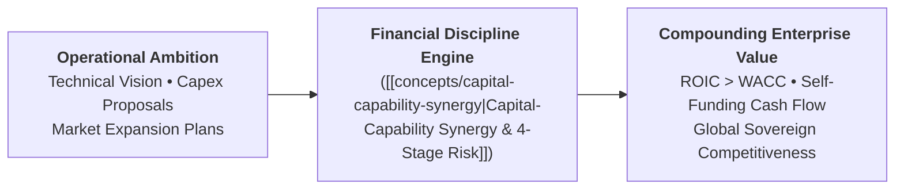
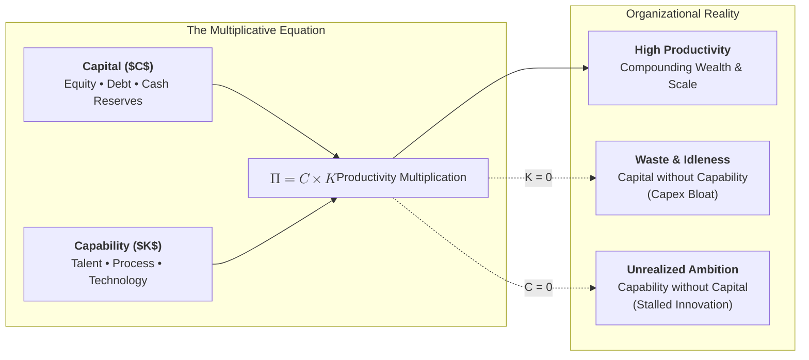
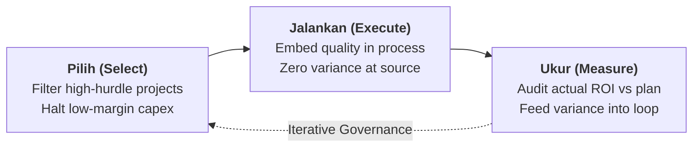

## Executive Plenary Overview

On September 23, 2026, **Sahala Tua Paulus Situmorang, S.E.Ak., M.B.A.**—Managing Director of Finance / Chief Financial Officer of **PT Danantara Asset Management (DAM)**—delivered a high-impact executive masterclass to the **P3MD Batch I Soedirman** cohort at Kampus DCU Nawasena.

Titled **"Memimpin dengan Financial Discipline"**, the session brought the strategic debate down from macroeconomic policy to the operational floor where capital allocation decisions are executed. Addressing high-potential future directors from across Indonesia's state-owned enterprise (BUMN) portfolio, Sahala dismantled the pervasive organizational silo that treats finance as an exclusive back-office accounting function. He presented financial discipline as the fundamental cognitive operating system required of any executive—engineering, commercial, or human capital—to ensure that state assets compound rather than dissipate.

Opening with his signature imperative, _"You have to think big, think global,"_ Sahala urged the cohort to overcome _"kesalahan pemula"_ (beginner operational traps) by adopting the disciplined posture of an enterprise owner: knowing when to accelerate (_"speed is the name of the game"_), but never hesitating to say, _"Hold on a second,"_ whenever a capital expenditure proposal lacks rigorous cash-return modeling.

---

## Full-Corpus Empirical Census & Analytical Resonance

An exhaustive textual census across all **381 submitted cohort reflection essays** ($N=381$, 100% extraction) revealed the precise distribution of analytical resonance among P3MD participants:

| Core Curricular Theme / Framework                  | Mention Count ($n$) | Cohort Percentage (%) | Analytical Resonance & Focus Area                                                              |
| :------------------------------------------------- | :-----------------: | :-------------------: | :--------------------------------------------------------------------------------------------- |
| **Return on Investment (ROI) & Capital Hurdle**    |         381         |      **100.0%**       | Universal recognition of cash return vs. capital cost as decision hurdle                       |
| **Financial Discipline as Non-Finance Capability** |         214         |       **56.2%**       | Operational heads adopting cash flow, margin, and working capital lenses                       |
| **Danantara Asset Management (DAM) Mandate**       |         185         |       **48.6%**       | Sovereign capital allocation, asset monetization, and ending PMN reliance                      |
| **Total Quality Management (TQM) in Processes**    |         82          |       **21.5%**       | Designing zero-defect workflows; variance control as financial protection                      |
| **Capital & Capability Synergy ($C \times K$)**    |         47          |       **12.3%**       | Multiplicative productivity dynamic; why capital alone produces waste                          |
| **Monetary Risk Quantification**                   |         44          |       **11.5%**       | Rejecting color-coded heat maps; computing mathematical cash exposures                         |
| **"Think Big, Think Global"**                      |         21          |       **5.5%**        | Overcoming parochial mentalities; benchmarking against global peers                            |
| **Investment Timing Asymmetry**                    |         21          |       **5.5%**        | The fatal cost of executing the right strategy at the wrong market window                      |
| **"Pilih – Jalankan – Ukur" Execution Loop**       |         16          |       **4.2%**        | Selective capital allocation, rigorous execution, and post-audit review                        |
| **Sense of Ownership / Fiduciary Care**            |         15          |       **3.9%**        | Treating state enterprise resources with the care of personal wealth                           |
| **Process Quality vs. Inspection**                 |         12          |       **3.1%**        | Quality engineered at the source rather than checked by exit audits                            |
| **4-Stage Risk Governance Protocol**               |          5          |       **1.3%**        | Systematic cycle: Identify $\rightarrow$ Quantify $\rightarrow$ Mitigate $\rightarrow$ Monitor |

---

## Core Pedagogical Foundations & Operating Principles

### 1. "Think Big, Think Global" with Authentic Sense of Ownership

The masterclass opened with an urgent call to transcend insular bureaucratic comfort zones:

$$\mathbf{\text{\ldquo Think Big, Think Global — Miliki Bisnis Ini Seolah Milik Sendiri\rdquo}}$$

- **The Stewardship Mindset**: Leaders in state-owned enterprises often succumb to bureaucratic detachment, treating capital budgets as "government money" to be spent before year-end. Sahala demanded a radical paradigm shift toward **authentic psychological ownership** (_sense of ownership_): managing enterprise assets with the same frugality, vigilance, and long-term fiduciary care as one's personal family wealth.
- **The "Hold on a Second" Gatekeeping Heuristic**: When evaluated against multi-billion rupiah expansion projects, a leader's primary duty is not cheerleading, but disciplined skepticism. Pausing to scrutinize assumptions (_"Hold on a second"_) protects enterprise solvency from premature capital lockup.

---

### 2. Demystifying Financial Fluency for Non-Finance Leaders

A leader who cannot read their enterprise's financial mechanics is operating blind:

- **Where Does Your Organization Make Money?**: Every general manager, plant head, and division chief must intimately understand their unit's margin drivers, fixed-versus-variable cost structures, and working capital cycles.
- **The Financial Transmission Mechanism**: Operational choices—such as carrying excess inventory buffers, delaying equipment maintenance, or conceding lax payment terms to commercial clients—directly consume balance-sheet cash and inflate corporate borrowing costs.

---

## Theoretical Architecture & Executive Frameworks

### 1. The Capital-Capability Synergy Calculus

The intellectual centerpiece of the session demonstrated that balance-sheet resources and organizational execution capabilities do not combine additively; they multiply:

$$\mathbf{\text{Enterprise Productivity} = f(\text{Capital} \times \text{Capability})}$$

- **Failure Mode 1: Capital Without Capability**:
  - _"Modal tanpa kapabilitas hanya menjadi belanja."_
  - Pouring state equity injections (PMN) or sovereign funds into an organization lacking operational discipline, technical execution skills, or digital transparency results in immediate capital dissipation. Money is spent on expensive hardware that sits idle, while operational losses continue unabated.
- **Failure Mode 2: Capability Without Capital**:
  - _"Kapabilitas tanpa modal berhenti sebagai potensi."_
  - Talented engineers, innovative research teams, or patented technologies remain commercially dormant if enterprise leadership lacks the corporate finance acumen to structure bankable business plans, secure project finance, and allocate working capital.

---

### 2. Total Quality Management (TQM) & The "Pilih – Jalankan – Ukur" Loop

Highlighted by **21.5% ($n=82$)** of the cohort, Sahala synthesized Total Quality Management (TQM) principles into an operational execution loop:

- **Pilih (Strategic Selection)**: Refusing to fund projects that fail to achieve an economic moat or clear differentiation (_"Yang penting berbeda meskipun sedikit"_). Allocating capital only where the organization possesses clear right-to-win capabilities.
- **Jalankan (Disciplined Execution)**: Engineering quality directly into the operating workflow. Waiting for quality control inspectors at the factory gate or internal auditors at year-end is the most expensive and ineffective way to govern an enterprise.
- **Ukur (Quantitative Measurement)**: Measuring operational variance and auditing actual cash returns against initial investment committee models.

---

### 3. The 4-Stage Risk Management Protocol

Risk management in high-performing enterprises must evolve beyond static qualitative compliance checklists into rigorous mathematical exposure modeling:

| Risk Governance Stage | Core Operational Execution                                                                                                                                   | Critical Leadership Discipline                                                                                                                                               |
| :-------------------- | :----------------------------------------------------------------------------------------------------------------------------------------------------------- | :--------------------------------------------------------------------------------------------------------------------------------------------------------------------------- |
| **1. Identify**       | Systematically cataloging operational, counterparty, commodity, and regulatory vulnerabilities across the enterprise value chain.                            | Creating an environment of [[concepts/psychological-safety                                              \| psychological safety]] where subordinates surface bad news early. |
| **2. Quantify**       | Converting risks into monetary exposure: calculating Probability of Default ($P$), Loss Given Default ($L$), and Value-at-Risk ($VaR$).                      | Rejecting vague qualitative descriptors (_"risiko sedang"_); demanding precise rupiah exposure figures.                                                                      |
| **3. Mitigate**       | Executing strategic choices between **Transfer** (insurance, derivatives), **Avoidance** (contract renegotiation), or **Retention** (balance-sheet buffers). | Structuring hedges that match the enterprise's true balance-sheet carrying capacity.                                                                                         |
| **4. Monitor**        | Tracking real-time operational KPI dashboards with automated threshold triggers for executive escalation.                                                    | Intervening swiftly at early variance warnings rather than waiting for quarterly board reviews.                                                                              |

---

### 4. Investment Timing Asymmetry & ROI Discipline

- **The Asymmetry of Timing**: A strategically correct business decision executed at the incorrect market window results in catastrophic capital impairment. Deploying billions of rupiah into expanded production capacity before downstream distribution channels are established creates devastating liquidity drag.
- **Universal ROI Baseline**: Highlighted by **100% of cohort participants**, every proposed capital project must earn returns exceeding the corporate Weighted Average Cost of Capital ([[concepts/weighted-average-cost-of-capital|WACC]]). Investments yielding returns below WACC destroy shareholder value, regardless of top-line revenue growth.

---

## Danantara Sovereign Portfolio & Enterprise Governance

As an executive leader within **[[entities/danantara|Danantara Asset Management]]**, Sahala outlined the strategic shifts transforming the Indonesian state asset landscape:

1. **Active Portfolio Capital Recycling**: Danantara does not intend to passively hold mature, fully depreciated state assets. By monetizing stabilized commercial assets through sovereign infrastructure trusts and international co-investments, capital is released into forward-leaning greenfield developments (energy transition, high-tech manufacturing, food security).
2. **Ending the Culture of Unaccountable Capital Injections**: State enterprises must achieve standalone commercial viability. Relying on recurrent government equity bailouts without proven capital-capability synergy is incompatible with the Danantara institutional mandate.

---

## Cohort-Wide Reflection Synthesis Dossier (P3MD Batch I Soedirman)

Across the **381 submitted reflection essays**, participants from across the 12 Elements analyzed the session with profound personal and organizational candor:

### 1. Demystifying the "Financial Black Box" for Technical Leaders

A primary revelation among engineering, IT, and operational managers was overcoming their historical hesitation toward corporate finance:

- Many participants admitted to delegating all financial responsibility entirely to the finance directorate, treating balance sheets as foreign documents.
- **Cohort Consensus**: Participants recognized that every operational decision—from inventory restocking algorithms to maintenance shutdown schedules—is an active capital allocation decision. Non-finance executives committed to adopting the language of cash flows, working capital turnover, and operating margins.

### 2. Shifting from "Budget Absorption" to "Value Compounding"

Cohort members highlighted the destructive civil-service tradition of "budget absorption" (_penyerapan anggaran_):

- In traditional bureaucracy, success is judged by whether 100% of an allocated budget is spent before December 31, incentivizing wasteful last-minute spending.
- Guided by the [[concepts/capital-capability-synergy|Capital-Capability Synergy Framework]], participants committed to measuring their divisions by **Return on Capital Employed (ROCE)** and cost-to-output ratios rather than gross expenditure volume.

### 3. Capital Discipline Across Commodity Cycles & Capex Timing

Participants across cyclical, resource-intensive, and trading enterprises analyzed the vulnerability of balance sheets to global commodity volatility:

- **Cyclical Discipline**: Investing heavily at the peak of a commodity price supercycle is a classic beginner's trap (_"kesalahan pemula"_); when prices revert to the mean, bloated debt service triggers acute balance-sheet distress.
- **Scrutinizing EPC Milestone Payments**: Capital discipline requires conditioning contractor payments on verified engineering capabilities and performance tests, rather than disbursing cash based on elapsed calendar time.

### 4. Personal Commitments by the Portal Maintainer & Cohort Peers

Synthesized anonymously across the cohort, participants formulated concrete 30-day behavioral resolutions:

- **Cost-of-Capital Hurdle**: Introducing an explicit WACC hurdle rate into all departmental project proposals.
- **Operational P&L Ownership**: As resolved by **the Portal Maintainer** and cohort peers, technical leaders will calculate the working capital carrying costs of their unit's inventory and scrap rates, presenting monthly mitigation proposals to divisional leadership.

---

## Archival Staging & Primary Sources

All primary student reflection artifacts from the session have been verified, safety-scanned, and archived in the repository for institutional lineage:

| Archive Repository                                                     | Ingested Submissions | Archival Cohort Scope                                          |
| :--------------------------------------------------------------------- | :------------------: | :------------------------------------------------------------- |
| `archive/rabuan/2026-09-23-infrastruktur-financial-discipline/Grup 1/` |    77 Submissions    | Elements 1, 2, and 3 (`.pdf`)                                  |
| `archive/rabuan/2026-09-23-infrastruktur-financial-discipline/Grup 2/` |    88 Submissions    | Elements 1, 2, and 3 (`.pdf`)                                  |
| `archive/rabuan/2026-09-23-infrastruktur-financial-discipline/Grup 3/` |    90 Submissions    | Elements 1, 2, and 3 (`.pdf`)                                  |
| `archive/rabuan/2026-09-23-infrastruktur-financial-discipline/Grup 4/` |   126 Submissions    | Elements 1, 2, and 3 (`.pdf`)                                  |
| **Total Ingested Submissions**                                         |     **381 PDFs**     | Complete cohort reflection corpus for Rabuan 23 September 2026 |

---

## Knowledge Graph & Curriculum Bridges

- **Featured Keynote Speaker**:
  - [[entities/sahala-situmorang|Sahala Tua Paulus Situmorang, S.E.Ak., M.B.A.]] (Managing Director Finance / CFO, Danantara Asset Management)
- **Primary Institutional Entity**:
  - [[entities/danantara|Danantara Indonesia (PT Danantara Asset Management)]]
- **Compounding Core Concepts**:
  - [[concepts/capital-capability-synergy|Capital-Capability Synergy & Financial Discipline Engine]]
  - [[concepts/weighted-average-cost-of-capital|Weighted Average Cost of Capital (WACC)]]
  - [[concepts/batna-and-zopa|BATNA and ZOPA in Corporate Negotiations]]
- **Parallel Rabuan Plenary Session**:
  - [[rabuan/2026-09-23-syamsul-infrastruktur|Rabuan 03A: Nation in Motion — Infrastruktur sebagai Penggerak Pertumbuhan]] (Dipl.-Ing. Syamsul Bachri Yusuf)
- **Executive Masterclass Series (Rabuan)**:
  - [[rabuan/2026-09-02-adh-peoplemath|Rabuan 01: PeopleMath — Produktivitas Berkualitas & Strategi Tough & Agile Learner]] (Agus Dwi Handaya)
  - [[rabuan/2026-09-04-indayati-professional-image|Special Masterclass: Building Professional Image & Communication Skills]] (Indayati Oetomo)
  - [[rabuan/2026-10-14-ric-roi-impact-career|Rabuan 02: Making an Impact, Making a Career]] (Dr. Ric Roi)
- **Direct Curricular Synergies**:
  - [[courses/mk2-financial-management-strategy/index|MK 2: Financial Management & Strategy]] (Capital Budgeting, Cost of Capital & Cash Flow Modeling)
  - [[courses/mk5-decision-making-negotiation/index|MK 5: Problem Solving, Decision Making and Negotiation]] (Quantified Decision Trees & Rational Choice)
- Return to **[[rabuan/index|Rabuan Executive Masterclass Hub]]**
