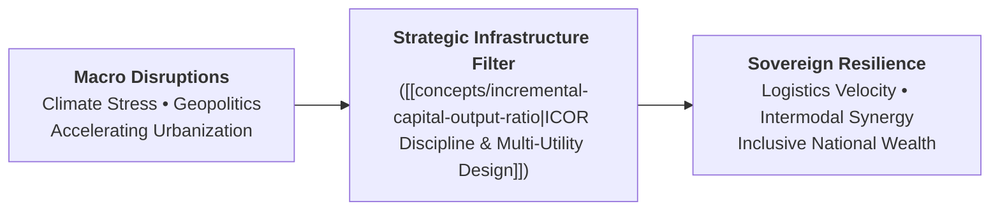
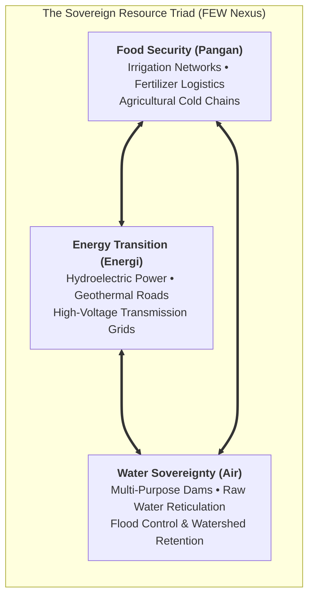
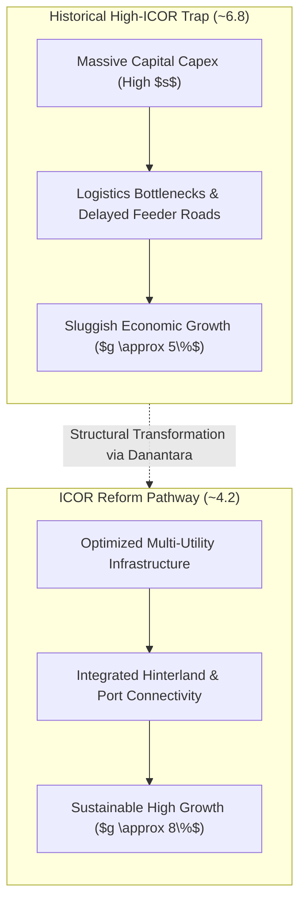

## Executive Plenary Overview

On September 23, 2026, **Dipl.-Ing. Syamsul Bachri Yusuf, M.Si. (Han)**—Staf Khusus Menteri Pekerjaan Umum (KemenPU) Bidang Teknologi dan Kepatuhan Internal and member of the Board of Commissioners of **[[entities/pt-jasa-marga|PT Jasa Marga (Persero) Tbk]]**—delivered an authoritative macro-strategic plenary lecture to the **P3MD Batch I Soedirman** cohort at Kampus DCU Nawasena.

Titled **"Nation in Motion: Infrastruktur sebagai Penggerak Pertumbuhan & Pemerataan Indonesia"**, the address challenged emerging state enterprise leaders to re-examine the foundational purpose of civil infrastructure. Moving decisively beyond ceremonial celebrations of physical project delivery, Syamsul framed national infrastructure as a high-stakes macroeconomic engine that must balance regional connectivity, social equity, national defense resilience, and capital efficiency under tightening global fiscal conditions.

Drawing upon Thomas Friedman's paradigm in _The World is Flat_, Syamsul emphasized that modern global competition is unforgiving: capital, industrial capacity, and talent flow instantly to regions with the lowest logistics friction and highest institutional predictability.

---

## Full-Corpus Empirical Census & Analytical Resonance

An exhaustive textual census across all **381 submitted cohort reflection essays** ($N=381$, 100% extraction) revealed the precise distribution of analytical resonance among P3MD participants:

| Core Curricular Theme / Framework             | Mention Count ($n$) | Cohort Percentage (%) | Analytical Resonance & Focus Area                                    |
| :-------------------------------------------- | :-----------------: | :-------------------: | :------------------------------------------------------------------- |
| **Geopolitical Realignment & Supply Chains**  |         230         |       **60.4%**       | Trade wars, resource protectionism, cross-border freight friction    |
| **ICOR & Capital Allocation Discipline**      |         218         |       **57.2%**       | Marginal capital efficiency; moving beyond physical milestone vanity |
| **Climate Change & Ecological Pressure**      |         209         |       **54.9%**       | Hydrological extremes, coastal flooding, infrastructure hardening    |
| **High-Velocity Urbanization**                |         151         |       **39.6%**       | Municipal congestion, mass transit corridors, clean water access     |
| **Primacy of National over Sectoral Ego**     |         88          |       **23.1%**       | Dismantling inter-BUMN silos; subordinating divisional KPIs          |
| **Disaster Resilience & Civil Defense**       |         84          |       **22.0%**       | Dual-use evacuation spines; supply chain survivability in crisis     |
| **Strategic Foresight ("Melihat Perubahan")** |         81          |       **21.3%**       | Anticipating structural shifts before statistical damage manifests   |
| **FEW Nexus (Food, Energy, Water)**           |         68          |       **17.8%**       | Tripartite resource security; multi-purpose dams and irrigation      |
| **Water Utility (PDAM) Restructuring**        |         58          |       **15.2%**       | Tariff equilibria, potable water access, national service standards  |
| **Dual-Use / Multi-Utility Infrastructure**   |         39          |       **10.2%**       | Embedding fiber optics, power, and water inside transport ROWs       |
| **KPBU & Private Investment Mobilization**    |         31          |       **8.1%**        | Relieving APBN debt strain through blended finance models            |
| **"Calon Penjaga Arah Bangsa"**               |         29          |       **7.6%**        | Ethical identity as fiduciaries of sovereign economic direction      |
| **"Memahami Apa yang Tersirat"**              |         13          |       **3.4%**        | Contextual governance; resolving needs beyond formal boundaries      |

---

## Core Pedagogical Foundations & Operating Principles

### 1. Strategic Foresight: "Melihat Ancaman Sebelum Terlihat"

A central thesis of the masterclass is that executive leadership in Indonesian state-owned enterprises (BUMN) cannot function reactively:

$$\mathbf{\text{\ldquo Lihat ancaman sebelum terlihat, dan perubahan sebelum terasa.\rdquo}}$$

- **The Foresight Imperative**: Waiting for statistical damage or physical crises before responding guarantees strategic failure. Effective leaders continuously scan macro-environmental indicators to anticipate structural disruptions decades in advance.
- **The Global Triad of Disruption**:
  1. **Climate Change & Ecological Pressure**: Increasing hydrological volatility, flash flooding, and sea-level incursions that imperil agricultural breadbaskets, port facilities, and coastal expressways.
  2. **Geopolitical Realignment & Fragmentation**: Shifting global trade pacts, raw material embargoes, and currency volatility that disrupt cross-border supply chains.
  3. **High-Velocity Urbanization**: Massive demographic influx into metropolitan centers, which outpaces municipal utility networks and demands integrated public transit and water infrastructure.

---

### 2. The Food, Energy, Water (FEW) Nexus

A major framework articulated by Syamsul—highlighted by **17.8% ($n=68$)** of the cohort—is the **FEW Nexus**:

- **Interlocked Vulnerability**: Agricultural self-sufficiency cannot exist without managed irrigation; municipal water distribution cannot operate without stable power; and clean energy expansion (hydroelectric, geothermal, mineral processing) requires abundant industrial water.
- **Infrastructure as the Nexus Integrator**: Modern public works must be planned as integrated multi-benefit systems. For example, a single multi-purpose reservoir dam simultaneously provides raw drinking water, downstream paddy irrigation, flood retention buffers, and clean hydroelectric peak-load generation.

---

### 3. "Memahami Apa yang Tersirat, Bukan Hanya yang Tertulis"

In managing complex public works and state-directed development, statutory demarcations frequently create paralyzing bureaucratic silos:

- **Beyond Jurisdictional Red Tape**: While municipal or provincial roads fall strictly under regional government budgets (_APBD_), critical economic paralysis requires Kementerian PU and state infrastructure operators to intervene proactively through presidential instructions (_Inpres Jalan Daerah_) and collaborative frameworks.
- **Administrative Form vs. Public Substance**: Hiding behind rigid bureaucratic job descriptions while public supply chains fail violates the ethical mandate of state stewardship. Leaders must grasp the systemic intent behind policies rather than clinging to literal text.

---

### 4. Primacy of the National Interest over Sectoral Ego

A recurring provocation delivered to the cohort was the elimination of **sectoral tribalism** across ministries and BUMN clusters:

- **Ego Sektoral Destruction**: When state enterprises compete destructively over territorial jurisdictions or hoard data, the sovereign state bears the cost through inflated logistics overhead and delayed project commissioning.
- **The Social Contract**: Power and authority in state enterprises are public trusts (_amanah_) dedicated exclusively to protecting the living standards, food security, and mobility of the Indonesian people.

---

## Macroeconomic Architecture & The Infrastructure Mandate

### The Uncomfortable Reality of ICOR

The analytical highlight of the lecture—analyzed by **57.2% ($n=218$)** of the cohort—was the **[[concepts/incremental-capital-output-ratio|Incremental Capital Output Ratio (ICOR)]]**:

$$\text{ICOR} = \frac{\Delta K}{\Delta Y} = \frac{\text{Investment Rate}}{\text{GDP Growth Rate}} = \frac{s}{g}$$

1. **The Capital Waste Metric**: ICOR forces the uncomfortable mathematical question: _How many rupiahs of capital expenditure are required to yield one additional rupiah of GDP?_ A high ICOR signifies structural economic waste, where capital is absorbed by friction, bureaucratic delays, and underutilized megaprojects.
2. **The 8% Growth Conundrum**: To achieve Indonesia's target of 8% GDP growth under an uncorrected historical ICOR of 6.8, the nation would need an aggregate investment rate exceeding **54% of GDP**—a macroeconomic impossibility that would trigger severe debt crises. Lowering ICOR to **4.0–4.5** reduces the required investment burden to a feasible 32–36% of GDP.
3. **From Concrete Volume to Economic Multipliers**: Infrastructure success cannot be measured by kilometers of concrete poured; it must be audited by its impact on reducing national logistics costs (targeting below 10% of GDP) and unlocking regional industrial clusters.

---

## Rethinking State Assets: Dual-Use Infrastructure & Concession Governance

Using **[[entities/pt-jasa-marga|PT Jasa Marga (Persero) Tbk]]** as a primary institutional case, Syamsul illustrated how state enterprise assets must be reimagined as multi-dimensional public wealth platforms:

| Infrastructure Dimension | Traditional Single-Purpose Approach                           | Integrated Dual-Use Paradigm                                                                                                      |
| :----------------------- | :------------------------------------------------------------ | :-------------------------------------------------------------------------------------------------------------------------------- |
| **Expressway Corridors** | Exclusively designed for vehicular toll revenue.              | Serving as national multi-utility rights-of-way (ROW) embedding fiber-optic backbones, water mains, and electricity grids.        |
| **Emergency Logistics**  | Roadbeds built strictly for standard freight loads.           | Strategic segments reinforced as emergency disaster evacuation arteries and military logistics corridors.                         |
| **Rest Area Economics**  | Franchised out exclusively to multinational fast-food chains. | Reserving prime footprints for local agricultural and SME cooperatives (Travoy hubs), anchoring regional wealth retention.        |
| **Asset Monetization**   | Holding debt-heavy mature toll concessions indefinitely.      | Recycling equity capital via Danantara sovereign infrastructure investment funds to finance new high-impact greenfield corridors. |

---

## Alternative Financing: Public-Private Partnerships (KPBU)

Addressing the constraints on the state budget (_APBN_), Syamsul underscored **Kerjasama Pemerintah dan Badan Usaha (KPBU)** as a vital strategic vehicle:

- **De-risking National Projects**: Leveraging government availability payments (_AP_) and viability gap funding (_VGF_) to attract private and sovereign institutional capital into capital-intensive infrastructure without burdening state balance sheets.
- **Contractual Governance & Quality Lock-In**: Structuring KPBU contracts so that private concessionaires bear long-term operational and maintenance risks, ensuring high service quality throughout multi-decade concession lifecycles.

---

## Cohort-Wide Reflection Synthesis Dossier (P3MD Batch I Soedirman)

Following the plenary lecture, **381 participants** across all 4 Groups and 12 Elements submitted detailed executive reflection essays. The cohort represents the senior leadership pipeline across Indonesia's major state enterprise clusters, including energy, agriculture, banking, manufacturing, infrastructure, and natural resources.

A rigorous, unified synthesis across the 381 submissions revealed four cross-cutting executive insights:

### 1. The Transition from Functional Specialist to "Calon Penjaga Arah Bangsa"

A profound resonance emerged around Syamsul's characterization of P3MD participants as _guardians of the nation's direction_ (_penjaga arah bangsa_):

- **Beyond Siloed KPIs**: Engineers, supply chain heads, and risk managers acknowledged that their operational decisions inside individual BUMNs directly impact national macro-resilience.
- **The Moral Baseline**: Technical proficiency without moral fortitude and ethical integrity produces rent-seeking and white-elephant projects. Participants pledged to actively resist politically motivated projects that lack economic feasibility.

### 2. Confronting the Uncomfortable Truth of ICOR in Enterprise Planning

The mathematical rigor of [[concepts/incremental-capital-output-ratio|ICOR]] fundamentally reshaped how participants view capital budgeting:

- Multiple participants from capital-intensive state enterprises confessed that capex proposals routinely celebrate gross spending numbers rather than marginal capital productivity.
- **Cohort Consensus**: Future enterprise proposals must incorporate an explicit "micro-ICOR" assessment—evaluating how capital spending lowers operational friction and accelerates revenue throughput across partner ecosystems.

### 3. Supply Chain Inputs & Domestic Downstreaming (Hilirisasi)

Participants from primary industrial and resource sectors connected physical infrastructure directly to the national industrialization agenda:

- **Upstream-Downstream Interdependence**: Civil infrastructure requires enormous material inputs—refined copper for national electrification grids, structural aluminum for rolling stock and aviation, nickel-steel alloys for pressurized water mains, and specialized cement formulations for marine ports.
- **Vigilance in Capital Procurement**: Participants emphasized the imperative of rigorous engineering, procurement, and construction (EPC) contract scrutiny to prevent cost overruns and ensure domestic value addition (_TKDN_) during megaproject buildouts.

### 4. Cross-Jurisdictional Agility & Breaking Institutional Silos

Reflecting on the principle of _memahami yang tersirat_, cohort members from regional operating units identified urgent inter-BUMN collaboration targets:

- Eliminating the "wait-and-see" mentality where state companies delay critical repairs because an asset lies across a municipal or departmental boundary.
- Formulating joint working committees between port operators ([[entities/pt-pelabuhan-indonesia|Pelindo]]), railway systems ([[entities/pt-kereta-api-indonesia|KAI]]), toll operators ([[entities/pt-jasa-marga|Jasa Marga]]), and state agricultural estates ([[entities/pt-perkebunan-nusantara|PTPN]]) to synchronize freight loading docks.

---

## Archival Staging & Primary Sources

All primary student reflection artifacts from the session have been verified, safety-scanned, and archived in the repository for institutional lineage:

| Archive Repository                                                     | Ingested Submissions | Archival Cohort Scope                                          |
| :--------------------------------------------------------------------- | :------------------: | :------------------------------------------------------------- |
| `archive/rabuan/2026-09-23-infrastruktur-financial-discipline/Grup 1/` |    77 Submissions    | Elements 1, 2, and 3 (`.pdf`)                                  |
| `archive/rabuan/2026-09-23-infrastruktur-financial-discipline/Grup 2/` |    88 Submissions    | Elements 1, 2, and 3 (`.pdf`)                                  |
| `archive/rabuan/2026-09-23-infrastruktur-financial-discipline/Grup 3/` |    90 Submissions    | Elements 1, 2, and 3 (`.pdf`)                                  |
| `archive/rabuan/2026-09-23-infrastruktur-financial-discipline/Grup 4/` |   126 Submissions    | Elements 1, 2, and 3 (`.pdf`)                                  |
| **Total Ingested Submissions**                                         |     **381 PDFs**     | Complete cohort reflection corpus for Rabuan 23 September 2026 |

---

## Knowledge Graph & Curriculum Bridges

- **Featured Keynote Speaker**:
  - [[entities/syamsul-bachri-yusuf|Dipl.-Ing. Syamsul Bachri Yusuf, M.Si. (Han)]] (Stafsus KemenPU & Dewan Komisaris PT Jasa Marga)
- **Primary Institutional Enterprise**:
  - [[entities/pt-jasa-marga|PT Jasa Marga (Persero) Tbk]]
- **Compounding Core Concepts**:
  - [[concepts/incremental-capital-output-ratio|Incremental Capital Output Ratio (ICOR) & Infrastructure Capital Productivity]]
  - [[concepts/capacity-cushion|Capacity Cushion & Operational Buffer Sizing]]
- **Parallel Rabuan Plenary Session**:
  - [[rabuan/2026-09-23-sahala-financial-discipline|Rabuan 03B: Memimpin dengan Financial Discipline]] (Sahala Tua Paulus Situmorang, MD Finance DAM)
- **Executive Masterclass Series (Rabuan)**:
  - [[rabuan/2026-09-02-adh-peoplemath|Rabuan 01: PeopleMath — Produktivitas Berkualitas & Strategi Tough & Agile Learner]] (Agus Dwi Handaya)
  - [[rabuan/2026-09-04-indayati-professional-image|Special Masterclass: Building Professional Image & Communication Skills]] (Indayati Oetomo)
  - [[rabuan/2026-10-14-ric-roi-impact-career|Rabuan 02: Making an Impact, Making a Career]] (Dr. Ric Roi)
- **Direct Curricular Synergies**:
  - [[courses/mk4-operations-supply-chain-management/index|MK 4: Operations & Supply Chain Management]] (Infrastructure Bottlenecks & Network Flows)
  - [[courses/mk2-financial-management-strategy/index|MK 2: Financial Management & Strategy]] (Capital Allocation & WACC)
- Return to **[[rabuan/index|Rabuan Executive Masterclass Hub]]**
