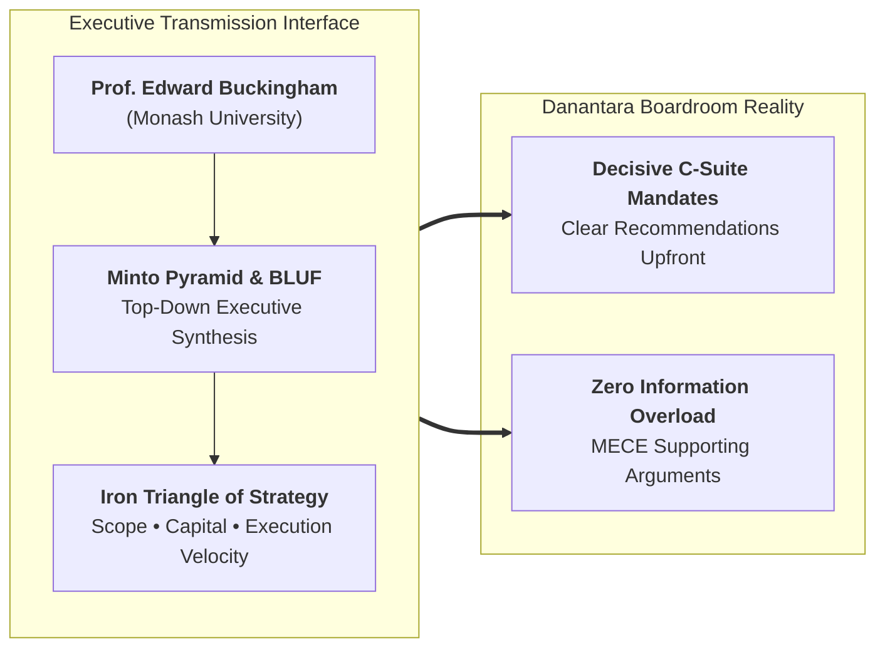
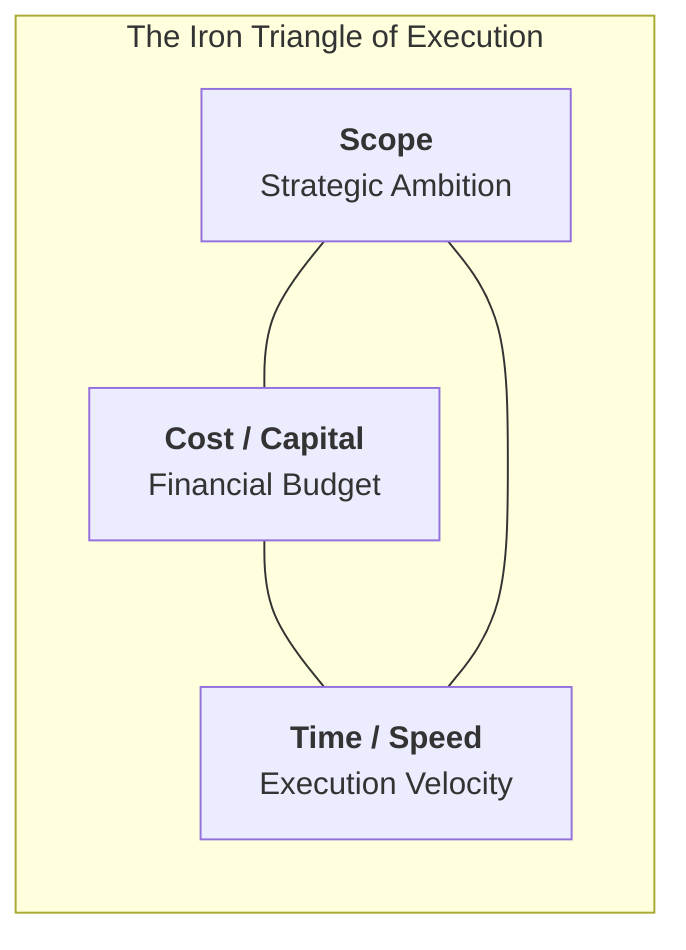
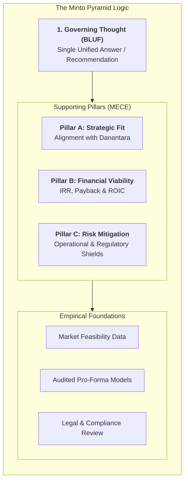
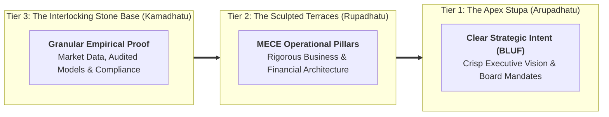

## Executive Plenary Overview

On September 30, 2026, **Prof. Edward Buckingham**—Professor of Management at **Monash Business School** and Director of Engagement at **Monash University Indonesia**—delivered an intensive executive masterclass on strategy execution and structured communication to the **P3MD Batch I Soedirman** cohort at Kampus DCU Nawasena.

Delivered alongside the national risk governance plenary by [[rabuan/2026-09-30-meilano-systemic-risk|Prof. Irwan Meilano (Dean of FITB ITB)]], Professor Buckingham's masterclass addressed the critical communication gap that undermines senior leadership in state-owned enterprises (BUMN) and the **Danantara** institutional architecture. Technical competence without top-down structured communication fails in boardroom deliberations; strategic vision without rigorous execution trade-offs dissipates capital.

---

## Bottom Line Up Front (BLUF) and Attention Scarcity

The primary operating constraint of senior governance bodies is **cognitive bandwidth**. Executive directors, commissioners, and ministry officials manage packed schedules and severe information overload.

- **The Chronological Trap**: Traditional presenters construct linear narratives—beginning with historical background, detailing methodology, discussing operational challenges, and only presenting the proposal on the final slide.
- **The BLUF Imperative**: Executive communication requires inverting the pyramid. The core conclusion, strategic recommendation, or requested capital decision must be delivered **in the very first sentence**. This establishes an immediate cognitive anchor, allowing decision-makers to evaluate subsequent supporting data through the lens of that governing answer.

---

## Efficiency vs. Effectiveness: Doing Things Right vs. Doing the Right Things

Citing Peter Drucker, Professor Buckingham drew a strict operational distinction:

- **Efficiency (_Doing things right_)**: Operational optimization, process speed, and cost discipline.
- **Effectiveness (_Doing the right things_)**: Strategic direction, portfolio selection, and strategic relevance.
- **The Executive Failure Mode**: An enterprise can operate with peak efficiency while executing an obsolete strategy. Efficiency without effectiveness merely accelerates an organization's arrival at the wrong destination.

---

## "Culture Eats Strategy for Breakfast"

Formulating an analytically perfect strategic plan is merely table stakes. Enterprise performance is governed by execution, and execution is dictated by culture:

$$\mathbf{\text{\ldquo Culture eats strategy for breakfast\rdquo}}$$

- When leaders articulate clear, structured, and empathetic narratives, they reduce institutional anxiety and align divergent stakeholder cultures toward shared strategic execution.

---

## The Iron Triangle of Project Execution

Project execution operates within an immutable trade-off matrix:

- Expanding project scope inevitably requires additional capital or extends delivery timelines; attempting to compress time while expanding scope without additional capital guarantees quality degradation or operational failure.
- In BUMN capital investments, leaders must consciously choose which variable is fixed, which is constrained, and which is optimized, rather than promising all three simultaneously.

---

## Theoretical Architecture: The Minto Pyramid & SCQA Engine

Structured executive logic requires arranging ideas into a rigid hierarchical pyramid:

- **Top-Down Summarization**: Any statement on a superior tier must actively summarize the grouping below it.
- **The MECE Rule**: Mutually Exclusive, Collectively Exhaustive (zero overlap, zero blind spots).
- **The SCQA Framework**:
  - **Situation**: Undisputed shared context and operating reality.
  - **Complication**: Destabilizing challenge or strategic disruption.
  - **Question**: Core boardroom dilemma to resolve.
  - **Answer**: Governing proposal delivered via BLUF.

---

## The Cognitive Model: Borobudur Stupa as Top-Down Architecture

Professor Buckingham utilized the architectural discipline of **Candi Borobudur** as an executive thinking model:

- In executive presentations, presenters must start at the **Apex (Arupadhatu)**—stating the governing recommendation clearly before descending into the supporting terraces of operational logic and empirical proof.

---

## Cohort-Wide Reflection Synthesis Dossier (P3MD Batch I Soedirman)

Following the masterclass, **378 participants** across all 4 Groups and 12 Elements submitted individual reflective essays analyzing their personal communication habits, operational vulnerabilities, and strategic execution practices across Indonesia's major state-owned enterprises.

### Full-Census Empirical Frequency Matrix ($N = 378$)

A comprehensive automated extraction across all 378 submitted texts establishes the empirical distribution of frameworks referenced by the cohort:

| Plenary Keynote Theme / Model           | Theoretical Anchor / Citation Source    | Cohort Submissions ($N = 378$) | Adoption Frequency (%) | Primary Analytical Focus in Reflections                            |
| :-------------------------------------- | :-------------------------------------- | :----------------------------: | :--------------------: | :----------------------------------------------------------------- |
| **Prof. Edward Buckingham**             | **Keynote Speaker Citation**            |            **373**             |       **98.7%**        | Strategic execution, communication clarity, leadership demeanor.   |
| **The Minto Pyramid Principle**         | Barbara Minto (_The Pyramid Principle_) |            **311**             |       **82.3%**        | Structuring memos, bottom-up vs top-down logic, executive clarity. |
| **The Iron Triangle of Execution**      | Project Management Trade-Off Matrix     |            **264**             |       **69.8%**        | Trade-offs between scope, cost, and time in enterprise projects.   |
| **SCQA Storytelling Framework**         | Structural Business Narrative Engine    |            **201**             |       **53.2%**        | Framing business problems, boardroom and ministerial memos.        |
| _"Culture eats strategy for breakfast"_ | Peter Drucker                           |            **133**             |       **35.2%**        | Organizational culture, change resistance, cultural transmission.  |
| **Candi Borobudur Metaphor**            | Architectural Hierarchy Model           |             **92**             |       **24.3%**        | Structural hierarchy: stupa (answer) supported by bedrock (data).  |
| **Efficiency vs. Effectiveness**        | Peter Drucker                           |             **68**             |       **18.0%**        | Doing things right vs. doing the right things.                     |

---

### Thematic Deep-Dive Across the Cohort

#### 1. Overcoming the "Competence Trap" and Deference (_Sungkan_)

- Technical specialists (geologists, mine planners, plant engineers, corporate financiers) widely recognized their vulnerability to the **Competence Trap**: believing that valid calculations excuse disjointed presentations.
- Participants reflected on how Javanese hierarchical deference (_sungkan_) leads presenters to bury bad news or avoid direct recommendations. The cohort recognized that delivering the conclusion upfront (**BLUF**) is not insolence, but the highest demonstration of professional respect for leadership time.

#### 2. Re-Balancing Strategic Trade-Offs in Enterprise Projects

- Across engineering and operational syndicates, participants analyzed past project delays through the lens of the **Iron Triangle**:
  - Expanding project scope to accommodate additional stakeholder requests without expanding financial budgets inevitably compromises project velocity or operational quality.
  - Future BUMN leaders committed to enforcing explicit trade-off discussions during project chartering.

---

### Personal Commitments: 30-Day Executive Standard

Across the cohort reflections, participants committed to concrete behavioral adjustments in communication and strategy execution:

| Leadership Dimension            | Previous Unconscious Reflex                                                       | 30-Day Executive Standard Commitment                                                                                   |
| :------------------------------ | :-------------------------------------------------------------------------------- | :--------------------------------------------------------------------------------------------------------------------- |
| **Executive Memos & Emails**    | Lengthy historical preambles spanning several pages before stating the request.   | Leading with **BLUF in Line 1**; using structured SCQA framing; keeping memos under 1 page.                            |
| **Boardroom Presentations**     | Presenting 40 chronological slides; revealing recommendations on the final slide. | Placing the core recommendation and financial ask on **Slide 1**; reserving subsequent slides for MECE validation.     |
| **Crisis & Feedback Delivery**  | Vague hints or sugarcoating bad news due to cultural _sungkan_.                   | Structuring feedback with **SCQA**: establishing mutual respect (S), naming the issue (C), and framing next steps (A). |
| **Project Trade-Off Decisions** | Agreeing to scope expansions without adjusting budgets or deadlines.              | Enforcing the **Iron Triangle**: requiring executive sponsors to explicitly re-balance scope, cost, or time.           |

---

## Archival Staging & Primary Sources

All primary submission artifacts from the cohort have been archived for institutional traceability:

| Archive Repository                                          |    File Count     | Primary Contents                                                          |
| :---------------------------------------------------------- | :---------------: | :------------------------------------------------------------------------ |
| `archive/rabuan/2026-09-30-buckingham-minto-method/Grup 1/` |  77 Submissions   | Individual reflection essays across Elements 1, 2, and 3 (`.pdf`).        |
| `archive/rabuan/2026-09-30-buckingham-minto-method/Grup 2/` |  87 Submissions   | Individual reflection essays across Elements 1, 2, and 3 (`.pdf`).        |
| `archive/rabuan/2026-09-30-buckingham-minto-method/Grup 3/` |  88 Submissions   | Individual reflection essays across Elements 1, 2, and 3 (`.pdf`).        |
| `archive/rabuan/2026-09-30-buckingham-minto-method/Grup 4/` |  126 Submissions  | Individual reflection essays across Elements 1, 2, and 3 (`.pdf`).        |
| **Total Ingested Submissions**                              |   **378 PDFs**    | Complete cohort reflections for P3MD Batch I Soedirman (`REF5`).          |
| **Extracted Text Corpus**                                   | **378 TXT Files** | Located at `.extracted/texts/` with automated metadata catalog.           |
| **Full-Census Summary**                                     | **JSON Manifest** | Located at `.extracted/cohort-summary.json` with complete census metrics. |

---

## Knowledge Graph & Curriculum Bridges

- **Featured Keynote Speaker**:
  - [[entities/edward-buckingham|Prof. Edward Buckingham]] (Professor of Management, Monash Business School)
- **Accompanying Plenary Session**:
  - [[rabuan/2026-09-30-meilano-systemic-risk|Rabuan 06: The Shifting Ground: Systemic Risk Governance & Institutional Resilience]] (Prof. Irwan Meilano)
- **Compounding Core Concepts**:
  - [[concepts/minto-pyramid-principle|The Minto Pyramid Principle & Structured Communication]]
  - [[concepts/professional-image-framework|Professional Image & Leadership 5C Framework]] (Executive signaling & communication)
  - [[concepts/kepner-tregoe-problem-analysis|Kepner-Tregoe Problem Analysis]] (Systematic problem breakdown & decision trees)
- **Related Executive Masterclasses (Rabuan Series)**:
  - [[rabuan/2026-09-02-adh-peoplemath|Rabuan 01: PeopleMath — Produktivitas Berkualitas & Strategi Tough & Agile Learner]] (Agus Dwi Handaya)
  - [[rabuan/2026-09-04-indayati-professional-image|Rabuan 02: Building Professional Image & Executive Communication Skills]] (Indayati Oetomo)
  - [[rabuan/2026-09-23-syamsul-infrastruktur|Rabuan 03: Nation in Motion — Infrastruktur sebagai Penggerak Pertumbuhan]] (Syamsul Bachri Yusuf)
  - [[rabuan/2026-09-23-sahala-financial-discipline|Rabuan 04: Memimpin dengan Financial Discipline]] (Sahala Tua Paulus Situmorang)
  - [[rabuan/2026-10-14-ric-roi-impact-career|Rabuan 07: Making an Impact, Making a Career — The 5 Levels of Impact]] (Dr. Ric Roi)
- **Direct Curricular Synergies**:
  - [[courses/mk1-organizational-behavior-managing-people/index|MK 1: Organizational Behavior & Managing People]] (Organizational culture & communication barriers)
  - [[courses/mk5-decision-making-negotiation/index|MK 5: Problem Solving, Decision Making and Negotiation]] (Persuasive framing & rational executive arguments)
- Return to **[[rabuan/index|Rabuan Executive Masterclass Hub]]**
